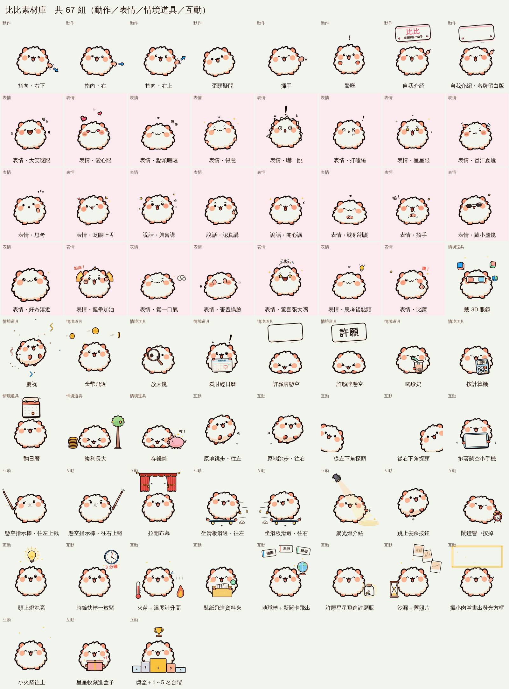

# 比比素材庫

Andy 第 3 版（`docs/marketing/video_1010/v3_brief.md` 第 12 條）：「表情、情境、道具要更豐富，做出來的要存成圖檔以後使用」。

每組一個資料夾：`key.png`（512×512 透明代表格）、`sheet.png`（橫排 sprite，每格 256×256、透明）、`anim.webp`（動態、透明、無限循環）。
全部同一隻、同一個場景座標（身體縮 0.75、中心 x=248、腳底 y=482），疊到影片時位置可以直接對齊。
重建：`python scripts/anim/bibi_library.py --bibi <scratchpad>/bibi --out docs/anim/bibi_library`（逐格 PNG 在 scratchpad，各批產生腳本見 `scripts/anim/`）。

總目錄：

| 名稱 | 中文 | 類別 | 適合用途 | 格數 | 長度 | 預覽 |
|---|---|---|---|---|---|---|
| `point_dr` | 指向・右下 | 動作 | 指向右下方的按鈕／表格 | 12 | 0.93 秒 | [代表格](point_dr/key.png)・[sprite](point_dr/sheet.png)・[動畫](point_dr/anim.webp) |
| `point_r` | 指向・右 | 動作 | 指向畫面右側的重點 | 12 | 0.93 秒 | [代表格](point_r/key.png)・[sprite](point_r/sheet.png)・[動畫](point_r/anim.webp) |
| `point_ur` | 指向・右上 | 動作 | 指向右上方的標題／數字 | 12 | 0.93 秒 | [代表格](point_ur/key.png)・[sprite](point_ur/sheet.png)・[動畫](point_ur/anim.webp) |
| `tilt` | 歪頭疑問 | 動作 | 提出問題、「這是什麼？」 | 12 | 1.04 秒 | [代表格](tilt/key.png)・[sprite](tilt/sheet.png)・[動畫](tilt/anim.webp) |
| `wave` | 揮手 | 動作 | 開場打招呼、片尾說再見 | 12 | 1.00 秒 | [代表格](wave/key.png)・[sprite](wave/sheet.png)・[動畫](wave/anim.webp) |
| `wow` | 驚嘆 | 動作 | 驚人數字出現時 | 12 | 0.95 秒 | [代表格](wow/key.png)・[sprite](wow/sheet.png)・[動畫](wow/anim.webp) |
| `intro` | 自我介紹（彈進畫面、揮掌、名牌、眨眼） | 動作 | 影片開場自我介紹 | 16 | 2.07 秒 | [代表格](intro/key.png)・[sprite](intro/sheet.png)・[動畫](intro/anim.webp) |
| `intro_blank` | 自我介紹・名牌留白版（影片自己放字） | 動作 | 開場自我介紹（名牌留白，自己放字） | 16 | 2.07 秒 | [代表格](intro_blank/key.png)・[sprite](intro_blank/sheet.png)・[動畫](intro_blank/anim.webp) |
| `face_laugh` | 表情・大笑瞇眼（身體抖） | 表情 | 輕鬆好笑的段落 | 12 | 1.35 秒 | [代表格](face_laugh/key.png)・[sprite](face_laugh/sheet.png)・[動畫](face_laugh/anim.webp) |
| `face_love` | 表情・愛心眼（飄小愛心） | 表情 | 喜歡這個功能 | 12 | 1.52 秒 | [代表格](face_love/key.png)・[sprite](face_love/sheet.png)・[動畫](face_love/anim.webp) |
| `face_nod` | 表情・點頭嗯嗯（同意） | 表情 | 同意、肯定 | 12 | 1.41 秒 | [代表格](face_nod/key.png)・[sprite](face_nod/sheet.png)・[動畫](face_nod/anim.webp) |
| `face_proud` | 表情・得意（閉眼抬下巴、小閃光） | 表情 | 自豪的功能介紹 | 12 | 1.63 秒 | [代表格](face_proud/key.png)・[sprite](face_proud/sheet.png)・[動畫](face_proud/anim.webp) |
| `face_shock` | 表情・嚇一跳（白眼圈、毛炸開） | 表情 | 風險提醒、嚇一跳的數字 | 12 | 1.24 秒 | [代表格](face_shock/key.png)・[sprite](face_shock/sheet.png)・[動畫](face_shock/anim.webp) |
| `face_sleepy` | 表情・打瞌睡（Zzz、鼻涕泡、啵！） | 表情 | 「不用熬夜看盤」 | 12 | 2.28 秒 | [代表格](face_sleepy/key.png)・[sprite](face_sleepy/sheet.png)・[動畫](face_sleepy/anim.webp) |
| `face_star` | 表情・星星眼（轉圈、閃閃） | 表情 | 超讚、驚豔 | 12 | 1.37 秒 | [代表格](face_star/key.png)・[sprite](face_star/sheet.png)・[動畫](face_star/anim.webp) |
| `face_sweat` | 表情・冒汗尷尬（汗滴滑落、抓抓頭） | 表情 | 常見錯誤、尷尬狀況 | 12 | 1.51 秒 | [代表格](face_sweat/key.png)・[sprite](face_sweat/sheet.png)・[動畫](face_sweat/anim.webp) |
| `face_think` | 表情・思考（往上看、點點點、想到了） | 表情 | 提出疑問、思考 | 12 | 1.78 秒 | [代表格](face_think/key.png)・[sprite](face_think/sheet.png)・[動畫](face_think/anim.webp) |
| `face_wink` | 表情・眨眼吐舌 | 表情 | 小撇步、俏皮提醒 | 12 | 1.36 秒 | [代表格](face_wink/key.png)・[sprite](face_wink/sheet.png)・[動畫](face_wink/anim.webp) |
| `talk_excited` | 說話・興奮講（眼睛發亮、小星星） | 表情 | 旁白講解（亮點、新功能） | 12 | 1.08 秒 | [代表格](talk_excited/key.png)・[sprite](talk_excited/sheet.png)・[動畫](talk_excited/anim.webp) |
| `talk_explain` | 說話・認真講（挑眉、小肉掌打拍子） | 表情 | 旁白講解（認真說明功能） | 12 | 1.32 秒 | [代表格](talk_explain/key.png)・[sprite](talk_explain/sheet.png)・[動畫](talk_explain/anim.webp) |
| `talk_happy` | 說話・開心講（嘴巴三種嘴型輪替、講到開心處瞇眼） | 表情 | 旁白講解（輕鬆） | 12 | 1.20 秒 | [代表格](talk_happy/key.png)・[sprite](talk_happy/sheet.png)・[動畫](talk_happy/anim.webp) |
| `face_bow` | 表情・鞠躬謝謝（起身冒小花） | 表情 | 片尾謝謝收看 | 12 | 1.64 秒 | [代表格](face_bow/key.png)・[sprite](face_bow/sheet.png)・[動畫](face_bow/anim.webp) |
| `face_clap` | 表情・拍手（小肉掌、啪啪） | 表情 | 鼓掌、恭喜 | 12 | 1.25 秒 | [代表格](face_clap/key.png)・[sprite](face_clap/sheet.png)・[動畫](face_clap/anim.webp) |
| `face_cool` | 表情・戴小墨鏡（從天而降、鏡片閃光） | 表情 | 很酷的功能、帥氣登場 | 12 | 1.49 秒 | [代表格](face_cool/key.png)・[sprite](face_cool/sheet.png)・[動畫](face_cool/anim.webp) |
| `face_curious` | 表情・好奇湊近（歪頭、湊到鏡頭、嗅嗅） | 表情 | 好奇湊近看新東西 | 12 | 1.47 秒 | [代表格](face_curious/key.png)・[sprite](face_curious/sheet.png)・[動畫](face_curious/anim.webp) |
| `face_determined` | 表情・握拳加油（鬥志火焰） | 表情 | 加油打氣、一起努力 | 12 | 1.39 秒 | [代表格](face_determined/key.png)・[sprite](face_determined/sheet.png)・[動畫](face_determined/anim.webp) |
| `face_relief` | 表情・鬆一口氣（憋氣→哈氣→軟趴趴） | 表情 | 問題解決、安心了 | 12 | 1.65 秒 | [代表格](face_relief/key.png)・[sprite](face_relief/sheet.png)・[動畫](face_relief/anim.webp) |
| `face_shy` | 表情・害羞摀臉（小肉掌、指縫偷看） | 表情 | 被稱讚、不好意思 | 12 | 1.50 秒 | [代表格](face_shy/key.png)・[sprite](face_shy/sheet.png)・[動畫](face_shy/anim.webp) |
| `face_surprise_happy` | 表情・驚喜張大嘴（跳起、彩帶） | 表情 | 驚喜、好消息公布 | 12 | 1.30 秒 | [代表格](face_surprise_happy/key.png)・[sprite](face_surprise_happy/sheet.png)・[動畫](face_surprise_happy/anim.webp) |
| `face_thinking_bulb` | 表情・思考後點頭（燈泡亮、嗯嗯） | 表情 | 想通了、恍然大悟 | 12 | 1.51 秒 | [代表格](face_thinking_bulb/key.png)・[sprite](face_thinking_bulb/sheet.png)・[動畫](face_thinking_bulb/anim.webp) |
| `face_thumbs` | 表情・比讚（小肉掌在身前） | 表情 | 推薦、按讚 | 12 | 1.48 秒 | [代表格](face_thumbs/key.png)・[sprite](face_thumbs/sheet.png)・[動畫](face_thumbs/anim.webp) |
| `3dglasses` | 戴 3D 眼鏡 | 情境道具 | 介紹 3D 剖析圖 | 12 | 0.95 秒 | [代表格](3dglasses/key.png)・[sprite](3dglasses/sheet.png)・[動畫](3dglasses/anim.webp) |
| `celebrate` | 慶祝 | 情境道具 | 達成、上線、好消息 | 12 | 0.88 秒 | [代表格](celebrate/key.png)・[sprite](celebrate/sheet.png)・[動畫](celebrate/anim.webp) |
| `coins` | 金幣飛過 | 情境道具 | 談收益、配息、錢流進來 | 12 | 0.84 秒 | [代表格](coins/key.png)・[sprite](coins/sheet.png)・[動畫](coins/anim.webp) |
| `magnifier` | 放大鏡 | 情境道具 | 放大看細節、深入分析 | 12 | 1.05 秒 | [代表格](magnifier/key.png)・[sprite](magnifier/sheet.png)・[動畫](magnifier/anim.webp) |
| `news` | 看財經日曆 | 情境道具 | 看財經新聞／日曆 | 12 | 1.07 秒 | [代表格](news/key.png)・[sprite](news/sheet.png)・[動畫](news/anim.webp) |
| `sign` | 許願牌懸空（牌面留白） | 情境道具 | 頭上牌子（留白，影片自己放字） | 12 | 1.01 秒 | [代表格](sign/key.png)・[sprite](sign/sheet.png)・[動畫](sign/anim.webp) |
| `sign_text` | 許願牌懸空（牌面「許願」） | 情境道具 | 許願、許願清單段落 | 12 | 1.01 秒 | [代表格](sign_text/key.png)・[sprite](sign_text/sheet.png)・[動畫](sign_text/anim.webp) |
| `boba` | 喝珍奶（含吸管、鼓臉頰、滿足瞇眼） | 情境道具 | 輕鬆段落、下班時間 | 12 | 1.29 秒 | [代表格](boba/key.png)・[sprite](boba/sheet.png)・[動畫](boba/anim.webp) |
| `calc` | 按計算機（螢幕數字跳、點頭） | 情境道具 | 試算、計算報酬 | 12 | 1.16 秒 | [代表格](calc/key.png)・[sprite](calc/sheet.png)・[動畫](calc/anim.webp) |
| `calendar` | 翻日曆（一頁頁往上翻、眨眼看） | 情境道具 | 日期、事件日曆、每天更新 | 12 | 1.16 秒 | [代表格](calendar/key.png)・[sprite](calendar/sheet.png)・[動畫](calendar/anim.webp) |
| `growth` | 複利長大（金幣疊高、小芽長成樹） | 情境道具 | 複利、長期成長 | 12 | 1.29 秒 | [代表格](growth/key.png)・[sprite](growth/sheet.png)・[動畫](growth/anim.webp) |
| `piggy` | 存錢筒（金幣投進去、叮） | 情境道具 | 存錢、配息、累積 | 12 | 1.03 秒 | [代表格](piggy/key.png)・[sprite](piggy/sheet.png)・[動畫](piggy/anim.webp) |
| `hop_l` | 原地跳步・往左 | 互動 | 原地跳步・往左 | 12 | 0.84 秒 | [代表格](hop_l/key.png)・[sprite](hop_l/sheet.png)・[動畫](hop_l/anim.webp) |
| `hop_r` | 原地跳步・往右 | 互動 | 原地跳步・往右 | 12 | 0.84 秒 | [代表格](hop_r/key.png)・[sprite](hop_r/sheet.png)・[動畫](hop_r/anim.webp) |
| `peek_l` | 從左下角探頭 | 互動 | 從左下角探頭 | 12 | 1.48 秒 | [代表格](peek_l/key.png)・[sprite](peek_l/sheet.png)・[動畫](peek_l/anim.webp) |
| `peek_r` | 從右下角探頭 | 互動 | 從右下角探頭 | 12 | 1.48 秒 | [代表格](peek_r/key.png)・[sprite](peek_r/sheet.png)・[動畫](peek_r/anim.webp) |
| `phone` | 抱著懸空小手機（螢幕留白） | 互動 | 抱著懸空小手機（螢幕留白） | 12 | 1.66 秒 | [代表格](phone/key.png)・[sprite](phone/sheet.png)・[動畫](phone/anim.webp) |
| `pointer_l` | 懸空指示棒・往左上戳 | 互動 | 懸空指示棒・往左上戳 | 12 | 1.26 秒 | [代表格](pointer_l/key.png)・[sprite](pointer_l/sheet.png)・[動畫](pointer_l/anim.webp) |
| `pointer_r` | 懸空指示棒・往右上戳 | 互動 | 懸空指示棒・往右上戳 | 12 | 1.26 秒 | [代表格](pointer_r/key.png)・[sprite](pointer_r/sheet.png)・[動畫](pointer_r/anim.webp) |
| `reveal` | 拉開布幕 | 互動 | 拉開布幕 | 12 | 1.75 秒 | [代表格](reveal/key.png)・[sprite](reveal/sheet.png)・[動畫](reveal/anim.webp) |
| `slide_l` | 坐滑板滑過・往左 | 互動 | 坐滑板滑過・往左 | 12 | 0.84 秒 | [代表格](slide_l/key.png)・[sprite](slide_l/sheet.png)・[動畫](slide_l/anim.webp) |
| `slide_r` | 坐滑板滑過・往右 | 互動 | 坐滑板滑過・往右 | 12 | 0.84 秒 | [代表格](slide_r/key.png)・[sprite](slide_r/sheet.png)・[動畫](slide_r/anim.webp) |
| `spotlight` | 聚光燈介紹 | 互動 | 聚光燈介紹 | 12 | 1.35 秒 | [代表格](spotlight/key.png)・[sprite](spotlight/sheet.png)・[動畫](spotlight/anim.webp) |
| `tap` | 跳上去踩按鈕（漣漪） | 互動 | 跳上去踩按鈕（漣漪） | 12 | 1.00 秒 | [代表格](tap/key.png)・[sprite](tap/sheet.png)・[動畫](tap/anim.webp) |
| `alarm` | 鬧鐘響→按掉（省時間） | 互動 | 鬧鐘響→按掉（省時間） | 12 | 1.05 秒 | [代表格](alarm/key.png)・[sprite](alarm/sheet.png)・[動畫](alarm/anim.webp) |
| `bulb` | 頭上燈泡亮（原來如此） | 互動 | 頭上燈泡亮（原來如此） | 12 | 1.05 秒 | [代表格](bulb/key.png)・[sprite](bulb/sheet.png)・[動畫](bulb/anim.webp) |
| `clock` | 時鐘快轉→放鬆（30 分變 3 分） | 互動 | 時鐘快轉→放鬆（30 分變 3 分） | 12 | 1.06 秒 | [代表格](clock/key.png)・[sprite](clock/sheet.png)・[動畫](clock/anim.webp) |
| `fire` | 火苗＋溫度計升高（題材熱度） | 互動 | 火苗＋溫度計升高（題材熱度） | 12 | 1.05 秒 | [代表格](fire/key.png)・[sprite](fire/sheet.png)・[動畫](fire/anim.webp) |
| `folder` | 亂紙飛進資料夾（統整資料） | 互動 | 亂紙飛進資料夾（統整資料） | 12 | 1.01 秒 | [代表格](folder/key.png)・[sprite](folder/sheet.png)・[動畫](folder/anim.webp) |
| `globe` | 地球轉＋新聞卡飛出 | 互動 | 地球轉＋新聞卡飛出 | 12 | 1.00 秒 | [代表格](globe/key.png)・[sprite](globe/sheet.png)・[動畫](globe/anim.webp) |
| `heart_wish` | 許願星星飛進許願瓶（會員許願） | 互動 | 許願星星飛進許願瓶（會員許願） | 12 | 1.05 秒 | [代表格](heart_wish/key.png)・[sprite](heart_wish/sheet.png)・[動畫](heart_wish/anim.webp) |
| `hourglass` | 沙漏＋舊照片（週期統計看過往） | 互動 | 沙漏＋舊照片（週期統計看過往） | 12 | 1.09 秒 | [代表格](hourglass/key.png)・[sprite](hourglass/sheet.png)・[動畫](hourglass/anim.webp) |
| `magic_frame` | 揮小肉掌畫出發光方框（框住重點） | 互動 | 揮小肉掌畫出發光方框（框住重點） | 12 | 0.95 秒 | [代表格](magic_frame/key.png)・[sprite](magic_frame/sheet.png)・[動畫](magic_frame/anim.webp) |
| `rocket` | 小火箭往上（持續進步） | 互動 | 小火箭往上（持續進步） | 12 | 0.88 秒 | [代表格](rocket/key.png)・[sprite](rocket/sheet.png)・[動畫](rocket/anim.webp) |
| `star_save` | 星星收藏進盒子（自選清單） | 互動 | 星星收藏進盒子（自選清單） | 12 | 1.00 秒 | [代表格](star_save/key.png)・[sprite](star_save/sheet.png)・[動畫](star_save/anim.webp) |
| `trophy` | 獎盃＋1～5 名台階（ETF 前五名） | 互動 | 獎盃＋1～5 名台階（ETF 前五名） | 12 | 1.00 秒 | [代表格](trophy/key.png)・[sprite](trophy/sheet.png)・[動畫](trophy/anim.webp) |
