# 比比部件（從官方部件總表切出）

來源：`../reference/parts_sheet_1011.webp`（Andy 2026-10-11）。每件透明 PNG、裁到內容框＋8px 透明邊、原圖像素（未縮放）。
重切：`python scripts/anim/bibi_parts.py`。總覽：`_preview.png`（洋紅／深／淺底輪流，檢查白邊）。

| 預覽 | id | 中文名 | 類別 | 尺寸 |
|---|---|---|---|---|
|  | `body_front` | 本體・正面（有五官） | 本體 | 323×265 |
|  | `body_blank` | 本體・無五官（毛球） | 本體 | 210×196 |
| 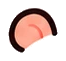 | `ear_l` | 耳朵・左 | 本體 | 66×61 |
| 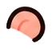 | `ear_r` | 耳朵・右 | 本體 | 65×61 |
| 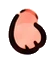 | `hand_l` | 手掌・左（往上舉） | 本體 | 55×63 |
| 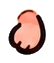 | `hand_r` | 手掌・右（往上舉） | 本體 | 54×63 |
| 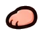 | `hand_side` | 手掌・側面（橫放） | 本體 | 64×52 |
| 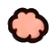 | `hand_pad` | 手掌・肉球面 | 本體 | 62×57 |
|  | `foot_l` | 腳・左 | 本體 | 70×53 |
| 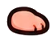 | `foot_r` | 腳・右 | 本體 | 70×52 |
| 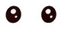 | `eyes_dot` | 眼睛・圓點（一對） | 五官 | 90×43 |
| 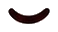 | `eye_closed_smile` | 眼睛・閉眼笑 ︶ | 五官 | 58×32 |
| 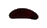 | `eye_closed_l` | 眼睛・閉眼 ︵（左） | 五官 | 47×28 |
| 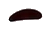 | `eye_closed_r` | 眼睛・閉眼 ︵（右） | 五官 | 51×30 |
| 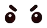 | `eyes_angry` | 眼睛・生氣（含眉） | 五官 | 79×48 |
|  | `face_sparkle` | 臉旁閃光 | 五官 | 86×63 |
|  | `face_cat_small` | 小臉・·ω· | 五官 | 68×45 |
| 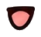 | `mouth_open` | 嘴・張開吐舌 | 五官 | 53×48 |
|  | `mouth_wide` | 嘴・大張（ω＋舌） | 五官 | 74×57 |
| 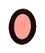 | `mouth_o` | 嘴・圓 o | 五官 | 45×53 |
| 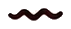 | `mouth_wavy` | 嘴・波浪（尷尬） | 五官 | 71×29 |
|  | `mouth_small` | 嘴・小開口 | 五官 | 50×43 |
| 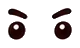 | `eyes_serious` | 眼睛・認真（含眉） | 五官 | 80×48 |
|  | `face_sad` | 小臉・難過 | 五官 | 67×42 |
|  | `face_angry` | 小臉・生氣 | 五官 | 76×51 |
|  | `blush` | 腮紅（一對，含斜線） | 五官 | 110×52 |
| 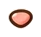 | `nose` | 鼻子 | 五官 | 41×37 |
|  | `fx_anger` | 怒（青筋） | 效果 | 75×77 |
|  | `fx_sweat` | 汗滴（兩滴） | 效果 | 65×78 |
|  | `fx_drop` | 淚滴／水滴 | 效果 | 52×78 |
|  | `fx_tears` | 淚流 | 效果 | 66×66 |
|  | `fx_exclaim` | ！！ | 效果 | 70×79 |
|  | `fx_question` | ？ | 效果 | 51×75 |
|  | `fx_heart` | 愛心 | 效果 | 69×64 |
|  | `fx_hearts_small` | 小愛心群 | 效果 | 71×82 |
|  | `fx_sparkle` | 閃光 | 效果 | 72×82 |
|  | `fx_music` | 音符 | 效果 | 92×72 |
|  | `fx_zzz` | Zzz | 效果 | 59×57 |
|  | `fx_bubble` | 對話泡泡 | 效果 | 94×86 |
| 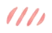 | `fx_slash` | 斜線（害羞） | 效果 | 67×42 |
| 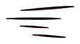 | `fx_speed` | 速度線 | 效果 | 115×64 |
|  | `fx_swirl` | 漩渦（暈） | 效果 | 82×82 |
|  | `fx_smoke` | 煙／哈氣雲 | 效果 | 84×79 |
|  | `prop_wizard_hat` | 巫師帽 | 道具 | 109×112 |
|  | `prop_laptop` | 筆電 | 道具 | 112×91 |
|  | `prop_phone` | 手機 | 道具 | 61×90 |
|  | `prop_money_bag` | 錢袋 | 道具 | 87×102 |
|  | `prop_coin` | 金幣 | 道具 | 61×65 |
|  | `prop_coin_stack` | 金幣疊 | 道具 | 82×82 |
|  | `prop_bill` | 鈔票 | 道具 | 80×65 |
|  | `prop_bill_stack` | 鈔票疊 | 道具 | 105×88 |
| 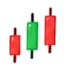 | `prop_kbar` | K 棒 | 道具 | 71×79 |
|  | `prop_arrow_up` | 上漲箭頭 | 道具 | 77×80 |
|  | `prop_arrow_down` | 下跌箭頭 | 道具 | 70×76 |
|  | `prop_monitor` | 看盤螢幕 | 道具 | 120×102 |
| 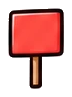 | `prop_sign_red` | 紅色舉牌 | 道具 | 72×97 |
|  | `prop_sign_green` | 綠色舉牌 | 道具 | 85×99 |
| 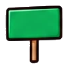 | `prop_sign_green_wide` | 綠色寬舉牌 | 道具 | 100×101 |
|  | `prop_shield` | 盾牌（$） | 道具 | 88×103 |
|  | `prop_diamond` | 鑽石 | 道具 | 83×79 |
| 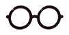 | `prop_glasses` | 眼鏡 | 道具 | 101×52 |
|  | `prop_newspaper` | 報紙 | 道具 | 96×90 |
|  | `prop_book` | 書 | 道具 | 102×83 |
|  | `prop_coffee` | 咖啡 | 道具 | 72×91 |
|  | `prop_boba` | 珍奶 | 道具 | 68×101 |
|  | `prop_seeds` | 瓜子 | 道具 | 87×68 |
| 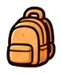 | `prop_backpack` | 背包 | 道具 | 78×92 |
|  | `prop_straw_hat` | 草帽 | 道具 | 100×74 |
|  | `prop_suitcase` | 行李箱 | 道具 | 70×101 |
|  | `prop_dumbbell` | 啞鈴 | 道具 | 99×69 |
|  | `prop_towel` | 毛巾 | 道具 | 110×81 |
|  | `prop_sleeping_bag` | 睡袋（比比在裡面） | 道具 | 112×88 |
|  | `prop_fur_balls` | 毛球 | 道具 | 105×76 |
|  | `pose_front` | 姿勢・正面 | 姿勢 | 207×168 |
|  | `pose_front_3q` | 姿勢・斜前方 | 姿勢 | 194×170 |
|  | `pose_back` | 姿勢・背面（露耳） | 姿勢 | 183×170 |
|  | `pose_back_tail` | 姿勢・背面（小尾巴） | 姿勢 | 198×169 |
|  | `pose_side` | 姿勢・側面 | 姿勢 | 183×170 |
|  | `pose_front_big` | 姿勢・正面（開心） | 姿勢 | 211×168 |
|  | `act1_01` | 動作參考第一排・第 1 格 | 動作參考 | 119×105 |
|  | `act1_02` | 動作參考第一排・第 2 格 | 動作參考 | 113×87 |
|  | `act1_03` | 動作參考第一排・第 3 格 | 動作參考 | 130×76 |
|  | `act1_04` | 動作參考第一排・第 4 格 | 動作參考 | 113×100 |
|  | `act1_05` | 動作參考第一排・第 5 格 | 動作參考 | 105×108 |
|  | `act1_06` | 動作參考第一排・第 6 格 | 動作參考 | 109×103 |
|  | `act1_07` | 動作參考第一排・第 7 格 | 動作參考 | 107×102 |
|  | `act1_08` | 動作參考第一排・第 8 格 | 動作參考 | 113×114 |
|  | `act1_09` | 動作參考第一排・第 9 格 | 動作參考 | 102×101 |
|  | `act1_10` | 動作參考第一排・第 10 格 | 動作參考 | 92×91 |
|  | `act1_11` | 動作參考第一排・第 11 格 | 動作參考 | 138×93 |
|  | `act1_12` | 動作參考第一排・第 12 格 | 動作參考 | 148×127 |
|  | `act2_01` | 動作參考第二排・第 1 格 | 動作參考 | 125×132 |
|  | `act2_02` | 動作參考第二排・第 2 格 | 動作參考 | 133×125 |
|  | `act2_03` | 動作參考第二排・第 3 格 | 動作參考 | 127×106 |
| 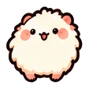 | `act2_04` | 動作參考第二排・第 4 格 | 動作參考 | 113×113 |
|  | `act2_05` | 動作參考第二排・第 5 格 | 動作參考 | 121×139 |
|  | `act2_06` | 動作參考第二排・第 6 格 | 動作參考 | 119×113 |
|  | `act2_07` | 動作參考第二排・第 7 格 | 動作參考 | 154×86 |
|  | `act2_08` | 動作參考第二排・第 8 格 | 動作參考 | 155×159 |
|  | `act2_09` | 動作參考第二排・第 9 格 | 動作參考 | 148×105 |
|  | `act2_10` | 動作參考第二排・第 10 格 | 動作參考 | 120×92 |
|  | `act3_01` | 動作參考第三排・第 1 格 | 動作參考 | 128×114 |
|  | `act3_02` | 動作參考第三排・第 2 格 | 動作參考 | 141×115 |
|  | `act3_03` | 動作參考第三排・第 3 格 | 動作參考 | 134×113 |
|  | `act3_04` | 動作參考第三排・第 4 格 | 動作參考 | 131×115 |
|  | `act3_05` | 動作參考第三排・第 5 格 | 動作參考 | 155×114 |
|  | `act3_06` | 動作參考第三排・第 6 格 | 動作參考 | 148×115 |
|  | `act3_07` | 動作參考第三排・第 7 格 | 動作參考 | 129×113 |
|  | `act3_08` | 動作參考第三排・第 8 格 | 動作參考 | 139×115 |
|  | `act3_09` | 動作參考第三排・第 9 格 | 動作參考 | 124×114 |
