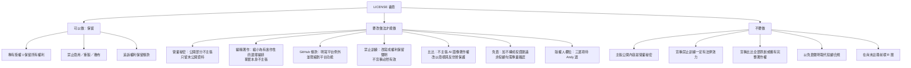

# LICENSE 審查與修正紀錄

> 2026-10-16，法遵與風險。性質：風險盤點與待確認清單，**不是法律意見**。
> 查證方式：WebSearch 取得搜尋摘要，**沒有讀到全國法規資料庫、智慧局、GitHub 條款的原文**；摘要是線索不是事實。
> 凡未見原文者信心度一律中或低；牽涉刑責、著作權歸屬、AI 訓練效力者標「必須由專業人士確認」。
> 只改了根目錄 `LICENSE`，沒有改 `site/`，沒有 commit。

## 一、總覽樹狀圖



## 二、逐條審查表

狀態：✅已改｜🔄已改但需專業人士確認｜⬜待 Andy 決定

| # | 原文（草稿） | 問題 | 修改理由 | 信心度 | 來源 | 仍需律師確認 | 狀態 |
|---|---|---|---|---|---|---|---|
| 0 | 「著作權所有 © 2026 MiaoZiKe（哩股哩股）」 | MiaoZiKe 是 GitHub 帳號名，「哩股哩股」是站名，兩者都不是法律上的權利主體；寫法未說明身分 | 保留現況寫法作預設，另列三個選項（第三節 (d)）；已在檔內加註待選 | 中 | 第三節 (d) | 是（筆名與署名的效力） | ⬜ |
| 1 | 「本儲存庫公開，僅供瀏覽，不代表授權使用」 | 與 GitHub 條款衝突：公開即被視為同意他人在平台上檢視與 fork，「僅供瀏覽」說太窄 | 改為「專有軟體、非開源」，並新增第二條平台例外 | 中 | 第五節 | 是 | 🔄 |
| 2 | 第一條：禁止複製、改作、散布…「圖像（含吉祥物）」「用於訓練、微調任何機器學習模型」 | ①禁止訓練寫成絕對禁止，效力不確定 ②含吉祥物圖像，可能被讀成主張完整著作權 ③沒有法定例外保留 | ①訓練拆到第五條改寫成權利保留聲明 ②吉祥物拆到第六條 ③加「合理使用與法定例外不受影響」 | 中 | 第六、七節 | 是 | 🔄 |
| 3 | 第二條：族群成分…屬於營業秘密與編輯著作，「不因公開而喪失保護」 | **這句法律上站不住腳**：營業秘密法第 2 條要件含秘密性與合理保密措施，已公開在公開 repo 與免費前端 JSON 的內容難以主張；「不因公開而喪失」是誇大，可能被認為不實或削弱可信度 | 刪除營業秘密主張；編輯著作縮小為「有創作性的選擇與編排」；明寫事實本身與演算法、構想不在範圍；營業秘密只留未公開資料 | 中高（營業秘密）／中（編輯著作） | 第三節 | 是 | 🔄 |
| 4 | 第三條：依平台服務條款允許的瀏覽、僅供個人閱讀的暫時性下載不在此限 | 方向對，但太簡略；「暫時性下載」的法律依據（暫時性重製例外）本次未查到條文原文 | 拆成第二條（平台功能）與第七條（個人閱讀、瀏覽器暫存），不引具體條號 | 中低 | 第五節 | 是 | 🔄 |
| 5 | 第四條：僅供資訊參考，不構成投資建議；依現況提供，不附擔保 | ①沒寫不考量個別狀況 ②擔保排除未保留法律不得排除之責任（消保法等，未逐條查）③沒有「非投顧」字樣 | 補充，見第八節 | 中 | 第八節 | **必須**（涉及證顧法） | 🔄 |
| 6 | 第五條：依著作權法、營業秘密法、商標法、公平交易法追究 | 營業秘密法不宜列（見 #3）；缺 GitHub 下架通知途徑 | 刪營業秘密法；加請求排除侵害、損害賠償與向平台提出下架通知 | 中 | 第五節 | 否 | ✅ |
| 7 | 「本聲明為草稿，文字尚待法遵確認」 | 公開檔案不必自曝草稿，但也**不可**改成「已經律師審閱」 | 改為「聲明版本：2026-10-16」；審閱狀態只記在本文件 | 高 | — | 否 | ✅ |
| 8 | 「聯絡方式：請透過網站客服聯繫」 | 可保留；加上「經書面同意始生效力」避免口頭授權爭議 | 併入第十條 | 中 | — | 否 | ✅ |
| 9 | （原文沒有）商標條款 | 比比與站名缺商標保護宣示；現階段尚未註冊，不可標 ® | 新增第六條：以商標方式使用（尚未註冊），禁止易致混淆的使用 | 中 | `trademark_registration.md` 第六節 | 是 | 🔄 |
| 10 | （原文沒有）第三方資料 | 政府開放資料等來源的權利不屬於自己，聲明應避免被讀成主張 | 新增第四條 | 中 | `source_and_user_data_protection.md` 相關資料授權說明 | 否 | ✅ |

## 三、六個重點檢視的查證結果

### (a) 著作權保護範圍與營業秘密

| 論點 | 查證結果 | 信心度 | 來源 |
|---|---|---|---|
| 著作權法保護表達，不保護思想、程序、操作方法、概念、原理 | 第 10 條之 1；兩個來源摘要一致，但皆為科普文章，**非條文原文** | 中 | [Legis-Pedia 整理](https://www.legis-pedia.com/article/Intellectual-property-rights/486)、[智慧局檔案（只見摘要）](https://www.tipo.gov.tw/wSite/public/Attachment/0/f1747117693724.pdf) |
| 編輯著作：資料的選擇與編排具創作性者可獨立保護，不影響被收錄資料的權利 | 第 7 條。但**門檻實務有爭議**：智慧財產及商業法院 113 年度刑智上易字第 35 號判決，以程式依既定邏輯交叉比對公開資料建成的資料庫被認定欠缺原創性，不是編輯著作 | 中 | [6laws 條文](https://6laws.net/6law/laws/著作權法.html)、[理律電子報 7431](https://www.leeandli.com/TW/Newsletters/7431.htm)（只見摘要） |
| 營業秘密三要件：秘密性、經濟價值、合理保密措施 | 第 2 條。秘密性喪失後事後救濟難以回復；合理保密措施實務看分級與帳號密碼管控（最高法院 102 年度台上字第 235 號之引述） | 中 | [104 法律百科](https://blog.104.com.tw/business-secret-rationality/)、[理律電子報 6541](https://www.leeandli.com/TW/Newsletters/6541.htm)（只見摘要） |
| 公開 repo 的原始碼能否主張營業秘密 | 搜尋**沒有找到**原始碼公開後喪失秘密性的專門判例，**未確認**；依三要件推論，公開且無存取限制的內容難以主張（推論） | 中（推論） | 同上 |
| 本站具體適用 | 族群 YAML、程式、文件都在公開 repo；免費前端 JSON 也透露族群成分（見 `source_and_user_data_protection.md` A3）→ **公開部分不主張營業秘密**。可主張者：未公開的金鑰、會員資料、私有 repo 的設定（若執行 B3 移私有，**移走之後的新版本**才有機會） | 中 | 同上 |

**結論**：舊第二條「不因公開而喪失其保護」已刪。**必須由專業人士確認**。

### (b) 與 GitHub 服務條款相容

| 論點 | 查證結果 | 信心度 | 來源 |
|---|---|---|---|
| 公開 repo 即授權他人檢視與 fork | 條款 D.5「對其他使用者的授權」：設為公開，即授予其他使用者在 GitHub 上檢視與以平台功能重製（fork）的非專屬授權；D.8 公開內容全網可存取 | 中（搜尋摘要，未讀原文） | [GitHub 服務條款](https://docs.github.com/en/site-policy/github-terms/github-terms-of-service)、[授權說明頁](https://docs.github.com/articles/licensing-a-repository) |
| 授權範圍是否僅限平台功能 | 有爭議：「fork」在一般條款中未定義，社群議題主張只涵蓋平台按鈕功能；**無判決**，僅社群意見 | 低 | [github/site-policy 議題 37](https://github.com/github/site-policy/issues/37)、[社群討論 76943](https://github.com/orgs/community/discussions/76943) |
| 沒有開源授權時的預設 | 預設著作權仍適用，他人不得超出平台條款使用 | 中 | [GitHub 授權說明](https://docs.github.com/articles/licensing-a-repository) |
| 下架 | GitHub 的著作權下架政策**不會停用 fork**（屬其他使用者）；2018 年的反通知書主張公開即授權（倡議文件，非判決）。**GitHub 條款是否另有 2026 年改版：未確認** | 低 | [GitHub 的 DMCA 儲存庫（只見摘要）](https://git.randommeaninglesscharacters.com/github/dmca/src/commit/ee5940e25d4fcc4ae121e19d2904900b8bc8ac80/2018/2018-08-08-Intersection-CounterNotice.md) |

**聲明做法**：不否認這個平台授權（否認會與條款矛盾、反而削弱可信度），改為「承認並限縮」：只在 GitHub 平台功能內、不含平台外散布、改作後對外服務、商用、移除標示（LICENSE 第二條）。**已存在的 fork 無法收回**，這是平台結構，**請專業人士確認**。

### (c) 「禁止用於訓練機器學習模型」的效力

| 論點 | 查證結果 | 信心度 | 來源 |
|---|---|---|---|
| 台灣有無 AI 訓練專屬例外 | 搜尋**沒有**找到 2026 年修法或專屬資料探勘例外；智慧局既有見解（2022、2023）：蒐集資料訓練屬「重製」，除符合第 44 條至第 65 條合理使用情形外，應取得授權；AI 學習不屬第 44 至 63 條，需依第 65 條第 2 項四項因素**個案綜合判斷，尚無一定標準** | 中 | [理律電子報 7218](https://www.leeandli.com/TW/Newsletters/7218.htm)（只見摘要） |
| 智慧局生成式 AI 著作權指引 | 媒體報導（2026-08-05）指 1.0 版完成：AI 訓練利用他人著作分三大類屬合理使用，其餘建議取得授權；滾動式檢討。**三大類內容、是否已正式公告、有無退出機制：未確認**，我沒找到官網全文 | 低到中 | [工商時報 2026-08-05](https://wantrich.chinatimes.com/news/20260805900616-420101)、[工商時報另一則](https://www.ctee.com.tw/news/20260805701974-430503) |
| 聲明的法律效力 | 單方聲明不能創造法律沒有賦予的權利；其作用是：①表明未授權，使「不知情」難以抗辯 ②若訓練行為不屬合理使用，聲明成為侵權主張的佐證 ③對爬蟲業者無技術阻擋力。若落在合理使用內，聲明**擋不住**。這是推論 | 低到中 | 同上 |

**聲明做法**：LICENSE 第五條改為「明示保留權利」，並寫「是否合理使用依第 65 條第 2 項認定，不排除法定例外」，不宣稱必然有效。**必須由專業人士確認**。
**替代做法**：技術面可加 `robots.txt` 對已知 AI 爬蟲設不同意（**效力與業者遵守度未查證**）；法律面是日後若指引有正式的權利保留機制，再依該機制聲明。

### (d) 版權人欄位

**必須由專業人士確認**身分與筆名效力。查證：搜尋未取得第 33 條現行文字與「個人未成立公司」的專門說明，**未確認**。智慧局會議資料提到別名著作的處理與「別名眾所周知」的關係（只見摘要）；日本法資料不可直接套用。

| 選項 | 寫法 | 優點 | 缺點 | 建議 |
|---|---|---|---|---|
| A 本名 | 「著作權所有 © 2026 王小明」 | 權利主體最明確；訴訟、下架通知最順；著作權在創作完成時即歸創作者，不需登記 | 本名公開在 public repo；個資與騷擾風險 | 願意公開本名且日後會移轉給公司時 |
| B 筆名 | 「© 2026 MiaoZiKe」（現況） | 不洩本名 | 筆名須能連結到你本人才好舉證；別名著作的保護與推定細節**未確認** | 不想公開本名時；**要保存「MiaoZiKe 即本人」的證據**（帳號註冊紀錄、商標申請人資料） |
| C 本名加筆名 | 「© 2026 王小明（筆名 MiaoZiKe，網站名稱：哩股哩股）」 | 最完整，舉證最強 | 同 A，本名公開 | 最保險 |
| D（待公司成立後）| 「© 2026 ○○有限公司」 | 乾淨 | 現在不存在；原創作者與公司間要有著作財產權讓與或僱傭歸屬文件 | 日後 |

「哩股哩股」是站名，**不是法律主體**（`site/legal_config.js` 的 `tax_id` 為「尚未辦理」），不建議單獨當版權人。

### (e) 吉祥物比比（AI 生成）

依 `trademark_registration.md` 4.2：智慧局 2023 年見解（兩家媒體轉述）單純 AI 生成圖像原則上不受著作權法保護，有人為實質投入才可能；2026 年指引報導指主張者須舉證人為部分；Andy 尚未回答工具、方案、紀錄（**未確認**）。因此 LICENSE 做了三件事：
1. 第一條不再把吉祥物與一般程式文件並列為「圖像」權利；
2. 第六條寫「著作權歸屬依法律認定，僅就人為創作部分（如有）保留，不為超出範圍的主張」；
3. 以商標與反仿冒保護：站名與比比作為商標使用（**尚未註冊，故只用 ™，不用 ®**）；公平交易法第 22 條門檻高（須著名），目前不宜指望（見該文件 4.6）。

**必須由專業人士確認**。也不得在對外文字寫「全部原創」。

### (f) 免責與「非投顧」

| 論點 | 查證結果 | 信心度 | 來源 |
|---|---|---|---|
| 刑責 | 證券投資信託及顧問法第 107 條，未經許可經營證顧業務：5 年以下徒刑，併科 100 萬至 5,000 萬罰金（金管會官員說明） | 中 | [鉅亨網](https://news.cnyes.com/news/id/5384442)、[科技新報](https://technews.tw/?p=769573)（只見摘要） |
| 判斷重點 | 實務重點在**是否收費、是否提供具體個股推介與買賣價位**，免責聲明不能決定性質 | 中 | 法院判決書（114 年度金訴字第 668 號，只見摘要）；[判決書](https://judgment.judicial.gov.tw/FILES/SCDM/114%2c%e9%87%91%e8%a8%b4%2c668%2c20260605%2c2.pdf) |
| 第 4 條定義原文、金管會對「非投顧」聲明的明確規範 | 本次搜尋**未查到**，未確認 | — | — |

**結論**：已補「不構成投資建議」「不考量個別狀況」「並非經主管機關許可之證券投資顧問事業」三句。**第三句是事實陳述，必須先由證券法規專業人士確認它與本站實際行為（「今日候選」「進場時機」等）一致**；若確認風險，寧可刪掉這句，也不要留一句會被反過來引用的話。**免責聲明不能取代合規**，收訂閱費前的風險見 `docs/product_strategy.md`。

## 四、仍需律師確認的項目

| # | 項目 | 為什麼 | 狀態 |
|---|---|---|---|
| 1 | 全文是否可作為公開專有授權 | 本草稿未經任何專業審閱 | ⬜ |
| 2 | 第八條「非證券投資顧問事業」句 | 涉及刑責與實際業務是否落入定義 | ⬜ |
| 3 | 第五條禁止訓練的措辭與保留權利方式 | 效力不確定、指引全文未確認 | ⬜ |
| 4 | 第三條編輯著作的範圍描述 | 原創性門檻有爭議判決 | ⬜ |
| 5 | 版權人欄位與筆名舉證 | 第 33 條現行文字未確認 | ⬜ |
| 6 | 第二條與 GitHub 條款的相容寫法 | 條款原文、fork 範圍、2026 年是否改版未確認 | ⬜ |
| 7 | 第六條比比：AI 生成的著作權與商標宣示 | Andy 尚未答工具、方案、紀錄 | ⬜ |
| 8 | 第七條「暫時性存放於瀏覽器」是否有明確法定依據 | 條號本次未查證 | ⬜ |
| 9 | 擔保排除條款在消費者保護法下的效力 | 未逐條查 | ⬜ |

## 五、第 3 項：頁尾著作權與商標標示建議（**未改 `site/`**）

**建議做**，信心度中。理由：①標示著作權人讓侵權者難以主張不知情（台灣著作權不以標示為要件，標示是舉證輔助，**不是取得條件**）；②商標用 ™ 明示主張，且 ™ 不需註冊；③成本近乎零。
**不要做**：標 ® （比比尚未註冊；公平交易委員會曾認定註冊前加註 ® 有虛偽不實之虞，見 `trademark_registration.md` 第六節，中信心）；站名「哩股哩股」的識別性與是否被他人註冊**尚未檢索**，標 ™ 是主張使用，不保證可註冊，是可以做的但請同意此風險。

頁尾草稿（可直接貼，版權人欄位依 Andy 在第三節 (d) 的選擇替換）：

```
© 2026 MiaoZiKe（哩股哩股）。保留所有權利。
「哩股哩股」™ 與吉祥物「比比」™ 為本站使用之標識，未經書面同意不得使用。
本站內容為公開資訊的整理與統計呈現，不構成投資建議；本站並非經主管機關許可之證券投資顧問事業。
```

其中第三行若專業人士不同意「非投顧」字樣，只留「不構成投資建議」。實作時先對照 `site/legal.js` 的智慧財產權條款（第 162 至 166 行）與頁尾免責聲明避免重複或矛盾：該條款寫「權利屬於服務提供者或其授權人」「您得為個人非商業目的閱覽、截圖與引用」，與 LICENSE 第七條方向一致，但**沒有商標宣示與禁止訓練**，上架前建議同步補齊（草稿同本檔 LICENSE 第五、六條，需專業人士確認後才寫入）。

## 六、需 Andy 回答的問題

1. 版權人欄位選哪一個（第三節 (d) 的 A、B、C）？是否願意在公開 repo 出現本名？
2. 「MiaoZiKe」是否就是你個人的唯一筆名／帳號？有沒有其他人貢獻程式或圖像（會牽涉共有或讓與）？
3. 比比：用哪個 AI 工具、哪個方案、何時生成、有沒有留紀錄（同 `trademark_registration.md` 第八節）？這會直接決定 LICENSE 第六條能寫多強。
4. 是否同意「非證券投資顧問事業」句先保留、並排入法遵專業確認（還是先刪，只留「不構成投資建議」）？
5. 是否要在 `robots.txt` 加對 AI 爬蟲的不同意設定（效力未查證，僅表達意思）？
6. 是否同意上架前把頁尾標示與 `site/legal.js` 的智慧財產權條款對齊（我不改，由前端負責人另案處理）？
7. 是否接受：已公開歷史與已存在的 fork 無法由聲明收回（B3 移私有只對之後的新版本有效）？

## 附錄：本次查證來源（皆為搜尋摘要，未讀原文）

- [理律電子報 6541（營業秘密）](https://www.leeandli.com/TW/Newsletters/6541.htm)、[104 法律百科 合理保密措施](https://blog.104.com.tw/business-secret-rationality/)
- [理律電子報 7431（資料庫編輯著作原創性）](https://www.leeandli.com/TW/Newsletters/7431.htm)、[著作權法全文 6laws](https://6laws.net/6law/laws/著作權法.html)
- [理律電子報 7218（AI 訓練與合理使用）](https://www.leeandli.com/TW/Newsletters/7218.htm)、[工商時報 2026-08-05](https://wantrich.chinatimes.com/news/20260805900616-420101)
- [GitHub 服務條款](https://docs.github.com/en/site-policy/github-terms/github-terms-of-service)、[GitHub 授權說明](https://docs.github.com/articles/licensing-a-repository)
- [鉅亨網 投顧刑責](https://news.cnyes.com/news/id/5384442)、[科技新報 非法投顧](https://technews.tw/?p=769573)
- 專案內：`docs/legal/trademark_registration.md`、`docs/security/source_and_user_data_protection.md`、`site/legal.js`、`site/legal_config.js`
