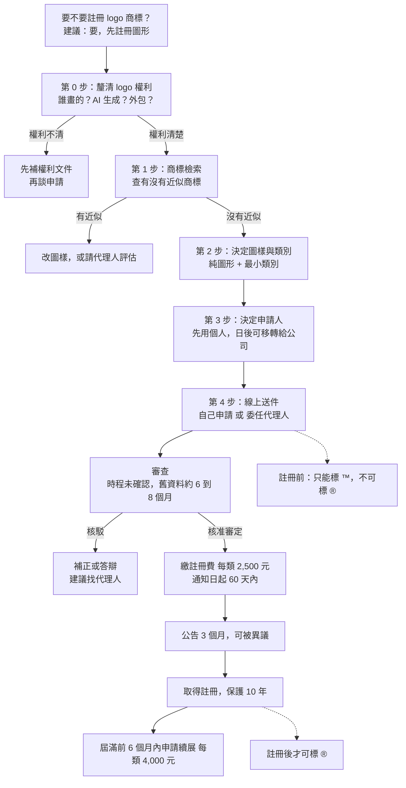
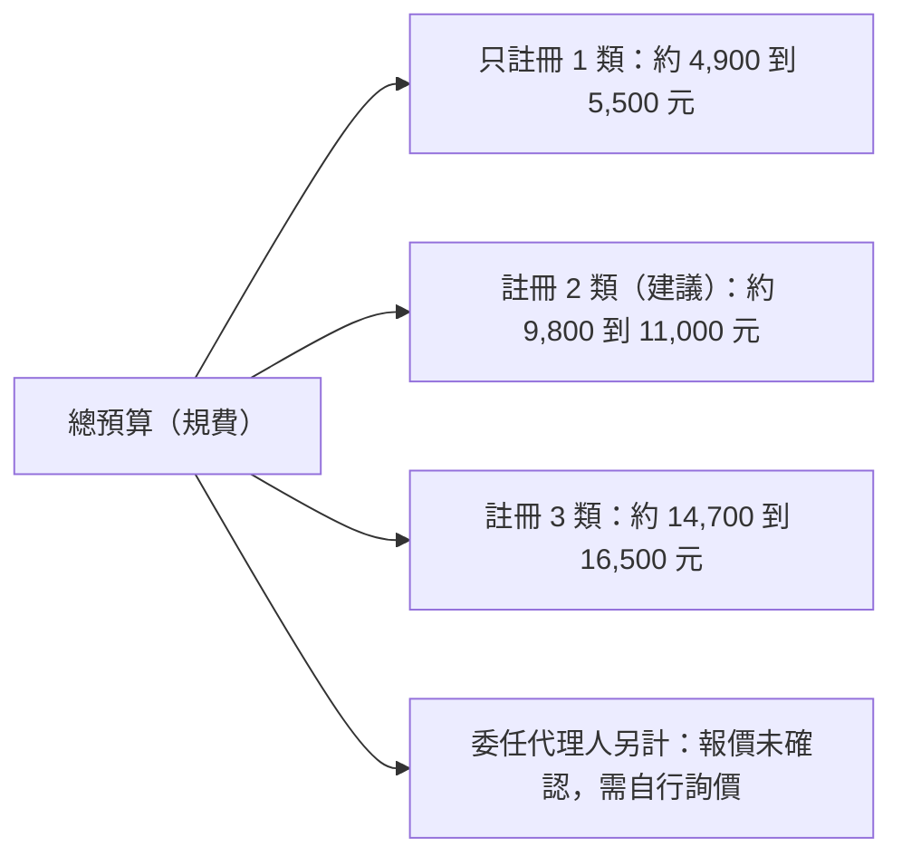

# 商標註冊評估：我們的 logo 要怎麼註冊

> 查證日期：2026-10-11。性質：風險盤點與待確認清單，**不是法律意見**。
> 查證方式：以 WebSearch 查證，摘要只是線索；點不進原文，所以下表「信心度」一欄會註明。
> 牽涉「是否構成侵權、近似是否會被核駁、著作權歸屬」的判斷，一律標為**必須由專業人士確認**。

## 一、總覽圖（先看這張）





## 二、結論先行

| 項目 | 結論 | 信心度 | 要找專業人士確認？ |
|---|---|---|---|
| 該不該註冊 | **該，但先註冊「圖形」**。網站要收訂閱費、上 App 商店，品牌被搶註或被仿冒的損失遠大於幾千元規費。 | 中（商業判斷） | 否 |
| 建議做法 | 先把 logo 權利釐清 → 自己先用線上檢索查近似 → 因為近似判斷是核駁最大風險，**建議委任代理人送件** | 中 | 是（近似判斷） |
| 建議類別 | 最小組合：第 42 類（線上非下載軟體／網站服務）＋第 41 類（線上電子出版品、財經資訊提供，不含投資建議）。有上架 App 才加第 9 類。**不建議第 36 類**（理由見第五節） | 低到中（分類名稱我只查到國外資料，未對到智慧局名稱） | 是 |
| 規費（每類） | 申請費 3,000 元；電子申請每件減 300，若指定名稱全與系統參考名稱相同每類再減 300；核准後註冊費 2,500 元；續展 4,000 元 | 中高（見下方來源） | 否，送件前到官網再確認一次 |
| 總預算區間 | 1 類約 4,900 到 5,500 元；2 類約 9,800 到 11,000 元（不含代理人費用）。代理人費用**未確認**，需詢價 | 中 | 否 |

**規費計算**（每類）：申請費 3,000，電子申請減 300 後 2,700，名稱全採系統參考名稱再減 300 後 2,400；加註冊費 2,500。所以每類 4,900（2,400＋2,500）到 5,500（3,000＋2,500）。電子申請減收是「每件」減 300，多類同件時略低於上述乘算，故以區間表示。

**規費來源與第二來源**
- 第一來源（官方）：[智慧財產局 商標規費清單（113年5月1日起生效）](https://www.tipo.gov.tw/tw/trademarks/589.html)；查證日 2026-10-11，我只看到搜尋摘要，未能開啟原頁。
- 第二來源：[全國法規資料庫 商標規費收費標準](https://law.moj.gov.tw/Hot/AddHotLaw.ashx?PCode=J0070005)、[理律法律事務所電子報](https://www.leeandli.com/TW/Newsletters/4470.htm)。
- 搜尋結果沒有顯示 2025 年之後有再修正，但也**沒有確認**目前仍是此版本，送件當天務必到官網看最新表。
- 超過 20 項商品每多一項加收 200 元，只適用第 1 到 34 類「商品」；我們走服務類（第 35 到 45 類），第 42、41 類不受此影響，第 9 類是商品類，指定項目請控制在 20 項內。
- 加速審查每類加收 6,000 元（來源：理律摘要與智慧局 113 年 5 月新制報導）。我們沒有急迫需求，不建議。

## 三、逐步流程

### 3.1 兩種做法的利弊

| 面向 | 自己申請 | 委任商標代理人 |
|---|---|---|
| 費用 | 只有規費 | 規費＋代理費（**報價未確認**，請詢價 2 到 3 家比較） |
| 近似判斷 | 靠自己看檢索結果，容易看漏 | 有經驗，能預判核駁風險 |
| 被核駁時 | 要自己讀核駁理由、寫答辯 | 代理人處理 |
| 類別與名稱用語 | 容易選到不被接受或保護太窄的用語 | 熟悉智慧局接受的用語 |
| 花的時間 | Andy 自己花數小時學習 | Andy 約 1 小時溝通＋簽委任書 |
| 適合 | 預算極緊、圖樣很獨特 | 要上架收費、不想承擔被搶註風險 |

建議：**先自己做檢索（免費），再決定要不要委任**。若檢索看到任何疑似近似，就委任。

### 3.2 步驟明細表

| 步驟 | 內容 | 誰做 | 花多久 | 花多少 | 狀態 |
|---|---|---|---|---|---|
| 0 | 釐清 logo 著作權與可商標性（見第六節） | Andy | 1 到 3 天 | 0 | ⬜待辦 |
| 1 | 用智慧局「商標檢索系統」查圖形與文字近似（圖形用圖形分類碼查，文字查「台股」「輪動」等） | Andy | 2 到 4 小時 | 0 | ⬜待辦 |
| 2 | 決定圖樣：純圖形（見 3.3） | Andy | 30 分鐘 | 0 | ⬜待辦 |
| 3 | 決定類別與指定服務名稱（見 3.4） | Andy＋代理人 | 1 小時 | 0 | ⬜待辦 |
| 4 | 決定申請人（見 3.5） | Andy | 30 分鐘 | 0 | ⬜待辦 |
| 5 | 線上申請送件（智慧局電子申請；個人需自然人憑證或其他認證方式，**未確認細節**） | Andy 或代理人 | 1 到 2 小時 | 申請費（見上） | ⬜待辦 |
| 6 | 等待審查；可能收到核駁先行通知或補正 | 代理人（建議） | 搜尋只找到舊資料：約 6 到 8 個月；一般案件最新平均月數**未確認** | 答辯另計 | ⬜待辦 |
| 7 | 核准審定後，於通知日起 60 天內繳註冊費 | Andy 或代理人 | 30 分鐘 | 每類 2,500 | ⬜待辦 |
| 8 | 公告 3 個月，任何人可異議（異議申請期間為公告日起 3 個月） | 等待；被異議時代理人處理 | 3 個月 | 0（被異議則答辯費另計） | ⬜待辦 |
| 9 | 取得註冊證；保護 10 年 | — | — | — | ⬜待辦 |
| 10 | 續展：權利屆滿前 6 個月內至屆滿後 6 個月內可申請，逾期在寬限期內加倍收費 | Andy 或代理人 | 1 小時 | 每類 4,000（寬限期內 8,000） | ⬜待辦 |

流程條文來源：[智慧財產局相關說明文件](https://www.tipo.gov.tw/wSite/public/Attachment/0/f1745912296696.pdf)、[延展註冊費用說明](https://www.tipo.gov.tw/tw/trademarks/607-8503.html)；第二來源：[Legis-Pedia 條文整理](https://www.legis-pedia.com/article/Intellectual-property-rights/819)。信心度：中高（摘要層級）。「註冊費 60 天」的原始來源我只看到外國指南字樣，**台灣的期限請以核准審定書上寫的為準**。

### 3.3 圖樣：純圖形還是文字加圖形

| 選項 | 優點 | 缺點 | 建議 |
|---|---|---|---|
| 純圖形（只有吉祥物／logo 圖） | 圖形與文字可獨立使用；日後改字體或加副標不受影響；圖形不需翻譯，海外通用 | 保護範圍只在圖形；文字名稱沒被保護 | **建議先申請這個** |
| 文字加圖形組合 | 一次涵蓋整體外觀 | 一旦網站改版、換字體或拆開使用，保護範圍可能對不上；拆開使用時被認為只註冊了組合 | 不建議當唯一申請 |
| 純文字（站名） | 保護站名本身 | 「台股」「輪動」可能被認為描述性（見第四節） | 預算允許再另申請，且要有自創字詞才有勝算 |

理由來源：理律與國外商標事務所文章均指出組合商標的權利通常只涵蓋整體圖樣、分開申請更完整但成本較高（[參考](https://www.leeandli.com/TW/Newsletters/5620.htm)）。信心度：中。**站名要不要另申請文字商標，請代理人看過站名後判斷。**

### 3.4 指定類別（最小必要組合）

| 類別 | 對應我們的什麼 | 建議 | 信心度 |
|---|---|---|---|
| 第 42 類 | 以非下載方式提供的軟體服務、網站平台（對應「網站訂閱」） | **建議**（核心） | 中（SaaS 屬第 42 類，來源為國外事務所文章，台灣用語未對） |
| 第 41 類 | 線上電子出版品、提供財經資訊內容 | **建議**，用語須避開「投資分析建議」 | 低到中 |
| 第 9 類 | 可下載的手機 App／軟體 | **有要上架 App 時才加** | 中 |
| 第 36 類 | 投資顧問、金融諮詢 | **不建議**：我們的「今日候選」「進場時機」正好卡在證券投資顧問定義附近（見 `docs/product_strategy.md` 與證券投資信託及顧問法第 4 條、第 107 條熱點）；在商標申請書上寫「投資顧問」等於自己貼上這個標籤，**必須由專業人士確認** | 中 |

最小組合：**第 42 類＋第 41 類**；上 App 時補第 9 類。各類只寫真的有在做的項目，因為指定過廣有被他人以「未使用」提出廢止的風險，且申請後通常不能追加項目（來源為國外事務所文章，台灣規則請代理人確認）。

### 3.5 申請人身分：個人 vs 公司

| 面向 | 以 Andy 個人名義 | 以公司名義（尚未成立） |
|---|---|---|
| 可行性 | 自然人可申請（商標法修正草案意見彙整表提到自然人與法人皆可申請，**條文原文未直接確認**） | 要先成立公司 |
| 對金流／上架 | 日後 Apple、Google 開發者帳號、收款帳戶若是公司名義，會出現「商標權人與營運主體不同」的情況，需做授權或移轉 | 一致，最乾淨 |
| 移轉成本 | 日後移轉給公司須簽「商標申請權移轉同意書」／商標權移轉文件，雙方代表人為同一人時要注意簽署人身分（智慧局範本有說明）；移轉費用**未確認** | 無 |
| 建議 | **現在就怕被搶註：先以個人名義送件，成立公司後再移轉**；若 3 個月內就要成立公司，則等公司成立再送 | |

信心度：中低，**必須由專業人士確認**移轉的稅務與費用。與金流對照部分請 payments-billing 補充（本文件撰寫時未向他們索取，列為待辦）。

## 四、風險：被核駁的常見原因

| 風險 | 說明 | 對我們的影響 | 處理 |
|---|---|---|---|
| 近似他人商標 | 圖樣、讀音、觀念與已註冊商標相同或近似、指定服務類似 | 吉祥物（白色毛球天竺鼠）造型簡單，**撞圖風險不低** | 步驟 1 檢索；必須由專業人士確認 |
| 描述性（缺乏識別性） | 商標法第 29 條第 1 項：直接描述服務的品質、用途、特性者不得註冊；有使用事實且已成為識別標識者可例外（第 1、3 款） | 純文字「台股輪動」很可能被認為描述服務內容；「資金輪動」更是通用說法 | 這就是建議先申請**圖形**的原因；文字商標需另行評估，信心度中（來源為理律實務文章，不是條文原文） |
| 通用名稱 | 同條第 2 款，**不能靠使用取得例外** | 「台股」「輪動」若單獨使用 | 不要把這些字當主體 |
| 顏色限定 | 搜尋結果**未查到**台灣針對顏色限定的專門說明 | 未確認 | 建議用黑白圖樣送件，保護所有顏色（國際慣例，台灣審查基準**未確認**，請代理人確認） |
| 易使公眾誤認 | 第 30 條第 1 項第 8 款，後天使用也無法排除 | 若圖樣含「證券」「投顧」「官方」字樣或金融機構象徵，可能被認為誤認 | 圖樣不放這類字樣 |

## 五、著作權歸屬：吉祥物 logo 先釐清

商標權與著作權是兩回事：註冊商標不會幫你取得圖的著作權，畫圖的人仍可能握有著作權。智慧財產法院見解認為商標圖樣中的圖形可受著作權法保護，文字則通常不受保護（來源：[理律電子報摘要](https://www.leeandli.com/TW/Newsletters/5620.htm)）。

| 情況 | 著作權歸誰 | 要先補什麼文件 | 信心度 |
|---|---|---|---|
| Andy 自己畫／自己設計 | Andy | 留存原始檔、創作過程紀錄 | 中 |
| 外包給設計師 | 依著作權法第 12 條：出資聘人完成者，原則上受聘人為著作人，財產權依契約，**沒約定歸受聘人**，出資人只有利用權 | 著作財產權讓與契約（明載全部讓與、不行使人格權、可商標註冊使用）；設計師簽名／蓋章；原始檔 | 中高（[參考](https://www.legis-pedia.com/article/Intellectual-property-rights/1367)），**必須由專業人士確認契約文字** |
| 受雇員工完成 | 職務著作，財產權歸雇用人（契約另有約定從約定） | 雇傭契約 | 中 |
| AI 生成 | 智慧局見解：人類先構思、繪製再以 AI 輔助修飾者可享著作權；僅輸入提示詞由 AI 全權產出者通常不受著作權保護 | 見下 | 中低（摘要層級，**必須由專業人士確認**） |

AI 生成的 logo 要備齊：① 使用的工具名稱、版本與服務條款（是否允許商業使用、商標註冊）；② 提示詞與生成紀錄；③ 人類修改的原始檔與修改痕跡；④ 工具是否可能產出與他人作品極相似的圖。AI 全權產出的圖**可能無著作權保護**，意味著別人仿冒時難以主張著作權，但**仍然可以申請商標**（商標看識別性，不看創作性；此點我未查到明文，請代理人確認）。

吉祥物若參考任何既有角色、素材包或第三方範本，須另外確認授權。設計相關事項（logo 原始檔、吉祥物權利紀錄）**尚未向 art-director／animation-director 索取**，列入行動清單。

## 六、暫時保護措施（註冊前）

| 符號 | 意義 | 註冊前可以用嗎 | 說明 |
|---|---|---|---|
| ™ | 主張為商標，不代表已註冊 | 可以 | 國外通常可使用；台灣法律對標示方式**無明文規範**（理律文章） |
| ® | 已註冊 | **不可以** | 台灣商標法未明文規範標記，但公平交易委員會曾認定：尚在申請中、甚至已審定但未確定取得專用權時加註 ®，構成虛偽不實及引人錯誤，違反公平交易法第 21 條第 1 項（來源：[理律電子報](https://www.leeandli.com/TW/Newsletters/4784.htm)）。信心度：中，**必須由專業人士確認** |

做法：現在起在網站頁首與 App 說明用「圖形＋™」；取得註冊證後才改 ®。同時保存「最早使用日期」的證據（網站上線截圖、Wayback 紀錄、commit 紀錄），供日後爭議時證明先使用。可直接貼上的標示草稿：

```
本網站名稱及其圖形標誌為站長所有之商標（™）。未經書面同意，請勿用於商業用途。
```

## 七、海外是否需要、何時做

| 項目 | 現況判斷 | 何時做 | 信心度 |
|---|---|---|---|
| Apple App Store／Google Play 上架 | 本次**沒有查到**兩商店對商標證明的要求（搜尋無結果），未確認 | 要上架前再查，另請 security-privacy／payments-billing 對照 | 低 |
| 馬德里國際註冊 | WIPO 規定申請人須是成員國國民或在成員境內有住所／營業所，並有本地基礎註冊；台灣是否可直接走此途徑搜尋**沒有明確結果**（常見做法是台灣公司直接向各國申請，例如美國向 USPTO） | 目前**不需要**；有明確海外用戶或上架美區後再評估 | 低，**必須由專業人士確認** |
| 優先權 | 在台灣送件後一般有一段期間可主張優先權向他國申請（期限我未查證，一般認為是 6 個月，**未確認**） | 台灣送件後半年內決定要不要往海外 | 低 |

結論：**現階段只做台灣**；海外等有實際收入或上架美區再說。

## 八、行動清單（Andy 照著打勾）

| 編號 | 項目 | 誰做 | 花多久 | 花多少 | 狀態 |
|---|---|---|---|---|---|
| 1 | 確認 logo 是誰畫的／哪個 AI 工具生成，蒐集原始檔與生成紀錄 | Andy | 1 天 | 0 | ⬜待辦 |
| 2 | 若是外包：取得著作財產權讓與契約；若是 AI：留存工具條款與修改痕跡 | Andy | 1 到 3 天 | 契約審閱費未確認 | ⬜待辦 |
| 3 | 向 art-director／animation-director 索取 logo 原始檔與吉祥物權利說明 | 由 CEO 轉派 | 1 天 | 0 | ⬜待辦 |
| 4 | 用智慧局商標檢索系統查圖形與文字近似，截圖留存 | Andy | 2 到 4 小時 | 0 | ⬜待辦 |
| 5 | 決定：純圖形、第 42 類＋第 41 類（有 App 再加第 9 類） | Andy | 30 分鐘 | 0 | ⬜待辦 |
| 6 | 詢價 2 到 3 家商標代理人（請對方報：代理費、核駁答辯費、移轉費） | Andy | 2 小時 | 0 | ⬜待辦 |
| 7 | 決定申請人：個人先送、公司成立後移轉；或等公司成立 | Andy | 30 分鐘 | 0 | ⬜待辦 |
| 8 | 網站先標示圖形＋™，保存最早使用證據 | Andy／frontend-ui | 1 小時 | 0 | ⬜待辦 |
| 9 | 送件（線上申請） | 代理人（建議） | 1 到 2 小時 | 2 類約 9,800 到 11,000 元規費＋代理費 | ⬜待辦 |
| 10 | 審查期間處理核駁通知 | 代理人 | 不定 | 答辯費未確認 | ⬜待辦 |
| 11 | 核准審定後繳註冊費 | Andy 或代理人 | 30 分鐘 | 已含在第 9 項預算 | ⬜待辦 |
| 12 | 公告期結束取得註冊證，改標 ® | Andy | 30 分鐘 | 0 | ⬜待辦 |
| 13 | 行事曆提醒：第 9 年 6 個月起準備續展 | Andy | 5 分鐘 | 日後每類 4,000 | ⬜待辦 |
| 14 | 上架前再評估第 9 類與海外 | Andy＋代理人 | 1 小時 | 視情況 | ⬜待辦 |

## 九、查不到或未確認（明講）

- 一般案件目前的平均審查月數：只查到舊資料（約 6 到 8 個月）與加速審查資料，**未確認**。
- 代理人費用行情：搜尋到報價平台但未能讀取內容，**未確認**，需自行詢價。
- 智慧局接受的第 36、41、42、9 類標準用語：只查到國外分類資料，**未對到台灣用語**，請在電子申請系統內以參考名稱挑選（也能多減 300 元規費）。
- 顏色限定核駁的台灣說明、App Store／Google Play 對商標的要求、台灣是否可直接走馬德里：**未查到**。
- 個人申請所需的認證方式與商標法第 19 條細節：**未查到原文**。
- 本文件撰寫時未向 art-director、animation-director、frontend-ui、payments-billing、security-privacy 索取資料，相關欄位已標為待辦。
- 所有規費金額以智慧財產局送件當日公告為準。

## 十、資料來源

- [智慧財產局 商標規費清單（113年5月1日起生效）](https://www.tipo.gov.tw/tw/trademarks/589.html)
- [全國法規資料庫 商標規費收費標準](https://law.moj.gov.tw/Hot/AddHotLaw.ashx?PCode=J0070005)
- [智慧財產局 延展註冊的費用](https://www.tipo.gov.tw/tw/trademarks/607-8503.html)
- [理律電子報 4470（規費）](https://www.leeandli.com/TW/Newsletters/4470.htm)
- [理律電子報 4784（® 標示與公平交易法）](https://www.leeandli.com/TW/Newsletters/4784.htm)
- [理律電子報 5620（圖形與文字的保護）](https://www.leeandli.com/TW/Newsletters/5620.htm)
- [理律電子報 6534／6940（商標法第 29 條描述性）](https://www.leeandli.com/TW/Newsletters/6534.htm)
- [Legis-Pedia 商標流程整理](https://www.legis-pedia.com/article/Intellectual-property-rights/819)
- [Legis-Pedia 著作權法第 12 條整理](https://www.legis-pedia.com/article/Intellectual-property-rights/1367)
- [WIPO 馬德里常見問題](https://www.wipo.int/zh/web/madrid-system/faq)
- [自由時報 商標加速審查](https://ec.ltn.com.tw/article/breakingnews/4276150)
