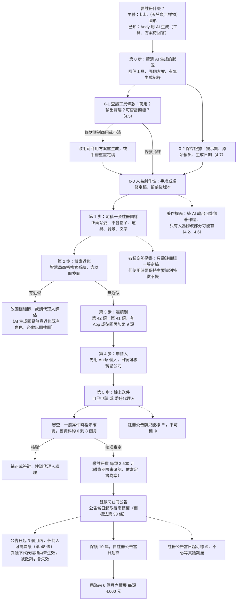
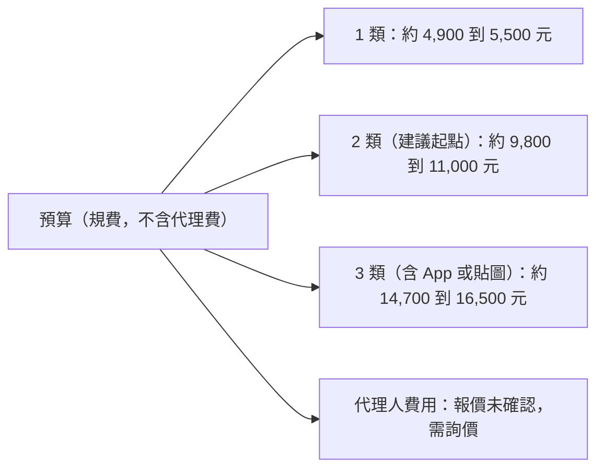

# 比比（白色毛球天竺鼠吉祥物）商標註冊評估

> 查證日期：2026-10-11。性質：風險盤點與待確認清單，**不是法律意見**。
> 查證方式：以 WebSearch 查證，摘要只是線索，點不進原文，每條都標信心度。
> 牽涉「近似是否會被核駁、著作權歸屬、使用與註冊圖樣是否同一」的判斷，一律標為**必須由專業人士確認**。
> 本版（第三版，2026-10-11）依 Andy 澄清改以「比比」為註冊主體，並納入新資訊：**比比是 Andy 自己用 AI 生成的（工具、方案、是否留紀錄尚未回答）**。第一版是泛用 logo 版，已被取代。
> 第三版新增：第四節 4.2 重寫（AI 生成與商標的關係）、4.5（AI 工具商用條款查證）、4.6（被抄襲時的救濟）、4.7（證據保存與增加人為創作性）、第八節行動清單與第九節待答問題。
> 查證限制：本次 WebSearch 只拿到搜尋摘要與二手轉述，**沒有讀到智慧局或各 AI 工具官方條款原文**；摘要會自己補內容，凡未見官方原文者一律標中或低信心。

## 一、總覽樹狀圖（先看這張）





## 二、先講我在 repo 找到了什麼（比比的現況盤點）

| 項目 | 位置 | 看到的事實 | 對商標的意義 |
|---|---|---|---|
| 現行 logo（藍底格線＋比比＋筆電＋書＋K 線＋箭頭＋「哩股哩股」） | `site/brand/logo-512.png`、原稿 `site/brand/src/logo_1009.jpg`（1254×1254） | 2026-10-07 品牌改名「哩股哩股」；10-10、10-11 又做過滿版修圖（背景延伸、抹接縫、重畫格線） | 這張是「比比＋很多元素」的組合圖，不適合直接當商標圖樣（見第三節） |
| 比比官方部件總表 | `site/brand/src/bibi_parts_sheet_1011.webp`（1254×1254） | 含正面頭像、身體／耳／腳分件、表情、道具、姿勢列；commit 訊息記為「Andy 給的比比官方部件總表（四肢短短），退件長手揮手圖存參考」 | **這張是最適合挑定稿的來源**：左上第一格的正面站姿比比 |
| 動畫素材 | `docs/anim/bibi_*`（67 組）、`scripts/anim/*`、`site/brand/bibi/` | 以原圖像素分層變形、補間、去背輸出；`docs/anim/README.md` 寫「原檔是 Andy 給的 GIF／圖／影片，永遠保留」 | 動畫是由原圖衍生，比比外觀鎖定規格寫在 `docs/anim/prompt_kit/01_總控Prompt.md` |
| 外觀鎖定規格 | 同上，第二節 | 奶油白毛茸茸圓潤、深棕黑柔和描邊、粉橘耳與小腳掌、桃粉腮紅、黑點眼、小嘴 | 這幾項就是「主要識別特徵」，用來回答第六節的動畫問題 |
| 原圖怎麼產生 | repo 內沒有生成紀錄；**Andy 已回答：比比是他自己用 AI 生成的**，但**還沒說用哪個工具、哪個方案、有沒有留紀錄** | `docs/anim/README.md` 第 59 行寫環境另外接了 Adobe（Firefly／Express）與 Canva、Figma，但那是「Andy 想用 AI 生分鏡圖時可走的管道」，**不能據此推定比比就是用這些做的**，未確認 | 工具與方案決定商用條款與輸出歸屬，見 4.2、4.5 |

## 三、結論先行

| 問題 | 結論 | 信心度 | 要找專業人士確認？ |
|---|---|---|---|
| 該不該註冊 | **該。比比是對外識別（網站、客服鈕、宣傳影片、貼文頭像），已經在使用，越早註冊越能擋搶註** | 中（商業判斷） | 否 |
| 註冊哪一個圖樣 | **比比純圖形：從官方部件總表挑一張正面站姿定稿**，不含帽子、道具、藍底、文字 | 中 | 是（近似與識別性） |
| 比比是 AI 生成，能註冊商標嗎 | **制度上商標看識別性與近似，不以「著作權人是誰」為申請要件，所以 AI 生成不當然擋住申請**；但**搜尋沒找到智慧局對 AI 生成圖樣申請商標的明文或審查基準，未確認**。真正的風險在：①著作權可能不存在或很薄（被抄襲時少一條救濟）②AI 圖與既有角色近似③工具條款是否准許商用、商標化 | 中（制度推論）／低（智慧局實務） | 是 |
| 站名「哩股哩股」要不要一起 | 另列為第二件、預算允許再做；是否具識別性（「股」字有描述性疑慮、疊字是否算自創）**未確認** | 低 | 是 |
| 類別 | 第 42 類＋第 41 類為起點；上 App 加第 9 類；**不建議第 36 類** | 低到中 | 是 |
| 預算 | 2 類約 9,800 到 11,000 元規費，代理費另計未確認 | 中 | 否，送件前再看官網 |
| 做法 | 先自己用免費檢索系統查近似，再委任代理人送件 | 中 | 是 |

**規費（每類）與來源**：申請費 3,000 元；電子申請每件減 300 元，若全部指定名稱與系統參考名稱相同每類再減 300 元；核准後註冊費 2,500 元；續展 4,000 元（屆滿後 6 個月內申請加倍為 8,000 元）。每類合計 4,900（2,400＋2,500）到 5,500（3,000＋2,500）。
- 第一來源（官方）：[智慧財產局 商標規費清單（113 年 5 月 1 日起生效）](https://www.tipo.gov.tw/tw/trademarks/589.html)，我只看到搜尋摘要。
- 第二來源：[全國法規資料庫 商標規費收費標準](https://law.moj.gov.tw/Hot/AddHotLaw.ashx?PCode=J0070005)、[理律電子報](https://www.leeandli.com/TW/Newsletters/4470.htm)、[延展註冊費用](https://www.tipo.gov.tw/tw/trademarks/607-8503.html)。
- 搜尋沒有顯示 2025 年後再修正，但**未確認目前仍是此版**，送件當天再查官網。加速審查每類加收 6,000 元，不建議。

## 四、七個問題的回答

### 4.1 圖樣怎麼選：比比圖形單獨，還是圖形加文字

| 選項 | 內容 | 優點 | 缺點 | 建議 |
|---|---|---|---|---|
| A 比比純圖形（正面站姿定稿） | 只有比比，無文字、道具、背景 | 日後換站名、字體、版面都不影響；貼在客服鈕、影片、貼圖、App 圖示都能用；別人仿冒比比造型時最直接 | 站名沒被保護；吉祥物造型簡單，近似風險要靠檢索確認 | **主申請，先做這個** |
| B 比比＋「哩股哩股」組合（即現行 logo） | 含筆電、書、K 線、箭頭、藍底格線 | 一次涵蓋現行整張圖 | 元素多且還在改（10-10、10-11 剛改過滿版背景），改版後可能與註冊圖樣對不上；保護範圍通常只及整體圖樣，不及個別部分 | **不建議當第一件** |
| C 文字商標「哩股哩股」 | 純文字 | 保護站名本身 | 識別性未確認（見第五節） | 第二件，預算允許再做，先請代理人看過 |
| D 文字商標「比比」 | 純文字 | 角色名稱 | 「比比」是常見詞，識別性與近似風險都高，**未查證** | 暫不建議 |

理由來源：理律文章指出組合商標的權利通常只涵蓋整體圖樣，分開申請保護較完整但成本較高（[理律電子報 5620](https://www.leeandli.com/TW/Newsletters/5620.htm)）。信心度：中。

**定稿圖樣的建議規格（給 art-director 或 Andy）**：
- 取官方部件總表左上第一格（正面站姿、張嘴微笑、粉腮紅、粉橘耳與腳）。
- 去掉影子、帽子、道具、背景；背景用純白或透明，輪廓（深棕描邊）完整。比比身體是奶油白，貼在白底上要確認描邊清楚不會看起來缺一塊。
- 解析度夠高（原表為 1254×1254，單格較小，可能要請原作者提供更大原檔，**未確認**）。
- 彩色或黑白：比比的辨識特徵包含粉腮紅與粉橘耳，以彩色送件保護範圍會偏向「這個配色」；黑白送件理論上不限色但辨識度較弱。搜尋沒有查到台灣審查基準對此的專門說明，**未確認，請代理人建議**。

### 4.2 比比是 AI 生成：商標與著作權是兩套制度

**已知事實**：Andy 說比比是他自己用 AI 生成的（工具、方案、有無生成紀錄尚未回答，見第九節）。

#### (1) AI 生成圖能不能申請台灣商標

| 問題 | 查證結果 | 信心度 | 要找專業人士確認？ |
|---|---|---|---|
| 申請商標要不要證明自己有著作權 | 商標審查看的是識別性與是否與他人商標近似混淆（本文第五節；理律電子報 6534 談第 29 條），**我沒有看到「申請時須證明圖樣著作權」的要件**。這是依制度框架的推論，不是智慧局明文 | 中低 | 是 |
| 智慧局對「AI 生成圖樣」申請商標有無明文或審查基準 | **本次搜尋沒有找到**，一次專門搜尋只回傳著作權面的新聞與智慧局以圖找圖檢索的報導。搜尋工具的回覆也自述「目前資料顯示商標審查未因圖樣是否由 AI 生成另訂標準」，但那是工具摘要的推論，**不能當作智慧局見解**。結論：**未確認** | 低 | 是 |
| 商標法是否另有「侵害他人著作權不得註冊」之類條款可能牽連 | 搜尋沒有查到第 30 條各款中與著作權直接對應的原文，**未確認**。若比比被認定抄襲他人著作，仍可能在註冊後被他人用評定或民事程序挑戰（路徑細節未確認） | 低 | 是 |
| 商標與著作權的關係 | 註冊商標不會讓你取得這張圖的著作權；智慧財產法院見解認為商標圖樣中的圖形可受著作權法保護（[理律電子報 5620](https://www.leeandli.com/TW/Newsletters/5620.htm)） | 中 | 否 |

**一句話**：AI 生成**不是**商標註冊的當然障礙，但「沒查到智慧局明文」不等於「保證可以」，代理人先評估較穩。

#### (2) 著作權面：智慧局見解

| 項目 | 查證結果 | 信心度 |
|---|---|---|
| 2023 年智慧局表示 | 單純由 AI 生成的圖像原則上不受著作權法保護，現行著作權法保障主體為自然人或法人；人類若有實際思想、心力投入，AI 只是輔助工具，則可主張保護（[中央社 2023-07-16](https://www.cna.com.tw/news/afe/202307160024.aspx)、[科技新報 2023-07-17](https://technews.tw/2023/07/17/generative-ai-pics-law-infringement/)，兩家獨立媒體；皆為新聞轉述，**非智慧局原文**） | 中 |
| 智慧局電子郵件解釋 | 搜尋摘要提到一份智慧局電子郵件回覆，引用著作權法第 3 條第 2 款及第 10 條（著作人指創作著作之人，著作人於著作完成時享有著作權）。摘要顯示編號 1111031（民國 111 年即 2022 年），與「2023」不一致，**我只看到摘要，日期與內容未確認** | 低 |
| 2025／2026 年指引 | 搜尋摘要有媒體（工商時報旗下財經網站、工商時報，2026-08-05）報導智慧局「生成式人工智慧著作權指引 1.0 版」完成、將公告，內容為：生成式 AI 非自然人不能成為著作人；原則上由能實質控制 AI 的創作人享有著作權；爭議時主張權利者要舉證哪些是人類創作、哪些是 AI 生成。**我沒有找到智慧局官網正式版全文，是否已正式公告、確切內容皆未確認** | 低到中 |
| 舉證責任（對比比的意義） | 依上述報導，**主張著作權的人要負責證明人為創作的部分**，所以「保存過程證據」是重點（見 4.7） | 低到中 |

> 查證提醒：上表「指引」一列來自單一系列媒體摘要，AI 摘要可能自己補內容，**不要引用成既定事實**，請以智慧局官網為準。

**對比比的影響（推論，必須由專業人士確認）**：
- 若比比是「輸入提示詞、直接取用輸出」，著作權可能**不存在**，別人複製比比時 Andy 不能靠著作權維權。
- 若 Andy 後續有實質的手繪、編修、構圖選擇（例如 10-10 修四肢、官方部件總表的分件重組），**人為修改的部分**才可能有著作權；範圍、門檻由法院個案認定，**未確認**。
- Claude 協助製作的動畫衍生素材（`docs/anim/bibi_*`），其著作權落在同一灰色地帶。

#### (3) 其他情況（供對照）

| 情況 | 著作權歸誰 | 要先備齊的文件 | 信心度 |
|---|---|---|---|
| Andy 自己手繪 | Andy | 原始檔、草稿、創作時間紀錄 | 中 |
| 外包給設計師 | 著作權法第 12 條：出資聘人完成者，原則上受聘人為著作人，財產權依契約，**沒約定歸受聘人**，出資人只有利用權（[參考](https://www.legis-pedia.com/article/Intellectual-property-rights/1367)） | 著作財產權讓與契約（全部讓與、不行使人格權、可商標註冊使用、含衍生與動畫改作）、設計師簽章、原始分層檔 | 中高，契約文字**必須由專業人士確認** |

**申請人**：因為 Andy 是自行用 AI 生成，不涉及外包權利歸屬，申請人以 Andy 個人最簡單，但前提是**所用 AI 工具的條款准許他取得輸出的權利並商用**（見 4.5）。日後成立公司時，商標移轉要簽移轉文件，雙方代表人為同一人時要注意簽署人身分（智慧局有「申請權移轉同意書」範本，移轉費用**未確認**）。

**仍待 Andy 回答**：見第九節「還需 Andy 回答的問題」。

#### (4) AI 生成圖與既有角色／商標相似的風險

| 風險 | 說明 | 處理 |
|---|---|---|
| 無意近似既有角色或商標 | 生成模型從大量作品學習，輸出可能與既有吉祥物近似；日本萬代 2025 年表示已有 AI 生成圖與其企業標誌近似造成混淆（[Inside](https://www.inside.com.tw/article/39647-bandai-google-gemini)）。「白色圓潤毛球天竺鼠」造型本來就普遍 | **把「以圖找圖」從建議升為必做**：智慧局 2024 年推出 AI 以圖找圖商標檢索（[科技新報](https://technews.tw/2024/03/26/new-trademark-search-system-ai-finds-images-based-on-images/)）；另用 Google 以圖搜尋、Pinterest、LINE 貼圖商店、各國商標庫（例如日本 J-PlatPat、美國 TESS 後繼系統）補查，截圖留存 |
| 搜尋不到不等於安全 | 以圖找圖只能找已註冊或申請的商標，找不到未註冊角色與著作 | 生成時避免使用他人角色名、畫風名當提示詞，並保存提示詞 |
| 結果要請人看 | 近似與混淆之虞是法律判斷 | **必須由專業人士確認** |

### 4.3 各種姿勢的動畫版本，是否只需註冊一個定稿圖樣

**結論：是，註冊一張定稿圖樣即可，不必每個姿勢各註冊；但使用時必須維持主要識別特徵，且最好常以接近註冊圖樣的樣子出現。**

依據：台灣實務判斷實際使用與註冊圖樣是否同一，是先找出註冊商標的「主要識別特徵」，再看實際使用是否改變這些特徵，依一般消費者認知個案認定（引自最高行政法院 110 年度上字第 51 號判決意旨，經[理律電子報](https://www.leeandli.com/TW/Newsletters/7619.htm)摘要）。商標法第 63 條第 1 項第 1 款有「自行變換商標或加附記」廢止事由，第 2 款有連續 3 年未使用廢止。我查到一件智慧財產法院 2025 年 12 月的輪胎商標判決，認為實際使用圖樣與註冊圖樣差異顯著而喪失同一性（我只看到節錄，審級結果**未確認**）。搜尋**沒有找到**針對「吉祥物換姿勢」的案例，以下是依框架的推論，信心度低，**必須由專業人士確認**。

| 做法 | 建議 |
|---|---|
| 主要識別特徵（建議寫進內部規範）：奶油白毛球輪廓與毛邊、深棕描邊、粉橘耳朵、桃粉腮紅、黑點眼、小嘴 | 動畫、貼圖、表情只改姿勢與表情，不改這些，與 `docs/anim/prompt_kit/01_總控Prompt.md` 的鎖定規格一致 |
| 官方部件總表有退件的「長手揮手圖」 | 與註冊圖樣差異最大的版本，不要拿來當對外正式識別 |
| 對外正式標示（頁首、App 圖示、客服鈕靜止態、社群頭像） | 用註冊圖樣原樣，不要用動作中的姿勢 |
| 動態商標（把動畫本身申請） | **不建議**：智慧局動態商標申請要逐格描述圖像變化並檢送 AVI 或 MPEG 檔（[智慧財產局表單說明](https://www.tipo.gov.tw/wSite/public/Attachment/0/f1745911876452.pdf)，摘要層級），比比有 67 組動作，無法一一列舉 |
| 不同造型（戴帽子、拿筆電、披毯子） | 這些是比比加道具，主體仍是同一張臉與身體；若想保護「戴星星帽的比比」是獨立識別，才另案，目前不需要 |

### 4.4 指定類別建議（比比圖形）

| 類別 | 對應比比的什麼用途 | 建議 | 信心度 |
|---|---|---|---|
| 第 42 類 | 以非下載方式提供的網站與軟體服務（儀表板網站本體） | **建議（核心）** | 中（SaaS 屬第 42 類，來源為國外商標事務所文章，台灣名稱未對） |
| 第 41 類 | 線上電子出版品、提供線上動畫與娛樂內容、財經資訊內容（不含投資建議） | **建議** | 低到中 |
| 第 9 類 | 可下載 App、可下載貼圖與動畫圖像檔 | **有上架 App 或貼圖時再加**（`docs/anim/sticker16` 已有貼圖企劃，是否對外發行**未確認**） | 中 |
| 第 36 類 | 投資顧問、金融諮詢 | **不建議**：本站「今日候選」「進場時機」已落在證券投資顧問定義附近（證券投資信託及顧問法第 4 條、第 107 條，見 `docs/product_strategy.md`），商標申請書寫「投資顧問」等於自己貼標籤，**必須由專業人士確認** | 中 |
| 第 16、25、28 類等周邊 | 貼紙文具、服飾、玩偶 | **目前不做**：沒有賣周邊，指定了又不使用，有被他人提出廢止的風險（連續 3 年未使用） | 中 |

最小必要組合：**第 42 類＋第 41 類**。指定服務名稱請在電子申請系統內挑「參考名稱」，可多減 300 元規費，也比較不會被要求修正。分類用語我只查到國外資料，**未對到智慧局用語**。

### 4.5 AI 工具服務條款：商用與商標登記

查證日：2026-10-11。**全部來自搜尋摘要與第三方整理站（terms.law、licenseorg、conductatlas 等），沒有讀到各家官方條款原文**，條款常改版，信心度一律中低；送件前請對照 Andy 實際使用的那個工具、那個日期的條款原文。

| 工具 | 摘要查到的商用與歸屬 | 對「商標登記」的說法 | 信心度 | 備註 |
|---|---|---|---|---|
| Midjourney | 多篇第三方整理一致：付費方案含商用權；免費試用的圖為 CC BY-NC 4.0（非商用）；條款稱使用者擁有輸出，但「在適用法律允許的最大範圍內」；年營收逾 100 萬美元的公司須訂 Pro 或 Mega 方案；Midjourney 保留對提示詞與輸出的永久、全球、可轉授權授權；不提供侵權賠償。條款版本日期各整理站說法不一（2025 年 1 月、2026 年 2 月、2026 年 5 月），**以官網為準** | 摘要**未提**商標登記限制 | 中低 | **若比比是免費試用期生成，風險最高**（非商用授權），必須問 Andy 生成日期與方案 |
| OpenAI（ChatGPT／DALL-E／影像生成） | 第三方整理引述條款：OpenAI 將輸出的權利讓與使用者，可商用，須遵守條款；輸出可能不唯一，他人可能得到相似輸出；因 OpenAI 另有改善服務的授權，讓與屬非專屬 | 摘要**未涉及**商標限制；「輸出可能與他人相似」對商標獨占性是風險 | 中低 | DALL-E 3 輸出歸使用者，各方案可商用，僅見單一比較站 |
| Adobe Firefly | Adobe 社群論壇（非官方人員，部分是專家志工）引 Generative AI 使用準則：一般可商用；整理站稱免費與付費在輸出使用上無差別、賠償保護僅適用 Firefly 與 Creative Cloud 內直接生成之內容 | 論壇答覆稱 Firefly 為商用安全設計，**不會依商標物件（logo、名稱）生成**；未見「不可註冊商標」的明文 | 中低 | **repo `docs/anim/README.md` 提到環境接了 Adobe**；Firefly 是否為比比來源未確認 |
| Canva（Magic Media 等） | 摘要沒取得官方輸出授權條文。第三方整理：AI 圖可商用，但不提供侵權賠償；2023 年一則會員論壇（未證實）稱 Magic Studio 圖視同 Pro 內容、不可原樣上商品 | 一篇澳洲律所文章稱**素材庫內容通常不適合作為要獨占註冊的品牌基礎**（談一般素材，不是專指 AI 輸出） | 低 | repo 提到環境接了 Canva；**用 Canva 素材或範本組出的比比，商標獨占性風險較高** |
| Gemini（Google） | 第三方整理：Google 不主張輸出所有權，一般可商用，但須遵守 Generative AI 禁止使用政策（[官方頁面](https://support.google.com/gemini/answer/16625148)，我只看到摘要）；另一整理站說條款「沒有明文禁止商用也沒有明文商用授權」，兩說矛盾；輸出含可見浮水印與 SynthID 隱形浮水印；不提供賠償 | 摘要**未涉及**商標限制；稱第三方商標、角色、包裝仍適用一般法律 | 低 | 浮水印若殘留於定稿圖樣，申請前必須處理，**未確認如何處理才合條款** |
| Figma（repo 也提到） | 本次**未查**（Figma 主要是設計工具；其生成圖功能條款未查證） | 未確認 | 未確認 | 若比比用其 AI 功能生成才需查 |

**共通結論（推論，必須由專業人士確認）**：
1. 各家摘要普遍「讓使用者擁有或可商用輸出」，但**同時**都不保證獨家（他人可能得到相似輸出）也不提供侵權賠償。對商標而言，這代表**你無法阻止 AI 工具把相似圖給別人**，商標只能擋別人在市場上用近似圖，不能擋生成。
2. 沒有任何一家的摘要明寫「禁止把輸出申請商標」，但**也沒有一家明寫「允許」**；此點**未確認**，應直接查該工具條款全文，必要時向工具商書面詢問。
3. 免費方案與付費方案的商用權可能不同，Midjourney 尤其明顯。**要記錄 Andy 當時是哪個方案**。

### 4.6 被抄襲時，你能用什麼法律救濟

| 工具 | 能不能用 | 要件與限制 | 信心度 | 專業人士確認？ |
|---|---|---|---|---|
| 註冊商標（商標法） | **可以，而且是比比最主要的武器**。註冊後可對近似圖樣用於同類服務之人主張侵權、請求排除與賠償 | 要先註冊成功；需證明近似、有混淆之虞、服務類似（本次未逐條查侵權責任條文）。**不依賴著作權**，這是 AI 生成物取得保護最穩的路 | 中（推論） | 是 |
| 著作權法 | **不一定能用** | 純 AI 輸出可能無著作權；只有人為創作性部分才可能有（4.2）。主張者要舉證哪些是人為創作（依報導，未確認）。這就是 4.7 要保存證據的原因 | 中低 | 是 |
| 公平交易法第 22 條（未註冊表徵） | **門檻高，目前不宜指望** | 修法後只保護**未註冊**商標或表徵，且須**著名**（以國內消費者認知為準）、限同一或類似商品服務、須致生混淆；救濟以民事為主（第 29 條請求除去或防止）。新站的吉祥物要做到「著名」需要時間（[理律電子報 5489 等](https://www.leeandli.com/TW/Newsletters/5489.htm)，我只看到摘要）。已註冊商標改由商標法規範 | 中 | 是 |
| 公平交易法第 25 條（概括條款）與反仿冒 | **最後備案**，要件模糊 | 摘要稱第 22 條涵蓋不到時，實務可能適用第 25 條，但要件不明確，**未確認**適用門檻 | 低 | 是 |
| 平台檢舉（網站、社群、商店下架） | 可以先試，實務常見 | 各平台通常要求商標註冊證或著作權主張；**沒有註冊證時成功率較低**（推論，未查各平台規定） | 低 | 否 |

**簡單結論**：AI 生成讓「著作權」這條路變窄，**所以註冊商標更重要**，同時**人為修改與證據保存**是補回著作權的方式。

### 4.7 實務建議：證據保存與增加人為創作性

#### 要保存的證據（從現在開始，已經生成的盡量補）

| 證據 | 要記什麼 | 為什麼 |
|---|---|---|
| 工具與方案 | 工具名稱、版本／模型名稱、帳號、**當時訂閱方案**（免費或哪個付費方案）、帳單截圖 | 決定商用權與輸出歸屬（4.5） |
| 生成日期與時間 | 每張圖的生成日、下載日 | 證明最早創作與使用時點；對照條款改版日 |
| 條款備份 | 生成當時該工具條款、使用準則的網頁存檔或截圖（含日期） | 條款會改，日後爭議要看當時版本 |
| 提示詞與參數 | 完整提示詞、負面提示詞、參考圖（若有）、種子值與設定、重生成次數 | 證明人為構想投入；也用來證明沒有使用他人角色名 |
| 原始輸出 | 未修改的原始檔，含 metadata 與浮水印狀態 | 區分「AI 輸出」與「人為修改」的基準點 |
| 人工修改前後版本 | 分層檔（PSD、Figma、Illustrator 等）、每階段另存、過程截圖或錄影 | 主張人為創作的核心證據（依報導舉證責任在主張者，未確認） |
| 近似檢索紀錄 | 智慧局以圖找圖與其他檢索的截圖、日期 | 證明沒有明知近似 |
| 公開使用證據 | 網站上線 commit、影片首發日、社群首貼截圖 | 最早使用日 |

repo 內已有證據可整理：`site/brand/src/bibi_parts_sheet_1011.webp`、`logo_1009.jpg` 與 commit 歷史能證明演進，但**不能證明最初 AI 生成過程**。

#### 如何增加人為創作性

| 做法 | 說明 | 注意 |
|---|---|---|
| 手繪或向量重描定稿 | 以 AI 圖為草稿，在 Illustrator、Figma 等重新描繪輪廓、耳朵、腳、腮紅等，定稿由人完成 | 重描後仍要保持與使用中的比比一致（4.3 的主要識別特徵），否則註冊圖樣與實際使用不同一 |
| 人為決定構圖與表達 | 自己決定姿勢、比例、配色、表情組並留下選擇紀錄 | 只改色或加濾鏡通常不足（推論，未確認） |
| 找設計師做定稿 | 外包完成定稿，簽**著作財產權讓與契約**（含商標註冊使用、衍生動畫改作） | 請設計師說明有無再使用 AI；契約**必須由專業人士確認** |
| 不要宣稱「全部原創」 | 申請書與對外說明用誠實的描述 | 避免日後被指虛偽（推論） |

註：增加人為創作性的目的有二，**補強著作權**，以及**降低與既有圖近似的機率**。後者對商標註冊同樣重要。

#### 申請書怎麼寫（商標圖樣說明）

商標申請書一般填圖樣、指定類別與服務、申請人，**不必也不應自行附上著作權聲明**；是否須說明圖樣創作來源，我**沒查到智慧局要求**，未確認。建議草稿：

```
商標名稱：比比（圖形）
商標種類：平面圖形商標（不含文字）
商標說明：本商標為一白色圓潤毛球狀卡通天竺鼠角色，具粉橘色耳朵與腳掌、桃粉腮紅、黑點眼與小嘴，
以深棕色細線描邊。（顏色是否限定，由代理人建議；不另行聲明著作權歸屬。）
指定使用類別：第 42 類、第 41 類（有上架 App 或貼圖再加第 9 類）
```

不要在申請文件寫「由 AI 生成」或「全部由本人創作」兩種不實或未經確認的說法；來源問題先交代理人評估再決定怎麼處理。

#### 是否建議找代理人先評估

**建議，且比之前更需要**。理由：①智慧局對 AI 生成圖樣無明文，需要有經驗者判斷；②AI 圖近似風險須人工研判；③人為創作性與著作權契約文字。建議先做一次「檢索＋可註冊性評估＋著作權／AI 條款諮詢」（費用**未確認**，需詢價），再決定是否送件。詢問清單（10.3）已加入 AI 生成相關問題。

## 五、被核駁的風險

| 風險 | 說明 | 對比比的影響 | 處理 |
|---|---|---|---|
| 近似他人商標 | 圖樣、觀念與已註冊商標相同或近似，且指定服務類似 | 白色圓潤毛球加小耳朵的吉祥物造型很普遍，**撞圖風險不低** | 先用智慧局商標檢索系統查；智慧局 2024 年推出 AI 以圖找圖檢索（[科技新報](https://technews.tw/2024/03/26/new-trademark-search-system-ai-finds-images-based-on-images/)），可上傳比比定稿圖直接比對；結果**必須由專業人士確認** |
| 描述性（缺乏識別性） | 商標法第 29 條第 1 項：直接描述服務特性者不得註冊，有使用事實可例外（第 1、3 款）（[理律電子報 6534](https://www.leeandli.com/TW/Newsletters/6534.htm)） | 比比圖形是卡通角色，一般不屬描述性，風險低；站名「哩股哩股」的「股」與股票相關，是否被認為描述性**未確認** | 圖形先申請；文字另案評估 |
| 通用名稱 | 同條第 2 款，不能靠使用取得例外 | 不涉及比比圖形 | 不要把「台股」「輪動」當主體 |
| 顏色限定 | 搜尋未查到台灣專門說明 | **未確認** | 請代理人建議彩色或黑白 |
| 易使公眾誤認 | 第 30 條第 1 項第 8 款 | 圖樣不要加「證券」「投顧」「官方」字樣或金融機構象徵 | 定稿圖樣只放比比本體 |

## 六、註冊前的暫時保護

| 符號 | 意義 | 註冊前可用？ | 說明 |
|---|---|---|---|
| ™ | 主張為商標，不代表已註冊 | 可以 | 台灣法律對標示方式無明文規範（[理律電子報 4784](https://www.leeandli.com/TW/Newsletters/4784.htm)） |
| ® | 已註冊（註冊公告後） | **註冊公告前不可以** | 公平交易委員會曾認定：申請中，甚至已審定但未確定取得專用權時加註 ®，構成虛偽不實及引人錯誤，違反公平交易法第 21 條第 1 項（同上）。信心度中，**必須由專業人士確認** |

做法：現在起在網站頁尾、App 說明、貼文簡介用「比比圖形＋™」，**註冊公告當日起**（取得商標權的時點，見第十一節）才改 ®，不必等異議期滿或註冊證寄到。同時保存「最早使用日」證據（網站上線 commit 紀錄、宣傳影片發布日、社群首發貼文截圖）。可直接貼上的標示草稿：

```
比比及其圖形標誌為本站所有之商標（™）。未經書面同意，請勿用於商業用途。
```

## 七、海外與馬德里

| 項目 | 判斷 | 何時做 | 信心度 |
|---|---|---|---|
| App Store、Google Play 上架 | 兩商店對商標證明的要求本次**沒查到**，未確認 | 要上架前再查，並請 security-privacy、payments-billing 對照 | 低 |
| 馬德里國際註冊 | WIPO 規定申請人須是成員國國民或在成員境內有住所或營業所，並有本地基礎註冊；台灣申請人能否直接走此途徑**搜尋沒有明確結果**（[WIPO 常見問題](https://www.wipo.int/zh/web/madrid-system/faq)） | 目前**不需要**；有明確海外用戶或上架美區後再評估 | 低，**必須由專業人士確認** |
| 優先權 | 台灣送件後一般有一段期間可主張優先權向他國申請，期限**未確認** | 台灣送件後半年內決定 | 低 |

結論：現階段只做台灣。

## 八、行動清單（Andy 照著打勾）

| 編號 | 項目 | 誰做 | 花多久 | 花多少 | 狀態 |
|---|---|---|---|---|---|
| 1 | 回答本節末「還需 Andy 回答的問題」：哪個 AI 工具、哪個方案、生成日期、有沒有留存生成紀錄（已知：比比是 AI 生成） | Andy | 30 分鐘 | 0 | ⬜待辦（最優先） |
| 1a | 查該工具「當時方案」的商用與輸出歸屬條款全文，網頁存檔留證（4.5） | Andy＋Claude 協助整理 | 1 小時 | 0 | ⬜待辦 |
| 1b | 若是免費試用或條款不允許商用：用可商用方案重生成，或手繪重畫定稿 | Andy／設計師 | 1 到 3 天 | 方案月費或設計費未確認 | ⬜視 1a 而定 |
| 2 | 蒐集並備份證據：提示詞、原始輸出、生成日期、人工修改前後分層檔、帳單截圖（4.7） | Andy | 1 到 3 天 | 0 | ⬜待辦 |
| 2a | 人為創作性：以 AI 圖為草稿，手繪或向量重描定稿，留每階段版本；或外包並簽著作財產權讓與契約 | Andy／設計師 | 1 到 5 天 | 設計費未確認 | ⬜待辦 |
| 3 | 請 art-director 提供比比定稿大圖（正面站姿、去影子帽子道具背景、高解析） | 由 CEO 轉派 | 1 天 | 0 | ⬜待辦 |
| 4 | 用智慧局商標檢索系統與以圖找圖（**必做**，AI 圖易無意近似既有角色），另加 Google 以圖搜尋等補查，截圖留存 | Andy | 2 到 4 小時 | 0 | ⬜待辦 |
| 5 | 訂出「主要識別特徵」內部規範，並讓動畫與貼圖遵守 | art-director／animation-director | 1 小時 | 0 | ⬜待辦 |
| 6 | 決定類別：第 42 類＋第 41 類（有 App 或貼圖再加第 9 類） | Andy＋代理人 | 1 小時 | 0 | ⬜待辦 |
| 7 | 詢價 2 到 3 家商標代理人，並請其**先評估「AI 生成圖樣可註冊性＋著作權＋工具條款」**（代理費、核駁答辯費、移轉費） | Andy | 2 小時 | 0 | ⬜待辦 |
| 8 | 決定申請人：Andy 個人先送、日後移轉；或等公司成立 | Andy | 30 分鐘 | 0 | ⬜待辦 |
| 9 | 網站與社群先標「比比圖形＋™」，保存最早使用證據 | frontend-ui | 1 小時 | 0 | ⬜待辦 |
| 10 | 送件（線上申請） | 代理人（建議） | 1 到 2 小時 | 2 類規費約 9,800 到 11,000 元＋代理費 | ⬜待辦 |
| 11 | 處理核駁、補正、答辯 | 代理人 | 不定 | 答辯費未確認 | ⬜待辦 |
| 12 | 核准審定後繳註冊費 | Andy 或代理人 | 30 分鐘 | 已含在第 10 項預算 | ⬜待辦 |
| 13 | 確認智慧局已「註冊公告」（公告當日即取得商標權），當天起改標 ®；同時行事曆記下公告日起 3 個月（異議期，期間內若收到異議通知，交代理人答辯，不必停用） | Andy | 30 分鐘 | 0 | ⬜待辦 |
| 14 | 行事曆提醒：第 9 年 6 個月起準備續展；每年確認註冊類別都有真實使用 | Andy | 5 分鐘 | 日後每類 4,000 | ⬜待辦 |
| 15 | 另案評估站名「哩股哩股」文字商標 | 代理人 | 1 小時 | 每類約 4,900 到 5,500 元 | ⬜待辦 |
| 16 | 上架 App 或發行貼圖前，再評估第 9 類與海外 | Andy＋代理人 | 1 小時 | 視情況 | ⬜待辦 |

### 還需 Andy 回答的問題（影響後續全部判斷）

1. 比比是用**哪個 AI 工具**生成的（Midjourney、ChatGPT／DALL-E、Adobe Firefly、Canva、Gemini、Figma 或其他）？
2. 當時是**哪個方案**（免費、哪個付費方案）？是用個人帳號還是公司帳號？
3. **生成日期**大約是哪天？
4. 有沒有**保留生成紀錄**（提示詞、原始輸出、對話紀錄、帳號歷史）？
5. 生成時有沒有放**參考圖**，或提示詞有沒有提到任何現有角色、品牌或畫風？
6. 原始輸出後來是**誰修改的**（Andy 自己、設計師、還是 Claude／其他 AI）？有沒有分層原檔？
7. 輸出上有沒有浮水印（例如 Gemini 的可見浮水印），目前定稿是否仍帶有？

## 九、查不到或未確認（明講）

- 商標法第 33、48 條的**現行條文原文**：本次搜尋沒有讀到全國法規資料庫原文，只拿到兩個獨立來源的轉述（見第十一節），信心度中高；送件前請核對 <https://law.moj.gov.tw> 與智慧局官網。
- 核准審定後繳註冊費的期限天數：搜尋摘要沒顯示，未確認，以審定書載明為準。

- 比比原圖的產生方式：Andy 已答「自己用 AI 生成」，但**工具、方案、日期、紀錄尚未回答**，repo 無記錄。
- 智慧局對 AI 生成圖樣申請商標的明文或審查基準：本次搜尋**未找到**。
- 申請商標是否須證明圖樣著作權：未找到明文，依制度推論不須，但**未確認**。
- 智慧局生成式 AI 著作權指引的正式版全文與公告狀態：只有媒體摘要。2023 年見解有兩家媒體轉述，**智慧局原文未讀到**；電子郵件解釋（編號 1111031）日期與內容未確認。
- 各 AI 工具（Midjourney、OpenAI、Adobe Firefly、Canva、Gemini、Figma）條款原文：全部只有第三方摘要，未讀到官方原文。Figma 未查。
- 商標法第 30 條各款中與著作權直接對應者、AI 圖被評定的實際路徑：未確認。
- 公平交易法第 22 條對吉祥物的具體案例：未找到。
- 各平台下架機制對「無註冊證」的要求：未查。
- 一般案件目前的平均審查月數：只查到舊資料約 6 到 8 個月與加速審查資料。
- 代理人費用行情：搜尋到報價平台但未讀取內容。
- 智慧局接受的第 41、42、9 類標準用語：只查到國外分類資料。
- 彩色與黑白的審查差異、顏色限定核駁的台灣說明：未查到。
- 「吉祥物換姿勢」是否仍具同一性：沒有直接案例，只有判斷框架。
- 站名「哩股哩股」與「比比」文字的識別性、是否已有人註冊：**未檢索**。
- App Store、Google Play 對商標的要求；台灣是否可直接走馬德里：未查到。
- 個人申請所需的認證方式、商標移轉費用：未查到。
- 本文件撰寫時未向 art-director、animation-director、frontend-ui、payments-billing、security-privacy 索取資料，相關欄位標為待辦。
- 所有規費以智慧財產局送件當日公告為準。

## 十、怎麼找外部商標代理人

查證日期：2026-10-11。**代理費行情本次沒有查到可靠數字，一律寫「需詢價」，不編造。**

### 10.1 去哪裡找

| 管道 | 說明 | 信心度 | 備註 |
|---|---|---|---|
| 智慧局「商標代理業務專區」與商標代理人名簿 | 113 年 5 月 1 日修正施行的商標法建立代理人登錄制度，智慧局表示會在網站公開代理人名單，登錄的姓名、執業處所、地址依法公開。來源：[智慧局公告資料](https://www.tipo.gov.tw/wSite/public/Attachment/0/f1745979976060.pdf)（只看到摘要） | 中 | 專區實際網址與查詢方式**未確認**，從智慧局官網商標專區進入查 |
| 律師事務所、會計師事務所 | 律師、會計師依法得執行商標代理，以業務備查辦理，與代理人登錄分開，**不一定出現在代理人名簿**（同上來源摘要） | 中 | 確認其備查資格 |
| 公會 | 例如中華民國全國律師聯合會、地方律師公會、商標相關公協會 | 低 | 本次未逐一查證，未確認 |
| 專業事務所 | 理律、常見的智慧財產事務所（本次僅以其電子報為資料來源，不代表推薦） | 低 | 規模大者報價通常較高，**未確認**，詢價為準 |

### 10.2 怎麼比價（至少 2 到 3 家）

| 步驟 | 做法 |
|---|---|
| 1 | 查身分：登錄的商標代理人，或律師、會計師；確認執業處所與聯絡方式真實 |
| 2 | 同一份需求寄給每家：比比定稿圖樣、第 42＋41 類（有 App 加第 9 類）、個人申請人、台灣單一國家 |
| 3 | 要求**分項報價**：代理費、規費、檢索費、答辯費各自列出，並寫明是否含稅 |
| 4 | 比「總成本區間」不是比單一低價：把可能發生的核駁答辯費、補正費加進去 |
| 5 | 看溝通：能否用白話說明近似風險、是否願意在檢索結果不佳時直接建議改圖樣而非硬送 |

### 10.3 詢問清單（可直接貼給代理人）

```
您好，我想為一個卡通吉祥物圖形（無文字）申請台灣商標，預計指定第 42 類、第 41 類，
申請人為個人，請協助報價並回答下列問題：
1. 報價是否包含：申請規費、註冊費、代理費、營業稅？請分項列出。
2. 送件前是否提供「近似商標檢索報告」？費用多少？是否含圖形檢索（含智慧局以圖找圖結果）？
3. 檢索後若評估近似風險高，您會如何建議（改圖樣、縮小指定服務、不送）？
4. 若被核駁（含補正、答辯、訴願），答辯是否另收費？如何計價（每次、每案、時數）？
5. 指定服務名稱由誰決定？是否使用智慧局參考名稱？
6. 審查期間內的進度通知方式？收到公文後多久內會通知我？
7. 取得註冊後是否協助：註冊公告通知、異議期間監控、續展提醒？是否另收費？
8. 若日後要把商標移轉給公司，辦理流程與費用？
9. 您的代理人登錄字號或律師、會計師備查資料？可提供嗎？
10. 您是否曾處理過吉祥物、角色圖形的案件？是否碰過 AI 生成圖樣的案件？
11. 圖樣為 AI 生成（工具與方案已確認），智慧局審查時是否須揭露或說明？有無核駁或評定的實務案例？
12. 若著作權可能不存在，註冊後被他人抄襲，您會建議哪些救濟路徑與證據準備？
```

### 10.4 比價時我自己要先備好的東西

- 第四節 4.2、4.7 的證據包（AI 工具名稱、方案、條款存檔、提示詞、原始輸出、人工修改前後檔）；代理人通常會先問這個。
- 定稿圖樣檔與用途說明。
- 預算上限：規費 2 類約 9,800 到 11,000 元（第三節），代理費另計。

## 十一、法條查證紀錄：註冊公告、取得商標權與異議

查證日期：2026-10-11。

**更正說明**：本文件先前流程圖與行動清單寫「公告 3 個月可被異議，期滿才取得註冊、才改標 ®」，**是錯的**，已改正。

| 項目 | 正確理解 | 條文出處 | 信心度 | 要找專業人士確認？ |
|---|---|---|---|---|
| 何時取得商標權 | 自**註冊公告當日**起由權利人取得商標權，不必等異議期滿 | 商標法第 33 條第 1 項、第 35 條第 1 項 | 中高 | 否，送件前核對原文 |
| 保護期間 | 10 年，自註冊公告當日起算 | 商標法第 33 條 | 中高 | 否 |
| 異議期間 | 註冊公告日後 3 個月內，任何人可提異議；追加或變更異議事由也須在同一期間內 | 商標法第 48 條；施行細則第 42 條 | 中高 | 否 |
| 異議的效果 | 異議是註冊**後**的挑戰程序，與評定（5 年內）、廢止並列；被異議不等於權利尚未生效 | 同上 | 中 | 若真被異議，**必須由專業人士處理** |
| 可否標 ® | 註冊公告當日起可標；公告前不可（見第六節） | 公平交易法第 21 條（引自理律） | 中 | 是 |
| 逾期未繳註冊費 | 非因故意者，期限屆滿後 6 個月內加繳 2 倍註冊費可復權，但影響第三人時不可 | 商標法第 32 條第 3 項 | 中 | 否 |

**查證來源**
- 獨立來源 1（取得商標權時點）：[理律電子報 7638](https://www.leeandli.com/TW/Newsletters/7638.htm)，搜尋摘要寫明「依商標法第 33 條第 1 項及第 35 條第 1 項，商標自註冊公告當日起由權利人取得商標權」。
- 獨立來源 2（異議 3 個月）：[臺北市政府法規資料庫文件](https://www.laws.taipei.gov.tw/lawatt/Law/A040100091010100-20131001-1000-001.pdf)，載明異議期間為註冊公告日後 3 個月，援引商標法第 48 條；版本為 2013 年，現行條文**未直接核對**。
- 獨立來源 3：[Legis-Pedia 商標流程整理](https://www.legis-pedia.com/article/Intellectual-property-rights/819)，摘要指出異議期間為公告註冊日後 3 個月內，評定原則上為 5 年內。
- 官方原文：全國法規資料庫與智慧局官網**本次搜尋未取得原文**，上列為轉述，故信心度標中高而非高。
- 本次修正的起因：監察委員指出原文與第 33、48 條不符，經上列來源比對，監察委員的指正成立。

## 十二、資料來源

- [智慧財產局 商標規費清單（113 年 5 月 1 日起生效）](https://www.tipo.gov.tw/tw/trademarks/589.html)
- [全國法規資料庫 商標規費收費標準](https://law.moj.gov.tw/Hot/AddHotLaw.ashx?PCode=J0070005)
- [智慧財產局 延展註冊的費用](https://www.tipo.gov.tw/tw/trademarks/607-8503.html)
- [智慧財產局 動態商標申請書說明](https://www.tipo.gov.tw/wSite/public/Attachment/0/f1745911876452.pdf)
- [理律電子報 4470（規費）](https://www.leeandli.com/TW/Newsletters/4470.htm)
- [理律電子報 4784（® 標示與公平交易法）](https://www.leeandli.com/TW/Newsletters/4784.htm)
- [理律電子報 5620（圖形與文字的保護）](https://www.leeandli.com/TW/Newsletters/5620.htm)
- [理律電子報 6534（商標法第 29 條）](https://www.leeandli.com/TW/Newsletters/6534.htm)
- [理律電子報 7619（使用同一性與廢止）](https://www.leeandli.com/TW/Newsletters/7619.htm)
- [Legis-Pedia 商標流程整理](https://www.legis-pedia.com/article/Intellectual-property-rights/819)
- [Legis-Pedia 著作權法第 12 條整理](https://www.legis-pedia.com/article/Intellectual-property-rights/1367)
- [科技新報 智慧局談生成式 AI 著作權（2023）](https://technews.tw/2023/07/17/generative-ai-pics-law-infringement/)
- [科技新報 智慧局 AI 以圖找圖商標檢索（2024）](https://technews.tw/2024/03/26/new-trademark-search-system-ai-finds-images-based-on-images/)
- [Inside 萬代與 AI 生成圖近似商標](https://www.inside.com.tw/article/39647-bandai-google-gemini)
- [WIPO 馬德里常見問題](https://www.wipo.int/zh/web/madrid-system/faq)
- [理律電子報 7638（取得商標權時點）](https://www.leeandli.com/TW/Newsletters/7638.htm)
- [臺北市政府法規資料庫（異議期間）](https://www.laws.taipei.gov.tw/lawatt/Law/A040100091010100-20131001-1000-001.pdf)
- [中央社 2023-07-16 智慧局談 AI 生成圖著作權](https://www.cna.com.tw/news/afe/202307160024.aspx)
- [理律電子報 5489（公平交易法第 22 條未註冊表徵）](https://www.leeandli.com/TW/Newsletters/5489.htm)
- [Google 生成式 AI 禁止使用政策（只見摘要）](https://support.google.com/gemini/answer/16625148)
- 第三方整理（非官方，僅供線索）：[terms.law Midjourney 2026](https://terms.law/2026/01/15/midjourney-commercial-use-rights-complete-2026-guide/)、[terms.law ChatGPT 輸出](https://terms.law/ai-output-rights/chatgpt/)、[terms.law Gemini](https://terms.law/ai-output-rights/gemini/)、[licenseorg Adobe Firefly](https://licenseorg.com/guide/ai-content/adobe-firefly)、[Adobe 社群討論](https://community.adobe.com/t5/adobe-firefly-discussions/commercial-use-of-free-adobe-firefly-generated-images-for-marketing/m-p/15340688)、[Canva 合約頁（局部）](https://www.canva.com/policies/ESA-2024-09-02/)、[Sprintlaw 談 Canva 商用](https://sprintlaw.com.au/articles/is-canva-copyright-free-for-business-use/)
- [智慧局 商標代理人制度資料](https://www.tipo.gov.tw/wSite/public/Attachment/0/f1745979976060.pdf)
