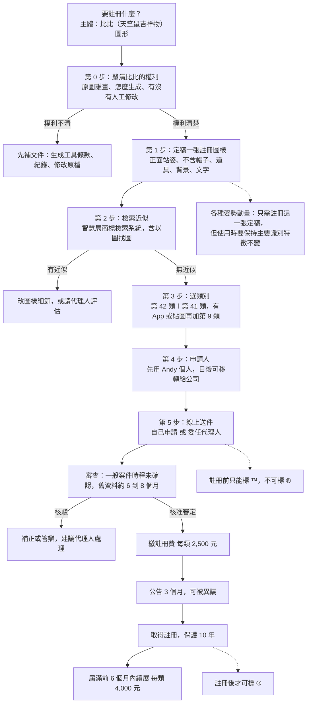
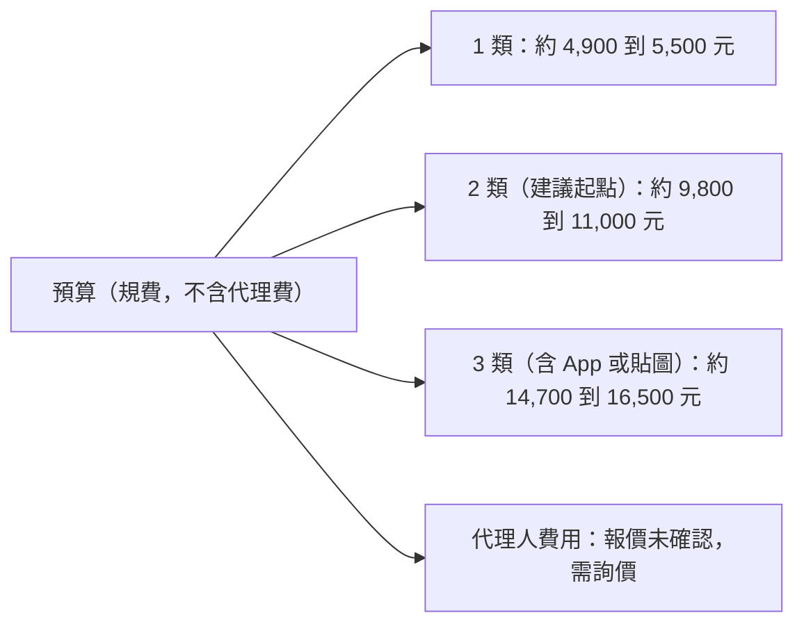

# 比比（白色毛球天竺鼠吉祥物）商標註冊評估

> 查證日期：2026-10-11。性質：風險盤點與待確認清單，**不是法律意見**。
> 查證方式：以 WebSearch 查證，摘要只是線索，點不進原文，每條都標信心度。
> 牽涉「近似是否會被核駁、著作權歸屬、使用與註冊圖樣是否同一」的判斷，一律標為**必須由專業人士確認**。
> 本版（第二版）依 Andy 澄清改以「比比」為註冊主體；第一版是泛用 logo 版，已被取代。

## 一、總覽樹狀圖（先看這張）





## 二、先講我在 repo 找到了什麼（比比的現況盤點）

| 項目 | 位置 | 看到的事實 | 對商標的意義 |
|---|---|---|---|
| 現行 logo（藍底格線＋比比＋筆電＋書＋K 線＋箭頭＋「哩股哩股」） | `site/brand/logo-512.png`、原稿 `site/brand/src/logo_1009.jpg`（1254×1254） | 2026-10-07 品牌改名「哩股哩股」；10-10、10-11 又做過滿版修圖（背景延伸、抹接縫、重畫格線） | 這張是「比比＋很多元素」的組合圖，不適合直接當商標圖樣（見第三節） |
| 比比官方部件總表 | `site/brand/src/bibi_parts_sheet_1011.webp`（1254×1254） | 含正面頭像、身體／耳／腳分件、表情、道具、姿勢列；commit 訊息記為「Andy 給的比比官方部件總表（四肢短短），退件長手揮手圖存參考」 | **這張是最適合挑定稿的來源**：左上第一格的正面站姿比比 |
| 動畫素材 | `docs/anim/bibi_*`（67 組）、`scripts/anim/*`、`site/brand/bibi/` | 以原圖像素分層變形、補間、去背輸出；`docs/anim/README.md` 寫「原檔是 Andy 給的 GIF／圖／影片，永遠保留」 | 動畫是由原圖衍生，比比外觀鎖定規格寫在 `docs/anim/prompt_kit/01_總控Prompt.md` |
| 外觀鎖定規格 | 同上，第二節 | 奶油白毛茸茸圓潤、深棕黑柔和描邊、粉橘耳與小腳掌、桃粉腮紅、黑點眼、小嘴 | 這幾項就是「主要識別特徵」，用來回答第六節的動畫問題 |
| 原圖怎麼產生 | **repo 內沒有記錄** | 只知道是 Andy 提供；`docs/anim/README.md` 提到環境接了 Adobe Firefly、Canva、Figma 可生圖；圖風看起來像生成式 AI 作品，但**我無法從圖判斷，未確認** | 著作權歸屬的關鍵缺口，見第四節 |

## 三、結論先行

| 問題 | 結論 | 信心度 | 要找專業人士確認？ |
|---|---|---|---|
| 該不該註冊 | **該。比比是對外識別（網站、客服鈕、宣傳影片、貼文頭像），已經在使用，越早註冊越能擋搶註** | 中（商業判斷） | 否 |
| 註冊哪一個圖樣 | **比比純圖形：從官方部件總表挑一張正面站姿定稿**，不含帽子、道具、藍底、文字 | 中 | 是（近似與識別性） |
| 站名「哩股哩股」要不要一起 | 另列為第二件、預算允許再做；是否具識別性（「股」字有描述性疑慮、疊字是否算自創）**未確認** | 低 | 是 |
| 類別 | 第 42 類＋第 41 類為起點；上 App 加第 9 類；**不建議第 36 類** | 低到中 | 是 |
| 預算 | 2 類約 9,800 到 11,000 元規費，代理費另計未確認 | 中 | 否，送件前再看官網 |
| 做法 | 先自己用免費檢索系統查近似，再委任代理人送件 | 中 | 是 |

**規費（每類）與來源**：申請費 3,000 元；電子申請每件減 300 元，若全部指定名稱與系統參考名稱相同每類再減 300 元；核准後註冊費 2,500 元；續展 4,000 元（屆滿後 6 個月內申請加倍為 8,000 元）。每類合計 4,900（2,400＋2,500）到 5,500（3,000＋2,500）。
- 第一來源（官方）：[智慧財產局 商標規費清單（113 年 5 月 1 日起生效）](https://www.tipo.gov.tw/tw/trademarks/589.html)，我只看到搜尋摘要。
- 第二來源：[全國法規資料庫 商標規費收費標準](https://law.moj.gov.tw/Hot/AddHotLaw.ashx?PCode=J0070005)、[理律電子報](https://www.leeandli.com/TW/Newsletters/4470.htm)、[延展註冊費用](https://www.tipo.gov.tw/tw/trademarks/607-8503.html)。
- 搜尋沒有顯示 2025 年後再修正，但**未確認目前仍是此版**，送件當天再查官網。加速審查每類加收 6,000 元，不建議。

## 四、四個問題的回答

### 4.1 圖樣怎麼選：比比圖形單獨，還是圖形加文字

| 選項 | 內容 | 優點 | 缺點 | 建議 |
|---|---|---|---|---|
| A 比比純圖形（正面站姿定稿） | 只有比比，無文字、道具、背景 | 日後換站名、字體、版面都不影響；貼在客服鈕、影片、貼圖、App 圖示都能用；別人仿冒比比造型時最直接 | 站名沒被保護；吉祥物造型簡單，近似風險要靠檢索確認 | **主申請，先做這個** |
| B 比比＋「哩股哩股」組合（即現行 logo） | 含筆電、書、K 線、箭頭、藍底格線 | 一次涵蓋現行整張圖 | 元素多且還在改（10-10、10-11 剛改過滿版背景），改版後可能與註冊圖樣對不上；保護範圍通常只及整體圖樣，不及個別部分 | **不建議當第一件** |
| C 文字商標「哩股哩股」 | 純文字 | 保護站名本身 | 識別性未確認（見第五節） | 第二件，預算允許再做，先請代理人看過 |
| D 文字商標「比比」 | 純文字 | 角色名稱 | 「比比」是常見詞，識別性與近似風險都高，**未查證** | 暫不建議 |

理由來源：理律文章指出組合商標的權利通常只涵蓋整體圖樣，分開申請保護較完整但成本較高（[理律電子報 5620](https://www.leeandli.com/TW/Newsletters/5620.htm)）。信心度：中。

**定稿圖樣的建議規格（給 art-director 或 Andy）**：
- 取官方部件總表左上第一格（正面站姿、張嘴微笑、粉腮紅、粉橘耳與腳）。
- 去掉影子、帽子、道具、背景；背景用純白或透明，輪廓（深棕描邊）完整。比比身體是奶油白，貼在白底上要確認描邊清楚不會看起來缺一塊。
- 解析度夠高（原表為 1254×1254，單格較小，可能要請原作者提供更大原檔，**未確認**）。
- 彩色或黑白：比比的辨識特徵包含粉腮紅與粉橘耳，以彩色送件保護範圍會偏向「這個配色」；黑白送件理論上不限色但辨識度較弱。搜尋沒有查到台灣審查基準對此的專門說明，**未確認，請代理人建議**。

### 4.2 比比若由 AI 生成或外包，著作權與申請人要先確認什麼

商標權與著作權是兩回事：註冊商標不會讓你取得這張圖的著作權。智慧財產法院見解認為商標圖樣中的圖形可受著作權法保護（[理律電子報 5620](https://www.leeandli.com/TW/Newsletters/5620.htm)）。

| 情況 | 著作權歸誰 | 要先備齊的文件 | 信心度 |
|---|---|---|---|
| Andy 自己手繪 | Andy | 原始檔、草稿、創作時間紀錄 | 中 |
| 外包給設計師 | 著作權法第 12 條：出資聘人完成者，原則上受聘人為著作人，財產權依契約，**沒約定歸受聘人**，出資人只有利用權（[參考](https://www.legis-pedia.com/article/Intellectual-property-rights/1367)） | 著作財產權讓與契約（全部讓與、不行使人格權、可商標註冊使用、含衍生與動畫改作）、設計師簽章、原始分層檔 | 中高，契約文字**必須由專業人士確認** |
| AI 生成（智慧局 2023 年表示：單純由 AI 生成的圖像原則上不受著作權法保護，若人類將 AI 當輔助工具並有實際思想投入則可主張保護，見[科技新報](https://technews.tw/2023/07/17/generative-ai-pics-law-infringement/)、[中央社](https://www.cna.com.tw/news/afe/202307160024.aspx)） | 看人類投入程度；全由提示詞產出者可能**無著作權** | ①工具名稱、版本、生成日期 ②該工具服務條款（商用、商標註冊、輸出歸屬）③提示詞與全部生成紀錄 ④人工修改的分層原檔與痕跡 ⑤是否用過他人角色或畫風當參考圖 | 中低，**必須由專業人士確認** |

**針對比比目前的現況，要 Andy 回答的問題**（repo 沒有答案）：
1. 比比原圖（`logo_1009.jpg`、部件總表）是怎麼來的：自己畫、請人畫、還是用哪個 AI 工具生成？
2. 若是 AI：用的是哪個工具、哪個帳號、哪一天？有沒有保留提示詞與生成紀錄？
3. 之後的分件、補畫、修圖（例如 10-10 修過四肢、10-11 修過滿版背景）是誰做的？Claude 協助製作的衍生動畫素材，其著作權也落在「AI 輔助」這個灰色地帶，同樣**必須由專業人士確認**。
4. 是否參考過任何現有角色或素材包（避免撞他人著作或商標）。

**對商標申請的影響**：就算比比的著作權不明或不受保護，**仍可能申請商標**（商標看識別性與近似，不看創作性）。但此點我沒有查到智慧局明文，**未確認**。真正的風險有兩個：①別人複製比比時，Andy 難以主張著作權（只剩商標與不正競爭可用）；②若 AI 輸出與他人既有商標或角色近似，註冊後仍可能被異議或評定。日本萬代 2025 年表示已有 AI 生成圖與其企業標誌近似造成混淆（[Inside](https://www.inside.com.tw/article/39647-bandai-google-gemini)），可見近似風險是真實存在的。

**申請人**：若比比權利人就是 Andy（自己創作，或已取得讓與），以 Andy 個人名義最簡單；若原圖權利在設計師或 AI 工具商手上，要先取得授權或讓與，再決定申請人。日後成立公司時，商標移轉要簽移轉文件，雙方代表人為同一人時要注意簽署人身分（智慧局有「申請權移轉同意書」範本，移轉費用**未確認**）。

### 4.3 各種姿勢的動畫版本，是否只需註冊一個定稿圖樣

**結論：是，註冊一張定稿圖樣即可，不必每個姿勢各註冊；但使用時必須維持主要識別特徵，且最好常以接近註冊圖樣的樣子出現。**

依據：台灣實務判斷實際使用與註冊圖樣是否同一，是先找出註冊商標的「主要識別特徵」，再看實際使用是否改變這些特徵，依一般消費者認知個案認定（引自最高行政法院 110 年度上字第 51 號判決意旨，經[理律電子報](https://www.leeandli.com/TW/Newsletters/7619.htm)摘要）。商標法第 63 條第 1 項第 1 款有「自行變換商標或加附記」廢止事由，第 2 款有連續 3 年未使用廢止。我查到一件智慧財產法院 2025 年 12 月的輪胎商標判決，認為實際使用圖樣與註冊圖樣差異顯著而喪失同一性（我只看到節錄，審級結果**未確認**）。搜尋**沒有找到**針對「吉祥物換姿勢」的案例，以下是依框架的推論，信心度低，**必須由專業人士確認**。

| 做法 | 建議 |
|---|---|
| 主要識別特徵（建議寫進內部規範）：奶油白毛球輪廓與毛邊、深棕描邊、粉橘耳朵、桃粉腮紅、黑點眼、小嘴 | 動畫、貼圖、表情只改姿勢與表情，不改這些，與 `docs/anim/prompt_kit/01_總控Prompt.md` 的鎖定規格一致 |
| 官方部件總表有退件的「長手揮手圖」 | 與註冊圖樣差異最大的版本，不要拿來當對外正式識別 |
| 對外正式標示（頁首、App 圖示、客服鈕靜止態、社群頭像） | 用註冊圖樣原樣，不要用動作中的姿勢 |
| 動態商標（把動畫本身申請） | **不建議**：智慧局動態商標申請要逐格描述圖像變化並檢送 AVI 或 MPEG 檔（[智慧財產局表單說明](https://www.tipo.gov.tw/wSite/public/Attachment/0/f1745911876452.pdf)，摘要層級），比比有 67 組動作，無法一一列舉 |
| 不同造型（戴帽子、拿筆電、披毯子） | 這些是比比加道具，主體仍是同一張臉與身體；若想保護「戴星星帽的比比」是獨立識別，才另案，目前不需要 |

### 4.4 指定類別建議（比比圖形）

| 類別 | 對應比比的什麼用途 | 建議 | 信心度 |
|---|---|---|---|
| 第 42 類 | 以非下載方式提供的網站與軟體服務（儀表板網站本體） | **建議（核心）** | 中（SaaS 屬第 42 類，來源為國外商標事務所文章，台灣名稱未對） |
| 第 41 類 | 線上電子出版品、提供線上動畫與娛樂內容、財經資訊內容（不含投資建議） | **建議** | 低到中 |
| 第 9 類 | 可下載 App、可下載貼圖與動畫圖像檔 | **有上架 App 或貼圖時再加**（`docs/anim/sticker16` 已有貼圖企劃，是否對外發行**未確認**） | 中 |
| 第 36 類 | 投資顧問、金融諮詢 | **不建議**：本站「今日候選」「進場時機」已落在證券投資顧問定義附近（證券投資信託及顧問法第 4 條、第 107 條，見 `docs/product_strategy.md`），商標申請書寫「投資顧問」等於自己貼標籤，**必須由專業人士確認** | 中 |
| 第 16、25、28 類等周邊 | 貼紙文具、服飾、玩偶 | **目前不做**：沒有賣周邊，指定了又不使用，有被他人提出廢止的風險（連續 3 年未使用） | 中 |

最小必要組合：**第 42 類＋第 41 類**。指定服務名稱請在電子申請系統內挑「參考名稱」，可多減 300 元規費，也比較不會被要求修正。分類用語我只查到國外資料，**未對到智慧局用語**。

## 五、被核駁的風險

| 風險 | 說明 | 對比比的影響 | 處理 |
|---|---|---|---|
| 近似他人商標 | 圖樣、觀念與已註冊商標相同或近似，且指定服務類似 | 白色圓潤毛球加小耳朵的吉祥物造型很普遍，**撞圖風險不低** | 先用智慧局商標檢索系統查；智慧局 2024 年推出 AI 以圖找圖檢索（[科技新報](https://technews.tw/2024/03/26/new-trademark-search-system-ai-finds-images-based-on-images/)），可上傳比比定稿圖直接比對；結果**必須由專業人士確認** |
| 描述性（缺乏識別性） | 商標法第 29 條第 1 項：直接描述服務特性者不得註冊，有使用事實可例外（第 1、3 款）（[理律電子報 6534](https://www.leeandli.com/TW/Newsletters/6534.htm)） | 比比圖形是卡通角色，一般不屬描述性，風險低；站名「哩股哩股」的「股」與股票相關，是否被認為描述性**未確認** | 圖形先申請；文字另案評估 |
| 通用名稱 | 同條第 2 款，不能靠使用取得例外 | 不涉及比比圖形 | 不要把「台股」「輪動」當主體 |
| 顏色限定 | 搜尋未查到台灣專門說明 | **未確認** | 請代理人建議彩色或黑白 |
| 易使公眾誤認 | 第 30 條第 1 項第 8 款 | 圖樣不要加「證券」「投顧」「官方」字樣或金融機構象徵 | 定稿圖樣只放比比本體 |

## 六、註冊前的暫時保護

| 符號 | 意義 | 註冊前可用？ | 說明 |
|---|---|---|---|
| ™ | 主張為商標，不代表已註冊 | 可以 | 台灣法律對標示方式無明文規範（[理律電子報 4784](https://www.leeandli.com/TW/Newsletters/4784.htm)） |
| ® | 已註冊 | **不可以** | 公平交易委員會曾認定：申請中，甚至已審定但未確定取得專用權時加註 ®，構成虛偽不實及引人錯誤，違反公平交易法第 21 條第 1 項（同上）。信心度中，**必須由專業人士確認** |

做法：現在起在網站頁尾、App 說明、貼文簡介用「比比圖形＋™」，取得註冊證後才改 ®。同時保存「最早使用日」證據（網站上線 commit 紀錄、宣傳影片發布日、社群首發貼文截圖）。可直接貼上的標示草稿：

```
比比及其圖形標誌為本站所有之商標（™）。未經書面同意，請勿用於商業用途。
```

## 七、海外與馬德里

| 項目 | 判斷 | 何時做 | 信心度 |
|---|---|---|---|
| App Store、Google Play 上架 | 兩商店對商標證明的要求本次**沒查到**，未確認 | 要上架前再查，並請 security-privacy、payments-billing 對照 | 低 |
| 馬德里國際註冊 | WIPO 規定申請人須是成員國國民或在成員境內有住所或營業所，並有本地基礎註冊；台灣申請人能否直接走此途徑**搜尋沒有明確結果**（[WIPO 常見問題](https://www.wipo.int/zh/web/madrid-system/faq)） | 目前**不需要**；有明確海外用戶或上架美區後再評估 | 低，**必須由專業人士確認** |
| 優先權 | 台灣送件後一般有一段期間可主張優先權向他國申請，期限**未確認** | 台灣送件後半年內決定 | 低 |

結論：現階段只做台灣。

## 八、行動清單（Andy 照著打勾）

| 編號 | 項目 | 誰做 | 花多久 | 花多少 | 狀態 |
|---|---|---|---|---|---|
| 1 | 回答第 4.2 節四個問題：比比原圖怎麼來的（自畫／外包／哪個 AI 工具） | Andy | 30 分鐘 | 0 | ⬜待辦 |
| 2 | 蒐集權利文件：外包契約，或 AI 工具條款截圖、提示詞與生成紀錄、人工修改原檔 | Andy | 1 到 3 天 | 契約審閱費未確認 | ⬜待辦 |
| 3 | 請 art-director 提供比比定稿大圖（正面站姿、去影子帽子道具背景、高解析） | 由 CEO 轉派 | 1 天 | 0 | ⬜待辦 |
| 4 | 用智慧局商標檢索系統與以圖找圖，查比比定稿的近似商標，截圖留存 | Andy | 2 到 4 小時 | 0 | ⬜待辦 |
| 5 | 訂出「主要識別特徵」內部規範，並讓動畫與貼圖遵守 | art-director／animation-director | 1 小時 | 0 | ⬜待辦 |
| 6 | 決定類別：第 42 類＋第 41 類（有 App 或貼圖再加第 9 類） | Andy＋代理人 | 1 小時 | 0 | ⬜待辦 |
| 7 | 詢價 2 到 3 家商標代理人（代理費、核駁答辯費、移轉費） | Andy | 2 小時 | 0 | ⬜待辦 |
| 8 | 決定申請人：Andy 個人先送、日後移轉；或等公司成立 | Andy | 30 分鐘 | 0 | ⬜待辦 |
| 9 | 網站與社群先標「比比圖形＋™」，保存最早使用證據 | frontend-ui | 1 小時 | 0 | ⬜待辦 |
| 10 | 送件（線上申請） | 代理人（建議） | 1 到 2 小時 | 2 類規費約 9,800 到 11,000 元＋代理費 | ⬜待辦 |
| 11 | 處理核駁、補正、答辯 | 代理人 | 不定 | 答辯費未確認 | ⬜待辦 |
| 12 | 核准審定後繳註冊費 | Andy 或代理人 | 30 分鐘 | 已含在第 10 項預算 | ⬜待辦 |
| 13 | 公告期滿取得註冊證，改標 ® | Andy | 30 分鐘 | 0 | ⬜待辦 |
| 14 | 行事曆提醒：第 9 年 6 個月起準備續展；每年確認註冊類別都有真實使用 | Andy | 5 分鐘 | 日後每類 4,000 | ⬜待辦 |
| 15 | 另案評估站名「哩股哩股」文字商標 | 代理人 | 1 小時 | 每類約 4,900 到 5,500 元 | ⬜待辦 |
| 16 | 上架 App 或發行貼圖前，再評估第 9 類與海外 | Andy＋代理人 | 1 小時 | 視情況 | ⬜待辦 |

## 九、查不到或未確認（明講）

- 比比原圖的產生方式（自畫、外包、AI）：repo 無記錄，圖風判斷不算證據，**必須問 Andy**。
- 一般案件目前的平均審查月數：只查到舊資料約 6 到 8 個月與加速審查資料。
- 代理人費用行情：搜尋到報價平台但未讀取內容。
- 智慧局接受的第 41、42、9 類標準用語：只查到國外分類資料。
- 彩色與黑白的審查差異、顏色限定核駁的台灣說明：未查到。
- 「吉祥物換姿勢」是否仍具同一性：沒有直接案例，只有判斷框架。
- 站名「哩股哩股」與「比比」文字的識別性、是否已有人註冊：**未檢索**。
- App Store、Google Play 對商標的要求；台灣是否可直接走馬德里：未查到。
- AI 生成圖能否作為台灣商標圖樣：未找到智慧局明文，只找到著作權面的見解。
- 個人申請所需的認證方式、商標移轉費用：未查到。
- 本文件撰寫時未向 art-director、animation-director、frontend-ui、payments-billing、security-privacy 索取資料，相關欄位標為待辦。
- 所有規費以智慧財產局送件當日公告為準。

## 十、資料來源

- [智慧財產局 商標規費清單（113 年 5 月 1 日起生效）](https://www.tipo.gov.tw/tw/trademarks/589.html)
- [全國法規資料庫 商標規費收費標準](https://law.moj.gov.tw/Hot/AddHotLaw.ashx?PCode=J0070005)
- [智慧財產局 延展註冊的費用](https://www.tipo.gov.tw/tw/trademarks/607-8503.html)
- [智慧財產局 動態商標申請書說明](https://www.tipo.gov.tw/wSite/public/Attachment/0/f1745911876452.pdf)
- [理律電子報 4470（規費）](https://www.leeandli.com/TW/Newsletters/4470.htm)
- [理律電子報 4784（® 標示與公平交易法）](https://www.leeandli.com/TW/Newsletters/4784.htm)
- [理律電子報 5620（圖形與文字的保護）](https://www.leeandli.com/TW/Newsletters/5620.htm)
- [理律電子報 6534（商標法第 29 條）](https://www.leeandli.com/TW/Newsletters/6534.htm)
- [理律電子報 7619（使用同一性與廢止）](https://www.leeandli.com/TW/Newsletters/7619.htm)
- [Legis-Pedia 商標流程整理](https://www.legis-pedia.com/article/Intellectual-property-rights/819)
- [Legis-Pedia 著作權法第 12 條整理](https://www.legis-pedia.com/article/Intellectual-property-rights/1367)
- [科技新報 智慧局談生成式 AI 著作權（2023）](https://technews.tw/2023/07/17/generative-ai-pics-law-infringement/)
- [科技新報 智慧局 AI 以圖找圖商標檢索（2024）](https://technews.tw/2024/03/26/new-trademark-search-system-ai-finds-images-based-on-images/)
- [Inside 萬代與 AI 生成圖近似商標](https://www.inside.com.tw/article/39647-bandai-google-gemini)
- [WIPO 馬德里常見問題](https://www.wipo.int/zh/web/madrid-system/faq)
