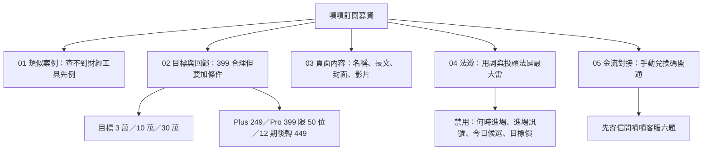

# 嘖嘖訂閱募資：總結（先看這份）

> 2026-10-17 整合。細節在 01～05 檔。所有查證只有搜尋摘要，嘖嘖合作條款原文沒讀到，數字信心多為中低。

## 結論

| 問題 | 結論 | 信心 |
|---|---|---|
| 399 合理嗎 | 合理但要加條件：限前 50 位、連續訂閱 12 期、第 13 期起轉 449；Plus 同步給 249，否則 Pro 399 會吃掉 Plus 299 | 中 |
| 目標金額 | 保守 30,000／建議 100,000／挑戰 300,000（人數×加權月價約 317×3 期）。損益兩平：只算現金成本約 25 人 | 中 |
| 以前有人做過嗎 | 嘖嘖、flyingV 查不到看盤或財經訂閱先例，是少人走的路；最近的是理財小物「WOOD 小金庫」（目標 10 萬、募得約 276 萬） | 中 |
| 費用 | 嘖嘖成功才收，約 8%（平台 5.5% 加金流 2.5%）；訂閱款次月 15 日撥付 | 中 |
| 最大風險 | 文案用詞踩證券投顧法；付款開通要手動；訂閱達標金額怎麼認列查不到 | 中 |

## 回饋四檔（名稱 12 字內）
支持比比 99／Plus 輪動進階 249／Pro 研究全開 399（限前 50 位）／Pro 長期同行 349（承諾 12 期）

## 第一步（依序）
1. 先把正式站 Plus 299／Pro 549 設定生效（正式 Worker 價格 10-09 仍是 0，未重新核對）。
2. 寄信問嘖嘖客服六題（個人能否提訂閱專案、名單匯出、API、扣款失敗、退款通知、結案後既有扣款）與訂閱達標金額怎麼算。
3. 約律師 30 到 60 分鐘，確認付費功能清單與免責聲明（含「非持牌」句）。
4. 補 03 檔第八節的 10 項資料，再做封面與影片。
