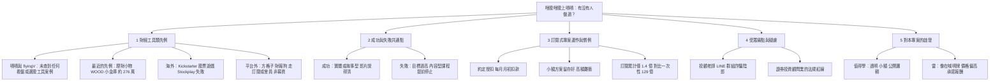

# 嘖嘖募資：同類產品先例研究（01 可比案例）

> 研究日期：2026-10-17（台北）。工具限制：只能用 WebSearch，點不進原文，摘要是線索不是事實。
> 全文原則：查不到就寫「未查到」，不編造數字。第二來源對不上的，一律標低信心。

---

## 0. 先講結論（五行）

1. **在嘖嘖與 flyingV 上，沒有查到任何「看盤軟體、選股工具、財經資訊訂閱」的先例**；查到的只有理財小物（存錢筒）與一般訂閱專案。這代表兩件事：沒有可借鏡的數字，也代表是少人走過的路，風險與機會都沒有基準可比。
2. 嘖嘖的訂閱式專案體量小：截至 2024 年 5 月，訂閱式累計贊助約 1.4 億元，一次性贊助約 129 億元（約 1%）。目標與預期要保守。
3. 唯一查到的訂閱經營經驗談指出：高額方案很難衝高，後來改 70 元小額方案，退訂率低於 1%。這與 `docs/product_strategy.md` 的判斷一致（超過 399 沒有品牌背書撐不住）。
4. 台灣散戶對「收費的投資建議」有強烈不信任（LINE 群組、投顧老師、暗樁），且金管會把「收費提供投資意見」視為證券投資顧問業，這是本專案文案最大的雷。
5. 「399 元／月」目前找不到任何同類價格基準；方格子個別作者 30～99 元／月、平台方案 149 元／月，可當低端參照。

---

## 1. 案例清單

### 1-1 嘖嘖與台灣群募平台：財經、投資、看盤、教育、訂閱類

| 專案名 | 平台 | 目標金額 | 實際募得 | 贊助人數 | 回饋價位 | 是否成功 | 網址 | 信心度 |
|---|---|---|---|---|---|---|---|---|
| 看盤軟體、選股工具類 | 嘖嘖、flyingV | 未查到 | 未查到 | 未查到 | 未查到 | 未查到任何案例 | 以多組關鍵字（嘖嘖、flyingV、看盤、選股、籌碼、App）搜尋，無任何對應專案 | 中（搜尋引擎覆蓋有限，不等於絕對沒有） |
| WOOD 小金庫（智慧存錢筒，理財小物，非投資工具） | 嘖嘖 | 100,000 | 約 2,763,159 | 未查到 | 未查到 | 成功（2020-07-10 結束） | https://www.zeczec.com/projects/WOOD | 中（單一來源，頁面摘要） |
| 樹吉（招財概念植栽，非投資工具） | 嘖嘖 | 168,000 | 達成率 86% | 未查到 | 未查到 | 失敗（2020-10-16 結束） | https://www.zeczec.com/projects/moneytree | 中（單一來源） |
| 某 ACG 創作者訂閱課程（教育類訂閱式專案） | 嘖嘖 | 未查到 | 累計約 1,207,581 | 568（不重複） | 未查到 | 頁面標示提前停止 | 見 https://www.zeczec.com/categories?type=3 搜尋摘要（專案名稱摘要未載明） | 低（摘要未載明專案名，單一來源） |
| 「每月來點政能量」（政治知識品牌，小額月訂閱） | 嘖嘖 | 未查到 | 未查到 | 未查到 | 未查到 | 運作中（以小額月支持） | https://www.zeczec.com/projects/support-taiwan | 低（只確認存在與形式） |
| 投資教育、財經 Podcast、財經書類 | 嘖嘖、flyingV | 未查到 | 未查到 | 未查到 | 未查到 | 未查到任何案例 | 搜尋「投資理財 課程 書 桌遊 嘖嘖」無對應 | 中 |
| 「學到」線上課程平台（含投資類課程，非專攻財經） | flyingV | 未查到 | 未查到 | 未查到 | 未查到 | 未查到（摘要稱專案已下架） | https://www.flyingv.cc/projects/23407 | 低 |

**說明**：2017 年台灣經濟研究院資料稱嘖嘖促成 170 件、逾 2 億元，flyingV 218 件、約 1 億元；2020 年 Mixxin 報告稱兩大平台合計約 23.8 億元、97.5 萬贊助人、1,730 件提案，破千萬的 65 件專案幾乎都是高單價家電與 3C。**台灣群募的主流是實體硬體與設計品，軟體或資訊服務類極少。**（來源：https://www.inside.com.tw/article/22930-2020-crowd-funding-report 、https://findit.org.tw/upload/research/research_20180122024.pdf；信心度：中）

### 1-2 平台外參照：財經內容與工具的訂閱型商業模式（非募資，但是定價與受眾的最近基準）

| 產品 | 型態 | 價位／規模 | 與本專案的關係 | 網址 | 信心度 |
|---|---|---|---|---|---|
| 方格子 vocus 平台方案 Premium | 平台訂閱 | 149 元／月（2020 年推出） | 內容訂閱的月費參照 | https://www.inside.com.tw/article/22256-Vocus-2020-report | 中 |
| 方格子個別財經作者 | 作者訂閱 | 30 元／月、60 元／月、99 元／月（年繳 990）等不一 | 個人財經內容多在 30～99 元 | https://vocus.cc/article/683b16f6fd897800014dca86 等 | 低（價格為個別作者、年份不一） |
| 財報狗 | 網站會員 | 會員數逾 27 萬（公司自稱） | 台灣財經數據工具的規模參照 | https://www.yourator.co/companies/Statementdog | 低（單一來源、公司自述） |
| 今周刊 App（台灣大電信方案） | 媒體訂閱 | 新戶首 3 月免費，另有加價存股電子報 | 電信綁約低價拉新 | https://www.businesstoday.com.tw/article/category/183012/post/202510270046 | 中 |
| 內部文件：XQ 籌碼模組 | 軟體模組 | 約 500 元／月（本專案文件引用） | 本專案自己的價格競品基準 | `docs/product_strategy.md` | 中（內部文件，外部未重驗） |

### 1-3 國外：Kickstarter、Patreon 類

| 案例 | 平台 | 結果 | 網址 | 信心度 |
|---|---|---|---|---|
| Stockplay（股票遊戲，線上版） | Kickstarter | 失敗，發起人自行中止（年份摘要未載明） | https://www.kicktraq.com/projects/stockplay/stockplay-online-version/ | 低（單一來源） |
| 股票投資工具類 | Kickstarter | 搜尋未見成功先例 | 見上 | 低 |
| Patreon 平台抽成與規模 | Patreon | 抽成 5% 加手續費；平台約 20 萬創作者、700 萬贊助者（公司自稱） | https://www.cnbc.com/id/106873396 | 中 |
| 台灣股市創作者在 Patreon | Patreon | 未查到案例 | — | — |

**結論**：財經投資工具類先例在嘖嘖、flyingV、Kickstarter 皆查不到成功案例，海外唯一查到的是失敗。**這是少人走的路，不是一條有數字可抄的路。**

---

## 2. 成功與失敗案例的共通點

資料太少，不足以做統計，以下標為「推論」，信心度一律中低。

| 面向 | 成功案例的樣子（嘖嘖整體、實體與訂閱） | 失敗案例的樣子 | 信心度 | 依據 |
|---|---|---|---|---|
| 標題 | 一句話說得出「拿到什麼」 | 概念抽象、看不出回饋 | 低（推論） | 一般群募建議與 WOOD 與樹吉對比 |
| 封面 | 單一主體、一眼看懂 | 資訊雜亂 | 低（推論） | 同上，無個案數據 |
| 影片 | 常見建議 2～3 分鐘，說明問題、示範、承諾 | 沒有影片或太長 | 中 | https://pledgebox.com/post/7-actions-to-build-your-community-before-your-kickstarter-campaign 、評論稱適合群募的商品「多半能靠影片說明」https://www.businesstoday.com.tw/article/category/154686/post/201805140034/ |
| 回饋設計 | 低門檻入口＋明確分層 | 只有高額方案，沒有小額入口 | 中 | 訂閱經驗談：高額方案衝不高，改 70 元小額方案 https://medium.com/@shasha_72362/ |
| 早鳥 | 前期集中達標，提高信心 | 上線後才開始拉人 | 低（二手引述） | 「首週達 30% 以上較易成功」為 Fundable 二手引述，未驗證 |
| 社群預熱 | 預先收集名單，上線當天就有人下單 | 上線才第一次對外講 | 中 | Kickstarter 官方建議先找約 10 位可信任支持者追蹤預熱頁 https://help.kickstarter.com/hc/en-us/articles/115005134914 |
| 透明度 | 說清楚做什麼、怎麼交付、風險 | 承諾含糊 | 低（推論） | 嘖嘖新機制「好評提案人」按履約表現減手續費 https://www.inside.com.tw/article/23232-zeczec-10-years-new-milestone |
| 目標金額 | 保守，容易達標 | 過高，提前停止 | 中 | 同一組二手來源均強調目標務實 |

**需要注意的反例**：Mixxin 資料顯示破千萬的專案幾乎全是高單價家電與 3C，可見嘖嘖最會賣的是「摸得到的東西」。**哩股哩股賣的是每天更新的資訊服務，天生不在嘖嘖的強項區。**

---

## 3. 嘖嘖「訂閱式專案」運作與成功案例

| 項目 | 查到的內容 | 信心度 | 來源 |
|---|---|---|---|
| 扣款方式 | 多數訂閱透過「約定授扣」，贊助人同意後每月月初扣款 | 低（單一來源，常見問答頁摘要，標示頁面距今已久） | https://www.zeczec.com/faq |
| 撥款時點 | 訂閱專案款項於次月 15 日撥付（同上，費率與時點可能已變動） | 低 | https://www.zeczec.com/faq |
| 抽成 | 全有或全無制；平台費 5.5% 加金流費 2.5% 共 8%；好評提案人最多可減 2.5 個百分點 | 中（兩來源：第三方比較文與 Inside 報導） | https://uptogo.com.tw/ 、https://www.inside.com.tw/article/23232-zeczec-10-years-new-milestone |
| 規模 | 截至 2024-05，訂閱式累計逾 1.4 億元；一次性逾 129 億元 | 中（政府創新獎報告摘要，單一來源） | https://service.moea.gov.tw/EE514/en/rocpia2/586-7814.html |
| 平台整體 | 2023-08 累計破 100 億；2026-05 破 200 億；2025 年度集資 35 億 | 中（多則新聞一致） | https://www.techbang.com/posts/108874 、https://newtalk.tw/news/view/2026-02-24/1021169 、https://www.bnext.com.tw/article/91104 |
| 月費分布 | 列表上從數十元到數萬元不等，高額是少數 | 低（頁面快照） | https://www.zeczec.com/categories?type=3 |
| 平均贊助額 | 未查到官方統計 | — | — |
| 目標設定慣例 | 未查到訂閱式專案的官方慣例；一般建議保守設定 | — | — |
| 訂閱經營實例 | 第一年每月穩定增加，約達每月 18 萬；高額方案難衝，改每月 70 元，退訂率低於 1% | 低（個人經驗談，單一來源） | https://medium.com/@shasha_72362/ |
| 留存率基準（一般訂閱產品，非嘖嘖） | 月訂閱一年後留存中位數約 11%；年訂閱約 28%；月訂取消後回訂約 20% | 中（RevenueCat 及轉述） | https://www.revenuecat.com/blog/growth/one-year-retention-rates-insights.md |

**已知空白（需 Andy 或後續用嘖嘖官方提案者後台確認）**：訂閱專案的目標金額定義（是月金額還是累計）、贊助人取消與失敗扣款的處理、財經類是否有審核限制。本次 WebSearch 查不到，不編造。

---

## 4. 受眾痛點與留言關鍵字

此項目未能取得嘖嘖或 PTT 的實際留言，只能整理新聞與評論裡的語彙，**標為低到中信心，建議後續請 Andy 提供社群實際留言補強。**

| 痛點／疑慮 | 常見語彙（來自新聞與評論，非實際留言） | 對產品的意義 | 信心度 | 來源 |
|---|---|---|---|---|
| 怕被當韭菜 | 「割韭菜」「收割」「暗樁」「老師仍勸攤平」 | 任何收費的投資內容都先被懷疑 | 中 | https://newtalk.tw/news/view/2021-11-09/663901 、https://tw.stock.yahoo.com/news/ |
| LINE 群組飆股 | 「飆股簡訊」「解盤群組」「付費激活帳號」 | 避免任何群組、明牌、喊單的視覺與用詞 | 中 | https://newtalk.tw/news/view/2021-11-09/663901 |
| 法規紅線 | 收費提供投資意見，可能屬證券投資顧問業；未經核准最高 5 年有期徒刑 | 文案不得出現「買賣建議」「目標價」 | 中（金管會說法經媒體轉述） | https://technews.tw/?p=769573 、https://ec.ltn.com.tw/article/breakingnews/5101291 |
| 財經老師形象 | 「名氣來自出版」「內容可信度」 | 沒有名人背書時，要靠方法透明 | 低（單篇評論） | https://www.thenewslens.com/article/120640 |
| 月費敏感 | 約三分之一的人六個月內回訂已取消服務，對價格敏感 | 月費越高越難留存 | 中 | https://www.bnext.com.tw/article/79638 |
| 免費工具很多 | 資料型網站（如 Goodinfo、Yahoo 股市、財報狗）都有免費版 | 付費要回答「比免費多什麼」 | 中 | 搜尋結果中的一般股市網站推薦文 |

**建議後續補強**：請另派人搜 PTT Stock 版「訂閱」「付費」關鍵字、Dcard 理財版、股市爆料同學會，抓真實留言語彙；本次 WebSearch 無法讀取討論串內文。

---

## 5. 對 Andy 專案的啟發

### 5-1 值得學

| 做法 | 理由 | 信心度 |
|---|---|---|
| 設一個最低門檻的入口方案（例如體驗型、年繳折扣之外再有月繳小額） | 經驗談：高額方案衝不高，小額退訂率低於 1% | 低到中 |
| 明講「這不是投資建議、不保證報酬」，並公開計算口徑、資料來源、更新時間 | 對抗「割韭菜」心理，也符合法規邊界；本專案本來就有資料來源與口徑文件 | 中 |
| 預熱先收名單，上線當天就有人下單 | Kickstarter 官方建議；嘖嘖也有「追蹤提案」機制（需到官方指南核對） | 中 |
| 目標金額從低設，達標後用延伸目標 | 群募共通建議；訂閱專案目標定義要先向嘖嘖確認 | 中 |
| 影片 2～3 分鐘，先給「問題、示範、承諾」 | 常見建議；本專案已有吉祥物比比與影片素材 | 中 |
| 把差異講清楚：回答「錢往哪個族群跑、貴不貴、何時進、有沒有理由不進」四題，不講買哪一檔 | 與免費資料網站區隔，也避開投顧紅線 | 中（需法務確認） |

### 5-2 雷

| 雷 | 為什麼 | 信心度 |
|---|---|---|
| 399 元／月沒有任何先例可支撐 | 同類價格基準查不到；方格子個別作者 30～99 元，平台 149 元；`docs/product_strategy.md` 自己也警告超過 399 沒有品牌背書撐不住，且會與 XQ 500 元模組硬碰 | 中 |
| 把 Pro 549 打到 399（約 27% 折扣）卻缺乏理由 | 建議用「創始會員」身分與固定終身價格來講，而不是單純折扣；折扣期限與是否可永久，要先定義清楚 | 低（推論） |
| 文案出現「必漲」「明牌」「飆股」「老師」 | 觸發散戶不信任與投顧法風險 | 中 |
| 把嘖嘖當預購平台，期待靠一次性爆量 | 嘖嘖爆量的是實體高單價商品；訂閱專案累計僅約 1% | 中 |
| 承諾每天更新卻沒有備援 | 自動管線若失敗，贊助人會視為履約失敗，影響好評提案人減費與口碑 | 低（推論） |
| 即時報價授權、金流、稅籍、退款條款還沒完成 | 本專案文件（`docs/launch_checklist_1009.md`、`docs/launch_gap_*_1009.md`）已列未完成項目；募資收款後才補會變成履約風險 | 中 |

### 5-3 建議的下一步（交給後續研究）

1. 請 Andy 或後續用瀏覽器實際登入嘖嘖提案後台，確認訂閱專案的目標定義、取消與失敗扣款規則、財經類審核限制（本次工具查不到）。
2. 另派人搜 PTT、Dcard 的真實留言，補第 4 節。
3. 與法務／記帳士確認：收費的「每日族群輪動分析」是否構成證券投資顧問業（`docs/compliance_and_tiers.md` 已有初步分析，但外部先例仍須專業人士確認）。
4. 價格：以「創始會員 399 元／月」對照「正式 Plus 299、Pro 549」是否會讓人覺得 Plus 比 Pro 更划算，需另做定價一致性檢查。

---

## 6. 本次搜尋紀錄（誠實列出查過什麼）

| 編號 | 關鍵字 | 結果 |
|---|---|---|
| 1 | 嘖嘖 財經 投資 看盤 工具 募資 專案 | 無對應專案，只得平台背景 |
| 2 | zeczec 訂閱式專案 如何運作 每月扣款 | 取得 2024 年訂閱累計規模、手續費政策 |
| 3 | flyingV 股票 投資 App 群募 | 無對應專案 |
| 4 | 台股 選股 軟體 群募 嘖嘖 贊助人數 | 全是 CMoney 產品頁，無群募 |
| 5 | 嘖嘖 訂閱制 專案 成功 累計訂閱人數 月費 投資理財 | 取得訂閱經驗談、訂閱課程提前停止案例 |
| 6 | zeczec.com 股票 投資 理財 課程 App 破百萬 | 無對應專案，取得 Timekettle 實體案例（與本題無關） |
| 7 | 財經 內容 群眾募資 投資教育 | 僅得 2017 平台業績，無財經案例 |
| 8 | Kickstarter 股票 投資 工具 | 僅得 Stockplay 失敗 |
| 9 | 嘖嘖 訂閱式專案 取消 扣款 規則 | 無直接結果；後以限定 zeczec.com 網域取得常見問答摘要 |
| 10 | 財報狗 股癌 市場先生 財經M平方 嘖嘖 | 無集資紀錄 |
| 11 | 嘖嘖 訂閱式集資 財經 Podcast | 無對應 |
| 12 | 方格子 付費訂閱 財經 | 取得月費參照 |
| 13 | Patreon 台灣 投資 股票 | 無台灣財經案例 |
| 14 | 台灣散戶 付費訂閱 財經 App 不信任 割韭菜 | 取得詐騙與信任語彙 |
| 15 | 限定 zeczec.com：股市 投資 訂閱式專案；財經 理財 專案探索 | 取得 WOOD 小金庫、樹吉、政能量 |
| 16 | 限定 flyingv.cc：理財 投資 專案 | 無財經專案 |
| 17 | Mixxin 群眾集資報告 | 取得 2020 平台整體統計 |
| 18 | 志祺七七、晏人物 嘖嘖 訂閱 | 無法查到訂閱人數，晏人物數字未取得第二來源，未採用 |
| 19 | 投顧老師 會員制 收費 金管會 | 取得法規紅線 |

**未能驗證的線索（未採用）**：搜尋摘要曾出現「晏人物訂閱制每月 652,389 元、4,754 人」，只有單一摘要，第二次搜尋無任何對應，**判定為不可採信，不列入結論**。
