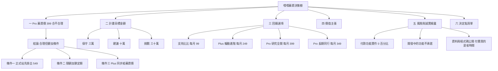

# 嘖嘖募資：計畫目標與回饋選項設計（哩股哩股）

> 撰寫日期：2026-10-17（台北）。撰寫者：行銷與商業策略。**只改這個檔，不改任何產品程式碼。**
> 查證限制（照實寫）：這個容器只能用搜尋摘要，打不開嘖嘖官網、提案契約與競品頁面。下面凡是「嘖嘖規則」都是摘要轉述，**提案契約原文沒讀到**；凡是競品價格都沿用 `docs/valuation_pricing_1007.md`（查詢日 2026-10-07），本次沒有重查。
> 信心度：高＝兩個以上獨立來源或讀過程式碼；中＝單一可信來源或第三方一致；低＝推論或單一第三方；未確認＝查不到，不當事實用。

---

## 一、第一個問題：Pro 募資價 399 合不合理（Andy 原話：「不知道這樣是否合理，需要你幫我評估」）

### 1-0 先確認指的是哪一個（已由 Andy 確認）

399 是 **Pro（正式價 549 元／月）的募資回饋價**，不是 Plus。折扣額 150 元，約 **72.7%（打 7.3 折）**，省 27.3%。

### 1-1 事實：用數字對照

| 項目 | Plus | Pro | 來源 | 信心 |
|---|---|---|---|---|
| 正式站規劃價（月繳） | 299 | 549 | `docs/payments/checkout_subscription_spec.md` 第 147～152 行；`confirm_ledger.md` 10-07 18:32 | 高（Andy 已拍板） |
| 正式站規劃價（年繳） | 2,990（每月約 249） | 5,268（每月約 439） | 同上 | 高 |
| **正式站上實際顯示的價格** | 不確定 | 不確定 | `docs/launch_gap_payment_1009.md` 第 20、46 行：正式 Worker 的價格是 0（顯示「價格待定」） | 中（10-09 的狀態，本次沒重核對） |
| 募資價（Andy 提議） | 未定 | 399 | Andy 原話 | 高 |
| Plus 與 Pro 的價差 | 正式價差 250 | 募資期若 Plus 仍 299，價差只剩 **100** | 算式 | 高（算術） |
| 目前 Pro 比 Plus 多出的「已上線」功能 | — | 研究瀏覽不限次數（Plus 每日 50 次）、自選清單不限頁數（每頁 200 檔） | `docs/plan_presets_1007.json` | 高 |
| Pro 另列但**標開發中**的功能 | — | 自選清單日報、自設條件提醒、剖析圖高解析匯出 | 同上 | 高 |

### 1-2 事實：成本與損益兩平（扣嘖嘖手續費）

嘖嘖手續費：專案成功後收最後集資總額的 **2.5% 金流基本服務費＋5.5% 嘖嘖手續費＝8%**，未達標不收。來源：[嘖嘖常見問答](https://www.zeczec.com/faq)（官方）、[嘖嘖提案人金流控管說明](https://www.zeczec.com/docs/funds-rules)（金流費依付款方式浮動）、[adHub](https://www.ad-hub.net/blog/zeczec-crowdfunding/)、[UpToGo](https://uptogo.com.tw/%E5%95%86%E6%A5%AD/%E5%89%B5%E6%96%B0%E5%89%B5%E6%A5%AD/%E5%98%96%E5%98%96%E5%8B%9F%E8%B3%87-%E6%8A%BD%E5%A4%9A%E5%B0%91%EF%BC%9F/)。信心：**高**（官方加兩個第三方一致）。**8% 含不含營業稅、金流費實際是否剛好 2.5%：未確認。**

每月成本（取自 repo 內既有文件，沒有新增數字）：

| 成本項目 | 每月金額 | 來源 | 信心 |
|---|---|---|---|
| 雲端、網域、寄信（不做盤中即時） | 約 800 元 | `docs/valuation_pricing_1007.md` 3-1；`docs/hosting_cost_plan.md` 第五節（每日開頁 8,000 次內會員系統免費，之後約 5～19 美元） | 中 |
| 資料來源 | 0 元（目前用免費公開資料）；FinMind 付費方案價格**查不到** | `docs/valuation_pricing_1007.md` 3-1 | 中／查不到 |
| Andy 的 Claude 訂閱 | **金額不知道**；既有文件用假設值 3,200 與 6,400 | 同上（假設值） | 未確認 |
| 盤中即時報價授權 | 證交所自動更新網際網路 10 萬＋傳輸 6 萬，每月約 16 萬 | `docs/legal/realtime_redistribution.md` | 中高（**本次募資不做，見第五節**） |
| 律師諮詢、行號登記 | 查不到行情 | `docs/launch_standard.md` 第二節第 4 點 | 未確認 |

每位會員每月實收（扣 8%）：

| 價位 | 募資頁實收 | 對照：正式站自行收款（以 3% 金流費估） |
|---|---|---|
| Pro 399 | **367 元** | Pro 549 實收約 533 元 |
| Plus 249 | 229 元 | Plus 299 實收約 290 元 |
| Plus 299 | 275 元 | 同上 |

損益兩平人數（算式：每月成本 ÷ 每人每月實收，無條件進位）：

| 成本情境 | 全是 Pro 399 | 全是 Plus 249 | 混合（支持 1 成、Plus 3.5 成、Pro 5.5 成，平均月價約 317、實收約 291） |
|---|---|---|---|
| 只算現金 800 | 3 人 | 4 人 | 3 人 |
| 加 Claude 6,400（假設值），共 7,200 | **20 人** | 32 人 | **25 人** |
| 再加 Andy 月薪 6 萬（`valuation_pricing_1007.md` 的假設值），共 67,200 | 184 人 | 294 人 | **231 人** |

信心：算術高，但成本三項是假設值，**整體中低**。

### 1-3 我的判斷：399 合理嗎

**結論：合理，但不是「無條件合理」。價位本身站得住，要處理的是四個副作用。** 信心：中低（沒有任何會員與轉換數據，見第五節）。

| 檢查項 | 判斷 | 理由 |
|---|---|---|
| 399 會不會虧本 | **不會** | 現金成本 800 元，3 人就打平；含 Claude 也只要 20 人。這個產品邊際成本近乎零，折扣吃的是利潤，不是成本 |
| 399 對照競品是否偏低 | **不算低** | 財報狗個股方案 599／月（中）、XQ 台股模組 300（中，年份不明）、爆料同學會 VIP 299（中），來源 `valuation_pricing_1007.md` 2-1。該文件的我自己建議區間是 Plus 249～299、Pro 499～599，所以 399 比建議區間下緣低約 20%，但募資價本來就該低於正式價 |
| 折扣幅度 27% 是否適當 | **偏深但可接受** | 同文件記錄同業年繳折扣是「10 個月價」（省 16.7%）。27% 比年繳折扣深，換來的是「願意當第一批、承擔我還沒上線付款功能的風險」。**這個比較是我的判斷，沒有查到募資早鳥折扣的業界統計** |
| 價格錨點 | **有風險，可處理** | 見 1-4 第 1 點 |
| Plus 與 Pro 的相對位置 | **最大問題** | 若 Plus 維持 299、Pro 降到 399，價差只剩 100 元，多數人會直接選 Pro，Plus 變成沒人買的陪襯。而 Pro 現在比 Plus 多出的**已上線**功能只有「不限次數」和「自選清單更大」，三項真正拉開差距的功能還在開發中 |
| 舊客戶公平性 | **要設鎖定期** | 見 1-4 第 3 點 |

### 1-4 四個要處理的副作用（每項附做法）

1. **價格錨點：549 必須先是真的。** 募資頁若寫「正式價 549」，正式站卻顯示 0 或價格待定，會被讀成虛構原價（比較廣告要求原價屬實，**公平交易法細節未逐條查，請律師看，信心：中低**）。做法：募資頁上線前，先到 `#admin/perm` 把 Plus 299／2,990、Pro 549／5,268 設定生效（既有待辦 A1），並在募資頁寫「**預定**正式價」。另外，募資價是限期、限額的「創始價」，不要在網站上把 399 當成常態價格展示。
2. **Plus 與 Pro 的價差被壓扁。** 做法有三個，我推薦 B：
   - A：Plus 維持 299。價差 100，Pro 幾乎吃掉 Plus。簡單，但 Plus 失去存在意義。
   - **B（推薦）：Plus 同步給募資價 249（正式價的 83%）。** 價差 150，比例和 Pro 接近（Pro 是 73%）。249 剛好等於 Plus 年繳折合每月價（2,990÷12），也落在 `valuation_pricing_1007.md` 建議的 249～299 區間。
   - C：Plus 199。低於同業個人開發者價位帶的下緣，付費者的客服要求不會因為便宜變少（該文件 2-4 的論點，中信心），不推薦。
3. **舊客戶公平性與幾期。** 三群人會同時存在：募資支持者（399）、之後的新客（549）、現有免費會員（0）。做法（推薦）：
   - **募資價鎖定「連續訂閱 12 期」**（中途停掉再回來，視為新客，用正式價）。
   - **第 13 期起轉 449**（正式價的 82%）並持續，轉換前至少 30 天站內與信件通知。理由：直接從 399 跳到 549 是 38% 漲幅，流失風險高；449 是緩衝，也仍保留創始支持者的感謝價。
   - 不建議「永久鎖 399」：邊際成本雖近零，但日後若要簽盤中即時授權（每月約 16 萬），永久低價撐不住；也對之後的 549 新客不公平。
   - **嘖嘖能不能在第 13 期自動改扣款金額：未確認。** 若不能，備案是 12 期結束時請支持者回網站用自家付款重新訂閱（但自家付款目前實作 0%，見第五節），或在嘖嘖開新的回饋選項請他們轉過去。這點必須在提案前問嘖嘖專案窗口。
4. **Pro 的內容不能比實際多。** 399 買到的是「不限次數＋Plus 全部＋自選清單更大」；三項「開發中」只能寫成「規劃中、不保證時程、不影響權益」，不可當賣點。

### 1-5 替代方案比較

| 方案 | 內容 | 優點 | 缺點 | 我的評價 |
|---|---|---|---|---|
| **一 推薦：399 限額＋鎖 12 期＋第 13 期轉 449，Plus 同步 249** | 見上 | 價差合理、有緩衝、成本三項都撐得住 | 要問嘖嘖能否改扣款金額 | 推薦 |
| 二 399 不限額、不設期數 | 照 Andy 原案 | 最簡單，轉換最高 | 永久低價、對後來的 549 新客不公平、Pro 吃掉 Plus | 不推薦 |
| 三 449 起跳（正式價 82%） | 折扣較淺 | 與正式價落差小，後續續訂摩擦小 | 對「第一批人冒風險」的補償太少，轉換偏低 | 備案；若募資頁預約人數很多可改這案 |
| 四 349（12 期承諾）當年繳替代 | 見第三節回饋四 | 用「承諾期數」換更低價，現金流更穩 | 嘖嘖能否固定 12 期：未確認 | 另列為獨立選項，與一並存 |

定太高會怎樣：449 以上，創始感不足，和「正式價 549 反正差不多」競爭，轉換掉。定太低會怎樣：低於 349，之後調到 549 的心理落差過大，且收入不足以撐起 Claude 加維運（假設情境 7,200 元要 25 人以上）。

---

## 二、計畫目標金額建議

### 2-1 事實：嘖嘖規則（與未確認）

| 項目 | 內容 | 來源 | 信心 |
|---|---|---|---|
| 全有或全無 | 期限內未達標，全額退還贊助者，且不收提案人手續費 | [adHub](https://www.ad-hub.net/blog/taiwan-crowdfunding-platform/)、[UpToGo 募資失敗會怎樣](https://uptogo.com.tw/%E5%95%86%E6%A5%AD/%E5%89%B5%E6%96%B0%E5%89%B5%E6%A5%AD/%E5%98%96%E5%98%96%E5%8B%9F%E8%B3%87%E5%A4%B1%E6%95%97%E6%9C%83%E6%80%8E%E6%A8%A3%EF%BC%9F/) | 中（兩個第三方一致；官方原文未讀） |
| 手續費 | 成功才收，總額 8%（2.5%＋5.5%）；「好評提案人」最多再減 2.5%（兩篇來源對減在哪一筆不一致） | 同 1-2；[INSIDE](https://www.inside.com.tw/article/23232-zeczec-10-years-new-milestone)、[addmaker](https://addmaker.tw/en/topic/1140) | 高（8%）／低（減免） |
| 訂閱扣款 | 多數用約定授扣，每月月初扣款；贊助人可自行停止訂閱 | [嘖嘖常見問答](https://www.zeczec.com/faq)（搜尋摘要） | 中 |
| 訂閱款項撥付 | 次月 15 日撥付 | 同上 | 中 |
| 專案結束 | 專案關閉後不會啟動下個月扣款；第三方經驗提醒提案人要記得月底關閉 | [嘖嘖專案公告](https://www.zeczec.com/projects/Lucky-Coaster/updates/27043) | 低到中 |
| 贊助者 7 天鑑賞期 | 嘖嘖常見問答稱適用消保法通訊交易；消基會調查指預購模式逾四成不符消保法 | [消基會](https://www.consumers.org.tw/product-detail-2508927.html) | 中 |
| **訂閱式專案的「目標金額」如何認列**（首期扣款？每月？累計？） | **查不到** | — | **未確認** |
| 訂閱式專案是否同樣適用全有全無 | **查不到** | — | **未確認** |
| 募資期間長度規定 | **查不到** | — | **未確認** |

### 2-2 算式

**目標金額＝需要付費人數 × 加權平均回饋價 × 期數**

- 加權平均回饋價：用第三節預估組合（支持者 1 成、Plus 3.5 成、Pro 5.5 成），**約 317 元／月**（99×0.1＋249×0.35＋399×0.55＝316.5）。這個組合是**我的假設**，不是數據。
- 期數：本表用 **3 期**（一季），是為了讓目標金額和「可用的現金」有對應；**若嘖嘖只認第一期扣款，期數要改成 1，所有目標金額會縮成三分之一**，請見 2-4 決定點。
- 實收＝目標 × 0.92（扣 8%）。

| 檔位 | 人數 | 算式 | 計算結果 | 建議填寫 | 3 期實收 | 對照 |
|---|---|---|---|---|---|---|
| **保守** | 30 人 | 30 × 317 × 3 | 28,530 | **30,000** | 約 27,600 | 3 期成本 21,600（800＋Claude 6,400 假設，共 7,200 元／月）；剛好蓋過，無薪資 |
| **建議** | 100 人 | 100 × 317 × 3 | 95,100 | **100,000** | 約 92,000 | 與表單範例值相同；3 期成本後剩約 70,000，可付律師、行號與付款功能開發期間的緩衝 |
| **挑戰** | 300 人 | 300 × 317 × 3 | 285,300 | **300,000** | 約 276,000 | 蓋過「成本加 Andy 月薪 6 萬（假設）」3 期共 201,600；每月約 95,100 超過勞務營業稅登記門檻（見第五節） |

損益兩平：只看成本 7,200 元，需 25 人；含月薪 6 萬需 231 人（1-2 表）。信心：算術高，成本假設中低。

### 2-3 為什麼不是越高越好（我的判斷，嘖嘖規則見 2-1）

1. **全有或全無**：目標訂得高，達不到就是全額退款，且公開失敗。失敗不收手續費，但信任成本與時間已經花掉。
2. **超標沒有額外獎勵**：達標後該收的都會收到，目標訂高不會多拿錢；目標訂低也不會少拿（手續費按最終總額算）。所以目標該訂在「**我一定做得到、而且收到的錢夠做到下一步**」，不是「我最多想要多少」。
3. **每多一個支持者就多一份交付義務**：我是一個人，沒有後端、沒有付款程式；人越多，手動開通與客服越重（見第五節）。
4. **沒有任何觀眾數據**：站上沒有付費會員與轉換資料（`valuation_pricing_1007.md` 一節），我查不到可靠的募資轉換率。**我的經驗規則（低信心、無來源）**：預熱名單人數至少要是目標人數的 5 到 10 倍，才下建議檔；否則降一檔。

### 2-4 要先問嘖嘖的三題（寫進決定點）

1. 訂閱式專案的達標金額，是看「首期扣款」、「每月」還是「累計」？
2. 訂閱式專案未達標，是否同樣全額不扣款？
3. 募資期間能設多久？關閉後已訂閱者是否持續扣款？

---

## 三、回饋選項設計

規則提醒（Andy 提供）：名稱限 12 字，不得含數量、價格、折扣、熱銷、最划算、前所未有、獨家等行銷字眼；價格單位為每月；選項內容審核後可增減。**嘖嘖對名稱用語的正式規範我查不到（未確認）**，以下名稱已避開所有列出的字眼，也避開「早鳥」「限量」「免費」。

### 3-1 四檔總表

| 檔位 | 名稱（字數） | 每月價 | 期數／鎖定 | 限額 | 對照正式站 | 信心 |
|---|---|---|---|---|---|---|
| 支持者 | 支持比比（4） | 99 | 連續訂閱期間；名單致謝 | 不限 | 無對應（等於註冊會員權益＋致謝） | 低（99 沒有依據，是整數取捨） |
| 入門 | Plus 輪動進階（9） | 249 | 鎖定連續訂閱 12 期，第 13 期起轉 279（Plus 正式價 299 的 93%）；備案見 1-4 | 不限 | Plus 299／2,990 | 中低 |
| **主力** | Pro 研究全開（7） | **399** | 鎖定連續訂閱 12 期，第 13 期起轉 449 | **前 50 位（嘖嘖能否設限額：未確認）** | Pro 549／5,268 | 中低 |
| 年繳替代 | Pro 長期同行（7） | 349 | 承諾連續訂閱滿 12 期，鎖定 24 期 | 不限 | Pro 年繳 5,268（每月約 439） | 低（嘖嘖能否固定 12 期：未確認） |

名稱字數：「Plus 輪動進階」含空格 9 字；「Pro 研究全開」7 字；「Pro 長期同行」7 字；「支持比比」4 字。皆在 12 字內，且不含禁用字眼。

### 3-2 各檔內容（只寫已上線的功能，來源 `docs/plan_presets_1007.json`）

| 檔位 | 內容 | 不付錢的人怎麼辦 | 信心 |
|---|---|---|---|
| 支持比比 | 站內致謝名單（可選擇匿名）、優先收到功能進度通知、可投票參與下一個功能排序（投票僅供參考，不保證採納） | 註冊會員本來就能用資金流向、輪動時鐘、桑基圖、ETF 一覽（每日 10 次研究瀏覽），不付錢也能用 | 高（內容） |
| Plus 輪動進階 | 研究瀏覽每日 50 次；3D 剖析圖完整；四週期同看、畫線、指標自訂；自選清單 5 頁、每頁 50 檔；ETF 報酬比較（自選 8 檔）；客服優先回覆（只限功能與資料說明） | 免費會員每日 10 次、2D 剖析圖每日 10 張；想看 3D 與多週期只能等或手動比對，慢但做得到 | 高（內容） |
| Pro 研究全開 | Plus 全部功能；研究瀏覽不限次數；自選清單不限頁數、每頁 200 檔 | Plus 每日 50 次、自選 5 頁，分批看也做得到 | 高（內容） |
| Pro 長期同行 | 同 Pro 研究全開；以「承諾期數」換較低月價 | 同上 | 中（內容）／低（機制可行性） |

**明確不寫入任何檔位**：自選清單日報、自設條件提醒、剖析圖高解析匯出（皆標「開發中」）；個股 AI 分析、今日關注、技術評分、選股策略完整名單（屬法遵 B 類，`docs/launch_standard.md` 第一節：先免費、收費前先問律師）；「進場時機」「買賣建議」這類字眼（C 類，永遠不做）；盤中即時報價（要簽交易所契約，見第五節）。

### 3-3 限量與早鳥設計

| 設計 | 做法 | 理由 | 信心 |
|---|---|---|---|
| Pro 研究全開 前 50 位 | 限額寫在嘖嘖的限量欄位，名稱不寫數量 | 限額讓創始價可信；50 位小於建議檔 100 人，滿額後剩餘支持者只能選 Plus 或長期同行（349 的承諾制） | 低（限額人數是我的判斷） |
| 滿額後 | 回饋改為「關閉」，不降價也不另開更便宜的 | 避免先買的人覺得被背刺 | 中 |
| 募資期間內改價 | 不做 | 嘖嘖審核後可改內容，但價格變動對已加入者是否生效未確認 | 低 |
| 早鳥字眼 | 不放名稱；內容裡只寫事實（價格、鎖定期、限額） | 避開 Andy 提供的禁用字眼 | 中 |

### 3-4 與正式站價格的關係（再列一次風險）

| 風險 | 說明 | 處理 |
|---|---|---|
| 價格錨點 | 見 1-4 第 1 點 | 先把 549 掛出來；募資頁寫「預定正式價」 |
| 舊客戶公平性 | 見 1-4 第 3 點 | 鎖 12 期，之後轉過渡價，30 天前通知 |
| 到期後續訂 | 嘖嘖是約定授扣，支持者不主動停就會持續扣 | 到期前通知；改價方式（改金額、重新訂閱、還是新回饋）要先問嘖嘖 |
| 同時存在兩套扣款 | 嘖嘖扣款與日後網站自家付款並存 | 嘖嘖支持者在網站以「手動開通的會員」處理，不重複扣款 |
| 退款 | 嘖嘖有 7 天鑑賞期說法（中）；我們網站的退款政策是排除七日解除權＋7 天退款保證（`docs/legal_refund_1009.md`） | **在嘖嘖上以嘖嘖規則為準**；兩套規則不要在募資頁混著寫，請律師看一次 |

---

## 四、吸引人的點（價值主張）

| # | 賣點 | 可信證據 | 信心 | 該避免的說法 |
|---|---|---|---|---|
| 1 | **一個畫面回答「錢往哪個族群跑」，而且順序固定：資金與基本面決定方向、技術決定時機、事件可否決** | 四問順序是產品骨架（`README.md`、`CLAUDE.md`）；資金流向頁有輪動時鐘、桑基圖、集中度；競品摘要多半只回答資金流向（`docs/product_strategy.md`） | 中（競品面低：只看過摘要，沒看過任何競品畫面） | 不寫「進場時機」「建議買進」；改寫「看資金往哪走」 |
| 2 | **看得懂產業鏈：27 張 2D 剖析圖、19 個會動的 3D 場景** | `docs/product_strategy.md` 優勢二與 `docs/delivery_log.md` 第 42 項記載 | 中高（自家文件；3D 在 Plus） | 不寫「獨家」；寫「站上可以直接點開看」 |
| 3 | **資料來源公開透明，省下自己整理的時間** | 資料來自證交所開放資料等公開來源（`README.md`）；付費買的是整理與視覺化，不是買不到的資料 | 高（事實）；資料授權細節見第五節 | 不寫「獨家資料」「內線」「明牌」 |

付費理由的語氣：**省你每天整理的時間、支持一個人做的產品**，不是「買到別人看不到的」。

---

## 五、風險與誠實揭露

### 5-1 事實：我們現在做不到的

| 項目 | 現況 | 來源 | 信心 |
|---|---|---|---|
| 自家付款功能 | **實作進度 0%**：沒有付款端點、沒有金流商帳號、沒有寄信、付費資料閘道未部署 | `docs/payments/checkout_subscription_spec.md` 第 7 行 | 高 |
| 募資期間的收款 | 由嘖嘖處理扣款，**不需要等自家付款完成**；但支持者權限要 Andy 到 `#admin/perm` 逐人手動開通並設到期日（目前訂閱頁本來就是「申請制，專人開通」） | `docs/marketing/trial_offer_1009.md` 第一節；`docs/legal_refund_1009.md` 第 12 行 | 高（程式現況）／**嘖嘖是否提供支持者信箱：未確認** |
| 付費內容隔離 | 站是靜態網站加公開 repo，`site/data/*.json` 任何人都能下載；付費差異主要是前端與額度限制 | `docs/valuation_pricing_1007.md` 3-3 前提二 | 高 |
| 主機條款 | GitHub Pages 條款不准商業或 SaaS 用途；收費前要搬 Cloudflare Pages（文件記載已雙部署，DECISIONS #339） | `docs/hosting_cost_plan.md` | 中（條款為搜尋摘要） |

### 5-2 資料來源的商業使用條款（逐家，查不到標未確認）

| 來源 | 現有查證 | 本次搜尋 | 對募資的意義 | 信心 |
|---|---|---|---|---|
| 證交所 OpenAPI | 政府資料開放授權條款第 1 版，可商用（`docs/product_strategy.md` 4-0） | 資料集頁面確實標示該授權，但**條款全文沒讀到**（[政府資料開放平臺](https://data.gov.tw/dataset/11548)） | 可作為付費內容的資料底層，需標示出處 | 中高 |
| 櫃買 OpenAPI | 同上 | 資料集標示同授權（[上櫃股票收盤行情](https://data.gov.tw/dataset/11371)）；櫃買「使用條款」頁**內容沒讀到**；另有付費的盤後資料商店，外部使用條件另計 | 同上，但條款原文未確認 | 中 |
| FinMind | `docs/compliance_and_tiers.md` ④-1 | FinMind 2026-07-12 公告：資料依政府開放授權取得，**使用者只取得使用權，不含對外再散布、轉售、鏡像**（[更新公告](https://finmind.github.io/WhatIsNew/)）；GitHub 專案另寫「教育、非商業用途」（[FinMind 專案](https://github.com/FinMind/FinMind)） | **不能當付費賣點**；公開 repo 每天提交衍生資料是否已違反：未確認 | 中（兩處一致，但條款全文未讀） |
| Yahoo | 禁止商業用途（中高） | Yahoo 條款：未經書面同意不得為商業目的重製、散布；說明頁：資料不得再散布（[Yahoo 說明](https://help.yahoo.com/kb/SLN2310.html)、[條款](https://legal.yahoo.com/xw/en/yahoo/terms/otos/index.html)） | **收錢前要從付費鏈路拔掉分 K 等衍生內容** | 中高 |
| 證交所即時（mis） | 提供他人使用需簽契約付費；個人可能無法申請 | `docs/legal/realtime_redistribution.md` | **本次募資不得承諾任何盤中即時** | 中高 |
| FRED | 未確認 | 本次未查 | 不放進付費賣點 | 未確認 |

**我的判斷（對應紅線一）：** 募資階段只賣「政府開放資料的整理與視覺化」＋人力與時間，不賣任何 FinMind 或 Yahoo 衍生欄位。在 FinMind 與 Yahoo 的衍生內容被盤點出付費鏈路之前，不要在募資頁暗示那些內容屬於付費權益。

### 5-3 其他風險

| 風險 | 說明 | 做法 | 信心 |
|---|---|---|---|
| 投顧法 | 收費加上個股分析、買賣點，可能構成證券投資顧問業務（5 年以下有期徒刑）。只賣整理與視覺化較安全 | 回饋文案只寫 A 類功能（資金流向、產業鏈、ETF 工具）；**收費前找證券律師看一次**（`docs/launch_standard.md` 第二節第 4 點） | 中（法條：[全國法規資料庫](https://law.moj.gov.tw/LawClass/LawAll.aspx?pcode=G0400121)；不是法律意見） |
| 營業稅登記 | 勞務類每月銷售超過 5 萬元要登記；每月 317 元平均價下約 158 位支持者就會超過 | 建議檔（每月約 3.2 萬）未達；挑戰檔（約 9.5 萬）已超過，要先評估登記行號 | 高（門檻兩個來源）／**嘖嘖提案人需不需要統編：未確認** |
| 發票 | 嘖嘖有一個訂閱專案因「公司名義訂閱需能開立發票」的稅務規定而移轉平台（單一專案公告） | 提案前問嘖嘖提案人身分、發票責任 | 低（[專案公告](https://www.zeczec.com/projects/e-reader/updates/60025)） |
| 個人所得稅 | 募資款是否列為個人所得、如何申報：**沒查** | 問會計師或國稅局 | 未確認 |
| 交付時程 | 一個人維運 | 見下 | — |

### 5-4 交付時程（保守）

| 里程碑 | 內容 | 保守估計 | 依據 |
|---|---|---|---|
| 募資成功當月 | 手動開通支持者（逐人設方案與到期日） | 成功後 3 個工作天內 | `#admin/perm` 現有功能；撥款是次月 15 日 |
| 價格設定 | 正式站掛出 Plus 299／Pro 549 | 募資頁上線前 | 既有待辦 A1，10 分鐘 |
| 自家付款 | 規格約 37～56 小時工程，agent 平行約 3～5 個工作天；**還要先過金流商審核（天數未確認）** | **募資頁一律不承諾日期**，只寫「規劃中」 | `docs/launch_gap_payment_1009.md` |
| 開發中的三項 Pro 功能 | 日報、提醒、匯出 | 不承諾；有進度才公告 | `docs/plan_presets_1007.json` |

寫在募資頁的原則：**只寫現在已經能用的功能與已能辦到的服務**；未來功能一律標「規劃中，不保證時程，不影響本回饋權益」。

---

## 六、決定點清單

### 6-1 已決定

| # | 決定 | 依據 |
|---|---|---|
| 1 | Plus 正式價 299／月、2,990／年；Pro 正式價 549／月、5,268／年 | `confirm_ledger.md` 10-07 18:32 |
| 2 | 399 是 Pro（正式價 549）的募資回饋價 | Andy 原話與本次確認 |
| 3 | 免費試用目前不提供，只保留 7 天退款保證 | `docs/legal_refund_1009.md` 10-09 18:1x |
| 4 | 付費層只賣 A 類功能；B 類先免費；C 類永遠不做 | `docs/launch_standard.md` |

### 6-2 待決定（附我的建議）

| # | 待決定 | 我的建議 | 若選別的 |
|---|---|---|---|
| 1 | Plus 的募資價 | **249**（方案 B） | 299 會讓 Pro 吃掉 Plus；199 太低 |
| 2 | 募資價鎖定幾期、之後怎麼辦 | **鎖 12 期，第 13 期起轉過渡價**（Pro 449、Plus 279） | 永久鎖定簡單但撐不住日後授權成本 |
| 3 | Pro 399 是否限額 | **前 50 位** | 不限額則等於永久低價 |
| 4 | 目標金額檔位 | **建議檔 100,000**（前提：先問清嘖嘖怎麼認列金額） | 預熱名單不足就選保守檔 30,000 |
| 5 | 是否做「Pro 長期同行」349（12 期承諾） | 先問嘖嘖能否固定期數，不行就刪掉這檔 | — |
| 6 | 是否做 99 的「支持比比」 | 做，邊際成本近零；若覺得稀釋定價感可刪 | — |
| 7 | 募資頁是否寫出預定正式價 | 寫，但前提是正式站已把 549 設定生效 | 不寫則錨點效果消失 |
| 8 | 嘖嘖上的退款規則 | 以嘖嘖規則為準，請律師確認與我們的退款政策不衝突 | — |

---

## 七、Andy 可能不同意的地方（一次否決）

1. **我建議 Plus 也打折（249）。** 你只提了 Pro 399；我認為不動 Plus 會讓 Pro 吃掉 Plus。
2. **我建議 399 設「前 50 位」與「12 期鎖定」。** 這會讓你少一點轉換，換來之後不被永久低價綁住。
3. **我建議目標先看「期數是 3 還是 1」。** 如果嘖嘖只認第一期，我給的三個目標金額都要縮成三分之一。
4. **我建議不承諾任何付款自動化日期、不承諾盤中即時、不承諾三項開發中功能。** 募資頁會比較平淡，但不會被指為不實。
5. **我不把 FinMind、Yahoo 衍生內容寫進付費賣點。** 即使它們現在畫面上有。
6. **「支持比比」99 檔，有些人會覺得是為了湊檔位。** 你可以刪。

## 八、我沒查到、不確定的

| # | 項目 | 狀態 |
|---|---|---|
| 1 | 嘖嘖訂閱式專案目標金額的認列方式、期間上限、是否全有全無 | 未確認 |
| 2 | 嘖嘖提案人是否需要統編、個人身分是否可開訂閱式專案 | 未確認 |
| 3 | 嘖嘖手續費 8% 是否含稅；訂閱專案的金流費是否同為 2.5% | 未確認 |
| 4 | 嘖嘖能否限額、固定期數、中途改扣款金額 | 未確認 |
| 5 | 嘖嘖是否提供支持者的信箱供手動開通 | 未確認 |
| 6 | 嘖嘖對回饋名稱用語的正式規範（只有 Andy 提供的列表） | 未確認 |
| 7 | 募資轉換率、早鳥折扣業界統計 | 沒查到可靠來源 |
| 8 | 櫃買、FRED、公開資訊觀測站的使用條款全文；FinMind 條款全文 | 未讀到原文 |
| 9 | 律師與行號登記費用；個人所得稅處理 | 未確認 |
| 10 | Andy 的 Claude 訂閱實際金額；正式站目前實際顯示的價格 | 未確認（本表用假設值） |
| 11 | 競品現價（財報狗、XQ 等）今日是否仍相同 | 沿用 10-07 查詢，本次未重查 |

## 九、做得到的第一步（一個人、沒有後端）

1. **今天**：到 `#admin/perm` 把 Plus 299／2,990、Pro 549／5,268 設定生效（10 分鐘），確認訂閱頁不再顯示「價格待定」。
2. **本週**：寫信或打電話問嘖嘖專案窗口 2-4 的三題，加上第八節的限額、固定期數、改扣款金額、提案人身分、發票五題，一次問完。
3. **本週**：約證券律師 30 到 60 分鐘，只問兩件事：回饋文案與功能清單有無投顧法疑慮；募資頁寫預定正式價有無比較廣告疑慮。
4. **募資頁上線前**：先放前導頁收預約名單，看人數決定選保守或建議檔。
5. **成功後**：用試算表記錄每位支持者的方案、開始日、鎖定到期日，手動在 `#admin/perm` 開通。
