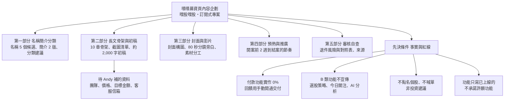

# 嘖嘖募資頁內容企劃（計畫名稱、簡介、長文、封面影片、預熱時程、審核自查）

> 企劃師 2026-10-18（台北）。需求：Andy 首次募資，要在嘖嘖（訂閱式專案）為「哩股哩股」台股資金輪動儀表板募資。
> 依據：`README.md`、`AGENTS.md`、`docs/launch_standard.md`、`docs/marketing/` 既有資料、`site/plan_presets.js`、`docs/payments/`、`docs/launch_gap_legal_1009.md`。
> 查證方式：只有 WebSearch 摘要，點不進嘖嘖原文與表單頁，凡寫「未確認」的一律不能當定論。
> 性質：企劃與文案初稿，不是法律意見。法遵標「請 legal-compliance 看」的地方，交件前要過一次。

## 一、總覽樹狀圖（先看這張）

## 二、先決條件：寫文案前先對齊的事實與紅線

| 編號 | 事實或紅線 | 依據 | 對文案的影響 |
|---|---|---|---|
| 1 | 網站已上線，資料每天盤後由自動化流程更新，免費合規來源 | `README.md`、`CLAUDE.md` | 可以寫「已上線、每天更新」，要附資料日期 |
| 2 | **付款功能實作進度 0%**，只有規格，沒有一行付款程式碼上線 | `docs/payments/checkout_subscription_spec.md` 現況段 | 募資頁不可寫「網站內刷卡訂閱」「自動續扣」；收款走嘖嘖，不碰網站金流 |
| 3 | 會員方案已有「範本＋到期日」機制：每個 email 一列，可指定方案與到期日，過期自動退回註冊會員 | `docs/marketing/trial_offer_1009.md` 第一節第 1 點 | 回饋交付可用「Andy 在管理區手動開通 Plus 並設到期日」，不必寫付款程式。量大時人工會變慢，見風險章 |
| 4 | 方案價格現況：Plus 每月 299（年繳 2,990）、Pro 每月 549（年繳 5,268） | `site/plan_presets.js` | 嘖嘖回饋價格要 Andy 自己定；是否與站上價格一致、募資價是否算優惠，法遵要看 |
| 5 | 收費功能清單只放 A 類（資金流向、輪動、桑基、族群估值、季節性、產業鏈地圖、ETF 工具等）；B 類（今日關注、技術評分、選股策略結果、個股 AI 分析）先免費、不宣傳；C 類永遠不做 | `docs/launch_standard.md` 第一節 | 募資頁不寫 B、C 類功能名稱，不寫買賣、進場點、目標價 |
| 6 | 上架前清單：收費前找證券／金融律師看付費功能清單，「我沒查到這件事做完了沒」 | `launch_standard.md` 第二節第 4 點、`trial_offer_1009.md` 第一節第 7 點 | 募資等於預先收費，**開案前建議先完成律師看一次**，列為待辦 |
| 7 | 比比商標尚未註冊；比比是 Andy 用 AI 生成 | `docs/legal/trademark_registration.md` | 不要在頁面打註冊商標符號；團隊段誠實寫「吉祥物由 AI 輔助生成」 |
| 8 | 資料是盤後、部分為前一交易日；不是即時看盤、不是當沖工具 | `README.md` 已知限制 | 與一般看盤軟體比較時，不能說「更即時」 |
| 9 | 站上「財經日曆」「ETF」「3D 剖析圖」畫面含公司名、ETF 名稱、供應商 | `docs/marketing/video_1010/compliance_check.md` 第一節 | 截圖與影片用法遵版規則：不入鏡個股代號、公司名、ETF 名稱、價格、報酬百分比 |

## 三、第一部分：名稱、簡介、分類

### 3-1 計畫名稱候選（5 個）

嘖嘖名稱字數上限未確認（表單頁需登入才看得到），以下都控制在 24 字內。

| 順位 | 候選名稱 | 理由 | 風險提醒 |
|---|---|---|---|
| 1（推薦） | 哩股哩股｜每天盤後，一頁看懂台股資金往哪跑 | 品牌名放最前面累積辨識；後半句直接講「用途」，沒看過的人 3 秒懂 | 「看懂」不是保證，文內不要加「穩」「賺」 |
| 2 | 比比陪你看盤後：台股資金輪動儀表板 | 主打吉祥物人格，對小白親切；「儀表板」讓人知道是工具不是社團 | 沒聽過比比的人第一眼看不出是財經；封面要補一句功能 |
| 3 | 哩股哩股訂閱計畫：小資也看得懂的資金輪動 | 直接點出客群與「訂閱」，審核端一看就知道是訂閱式 | 「小資」可能被讀成鎖定資金少的人，法遵看是否要改「新手」 |
| 4 | 錢跑去哪了？哩股哩股台股資金地圖 | 問句鉤子，容易被點進去（影片研調：問句開場有效） | 「地圖」與站上「產業地圖」混用，要確認讀者不會誤會是別的功能 |
| 5 | 哩股哩股｜不用盯盤，晚上十分鐘看懂族群輪動 | 訴求省時間，對上班族有感 | 「十分鐘」是我們的估計，沒有使用者數據，要在內文註明「約」或用實測計時 |

### 3-2 計畫簡介（簡短，2 版）

嘖嘖「簡短」的字數上限未確認，兩版都在 50 字內。

| 版本 | 內容 | 字數 | 特色 |
|---|---|---|---|
| 版本 A（說明型） | 把公開資料整理成圖：每天盤後看錢往哪個族群跑、族群估值位置，比比陪你看懂。非投資建議。 | 約 45 字 | 講清楚是什麼、給誰，免責放進簡介 |
| 版本 B（情感型） | 每晚十分鐘，用輪動圖、熱力圖、產業鏈地圖看懂台股族群。訂閱支持，一起把工具養大。 | 約 40 字 | 突出訂閱的共創感，免責靠內文與頁尾 |

建議用版本 A（審核端與法遵都較安心）；版本 B 留給社群貼文的第一行。

### 3-3 分類建議

| 項目 | 內容 | 狀態 |
|---|---|---|
| 搜尋到的嘖嘖分類 | 音樂、攝影、出版、時尚、設計、表演、藝術、科技、教育、遊戲、飲食、空間、社會、插畫漫畫、電影動畫、地方創生（另有線上課程等項目） | 來源是專案探索頁搜尋摘要，**表單內實際選單未確認**，Andy 開表單時請對一次 |
| 首選 | **科技**（網站與資料工具） | 建議 |
| 次選 | 教育（若審核端認為重點是「看懂財經」的學習） | 備選 |
| 不建議 | 社會、設計、出版 | 與產品性質不符，可能延誤審核 |
| 搜尋結果沒有「財經」或「軟體」專屬分類 | 無法選財經類 | 未確認，以表單為準 |

## 四、第二部分：長文章節骨架與初稿

### 4-1 十章骨架與每章寫法

原則（依 `AGENTS.md` 企劃規矩）：每一段都寫「客戶原本的麻煩 → 網站怎麼幫他省時間」；不喊單、不保證獲利、不點名個股；功能只寫已上線的。

| 章 | 標題建議 | 篇幅 | 寫法 | 放哪些圖 |
|---|---|---|---|---|
| 1 | 開場鉤子：看盤的四個疑問 | 約 250 字 | 用「錢往哪個族群跑？現在貴不貴？什麼時候看時機？有沒有該小心的事？」四問開場，接「每天看一堆 App 還是霧煞煞」的畫面；最後一句交代「我們把它整理成一頁」 | 封面同款比比＋儀表板；一張「網頁關閉後四個問題」示意圖 |
| 2 | 哩股哩股是什麼、怎麼運作 | 約 350 字 | 用判斷順序講：資金面與基本面看方向、技術面看位置、事件面當提醒。再講流程：每天盤後自動抓免費合規資料、算指標、更新網站 | 流程圖（資料來源→計算→網站）；資料日期徽章 |
| 3 | 你會看到什麼（核心功能巡禮） | 約 400 字 | 一個功能一段：麻煩 → 怎麼省時間。資金輪動、資金分流樹、產業熱力圖、產業地圖與 3D 剖析圖、季節性、ETF 工具、財經日曆 | 見 4-2 截圖清單 |
| 4 | 比比的故事 | 約 200 字 | 白色毛球天竺鼠，客服小助手與導覽員；為什麼是天竺鼠（待 Andy 補由來）；比比在站上做什麼（右下角常見問題、意見回饋、頁首導覽）。誠實寫「由 AI 輔助生成」 | 比比表情組（`docs/anim/bibi_library/`）；比比自我介紹分鏡 |
| 5 | 跟一般看盤軟體差在哪 | 約 250 字 | 用表格，只比「用途與方式」，不踩別人、不寫「更準」「最強」。誠實寫「我們不是即時報價軟體」 | 比較表 |
| 6 | 資料從哪來、我們不做什麼 | 約 250 字 | 證交所開放資料、FinMind、集保、鉅亨與經濟日報等；不碰禁爬端點；不喊單、不接下單、不是投資顧問 | 資料來源表；免責框 |
| 7 | 為什麼要募資、錢會用在哪 | 約 200 字 | 資金用途占比（待 Andy 補實際成本）；不寫「做完才有功能」，已上線的就說已上線，募資是為了持續維運與新增功能 | 資金用途圖（甜甜圈，參照 `docs/chart_library.md` A 款） |
| 8 | 回饋選項說明與交付方式 | 約 250 字 | 每個回饋：包含什麼、何時開通、怎麼開通、到期怎麼辦；明講第一期由人工開通 | 回饋比較表 |
| 9 | 團隊與時程 | 約 200 字 | 誰在做、做過什麼（待 Andy 補）；時程表：募資期間、開通日、之後半年規劃（只寫有把握的） | 時程圖 |
| 10 | 風險與常見問題 | 約 300 字 | 資料延遲、服務中斷、功能變動、退訂與退款、非投資建議；用問答 | 常見問題收合表 |

### 4-2 畫面截圖清單

截圖規則：真實畫面、淺色主題、標註資料日期；不入鏡個股代號、公司名、ETF 名稱、價格、報酬百分比、管理頁與額度「不限」字樣；手機截圖寬 390、桌機寬 1440；單張小於 1MB（嘖嘖內文圖片限制未確認，保守處理）。

| 編號 | 路由 | 畫面重點 | 用在章 | 注意 |
|---|---|---|---|---|
| S1 | `#overview` | 總覽：大盤指數、族群溫度 | 2、3 | 隱藏今日關注區塊 |
| S2 | `#flow` | 資金輪動輪盤 | 3、封面 | 封面用此張最乾淨 |
| S3 | `#flow/sankey` | 資金分流樹 | 3 | 無個股名稱的層級 |
| S4 | `#heatmap/industry` | 產業熱力圖 | 3 | 用產業層級，不要展開成分股 |
| S5 | `#industry/<鏈>` 產業鏈示意圖 | 晶圓代工到封測的上下游 | 3 | 只拍示意圖，不開供應商列 |
| S6 | 3D 剖析圖 | 零件拆開的畫面 | 3 | 不開說明卡的供應商欄 |
| S7 | `#season` | 週期統計月份格 | 3 | 圖上註明「歷史不代表未來」 |
| S8 | `#etf/inc` | ETF 現金流試算頁 | 3 | 用空白預設值，不要有金額與商品名；不開行事曆 |
| S9 | `#earnings` | 財經日曆「FED 消息」分頁 | 3 | 不點公司格 |
| S10 | 手機 `#overview` | 手機版第一屏 | 2 | 手機框包起來 |
| S11 | 右下角比比客服面板 | 常見問題、意見回饋 | 4 | 不入鏡 email |
| S12 | 回饋比較表 | 純文字圖 | 8 | 美術製作 |

### 4-3 初稿（可直接貼進嘖嘖，約 2,000 字）

標記說明：`【待 Andy 補：...】` 是我沒有資料、不能替你編的地方；`【法遵確認】` 是交件前要請 legal-compliance 看的句子。圖片位置用 `［圖 S2］` 標出。

---

**你有沒有這種晚上？**

下班、吃完飯、打開手機，想看看今天台股的錢跑去哪了。新聞一則接一則，K 線軟體滿滿的線，社群裡每個人講的都不一樣，看了半小時，還是不知道：

- 今天資金往哪個族群流？
- 那個族群現在的估值位置偏高還偏低？
- 價量走到哪個位置、近期有哪些事件日，值得自己多留意？

我們做了「哩股哩股」，把這些公開資料整理成一頁一頁看得懂的圖。**我們不告訴你買什麼、賣什麼，只幫你把資料整理好，判斷永遠是你自己的。**【法遵確認：第三項「值得留意」是否改成更中性】

［圖 S2：資金輪動輪盤］

**它是什麼**

哩股哩股是一個已經上線的網站（miaozike.github.io/tw-rotation）。每天台股收盤後，系統自動從公開、合規的資料來源抓取行情，算出資金流向、族群估值、價量位置等指標，更新成網頁。你不用裝軟體、不用自己拉表格，手機瀏覽器就能開。

判斷的順序刻意設計過：先看資金往哪走、基本面撐不撐得住（方向），再看價量位置（時機），最後看有沒有事件需要留意（提醒）。這樣不會一看到線型漂亮就衝動。

**你會看到什麼**（每一項都是現在網站上就有的功能）

1. **資金輪動**：以前你要自己比對每個族群的成交值，現在一張輪盤看出成交占比在族群間怎麼移動。
2. **資金分流樹**：大盤的錢分到哪些族群、再分到哪些子族群，像水流一樣一層層看。
3. **產業熱力圖**：整個台股一張圖，紅漲綠跌，方塊越大成交值越大，一眼看出哪個產業今天最熱。
4. **產業地圖與 3D 剖析圖**：不懂晶圓代工到封測誰在做什麼？拆開來看上下游，不用再翻十篇文章。
5. **週期統計**：族群在歷年每個月的平均表現，附樣本數與勝率。**歷史統計不代表未來。**
6. **ETF 工具**：配息日一覽、現金流試算（參數自己填）。
7. **財經日曆**：財報、法說會、重要總經日期，不漏掉。

［圖 S3、S4、S5、S7：各一張］

**比比是誰**

比比是一隻白色毛球天竺鼠，是網站的導覽員與客服小助手。【待 Andy 補：比比的由來，為什麼是天竺鼠、名字怎麼來】看不懂圖的時候，右下角點比比，有常見問題；想要什麼功能，也可以在「意見回饋」告訴比比。比比的圖像由 AI 輔助生成，我們會誠實標示。

［圖 S11：比比客服面板］

**跟一般看盤軟體不一樣的地方**

| | 一般看盤軟體 | 哩股哩股 |
|---|---|---|
| 主要用途 | 看個股即時報價、下單 | 看族群之間資金怎麼動、整理成圖 |
| 資料時間 | 多為即時 | **盤後更新，部分為前一交易日**，不是即時 |
| 是否下單 | 通常可以 | 不提供，也不自動執行 |
| 新手門檻 | 指標多、設定多 | 一頁一個問題，比比帶你看 |

我們不是要取代你的看盤軟體，而是補上「族群層級」這一塊。

**資料從哪來、我們不做什麼**

資料全部來自免費且合規的來源：證交所開放資料、FinMind、集保結算所、鉅亨與經濟日報的公開新聞等。我們不碰條款禁止抓取的官網端點。**哩股哩股為公開市場資料之整理與視覺化工具，並非證券投資顧問事業，內容不構成任何投資建議；投資有風險，過去表現不代表未來，請自行審慎判斷。**

**為什麼要在嘖嘖募資**

網站已經上線，但要長久維運，需要持續投入時間與雲端與資料服務成本。這次募資是希望找到願意長期支持的夥伴，用訂閱的方式，讓網站能穩定更新、慢慢長大。【待 Andy 補：每月實際成本，例如網域、雲端、資料服務、人力時間；目標金額如何算出】

**回饋選項**

【價格待 Andy 定，下表金額皆為占位】

| 回饋 | 包含 | 開通方式 |
|---|---|---|
| 比比加油包 | 感謝名單、募資者專屬比比貼圖 | 結案後寄信 |
| Plus 月訂夥伴 | 站上 Plus 方案功能，每月訂閱 | 每期由我們手動開通，並寄通知 |
| Plus 年度夥伴 | 同上，整年 | 同上 |
| Pro 進階月訂 | 站上 Pro 方案功能 | 同上 |
| 共創許願夥伴 | Pro 方案加上每季一次功能許願優先排序 | 同上 |

**重要：目前網站內建的刷卡付款功能還在開發，所以這次所有回饋都透過嘖嘖收款，我們會在每期開始前，手動把你的 email 開通成對應方案。我們不會承諾自動續扣到網站，也不會用到你的卡號。**

**時程與交付**

- 【待 Andy 補：募資期間，例如 2026/11/12 至 2026/12/11】
- 結案後 3 個工作天內寄開通通知【待 Andy 確認可行】
- 每月 1 日由嘖嘖扣款，次月 15 日撥款給提案者（依社群整理，嘖嘖官方未確認，請以平台說明為準）

**團隊**

【待 Andy 補：姓名或暱稱、背景、做過什麼、聯絡方式。提醒：不要提供持股、成本價】

**風險與常見問題**

- **資料有延遲嗎？** 有。盤後更新，部分是前一交易日。
- **你們會推薦股票嗎？** 不會。我們不提供買賣建議、進場點或目標價。
- **網站掛了怎麼辦？** 網站跑在公開雲端服務，若發生長時間中斷，我們會在專案更新公告，並延長你的訂閱期限。【待 Andy 確認補償方式】
- **想退訂或退款？** 【待 Andy 與法遵確認：依嘖嘖規則與《消費者保護法》，退款條件寫在這裡】
- **我是新手，看得懂嗎？** 每個圖旁邊有說明，卡住就點比比。
- **我一定要訂閱嗎？** 不用。註冊會員有免費功能，訂閱是支持與解鎖更多使用次數。【法遵確認：免費與付費差在次數，不是差在內容，文字與站上一致】

---

## 五、第三部分：封面與影片企劃

### 5-1 封面（1200x675，16:9，小於 1MB）

主視覺：比比加儀表板。版面全部分區，**兩兩不重疊**（`docs/marketing/video_1010/layout_rules.md`）。

| 元素 | 位置與大小（x, y, 寬, 高） | 內容與字級 | 備註 |
|---|---|---|---|
| 品牌 LOGO | 60, 48, 220, 60 | 哩股哩股 LOGO | 左上 |
| 主標 | 60, 140, 540, 130 | 「哩股哩股」96px 粗體 | 單行 |
| 副標 | 60, 290, 540, 110 | 「每天盤後，一頁看懂資金往哪跑」44px，兩行 | 行距足夠 |
| 募資標籤 | 60, 430, 300, 64 | 「訂閱式專案」膠囊 | 嘖嘖字樣不放，避免被視為官方背書 |
| 小字免責 | 60, 590, 540, 50 | 「公開資料整理工具・非投資建議」24px | 底部 |
| 儀表板卡 | 640, 60, 500, 380 | 真實截圖 S2（資金輪動），圓角 28px；卡下緣放「網站實際畫面」小字 | 卡內不放任何別的元素 |
| 比比 | 640, 470, 200, 190 | 站姿揮手 | 在卡的正下方空位 |
| 對話泡泡 | 870, 490, 270, 100 | 「我幫你看懂！」36px | 尾巴向左指比比，不壓比比與儀表板卡 |

重疊自查：左欄 x 60–600，右欄 x 640–1140，兩欄不相交；右欄儀表板卡 y 60–440，比比與泡泡 y 470 以下，不相交；泡泡 x 870 起，比比 x 到 840，尾巴只在 840–870 之間。交件要附「重疊檢查：程式逐元素 0 筆；人工 0 筆」一行，沒有這行不收件。

交付：PNG 與 JPG 各一份，檔案小於 1MB；另出 1080×1350 與 1080×1080 社群版。

### 5-2 影片分鏡大綱（約 80 秒＝正片 75 秒＋警語 5 秒；嘖嘖限 YouTube 或 Vimeo）

沿用 `docs/marketing/video_1010/storyboard.md` 的比比主持素材與錄影，**新增「為什麼募資」與「怎麼支持」兩段**。旁白由比比第一人稱口語；每句不超過 16 字上下，不寫價格、不寫買賣。

| 鏡 | 秒數 | 畫面 | 大字（≤10 字） | 旁白稿（比比） |
|---|---|---|---|---|
| 1 | 0–5 | 手機螢幕滿是分頁、新聞、K 線，比比探頭 | 看盤看到霧煞煞？ | 每天看一堆資料，還是不知道錢跑去哪？ |
| 2 | 5–10 | 比比跳出，名牌「比比」 | 我是比比 | 嗨，我是比比，這個網站的導覽員。 |
| 3 | 10–17 | 總覽 `#overview` 手機框，比比用指示棒點 | 一頁看今天 | 打開就是今天的大盤和族群溫度。 |
| 4 | 17–26 | `#flow` 輪盤，比比踩 ▶ 播放 | 錢往哪個族群跑 | 資金輪動，看成交占比怎麼在族群間移動。 |
| 5 | 26–33 | `#heatmap/industry` 熱力圖，比比掃光 | 一眼看強弱 | 整個台股一張圖，方塊越大成交越多。 |
| 6 | 33–42 | 產業鏈與 3D 剖析圖旋轉 | 產業鏈拆開看 | 不懂上下游？拆開來，一層一層看。 |
| 7 | 42–48 | 週期統計月份格，旁邊小字「歷史不代表未來」 | 歷年每個月 | 想知道歷年這個月的規律，也在這裡。 |
| 8 | 48–54 | ETF 現金流試算（空白預設），不入鏡商品名 | 自己填參數 | ETF 現金流，數字自己填。 |
| 9 | 54–60 | 比比拿小板子，畫面是成本拆解圖（甜甜圈） | 為什麼募資 | 網站要長久，需要伺服器和資料服務。【待 Andy 補實際用途】 |
| 10 | 60–67 | 回饋方案卡（無價格，只列名稱） | 訂閱支持我們 | 訂閱支持，我們每月把它養大。 |
| 11 | 67–72 | 客服面板、許願牌 | 想要什麼，告訴比比 | 想要什麼功能，也可以許願。 |
| 12 | 72–75 | 比比揮手、LOGO | 哩股哩股 | 謝謝你，晚點見！ |
| 13 | 75–80 | 警語卡 | 投資警語 | 無旁白；字幕：哩股哩股為公開市場資料之整理與視覺化工具，並非證券投資顧問事業。影片內容僅供功能說明，不構成任何投資建議或買賣依據；投資有風險，過去表現不代表未來，請自行審慎判斷。 |

規則：全片不放個股代號、ETF 名稱、價格、報酬百分比；片尾不放網址與信箱（延續 10-10 Andy 指示，嘖嘖頁自帶連結）；音樂用原創合成（`make_music_v3.py`），無版權問題；字幕必開。

審片：每 0.5 秒抽一格全解析度看，回報寫「重疊檢查：程式 N 幀 0 筆；人工 M 格 0 筆」。

### 5-3 素材清單與交給哪個部門

| 素材 | 規格 | 負責 | 驗收 | 預計交件 |
|---|---|---|---|---|
| 封面 1200×675 | PNG/JPG <1MB；重疊 0 筆 | art-director（構圖、風格）＋visual-designer（出圖） | CEO 親眼看圖，附並排比較 | 10/23 |
| 封面社群版 1080×1350、1080×1080 | 同上 | visual-designer | 同上 | 10/24 |
| 影片分鏡定稿 | 13 鏡，旁白審過 | storyboard-artist | legal-compliance 逐句過 | 10/21 |
| 影片成品 80 秒 | 1080p，字幕、片尾警語 5 秒 | video-editor（剪輯）＋motion-designer（比比動作） | 重疊檢查那行＋法遵 15 項逐格 | 10/27 |
| 截圖 S1 至 S12 | 見 4-2 | video-editor（沿用 `capture.py` 錄影） | 無個股、無 ETF 名稱 | 10/22 |
| 比較表、回饋表、時程圖、資金用途圖 | 內文圖，每張 <1MB | visual-designer＋tech-illustrator | 字級在手機可讀 | 10/25 |
| 長文與回饋文案 | 約 2,000 字，標出待補 | content-planner（本檔） | legal-compliance、marketing-strategist 各看一次 | 10/22 |
| 預熱貼文 10 篇 | 見第六部分 | marketing-strategist＋content-planner | 30 秒發文前檢查表 | 10/26 |

另需補的專家：legal-compliance（文案與回饋法遵）、payments-billing（人工開通流程與對帳）。這兩位需要先確認，影片才能定稿。

## 六、第四部分：預熱與推廣時程（開案前 2 週到結案）

假設開案日 D＝2026-11-12（週四），結案約 D＋30 天（2026-12-11，週五）。日期是範例，Andy 定案後平移即可。嘖嘖審核時間未確認，因此 D－14 就送審，留兩週緩衝。

### 6-1 里程碑

| 日期 | 項目 | 誰 | 驗收 |
|---|---|---|---|
| 10/18 至 10/22 | Andy 補資料（價格、目標、團隊、客服信箱、比比由來）；律師看付費功能清單 | Andy | 待補欄位清空 |
| 10/22 至 10/27 | 封面、影片、截圖、內文圖完成並過審 | art-director、video-editor 等 | 重疊 0 筆、法遵過 |
| 10/29（D－14） | 嘖嘖送審；IG、Threads 預熱帳號整備 | Andy＋marketing-strategist | 送審完成 |
| 11/5（D－7） | 預告貼文、等候名單 | 同上 | 名單數量記錄 |
| 11/12（D） | 開案，20:00 發主貼文與影片 | 同上 | 募資頁上線 |
| 11/13 至 12/10 | 每週更新、回覆留言 | 同上 | 見 6-3 |
| 12/11 | 結案前 72 小時倒數 | 同上 | |
| 結案後 3 個工作天 | 手動開通、寄信 | Andy | 開通清單逐筆核對 |

### 6-2 預熱期社群節奏（D－14 至 D）

台灣 Threads 互動高峰在晚上 8 到 10 點、週四最高（`docs/marketing/video_1010/research.md` 1-11，信心中，原始資料同源）；IG 沒有台灣專屬數據（未確認）。貼文時間統一 20:00 至 21:30，兩週後用洞察報告校正。

| 日期 | IG | Threads | 其他 |
|---|---|---|---|
| D－14 週四 | 自我介紹：比比是誰（單圖） | 同步，附一個提問「你看盤最卡的是哪一步？」 | 無 |
| D－11 週日 | 功能一：資金輪動（輪播 3 張） | 純文字長串，說明用法 | 無 |
| D－9 週二 | 功能二：熱力圖 | 回覆留言 | 無 |
| D－7 週四 | 預告：「11/12 嘖嘖見」＋等候名單連結 | 同上 | Dcard 理財板發討論文（見 6-4） |
| D－5 週六 | 幕後：網站怎麼每天自動更新 | 同上 | 無 |
| D－3 週一 | 比比開箱：回饋選項預告（無價格） | 同上 | |
| D－1 週三 | 倒數 24 小時，影片短版 | 同上 | |
| D 週四 | 開案主貼文＋影片 | 同步 | 寄信通知等候名單 |

### 6-3 募資期間節奏

| 週 | 重點 | 形式 |
|---|---|---|
| 第 1 週 | 開案感謝、前 48 小時衝刺 | 限時動態每天一則進度，Threads 一天一串 |
| 第 2 週 | 一個功能深入教學 | IG 輪播＋Threads 長串 |
| 第 3 週 | 許願徵集與回覆 | 回覆許願貼文 |
| 第 4 週 | 倒數與感謝 | 影片短版、結案前 72 小時、24 小時各一則 |

每週 3 至 4 篇，不灌水。只貼「已上線」功能，不貼未完成的畫面。

### 6-4 各平台注意事項

| 平台 | 做法 | 注意（版規與投顧法） | 狀態 |
|---|---|---|---|
| IG | 輪播＋Reels；個人檔案放嘖嘖連結 | 文案固定附免責短版；不放個股名；不寫買賣 | 可執行 |
| Threads | 純文字為主，63% 的串文是純文字（Meta 2024，舊資料） | 同上；回覆留言不評論個股 | 可執行 |
| Dcard（理財板） | 一篇誠實的「我做了一個網站」分享，說明這是自己的專案 | **站規：品牌帳號仍須遵守全站站規、各看板版規與廣告規範；板規由板主制定**，發文前讀板規；不放業配標示以外的暗示；不要用「官方合作」標籤。理財板專屬規定**未確認**（搜尋摘要沒有） | 發文前人工讀版規 |
| PTT Stock 板 | **建議不發募資連結文**。若要參與，只在符合版規時分享「資金輪動怎麼看」的方法討論，不放連結、不點名個股 | Stock 板政見的定位是交易策略、金融商品分析與股票知識，避免炒作；**板規置底公告全文未查到，是否禁廣告未確認**，Andy 發文前務必先讀置底公告；投顧法：不推薦個股、不預測漲跌、不收費提供建議 | 未確認，預設不發 |
| FB 粉專／LINE | 沿用 `docs/marketing/social_setup_1009.md` 帳號與追蹤網址 | 同上 | 可執行 |

固定免責短版（每篇內文最後一行）：本站為公開資料整理與視覺化工具，非證券投資顧問，不提供投資建議；投資請自行判斷並承擔風險。

發文前 30 秒檢查（`docs/launch_gap_legal_1009.md` 第三節）：有沒有個股名、有沒有買賣字眼、有沒有保證獲利、有沒有價格以外的優惠承諾、免責有沒有放。

## 七、第五部分：嘖嘖審核常見退件原因與對照自查表

### 7-1 查證結論（先講老實話）

嘖嘖官方沒有公布「退件原因清單」。WebSearch 找不到列表，也找不到經驗文整理的退件統計。以下兩部分分開寫：**官方 FAQ 能確認的審核項目**，與**我依平台性質推導的高風險點（信心中低）**。

### 7-2 對照自查表

| 編號 | 審核關注點 | 依據 | 信心 | 我們的狀態 | 自查動作 |
|---|---|---|---|---|---|
| 1 | 提案是否合法、計畫是否合理，需提供必要合法文件 | 嘖嘖 FAQ：第一階段為初步評估 | 高（官方摘要，但資料日期偏舊） | 風險：金融資訊類，需確認不構成投顧業務 | 附上免責與資料來源；legal-compliance 看過 |
| 2 | 身分及金流確認：自然人或法人各需不同文件 | 嘖嘖 FAQ：第二階段 | 高 | 待確認：以 Andy 個人身分提案的文件清單 | Andy 提前備妥身分證明與收款帳戶；清單**未確認**，以表單為準 |
| 3 | 過去是否有收到款項卻未交付回饋的紀錄 | 嘖嘖 FAQ | 高 | 無 | 無 |
| 4 | 產品類需提供可運作樣品 | 嘖嘖 FAQ | 高 | 本案網站已上線，等同可運作 | 在頁面放網站網址與實際畫面 |
| 5 | 提案頁要有清楚的執行方式、資金用途、時間表 | adHub 攻略、FAQ 摘要 | 中 | 資金用途與時程目前是待補欄位 | Andy 補資料前不送審 |
| 6 | 相關網頁真實性與可行性（無官網可用粉專替代） | 任務表單說明 | 高（表單欄位說明） | 有官網 | 網站網址填 miaozike.github.io/tw-rotation；粉專同步備妥 |
| 7 | 回饋是否能如期交付、是否寫清楚交付日期 | 嘖嘖 FAQ：回饋選項標示預計送出日期 | 中 | 人工開通，量大時風險 | 寫「結案後 3 個工作天」並確認做得到 |
| 8 | 內容是否誇大、保證獲利、涉及違法 | 提案人條款第十六條「禁止不當行為」（具體項目被截斷，**未確認**） | 低 | 風險最高：財經類 | 全文不出現保證、穩賺、飆、買賣建議 |
| 9 | 商標、肖像、素材是否侵權 | 一般實務 | 低 | 比比為 AI 生成、商標未註冊；音樂為自製 | 寫明 AI 輔助；留生成紀錄（`trademark_registration.md` 4.7） |
| 10 | 圖片檔規格（封面 <1MB、1200×675、16:9）、影片（YouTube 或 Vimeo） | 任務表單 | 高 | 待製作 | 見第五部分 |
| 11 | 回饋名稱不超過 12 字 | 任務表單 | 高 | 見下表 | 見下表 |
| 12 | 訂閱式專案的扣款設定 | 社群整理：每月 1 號扣款，次月 15 日撥款；需在「每月收款」與「預付期數」擇一 | 低（非官方） | 未確認 | 開案前向嘖嘖客服確認 |
| 13 | 平台不替提案內容背書；提案人自負其責 | 嘖嘖 FAQ | 高 | 無 | 無 |
| 14 | 法規趨勢：數位部預告「集資平台定型化契約應記載及不得記載事項」草案 | 中央社 2023-11 報導 | 中 | 定稿內容未查到 | 關注更新 |

### 7-3 回饋名稱字數檢查（上限 12 字）

| 名稱 | 字數 | 通過 |
|---|---|---|
| 比比加油包 | 5 | 是 |
| Plus 月訂夥伴 | 8（含空格） | 是 |
| Plus 年度夥伴 | 8 | 是 |
| Pro 進階月訂 | 7 | 是 |
| 共創許願夥伴 | 6 | 是 |

### 7-4 來源

| 來源 | 網址 | 用在哪 |
|---|---|---|
| 嘖嘖常見問答（審核四階段，頁面日期偏舊） | https://www.zeczec.com/faq | 7-2 第 1 至 4、7、13 項 |
| 嘖嘖平台提案人金流控管說明 | https://www.zeczec.com/docs/funds-rules | 金流說明（只看到標題，內容未讀） |
| 嘖嘖提案人條款 | https://www.zeczec.com/docs/creator_terms | 第 8 項（第十六條，內容被截斷） |
| 集資平臺之贊助者保護措施自律規範 | https://zeczec.com/blog/supporter-protection-guidelines | 贊助者保護（只看到標題） |
| 嘖嘖專案探索（分類） | https://www.zeczec.com/categories | 3-3 分類 |
| 嘖嘖訂閱式專案探索 | https://www.zeczec.com/categories?type=3 | 訂閱式專案存在的證據 |
| 訂閱式專案社群整理（HackMD） | https://hackmd.io/@waterwater/BJsousXGT | 第 12 項，扣款與撥款日 |
| 嘖嘖平台全攻略（adHub） | https://www.ad-hub.net/blog/zeczec-crowdfunding/ | 第 5 項 |
| 消費者文教基金會：群眾募資糾紛 | https://www.consumers.org.tw/product-detail-2648005.html | 平台的審查義務說法 |
| 中央社：數位部草案 | https://www.cna.com.tw/news/afe/202311300219.aspx | 第 14 項 |
| Dcard 官方公告（業配與品牌帳號規範） | https://www.dcard.tw/f/announcement/p/234243656 | 6-4 Dcard |
| PTT Stock 板政見 | https://www.ptt.cc/bbs/Stock/M.1592709377.A.BAD.html | 6-4 PTT |
| 研調：Threads 發文時間 | `docs/marketing/video_1010/research.md` 1-11 | 6-2 |

**搜尋限制**：「嘖嘖手續費費率」「PTT Stock 板板規」「Dcard 理財板版規」三項各搜一次都沒有拿到原文，標為未確認。

## 八、需要 Andy 補或決定的事項

| 編號 | 事項 | 為什麼需要 | 時限 |
|---|---|---|---|
| 1 | 每月實際成本與目標金額 | 資金用途與計畫目標 | 10/22 |
| 2 | 回饋價格與名額 | 嘖嘖回饋選項 | 10/22 |
| 3 | 團隊與自我介紹（姓名或暱稱、背景） | 審核看真實性；內文團隊章 | 10/22 |
| 4 | 比比的由來 | 比比故事章 | 10/22 |
| 5 | 客服信箱（需另開，見 `launch_standard.md` 第 8 條） | 頁面聯絡方式 | 10/26 |
| 6 | 手動開通量能：預期人數多少、每日願意花多久 | 回饋可行性 | 10/22 |
| 7 | 開案日與結案日 | 時程 | 10/22 |
| 8 | 律師看付費功能清單、人工開通與退款文字 | `launch_standard.md` 第二節第 4 點 | 開案前 |
| 9 | 提案人身分（個人或行號）與文件 | 嘖嘖第二階段審核 | 送審前 |
| 10 | 開表單時核對分類選單、字數上限、圖片大小 | 本檔多處標未確認 | 送審前 |
