# 嘖嘖募資：法遵風險盤點與開案前自查

> 撰寫：法遵與風險｜日期：2026-10-17（台北）｜對象：Andy
>
> **這份是風險盤點與待確認清單，不是法律意見。** 沒有動任何產品程式碼、沒有 commit、沒有 push。
> 查證方式：只有搜尋摘要可用，打不開嘖嘖官網原文（連線失敗），所以**下列嘖嘖條文全部是摘要轉述，一律標「未確認」**，開案前要把原文逐條讀過。
> 信心度：高＝兩個以上獨立來源或摘要引了條文／判決字號；中＝單一可靠來源；低＝二手或立場可能偏；未確認＝查不到或只見摘要。
> 與既有文件對齊：`docs/launch_standard.md`、`docs/compliance_and_tiers.md`、`docs/legal/license_review.md`、`docs/legal/trademark_registration.md`、`docs/payments/checkout_subscription_spec.md`。

## 〇、總覽樹狀圖（先看這張）

```mermaid
flowchart TD
  R["嘖嘖募資法遵風險"] --> A["一、證顧法（刑責）"]
  R --> B["二、募資與預購的法律性質"]
  R --> C["三、個人提案的身分與稅務"]
  R --> D["四、廣告與智慧財產"]
  R --> E["五、嘖嘖合作條款"]
  R --> F["六、自查清單與律師事項"]

  A --> A1["紅：募資頁寫『何時進場』『進場訊號』"]
  A --> A2["橙：『資金輪動』寫成買賣動作"]
  A --> A3["綠：族群資金統計、產業鏈、資料整理"]
  A --> A4["募資款算不算報酬：要律師確認"]

  B --> B1["性質：預購為主，不是贈與（推論）"]
  B --> B2["七日鑑賞期：訂閱屬繼續性服務，風險高"]
  B --> B3["定型化契約：自動續約要拆開同意"]

  C --> C1["自然人上限：任意連續30天100萬"]
  C --> C2["無統編不能開統一發票"]
  C --> C3["募資款所得類別：未確認"]

  D --> D1["Meta／Google 金融廣告驗證"]
  D --> D2["比比只能用 ™，AI 生成著作權存疑"]
  D --> D3["證交所標示出處，FinMind 與 Yahoo 不上頁面"]

  E --> E1["最不利：違約金10%（最低30萬，摘要）"]
  E --> E2["未達標：全額退款，不收費"]
  E --> E3["延遲交付：30日內提解決方案（摘要）"]

  F --> F1["可勾選自查表"]
  F --> F2["必須由律師確認的事項"]
```



## 一、先講結論（五行）

1. **最大的雷是募資頁的用詞，不是產品本身。** 「何時進場」「進場訊號」「今日候選」「技術評分」落在證顧法第4條「分析意見或推介建議」的定義核心；募資頁還會成為日後被拿來證明「對不特定人招攬」的證據。
2. **嘖嘖募資款很可能就是第4條的「報酬」。** 條文是「直接或間接自委任人或第三人取得報酬」。免費階段缺的那個要件，在募資的那一刻就補上了。所以回饋內容一律只放 `launch_standard.md` 的 A 級（族群與市場工具），B 級（評分、排行、今日關注）與 C 級（買賣建議）不進回饋、不進募資頁、不進影片。
3. **訂閱型回饋最大的消費者風險是七日鑑賞期與自動續約，** 建議回饋做成「固定期數預付」，不要在嘖嘖上綁自動續扣。
4. **個人提案要先過三關：** 嘖嘖要求身分資料正確、自然人上限（任意連續30天100萬，摘要）、第三方金流專屬帳戶審核；沒有統編就不能開統一發票，要先決定收據怎麼給。
5. **品牌與資料：** 比比只用 ™，不寫「原創」「版權所有」；證交所／櫃買／集保資料要標出處，FinMind 與 Yahoo 衍生的東西不放在募資頁截圖與回饋裡。

---

## 二、證券投資信託及顧問法（證顧法）

### 2-1 定義與刑責（對照 `compliance_and_tiers.md` 1-1，不重查）

| 項目 | 內容 | 風險等級 | 信心度 | 來源 |
|---|---|---|---|---|
| 第4條定義 | 直接或間接自委任人或第三人取得報酬，對有價證券等之投資或交易有關事項提供分析意見或推介建議者，為證券投資顧問 | — | 高 | 全國法規資料庫（摘要引條文）；本專案 `compliance_and_tiers.md` |
| 第107條第1款 | 未經許可經營：五年以下有期徒刑，併科一百萬至五千萬罰金 | 紅 | 高 | 多份判決書引述（見 2-3） |
| 實務補充要件 | 招收會員、收取報酬，對不特定人、經常性提供 | 紅 | 中 | 律師文章與立法院資料摘要 |
| 「教育」「財經資訊」「網站收費」的豁免或界線函釋 | 本次**查不到**金管會正式函釋 | — | 未確認 | 兩次搜尋均無結果。**不准當成「可以」** |

**必須由專業人士（證券法規律師）確認。**

### 2-2 募資頁用詞三堆（可以用／要改寫才能用／不要用）

判準：①有沒有點名個股 ②有沒有買賣動作或時點 ③有沒有價位（進、出、停損、目標）④有沒有暗示「照著做會賺」。

**可以用**

| 用詞或寫法 | 為什麼 | 風險 | 信心 |
|---|---|---|---|
| 「看見資金流向哪些族群」「族群資金流入流出統計」 | 族群層級、描述歷史事實，不指向特定標的 | 低 | 中（無函釋可引，屬依條文結構的判斷） |
| 「產業鏈地圖」「供應鏈關係圖」「題材熱度」 | 產業知識整理，不是證券分析 | 低 | 中 |
| 「依公開資料統計，每日盤後更新」 | 描述資料處理方式 | 低 | 中 |
| 「整理證交所、櫃買、集保公開資料」 | 事實陳述，並附出處 | 低 | 高（授權面）／中（證顧面） |
| 「自己設條件的篩選器」 | 由使用者設定，不是我方推介 | 低到中 | 低（待律師） |

**要改寫才能用**

| 原寫法 | 問題 | 替代寫法 | 風險（改寫後） |
|---|---|---|---|
| 「掌握資金輪動」 | 「掌握」有行動暗示，連到後面的買賣 | 「觀察資金在各族群間的流向變化」 | 低到中 |
| 「找出強勢族群」 | 「找出」接近挑選 | 「列出近期資金淨流入較多的族群（歷史統計）」 | 中 |
| 「技術面」 | 容易被看成技術分析意見 | 「均線與量能等公開指標的視覺化」，且不給結論句 | 中 |
| 「事件提醒」 | 若附利多利空判讀就變分析意見 | 「重大訊息彙整（僅列事實與時間）」 | 中 |
| 「適合新手」 | 暗示可照做 | 「協助整理資訊，不提供買賣建議」 | 低到中 |

**不要用（一律附替代說法）**

| 禁用字眼 | 原因 | 替代做法 | 風險 | 信心 |
|---|---|---|---|---|
| 「何時進場」「進場時機」「進場訊號」 | 買賣時點是最典型的推介建議；本站 M3「決定時機」即在此 | 募資頁完全不提；改講「觀察哪些族群資金在變化」 | 紅 | 高（`compliance_and_tiers.md` 已列為定義核心） |
| 「今日候選」「推薦」「明牌」「選股」「標的清單」 | 點名個股＋推介 | 「族群層級的資金統計」；個股頁不進回饋 | 紅 | 高 |
| 「買進」「賣出」「停損」「目標價」「風報比」「勝率」 | 價位與動作 | 不用，也不在截圖露出 | 紅 | 高 |
| 「跟著資金走就能賺」「抓住下一個飆股」「穩賺」「保證」 | 暗示獲利，另有廣告不實與詐欺聯想 | 「協助你自己整理資訊並自行判斷」 | 紅 | 中 |
| 「專業投顧級」「AI 幫你選股」 | 容易被解讀為投顧服務 | 「資料整理與統計工具」 | 紅 | 中 |
| 「券商目標價」「分析師評等」收進回饋 | 士林地院107年金訴字第2號見解：把投顧分析納入自己網站即屬提供意見（二手轉述） | 募資期間個股頁券商觀點整區不上線 | 紅 | 中 |

**截圖與影片的連動風險**：募資頁、影片、貼文只要出現「今日候選」「進場」「停損」「目標價」欄位的畫面，等同寫在頁面上。截圖前先遮蔽或換成族群層級頁面。

### 2-3 已查到的判決（皆為搜尋摘要，未讀全文；字號請律師調閱）

| 法院與字號 | 摘要重點 | 與我們的關聯 | 信心 |
|---|---|---|---|
| 橋頭地院 110年金訴字第104號 | 每月999元訂閱，推送當沖推介；徒刑十月併罰金 | 月費訂閱＋具體推介 | 中 |
| 臺中地院 111年金訴字第1723號 | 「每日報告王」平台提供個股推介與操作建議；徒刑六月緩刑；被告辯稱只提供客觀資訊，法院依證述認定有投資意見 | **「我只是客觀資訊」不是當然的抗辯** | 中 |
| 桃園地院 114年審金簡字第555號 | 非法經營證顧：徒刑一年併罰金一百萬，緩刑三年、付公庫50萬 | 量刑參考 | 中 |
| 114年金訴字第668號（判決日2026-06-05，法院全稱摘要未載） | Instagram 引流，每月666至1,800元會費進 Discord 群組，內有個股推介與買賣價位；認定目的在獲取會費 | **「社群引流＋月費會員」的典型態樣，與本案訂閱結構相近** | 中 |
| 士林地院 107年金訴字第2號（引自 `compliance_and_tiers.md`） | 轉述各投顧分析並納入網站，亦屬提供意見 | 券商觀點區 | 中 |

**金管會裁罰案例**：搜尋只見對**合法持牌**業者的廣告違規罰鍰（國泰投信，60萬，與本案性質不同）與民眾檢舉統計；**未查到針對「一般財經資訊網站收訂閱費」的行政裁罰或函釋，標未確認。** 未查到不等於沒有風險，目前是刑事追訴為主要路徑。

### 2-4 免責聲明（可直接貼，需律師定稿）

放置位置：募資頁最下方固定一區、影片結尾字幕一行、貼文圖說一行。**免責聲明不能阻卻證顧法責任**（刑責看行為態樣，見 `license_review.md` (f)），只能降低誤解。

```
【重要聲明】
本專案提供的是依公開資料統計與整理之資訊工具，內容為歷史資料的呈現，
不構成任何買賣、持有或進出場的建議或邀約，也不針對任何個別股票提供分析意見。
資料可能有延遲、遺漏或錯誤，使用者應自行判斷並自負投資風險。
過去的統計結果不代表未來表現。
本專案提案人並非經主管機關許可之證券投資顧問事業，亦不提供一對一諮詢、帶單、代操或喊單服務。
資料來源：臺灣證券交易所、證券櫃檯買賣中心、臺灣集中保管結算所等機關依政府資料開放授權條款第1版提供之公開資料。
```

> 末句前一段「並非經主管機關許可之證券投資顧問事業」是事實陳述，**必須先由律師確認它與本站實際內容一致**；若有疑慮，寧可刪掉，也不要留一句會被反過來引用的話（對照 `license_review.md` 第四節 #2）。

---

## 三、募資與預購的法律性質

| # | 問題 | 查證結果 | 風險等級 | 信心度 | 來源 |
|---|---|---|---|---|---|
| 3-1 | 訂閱式專案屬預購、贈與或其他？ | 回饋型募資有對價（贊助者換取回饋），一般文章稱接近「預售」，不是贈與；消基會視為通訊交易。**屬哪一種契約的正式見解未查到，標未確認** | 中 | 低到中 | 消基會（consumers.org.tw 兩篇）、Inside 文章摘要 |
| 3-2 | 消保法第19條七日解除權 | 消基會意見：募資屬通訊交易，應適用七日解除權；其調查指預購模式逾四成提案不符消保法 | 紅 | 中 | [消基會](https://www.consumers.org.tw/product-detail-2508927.html) |
| 3-3 | 數位服務能否排除七日 | 準則第2條第5款：非以有形媒介提供之數位內容或**提供即完成**的線上服務，須消費者**事先同意**才開始提供並**已告知**排除。消保處函釋：就個案判斷；告知宜放在商品簡介頁最易見處，夾在長篇條款可能被認定不清楚 | 紅 | 中 | [行政院消保處／準則摘要](https://www.ey.gov.tw/Page/4FF303AE95592945/80289438-3b0c-456b-a79d-1f93cbbc6aa4) |
| 3-4 | 月訂閱算不算「提供即完成」 | 月、季、年訂閱屬**繼續性服務**，不適用該例外，是企業條款上的說法，非法規本身；主管機關採從嚴。**結論：不要押寶排除七日。** | 紅 | 低到中 | 法律諮詢網站、企業條款摘要 |
| 3-5 | 定型化契約 | 募資頁的退款、延遲、取消條款屬我方預先擬定，適用消保法定型化契約規定（第12條顯失公平者無效，與 `compliance_and_tiers.md` 一致）。數發部擬訂「集資平臺定型化契約應記載及不得記載事項」草案，**是否已公告、是否適用本案：未確認** | 中 | 中（草案存在）／未確認（現況） | [行政院公報](https://gazette.nat.gov.tw/EG_FileManager/eguploadpub/eg029224/ch05/type3/gov87/num17/images/Eg01.pdf)、[中央社](https://www.cna.com.tw/news/afe/202311300219.aspx) |
| 3-6 | 自動續約 | 數發部研擬禁止自動續約為預設選項（4Gamers 報導，最新狀態未確認） | 中 | 低 | [4Gamers](https://www.4gamers.com.tw/news/detail/81565/taiwanese-goverment-plan--forbidden-auto-subscription) |
| 3-7 | 嘖嘖退款與延遲交付規則 | 見第六節（條款摘要，未確認原文） | 中 | 未確認 | 嘖嘖服務條款與合作條款摘要 |

### 建議做法（要改做法才能做）

| 項目 | 建議 | 對齊本站金流規格 |
|---|---|---|
| 回饋型態 | 「固定期數預付」（例如 3 個月、12 個月），**不在嘖嘖綁自動續扣**；期滿後由使用者在官網自行決定是否續訂 | `checkout_subscription_spec.md` 的定期定額是官網續訂路徑，兩者**不同**，見第四節 |
| 七日 | 比照規格 4-1：站方自願提供 7 天全額退款保證；**不主張排除七日解除權**，募資頁明寫退款規則 | 與規格一致（7 天保證） |
| 開通時間 | 回饋頁寫清楚「服務開通日」「預計開通日」（延遲有據可查）；開通前不計期數 | 規格 3 章「付款後必定開通」 |
| 價格 | 募資價 399 對應官網價 549：寫明「募資回饋價適用期數」與「期滿後的官網價」，避免價差爭議 | 規格 1-2 為 Plus 299／Pro 549 |

---

## 四、個人提案的身分與稅務

> 稅務是整份信心最低的一節（`checkout_subscription_spec.md` 第6節同樣標示）。**全部交記帳士或會計師確認。**

| # | 項目 | 查證結果 | 風險 | 信心度 | 來源 | 與 `checkout_subscription_spec.md` 差異 |
|---|---|---|---|---|---|---|
| 4-1 | 嘖嘖個人提案資格 | 官方 FAQ 摘要：可以「自然人」發起；自然人任意連續30天集資上限100萬，法人第一階段上限1,500萬 | 中 | 中 | [嘖嘖 FAQ](https://www.zeczec.com/faq)（搜尋摘要） | 規格未提；**目標金額與階段要在 30 天上限內設計** |
| 4-2 | 提案前須有金流專屬帳戶 | 提案團隊須在第三方金流（Paynow、藍新、PAYUNi、AFTEE）開立專屬帳戶並通過身分與專案審核 | 中 | 中 | [嘖嘖金流控管說明](https://www.zeczec.com/docs/funds-rules) | **規格 P2 的「個人會員能否開定期定額」是官網路徑；這裡是嘖嘖路徑，要另外問** |
| 4-3 | 撥款與費用 | 達標後扣金流約2.5%與平台5.5%（合計約8%，好評提案人最高減2.5%），完成必要條件後28個工作日內撥付；未達標由金流原路退款，嘖嘖不收費 | 中 | 中 | 同上＋[Inside](https://www.inside.com.tw/article/32512-zeczec-10b) | 規格 1-2 的實收試算（綠界2.75%）**不適用於嘖嘖期間**，另算 |
| 4-4 | 是否需營業登記或統編 | 嘖嘖側：個人可提案（見4-1）。稅務側：網路銷售勞務每月5萬、貨物每月10萬起徵點，同一人合併計算（規格第6節）。訂閱屬勞務或數位貨物：**未確認** | 中 | 中低 | 規格第6節（財政部稅務入口網摘要） | 一致 |
| 4-5 | 發票 | 無統編不能開統一發票；實務為電子收據（非稅務憑證）。**嘖嘖是否替提案人處理發票、贊助者能否索取：未查到，標未確認** | 中 | 低 | 規格第6節；嘖嘖側未查到 | 一致；**新增待問：嘖嘖是否有發票流程** |
| 4-6 | 募資款所得稅 | 回饋型有對價，所得稅法第4條「贈與免稅」**可能不適用**（推論）；所得類別（營利、執行業務、其他）與申報：**未確認** | 中 | 低 | 台灣稅務文章摘要（捐贈型與回饋型區分） | 規格同標未確認 |
| 4-7 | 營業人名稱與統編揭露 | 112年起網路銷售網頁應揭露營業人名稱與統編；本站 `legal_config.tax_id` 為「尚未辦理」 | 中 | 中 | 規格第6節 | 一致 |
| 4-8 | 「身分資料正確」 | 嘖嘖合作條款第三條要求提案人身分資料正確（依你提供的表單文字；條文原文未確認）。**募資頁、金流帳戶、官網頁尾的姓名、地址、聯絡方式要一致** | 中 | 中（要求本身）／未確認（罰則） | 你提供的表單文字 | 規格 8 章 A 類待辦 |

**建議**：開案前先決定「募資款與之後官網訂閱是否由同一主體收款」。若預期月收入逼近5萬，或嘖嘖／金流商要求統編，直接登記行號，一次解決發票與揭露（登記天數費用：未確認）。

---

## 五、廣告與智慧財產

### 5-1 廣告平台

| # | 項目 | 查證結果 | 風險 | 信心度 | 來源 |
|---|---|---|---|---|---|
| 5-1-1 | Meta 金融類廣告 | 台灣自2024年6月起陸續要求金融服務業廣告主完成驗證，揭露出資者與受益者；推廣金融商品可能需證明監管授權。**「股票資訊工具」是否歸入金融服務類：搜尋沒有明確結果，未確認** | 中 | 中（驗證制度）／未確認（歸類） | [科技新報](https://technews.tw/?p=1243075)、[Meta 金融服務政策](https://transparency.meta.com/zh-tw/policies/ad-standards/restricted-goods-services/financial-services/) |
| 5-1-2 | 廣告出資者資訊揭露 | 數發部2025年6月因廣告揭露不全對 Meta 罰1,500萬；廣告主需準備出資者資訊 | 低到中 | 中 | [中央社](https://cna.com.tw/news/afe/202506300205.aspx) |
| 5-1-3 | Google 金融服務廣告 | 金融服務廣告驗證計畫擴及台灣，須表明取得金管會等監管授權；受管制商品以差價合約、外匯等為主；股票資訊工具是否涵蓋：**未確認**。警告期至少7天 | 中 | 中低（報導為2022至2023年） | [科技新報](https://technews.tw/?p=916529) |
| 5-1-4 | 建議 | 廣告素材與落地頁**只用第二節「可以用」那一堆的字眼**；上架前讀 Meta 與 Google 現行政策原文；廣告帳號與身分驗證一致 | — | — | — |

### 5-2 比比、logo 與 AI 圖像（對齊 `trademark_registration.md`、`license_review.md` (e)）

| # | 項目 | 結論 | 風險 | 信心度 | 要律師確認 |
|---|---|---|---|---|---|
| 5-2-1 | 比比與站名標示 | **尚未註冊，只能寫 ™，不寫 ®**；募資頁、影片、貼文一致 | 中 | 高（制度）／中（實務） | 否 |
| 5-2-2 | AI 生成圖的著作權 | 智慧局2023年見解：單純 AI 生成原則上不受著作權法保護，人為實質投入才可能；2026年指引報導要求主張者舉證人為部分（單一系列媒體摘要，正式版未確認）。**募資頁不寫「全部原創」「版權所有」** | 中 | 中（2023）／低到中（2026） | 是 |
| 5-2-3 | 募資頁是否會被指稱侵權 | AI 圖與既有角色近似的風險；尚未做近似檢索（行動清單見商標文件第八節） | 中 | 低 | 是 |
| 5-2-4 | AI 工具條款允許商用 | Andy 尚未回答使用的工具、方案與生成紀錄（商標文件第九節），**未確認** | 中 | 未確認 | 是 |
| 5-2-5 | 嘖嘖對 AI 圖像或智慧財產的要求 | 提案人通常要保證不侵權，並可能有揭露要求：**原文未確認** | 中 | 未確認 | 是 |
| 5-2-6 | 建議 | 保存比比的生成紀錄與人為修改證據；募資頁用「吉祥物比比™」；另在頁面註明「部分插圖以 AI 輔助製作」（揭露比隱瞞安全） | — | — | — |

### 5-3 第三方資料來源標示（對齊 `compliance_and_tiers.md` ④-1、④-2）

| 來源 | 狀態 | 募資頁做法 | 風險 | 信心度 |
|---|---|---|---|---|
| 證交所、櫃買 OpenAPI、集保 | 政府資料開放授權條款第1版，允許商業利用；**須依規定標示出處，未標示視為自始未取得授權**（摘要） | 頁面與影片結尾標「資料來源：臺灣證券交易所、證券櫃檯買賣中心、臺灣集中保管結算所」 | 低（有標示）／中（未標示） | 高 |
| FinMind | 條款摘要：不含對外再散布、轉售、鏡像；本站衍生資料已在 public repo（`compliance_and_tiers.md` 指出免費階段可能已踩到） | **不放進募資頁截圖與回饋說明；回饋清單不含以 FinMind 為唯一來源的欄位** | 紅 | 中低 |
| Yahoo | 明文禁止商業用途 | 不放；回饋不含分 K 等 Yahoo 衍生欄位 | 紅 | 中高 |
| `mis.twse.com.tw` 即時報價 | 商用授權未確認，且交易所對即時資訊另有簽約制度（`docs/legal/realtime_redistribution.md`） | **回饋不承諾「即時報價」**；盤中僅放官方連結 | 橙 | 中 |

---

## 六、嘖嘖合作條款重點白話整理

> **全部依搜尋摘要，條文原文打不開，一律「未確認」。** 開案前請你把原文逐條讀過，尤其第三條（身分）、違約金條、退款條。
> 條款頁：[提案人條款](https://www.zeczec.com/docs/creator_terms)、[服務條款](https://www.zeczec.com/docs/terms_of_service)、[金流控管說明](https://www.zeczec.com/docs/funds-rules)、[贊助者保護自律規範](https://updates.zeczec.com/supporter-protection-guidelines/)。

### 6-1 重點條文白話

| # | 主題 | 摘要所述內容（白話） | 對你的影響 | 信心度 |
|---|---|---|---|---|
| 1 | 平台角色 | 贊助交易是提案人與贊助者之間的關係，嘖嘖不監控專案進度，也不擔保回饋一定實現；自律規範稱平台不因提供服務而成為雙方法律關係的一方 | **履約責任全在你** | 中（兩處摘要一致） |
| 2 | 取消權 | 嘖嘖保留隨時取消專案並退還全部贊助款的權利 | 內容被認為違規（例如金融字眼）可能被下架或取消 | 中 |
| 3 | 未達標 | 時間結束未達門檻視為失敗，由第三方金流原路退款，嘖嘖不收手續費 | 無募資款損失，但前期成本自負 | 中 |
| 4 | 費用與撥款 | 成功才收平台5.5%＋金流約2.5%；完成必要條件後28個工作日內撥款 | 現金流延後，才能支付開發與客服 | 中 |
| 5 | 募資期間退款 | 期間內贊助者要求退款或變更，嘖嘖可直接與其協商，**提案人不得異議** | 你無法拒絕 | 低到中 |
| 6 | 結案後退款 | 專案成功結束後的退款，受契約中款項保留款等約定限制，通常依提案人政策、需與提案人溝通 | 結案後的退款客服由你承擔 | 低 |
| 7 | 履約不能 | 提案人未履行義務，可被要求30日內提出具體方案並公告在專案頁；逾期可請求懲罰性違約金 | **延遲交付要主動公告，不能沉默** | 低到中 |
| 8 | 違反行為約定 | 平台可解除或提前終止契約，並請求**募資總金額10%作為懲罰性違約金**；摘要稱**最低30萬元** | **對提案人最不利的一條** | 低（數字僅單一摘要） |
| 9 | 身分資料 | 提案人身分資料須正確（你提供的表單文字） | 資料不實可能構成違約 | 中（要求）／未確認（罰則） |
| 10 | 自律規範 | 提案人須載明聯繫方式、履約能力、產品資訊，並說明開發未成功、給付遲延與瑕疵的處理方式 | 募資頁要寫「延遲與失敗的處理」 | 中 |

### 6-2 對提案人最不利的三條（依嚴重度）

| 排名 | 條款 | 為什麼最不利 | 因應 |
|---|---|---|---|
| 1 | 違反行為約定的懲罰性違約金（募資總額10%，最低30萬，摘要） | 金額與是否達標、是否交付無關；若頁面用詞被認定違規，可能同時被解約與求償 | 募資頁字眼自查（第二節）；上線前請嘖嘖審稿並留紀錄 |
| 2 | 提案人無法對募資期間退款異議 | 現金流不可控 | 募資期間不提前動用款項 |
| 3 | 延遲交付須30日內提方案並公告，逾期違約金 | 開發團隊一人，任何延誤都會觸發 | 排期保守，回饋載明預計開通日並預留緩衝（見 6-3） |

### 6-3 延遲交付、未達標、退款責任對照

| 情境 | 你的責任（摘要所述） | 建議預先承諾（可貼募資頁） |
|---|---|---|
| 未達標 | 無撥款，贊助者原路退款，無手續費 | 「未達標將全額退款，本專案不收取任何費用」 |
| 達標後延遲開通 | 主動公告原因與新時程；30日內提方案；贊助者可能要求退款 | 「預計開通日為某年某月。若延遲超過 30 日，贊助者可申請全額退款」 |
| 服務中斷 | 依規格 4-1：連續7日無法使用核心功能比例退款或延長 | 同規格寫法 |
| 結案後要求退款 | 依款項保留款與提案人政策協商 | 「開通後 7 日內可全額退款」（與規格 4-1 一致） |
| 無法履約 | 退還贊助款、可能被請求違約金 | 保留現金於募資款撥款前不動用 |

---

## 七、開案前法遵自查清單（可勾選）

狀態欄：⬜ 未做｜🔄 進行中｜✅ 完成｜⚖ 需律師或專業人士

| # | 項目 | 內容 | 狀態 |
|---|---|---|---|
| 1 | 讀嘖嘖提案人條款原文 | 逐條讀：第三條身分、違約金、退款、保留款、取消權；筆記存檔 | ⬜ |
| 2 | 募資頁字眼自查 | 搜尋全文有無「進場」「訊號」「候選」「推薦」「買進」「停損」「目標價」「保證」「穩賺」 | ⬜ |
| 3 | 截圖與影片檢查 | 無個股買賣欄位、無券商目標價、無 FinMind 或 Yahoo 衍生資料畫面 | ⬜ |
| 4 | 回饋清單 | 只含 A 級功能；B、C 級不進回饋；與 `launch_standard.md` 一致 | ⬜ |
| 5 | 免責聲明 | 第二節 2-4 草稿貼上募資頁、影片結尾、貼文圖說 | ⬜ ⚖ |
| 6 | 證顧法律師確認 | 付費功能清單與頁面用詞是否落入第4條（半小時到一小時，見 `launch_standard.md` 第4條） | ⬜ ⚖ |
| 7 | 退款與鑑賞期條文 | 募資頁寫清楚 7 天全額退款、不主張排除七日、開通日、延遲處理 | ⬜ ⚖ |
| 8 | 回饋型態決定 | 固定期數預付（建議）或其他；是否綁自動續扣 | ⬜ |
| 9 | 價差說明 | 募資價399、官網價549、適用期數、期滿規則 | ⬜ |
| 10 | 金流專屬帳戶 | 向嘖嘖確認個人可用的金流商與審核文件 | ⬜ |
| 11 | 自然人上限 | 目標與階段設計在任意連續30天100萬之內（或確認可否升級） | ⬜ |
| 12 | 發票與稅務 | 問記帳士：所得類別、是否登記行號、收據作法、嘖嘖是否處理發票 | ⬜ ⚖ |
| 13 | 身分資料一致 | 嘖嘖帳號、金流帳戶、官網頁尾姓名地址聯絡方式一致 | ⬜ |
| 14 | 客服信箱 | 另開客服信箱，填入條款與募資頁（`launch_standard.md` 第8條） | ⬜ |
| 15 | 資料來源標示 | 證交所、櫃買、集保標出處；FinMind、Yahoo 衍生資料不上頁面 | ⬜ |
| 16 | 比比標示 | 只用 ™；不寫原創與版權所有；保存生成紀錄 | ⬜ |
| 17 | AI 圖像揭露 | 註明部分插圖以 AI 輔助製作；查嘖嘖是否有揭露規定 | ⬜ |
| 18 | 廣告政策 | 讀 Meta、Google 現行金融政策原文；廣告主驗證完成 | ⬜ |
| 19 | 官網條款同步 | 使用條款、隱私權政策、免責聲明上線，頁尾可點到（`launch_standard.md` 第1條） | ⬜ |
| 20 | 法律同意橫幅 | `site/legal_config.js` 的 `enabled` 改 true，修兩個小瑕疵（`launch_standard.md` 第9條） | ⬜ |
| 21 | 備份與兩步驟驗證 | 全站備份跑過、三個帳號開兩步驟驗證 | ⬜ |
| 22 | GitHub Pages 條款 | 收費前搬離（GitHub Pages 禁止經營線上生意，見 `product_strategy.md`） | ⬜ ⚖ |
| 23 | 延遲交付預案 | 預計開通日加緩衝、延遲公告範本、30日方案範本 | ⬜ |

### 需律師確認事項（建議一次帶去）

| # | 事項 | 為什麼 | 對應法條或來源 |
|---|---|---|---|
| L1 | 募資頁敘述與回饋內容是否構成「分析意見或推介建議」；募資款是否為「報酬」 | 刑責 | 證顧法第4、107條 |
| L2 | 「族群資金流向」是否因點進族群可看到成分股而被視為個股資訊 | 邊界 | 同上 |
| L3 | 第二節免責聲明末句（非持牌）是否保留 | 反過來被引用的風險 | `license_review.md` 第四節 #2 |
| L4 | 訂閱回饋的七日解除權、固定期數預付是否更安全、告知方式 | 消保 | 消保法第19、12條；準則第2條第5款 |
| L5 | 嘖嘖合作條款：違約金10%（最低30萬）的效力與風險、保留款、第三條身分 | 對提案人最不利 | 提案人條款原文 |
| L6 | 募資款的所得類別、是否需營業登記與發票 | 稅 | 所得稅法、加值型營業稅法 |
| L7 | 比比商標近似檢索與 AI 生成的著作權、嘖嘖頁面使用方式 | 智慧財產 | `trademark_registration.md` |
| L8 | FinMind 衍生資料已在 public repo 的風險（免費階段） | 授權 | `compliance_and_tiers.md` ④-1 |
| L9 | Meta、Google 金融廣告驗證是否涵蓋本站 | 廣告 | 兩平台政策原文 |

---

## 八、本次查不到或未確認（照實列）

| 項目 | 已嘗試的關鍵字或來源 | 狀態 |
|---|---|---|
| 嘖嘖提案人條款與服務條款原文 | 官網網址連線失敗；搜尋僅得摘要 | 未確認，開案前自讀 |
| 嘖嘖對訂閱制專案的專門規定、是否支援定期扣款 | 「嘖嘖 訂閱制 專案」等 | 未查到 |
| 嘖嘖對金融或投資類提案的限制 | 「不得提案」「金融」等 | 未查到（高度相關，**開案前直接寫信問客服**） |
| 嘖嘖延遲交付的具體天數與退款機制條文 | 多組關鍵字 | 僅見30日方案說法（單一摘要） |
| 金管會對財經資訊產品收訂閱費的函釋、行政裁罰 | 多組關鍵字 | 未查到 |
| 財政部對回饋型募資的營業稅、發票函釋 | 「群眾募資 營業稅 統一發票」 | 未查到 |
| 數發部集資平臺定型化契約最新狀態 | 公報與新聞 | 僅見草案 |
| Meta、Google 對「股票資訊工具」的專門限制 | 「股票訊號」等 | 未查到 |

查證提醒：本文凡由搜尋摘要而來者，摘要可能自行補出原文沒有的細節（本專案踩過兩次），金額與天數（8%、28個工作日、30日、10%、30萬、100萬）上線前一律回原文核對。

## 九、來源（皆為搜尋摘要，未讀全文）

- [嘖嘖常見問題](https://www.zeczec.com/faq)、[提案人金流控管說明](https://www.zeczec.com/docs/funds-rules)、[提案人條款](https://www.zeczec.com/docs/creator_terms)、[服務條款](https://www.zeczec.com/docs/terms_of_service)、[贊助者保護自律規範](https://updates.zeczec.com/supporter-protection-guidelines/)
- 判決：[橋頭地院 110金訴104](https://judgment.judicial.gov.tw/FILES/CTDM/110%2c%e9%87%91%e8%a8%b4%2c104%2c20230530%2c1.pdf)、[臺中地院 111金訴1723](https://judgment.judicial.gov.tw/FILES/TCDM/111%2c%e9%87%91%e8%a8%b4%2c1723%2c20230802%2c1.pdf)、[桃園地院 114審金簡555](https://data.judicial.gov.tw/opendl/JDocFile/TYDM/114%2c%e5%af%a9%e9%87%91%e7%b0%a1%2c555%2c20251029%2c1.pdf)、[114金訴668](https://judgment.judicial.gov.tw/FILES/SCDM/114%2c%e9%87%91%e8%a8%b4%2c668%2c20260605%2c2.pdf)
- 金管會與鉅亨：[鉅亨網](https://news.cnyes.com/news/id/5384442)
- 消保：[消基會](https://www.consumers.org.tw/product-detail-2508927.html)、[行政院消保處](https://www.ey.gov.tw/Page/4FF303AE95592945/80289438-3b0c-456b-a79d-1f93cbbc6aa4)、[行政院公報](https://gazette.nat.gov.tw/EG_FileManager/eguploadpub/eg029224/ch05/type3/gov87/num17/images/Eg01.pdf)、[中央社 2023-11-30](https://www.cna.com.tw/news/afe/202311300219.aspx)
- 廣告：[科技新報 Meta 驗證](https://technews.tw/?p=1243075)、[中央社 Meta 罰款](https://cna.com.tw/news/afe/202506300205.aspx)、[科技新報 Google 驗證](https://technews.tw/?p=916529)
- 本專案文件：`docs/launch_standard.md`、`docs/compliance_and_tiers.md`、`docs/legal/license_review.md`、`docs/legal/trademark_registration.md`、`docs/legal/realtime_redistribution.md`、`docs/payments/checkout_subscription_spec.md`
