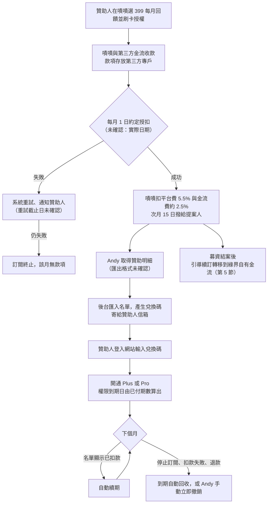
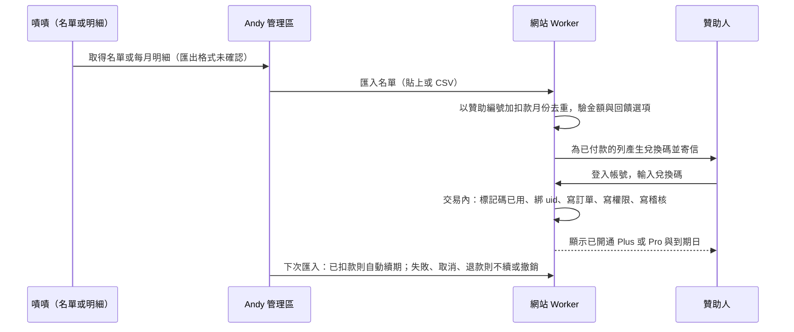
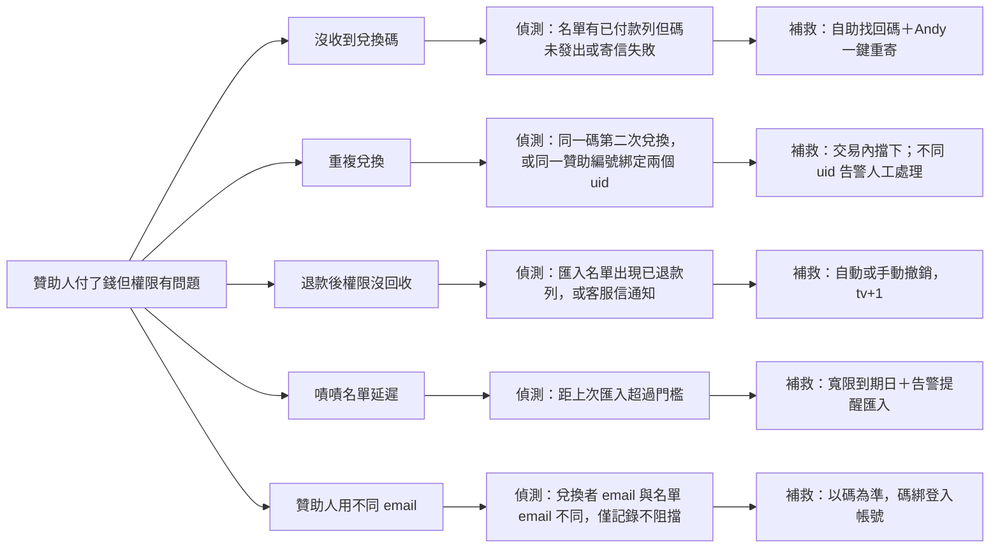

# 嘖嘖募資：平台費用、撥款與會員開通交付

> 產出日：2026-10-17（台北）。對象：Andy（個人經營者，首次募資）。**只是規劃文件，沒有改任何產品程式碼。**
> 查證方式：只有 WebSearch 摘要（讀不到原文頁面），**摘要是線索不是事實**。每項事實標來源與信心度；查不到一律標「未確認」，不假設。
> 已讀並對齊：`docs/payments/checkout_subscription_spec.md`（下稱「金流規格」）、`docs/payments/entitlement_security_review.md`（下稱「資安審查」）、`docs/checkout_plan.md`。
> 價格前提（Andy 本次指定）：Plus 299／月、Pro 549／月、募資回饋價 399／月；嘖嘖回饋選項單位為「每月」。**399 對應哪一個方案，Andy 尚未指定，本文標「待定」，不替他決定。**

## 0. 總覽流程圖

**五行結論：**

1. 嘖嘖訂閱式專案：平台費 5.5% 加金流費約 2.5%，合計約 8%（FAQ 摘要，信心中）；訂閱款項次月 15 日撥付；100 位 399 元贊助人約實收 36,708 元每月（試算，**未確認**）。
2. **嘖嘖有沒有 API、webhook、可匯出名單：查不到，一律未確認。** 只查到「每月贊助明細」與成功後可看「贊助人列表」，所以開通設計成「Andy 匯入名單 → 發兌換碼 → 贊助人自己兌換」，不依賴即時通知。
3. 與正式站規格有三處無法完全對齊：不能「付款後立即自動開通」、退款不能即時得知、價格 399 與方案價 299／549 不同。本文第 2 節逐項寫出折衷。
4. 開收前仍有金流規格列的三道牆（投信投顧法、付費資料仍在公開 JSON、無統編發票）；**改用嘖嘖收款不會讓這三道牆消失**。
5. 結案後續訂：卡片授權綁在原收款方，**應推論為無法搬移**（未確認），贊助人必須在網站重新授權；要設計避免雙重扣款。

---

## 1. 嘖嘖訂閱式專案如何運作

### 1-1 事實清單

| # | 項目 | 查到的內容 | 信心度 | 來源 |
|---|---|---|---|---|
| 1 | 專案類型 | 嘖嘖專案探索頁有獨立的「訂閱式專案」分類，與群眾集資、預購式、合作式並列 | 高 | 嘖嘖專案探索頁 [1] |
| 2 | 發起費用 | 發起計畫不收費，只有集資成功的專案才收平台手續費與金流費 | 中（頁面標示為較舊內容） | 嘖嘖常見問答 [2] |
| 3 | 平台手續費 | 5.5% | 中 | 常見問答 [2]、金流控管說明 [3]、adHub 文章 [8] |
| 4 | 金流費 | 約 2.5%，**依付款方式而異**，實際比例在《群眾募資專案委託契約書》附件表格；有摘要提到其中一項為 2.55% | 中低 | [2][3]、提案契約頁 [4] |
| 5 | 訂閱式專案專屬契約 | 網站有 `creator_terms_sub` 頁面，**內容沒讀到**，訂閱專案費率是否與群募相同：**未確認** | 低 | [10] |
| 6 | 扣款機制 | 贊助人同意「約定授扣」後，於每月月初扣款；多個專案與提案人文件寫「每月 1 號」 | 中（月初為官方，1 號為提案人說法） | [2]、HackMD 提案人筆記 [5]、專案公告 [6] |
| 7 | 扣款失敗 | 有社群整理文件稱：信用卡失效時系統持續嘗試扣款到當月 10 號並通知贊助人，未處理則 10 日後不再扣款並終止該訂閱；另一份提案團隊整理稱扣款失敗通知由藍新金流寄給提案人。**皆非官方，重試規則未確認** | 低 | [5][7] |
| 8 | 贊助人取消 | 到嘖嘖「贊助紀錄」→「修改／查看紀錄」→「停止訂閱」；在下個扣款日前取消就不再被扣 | 中 | 專案常見問答頁 [7] |
| 9 | 提案人結束專案 | 有提案人提醒：要結束訂閱專案必須在月底關閉計畫，否則持續扣款；也有專案公告說專案結束後會員不用取消，次月自動停止扣繳 | 中低 | [6][7] |
| 10 | 退款 | 集資期間：贊助人寫信嘖嘖客服附贊助編號，由客服協助退款；專案結束後須聯絡提案方；一次付多期的退款可能由提案團隊或客服處理。**專案結束後誰出錢、怎麼退：未確認** | 中低 | 專案常見問答頁 [7] |
| 11 | 撥款時程 | 訂閱專案款項於**次月 15 日**撥付（常見問答摘要）；提案人筆記稱每月 15 日把前一個月入款轉匯並同時收平台費，提供「每月贊助明細」（不是贊助人名單）。**群募與預購另有一種：完結後 28 個工作日內撥付（金流控管說明）。兩種說法並存，訂閱以哪個為準：以提案契約為準，未確認** | 中低 | [2][3][5] |
| 12 | 款項保管 | 所有提案團隊於專案上線前須在第三方金流平台開立專屬帳戶，集資款由第三方獨立託管；合作的金流業者含立吉富、藍新、統一數網、恩沛 | 中 | 金流控管說明 [3]、隱私權政策 [9] |
| 13 | 發票 | 贊助人收到的是金流公司寄出的收款證明，**不是**電子發票；發票或收據由各提案團隊自行開立 | 中 | 常見問答 [2]、搜尋摘要 [11] |
| 14 | 稅務風險案例 | 一個在嘖嘖營運訂閱的團隊公告：依最新稅務規定，**以公司名義營運訂閱制需能為會員開立合規發票**，因此嘖嘖方案全面中止並移轉到 Firstory。這是**單一提案人的說法**，不是嘖嘖平台公告，且適用對象（公司、個人）未確認 | 低 | 專案公告 [6] |
| 15 | 提案人資格 | 設籍台灣、完全行為能力的自然人，或合法登記的法人或團體；未成年需法定代理人同意。**此條只在 2022 年提案大賽簡章看到，不一定等於一般提案規定** | 低 | [12] |
| 16 | 審核 | 初審、二審，評估可行性、內容完整性與合法性（第三方介紹文章） | 低 | [13] |

### 1-2 實收試算（399 元每月、100 位贊助人）

假設：100 人全數當月扣款成功；平台費 5.5%、金流費 2.5%（取常見問答合計 8%）；無退款、無扣款失敗。**全部為試算，費率與是否另加營業稅皆未確認。**

| 項目 | 算式 | 金額（元） | 信心度 |
|---|---|---|---|
| 贊助總額（當月） | 399 × 100 | 39,900 | 高（假設） |
| 扣：平台手續費 5.5% | 39,900 × 5.5% | −2,194.5 | 中 |
| 扣：金流費 2.5% | 39,900 × 2.5% | −997.5 | 中低（依付款方式而異） |
| **提案人實收（基準）** | 39,900 − 3,192 | **36,708** | 中低 |
| 敏感度一：金流費改 2.55% | 金流費 1,017.45 | 36,688 | 低 |
| 敏感度二：平台費另加 5% 營業稅（**是否另加：未確認**） | 多扣 109.7 | 約 36,598 | 未確認 |
| 每位贊助人每月平均實收 | 36,708 ÷ 100 | 約 367.1 | — |
| 撥款時間 | 例：11 月 1 日扣款 → 12 月 15 日撥付（依「次月 15 日」讀法，約 44 天） | — | 中低 |
| 之後的稅 | 營業稅、所得稅、是否需營業登記：見 4 節與金流規格第 6 節，**未確認** | — | — |

另外要記住：
- 扣款失敗或退款的人沒有款項，實收會低於 36,708；失敗率沒有查到，**不假設**。
- 若 399 對應的是 Pro 且日後恢復 549，則同樣 100 人每月在自有金流下的毛額是 54,900，與本表無關。
- 對照自有金流（金流規格 1-2：綠界約 2.75%，加 5% 手續費稅約 2.89%）：399 元實收約 387.5 元，比嘖嘖多約 20.4 元每人每月（約 5.1 個百分點）；但自有金流還需要開發、客服與發票成本。

---

## 2. 贊助人付款後如何在我們網站開通權限

### 2-1 嘖嘖能提供什麼資料（決定整個設計）

| 問題 | 查到的 | 信心度 | 對設計的影響 |
|---|---|---|---|
| 有沒有 API | 搜尋兩次都沒有任何嘖嘖開放 API 的資料 | **未確認**（查無不等於沒有） | 設計不依賴 API |
| 有沒有 webhook（即時通知） | 查無 | **未確認** | 設計不依賴即時通知 |
| 贊助人名單 | 官方常見問答：**計畫成功結束後**，提案人可在計畫頁工具箱找到「贊助人列表」，含聯絡資料與贊助細節 [2]。**進行中的訂閱專案能否隨時看：未確認** | 中（群募）／未確認（訂閱） | 可能募資期間看不到完整名單 |
| 每月明細 | 嘖嘖每月 15 日提供「每月贊助明細」給提案人（提案人筆記，較舊）[5] | 低 | 至少每月能拿到一次 |
| 匯出格式 | 查無（是否 CSV、欄位為何） | **未確認** | 匯入器要能吃「貼上表格」或 CSV，欄位以實際檔案為準 |
| 贊助人的 email | 提案人可取得聯絡資料；贊助人嘖嘖帳號 email 與網站登入 email 不一定相同 | 中低 | 不能用 email 比對權限（與資安審查一致） |

### 2-2 比對方式選擇

| 方案 | 做法 | 優點 | 缺點 | 採用 |
|---|---|---|---|---|
| A 用 email 比對 | 網站會員 email＝嘖嘖 email 就自動開通 | 最簡單 | 違反資安審查「email 不做權限比對」（金流規格 2-1、T33、T34）；換信箱、冒用都會錯接 | 不採用 |
| B 贊助編號比對 | 贊助人輸入嘖嘖贊助編號 | 贊助人好理解 | 編號可能外流或被猜；仍需名單才能驗證 | 只當輔助查詢 |
| **C 兌換碼（建議）** | Andy 匯入名單後，系統為每位已付款贊助人產生一組一次性兌換碼，寄到名單上的 email；贊助人**登入網站帳號後**輸入兌換碼，碼綁定登入帳號的 uid | 持有碼＝已驗證；權限綁 uid，email 只用來寄碼 | 多一步操作；需要寄信能力（金流規格待辦 A8，**尚未註冊寄信服務**） | **採用** |

### 2-3 兌換碼流程

規則（逐條，對齊既有規格）：

| # | 規則 | 對齊的既有規格 |
|---|---|---|
| 1 | 兌換碼由 Worker 隨機產生（建議 12 碼，易讀字元集，約 60 位元），**資料庫只存雜湊**，明碼只在寄信那一刻出現；一碼一人一次 | 資安審查 A2-1「金鑰與祕密不外露」 |
| 2 | 每個碼綁定：贊助編號、對應方案（plus 或 pro）、可兌換期限（建議 90 天）、狀態（已發、已兌換、已撤銷、逾期） | 金流規格 2-2 新增 `zc_codes`、`zc_import_rows` 兩表，**只加不改** |
| 3 | 兌換必須登入；權限寫在登入帳號的 uid，**不用 email 比對** | 資安審查 A2-3、金流規格 T33／T34 |
| 4 | 兌換錯誤次數限制：每帳號每小時 5 次、同 IP 每分鐘上限，超過鎖定並告警 | 資安審查 A2-2 第 1 步 |
| 5 | 開通走既有 `activateFromCharge()` 的同一支邏輯（單一交易、冪等、期數公式），來源標 `zeczec_import`；`pay_orders.gateway` 新增值 `zeczec`；`perm.source` 用資安審查已定的 `grant` | 金流規格 3-1 原則 2、3-3；資安審查 A2-3 |
| 6 | 到期日仍由「已付最高期數」往後推算，不是「現在加 30 天」；每一期對應名單上一列「已扣款」 | 金流規格 3-3 |
| 7 | 續期：之後每次匯入，同一贊助編號出現新的「已扣款」列就自動延長，不必重發碼 | 同上 |
| 8 | 到期自動回收：名單未出現新的已扣款列，到期日一過 `perm` 自然失效，退回註冊會員（資料保留不刪） | 金流規格 2-3 狀態機 `expired` |
| 9 | 只在 Andy 手動撤銷、退款或扣款爭議時才立即收回：`expires=現在`、登入權杖 `tv+1`、通知 data-gw 作廢快照 | 資安審查 A2-3、A2-5 |

### 2-4 與正式站自有金流的差異與衝突（最重要）

| # | 項目 | 正式站規格 | 嘖嘖路線 | 衝突程度 | 折衷處理 |
|---|---|---|---|---|---|
| 1 | **付款後立即自動開通** | 六道保險，通知抵達後 5 秒內開通 | 沒有即時通知；名單最快是 Andy 匯入後才有，月明細是次月 15 日 | **高，無法對齊** | 改成「碼發出才算付款確認」：匯入名單後發碼，贊助人兌換即時開通。承諾口徑要改：**付款後最慢 N 小時內收到碼（N 由 Andy 的匯入頻率決定，建議募資期間每天匯入一次）** |
| 2 | 「不可漏開」 | 任何已付款未開通超過 2 分鐘就告警 | 無法偵測「已付款但還沒進名單」 | 高 | 嘖嘖後台人工比對：每次匯入時，名單中有「已付款但沒有碼」的列一律告警；另開「我沒收到碼」自助入口（3 節 ZF01） |
| 3 | **退款即時回收** | 先收權限再退錢，權限立即失效 | 募資期間退款由嘖嘖客服處理，**不一定會即時通知 Andy**（通知方式未確認） | 高 | 每次匯入比對「已退款」列→自動撤銷；另請 Andy 向嘖嘖問清楚退款通知管道（4 節）；在那之前接受「最遲在下次匯入時回收」，並寫進條款 |
| 4 | **價格** | 方案價 Plus 299／Pro 549（`plans` 表），金額驗證＝訂單快照 | 贊助金額 399，且與 299／549 都不同 | 中 | 新增「回饋選項對照表」`reward_tiers`（嘖嘖回饋→方案→贊助金額→涵蓋月數）。匯入驗金額時比對**回饋選項的金額**，不比對現行方案價；`pay_orders.amount` 存 399 快照，之後調價不影響舊單。**399 對應 Plus 或 Pro：待 Andy 定。** 若對應 Pro，等於折扣 150 元；若對應 Plus，等於加價 100 元（不合理，應不採用）。價格是否保價及保到何時：待 Andy 定，並寫進嘖嘖頁面與條款 |
| 5 | 週期 | 月繳／年繳 | 嘖嘖只有「每月」 | 低 | 年繳不在嘖嘖路線 |
| 6 | 7 天鑑賞期與退款保證 | 站方自願 7 天內全額退款、結帳時兩個勾選框留證據 | 結帳在嘖嘖頁面完成，**勾選框與同意證據不在我們手上** | 中 | 兌換時再彈一次同意畫面（排除七日解除權、告知續扣方式），記 `consent_at`、`consent_version`；⚖ 請法遵確認嘖嘖頁面上的告知是否足夠 |
| 7 | 發票 | `invoice_mode`：無統編時寄電子收據 | 嘖嘖只給收款證明，發票由提案人自開 | 中 | 沿用 `receipt`；有統編後須對嘖嘖收入開立發票，**實務方式未確認**（記帳士，4 節） |
| 8 | 寬限期 | 到期後 3 天；`active` 另加 24 小時緩衝 | 月明細次月 15 日才到，若 24 小時緩衝一到就收回，**已付款者每月 2 日到 15 日都會被誤鎖** | 高 | 建議：每期到期日定為「下次扣款日（次月 1 日）加 15 天」，涵蓋重試到 10 號與明細 15 號；代價是扣款失敗者最多多用 15 天。**屬 Andy 要拍板的規則，非本文決定**；若嘖嘖能提供即時名單，則縮回 24 小時 |
| 9 | 法律門檻 | 投信投顧法等三道牆 | 嘖嘖收款也是收費 | 無差異 | **改用嘖嘖不會繞過**，開收前仍須完成 ⚖（金流規格 1-1 第 5 點） |
| 10 | 退款前提 | 錢由 Andy 到金流後台手動退刷（第一版） | 募資期間退款由嘖嘖客服執行；結案後可能是 Andy 自己退 | 中 | 結案後的退款流程待嘖嘖契約確認（未確認） |

### 2-5 最小成本與第一步

| 項目 | 做得到的第一步 | 最小成本 |
|---|---|---|
| 匯入名單 | 先做「貼上表格」匯入頁，欄位待拿到實際檔案再定 | 約 4～6 小時（估算，依既有 Worker 與管理區沿用） |
| 兌換碼 | 沿用 `perm` 與 `activateFromCharge()`，新增兩張表與兩個端點（兌換、找回碼） | 約 6～10 小時（估算） |
| 寄信 | 註冊寄信服務（金流規格待辦 A8） | 免費額度與價格未確認 |
| 最陽春替代 | 不寫程式：Andy 手動在 `#admin/perm` 對每位贊助人送出 N 個月方案，一人一人處理 | 0 元，但 100 人以上無法維持，且不能自動回收 |

---

## 3. 失敗模式樹

| 編號 | 失敗模式 | 怎麼發生 | 偵測 | 自動補救 | 人工補救 | 信心度 |
|---|---|---|---|---|---|---|
| ZF01 | 贊助後沒收到兌換碼 | 信寄進垃圾信箱、名單 email 填錯、寄信服務故障、匯入前尚未入名單 | 匯入時「已付款但碼未發出」列表；寄信失敗記錄；贊助人來信 | 網站「找回兌換碼」：輸入贊助編號，**只寄到名單上的 email，頁面不顯示碼**（避免被冒領）；寄信失敗自動重試 3 次 | Andy 在管理區按「重寄」，或直接把碼用其他管道給贊助人（先核對贊助編號與嘖嘖訂單） | 設計值 |
| ZF02 | 重複兌換 | 同一碼被兩人用、同一人兩個帳號用同一碼、轉送碼 | 兌換交易撞「已兌換」；同一贊助編號出現第二個 uid | 單一交易內以碼狀態為準，第二次回「已使用」；不同 uid 嘗試兌換同一贊助編號時**拒絕並告警** | 若是贊助人換帳號：Andy 在管理區「解除綁定再重發新碼」，舊碼作廢，舊 uid 權限收回（此操作寫稽核） | 設計值 |
| ZF03 | 退款後權限沒回收 | 募資期間退款由嘖嘖客服處理，沒通知 Andy；或結案後 Andy 自己退但忘了撤銷 | 每次匯入比對狀態欄位；Andy 退款時的管理區按鈕；每週對帳：已退款名單 vs 仍有效的 `source=grant` 權限 | 名單出現「已退款或已取消」列→自動撤銷對應 uid 的權限、`tv+1`、通知 data-gw 作廢快照 | Andy 在管理區「依贊助編號撤銷」；若嘖嘖不給退款狀態欄位（**未確認**），改為每月人工核對一次 | 設計值 |
| ZF04 | 嘖嘖名單延遲 | 名單只有每月 15 日一份；成功後才能看完整名單；匯出功能不存在 | 距上次成功匯入超過 2 天（募資期間）或 35 天（月明細）→ 告警 | 到期日採「次月 1 日加 15 天」，延遲期間不誤鎖已付款者；新贊助人因為沒有碼而暫時無法開通 | 向嘖嘖客服要名單；必要時先由 Andy 手動送方案給已核對的贊助人（限期，標 `source=manual`，之後以名單補正） | 設計值 |
| ZF05 | 贊助人用不同 email | 嘖嘖帳號用 A 信箱、網站用 Google 登入的 B 信箱、碼寄到 A | 兌換時比對名單 email 與登入 email，**不同只記錄、不阻擋** | 因為權限綁 uid 而非 email，不同 email 不影響兌換；碼寄到名單信箱，贊助人在 A 信箱收碼、用 B 帳號登入兌換即可 | 贊助人收不到 A 信箱 → 用贊助編號與嘖嘖「贊助紀錄」截圖向 Andy 證明，由 Andy 重寄到新信箱並記稽核 | 設計值 |
| ZF06 | 名單格式變動 | 嘖嘖改欄位、匯出檔多了欄 | 匯入器驗必要欄位，缺欄整批拒絕並指出缺哪一欄 | 整批不入庫 | 人工調整欄位對照後重匯 | 設計值 |
| ZF07 | 金額與回饋選項對不上 | 贊助人加碼贊助、選到別的回饋 | 匯入驗證：金額不等於 `reward_tiers` 對應金額 | 該列暫存「待人工」，不發碼 | Andy 檢視，確認後手動放行 | 設計值 |
| ZF08 | 同一人兩個帳號各買一份 | 一人多單 | 同 email 多筆贊助編號 | 各自獨立處理，不合併 | 無需處理（付了兩份就是兩份） | 設計值 |

---

## 4. Andy 要動手的事（一句話一項）

> 「嘖嘖所需文件」的官方清單查不到，以下標示哪些是查到的、哪些是推論。

| # | 事項 | 狀態 | 依據與信心度 |
|---|---|---|---|
| 1 | 到嘖嘖註冊會員帳號（Email 登入），並用同一帳號進入 `zeczec.com/start?type=subscription` 開始提案。 | ⬜ | 提案入口由 Andy 提供；註冊細節未確認 |
| 2 | 先寄信到 `support@zeczec.com` 問清楚六件事：**① 個人能否提訂閱式專案 ② 提案人能不能隨時看或匯出贊助名單（含欄位）③ 有沒有 API 或即時通知 ④ 扣款失敗的重試規則與是否通知提案人 ⑤ 募資期間與結案後退款誰執行、是否通知提案人 ⑥ 訂閱專案的實際費率、撥款日、結案後能否停止新增贊助但保留既有扣款**。 | ⬜ | 全部目前未確認 |
| 3 | 閱讀並簽署《訂閱式專案委託契約書》（`creator_terms_sub`），附件費率表拍照存檔。 | ⬜ | 契約頁存在 [10]，內容沒讀到 |
| 4 | 通過嘖嘖的身分與專案審核（初審、二審）。 | ⬜ | 審核流程為第三方介紹文章 [13]，低信心 |
| 5 | 在嘖嘖合作的第三方金流業者（立吉富、藍新、統一數網、恩沛之一）開立提案專屬收款帳戶，提供收款的銀行帳戶。 | ⬜ | 專戶規定 [3]、業者名單 [9]；**個人所需文件清單查不到**。一般慣例為身分證件與本人銀行帳戶封面，**僅為推論，以嘖嘖與金流業者要求為準**；個人戶收款額度上限：未確認 |
| 6 | 確認提案身分：個人提案需為設籍台灣、完全行為能力的自然人；若要以公司或行號名義，需準備登記文件。 | ⬜ | 僅 2022 年簡章 [12]，低信心 |
| 7 | 問記帳士三件事：嘖嘖撥款算不算銷售額、要不要辦稅籍或登記行號、要不要對贊助人開發票（有提案人公告以公司名義營運訂閱需開合規發票 [6]）。 | ⬜ | 稅務全部未確認；起徵點資料見金流規格第 6 節（勞務每月 5 萬元起，399 元約 126 人月收達 5 萬，**此試算以毛額計，是否適用未確認**） |
| 8 | 決定 399 對應 Plus 還是 Pro、是否保價、保到何時，並告訴我，我再寫進 `reward_tiers`。 | ⬜ | Andy 的商業決定 |
| 9 | 決定到期緩衝規則（建議「次月 1 日加 15 天」，見 2-4 第 8 列）。 | ⬜ | 設計值 |
| 10 | 註冊寄信服務並開兩步驟驗證（沿用金流規格 A8、A10）。 | ⬜ | 免費額度未確認 |
| 11 | 預約律師一小時，確認「嘖嘖頁面告知＋站內再同意」是否足夠，以及投信投顧法三道牆（沿用金流規格 A7）。 | ⬜ | 沿用既有規格 |
| 12 | 拿到第一份實際名單或明細後，丟給我（遮住個資後只留欄位名），我再定匯入欄位。 | ⬜ | 欄位未確認 |

---

## 5. 募資成功後與自有金流（綠界等）的銜接建議

### 5-1 前提與限制

| 事實 | 信心度 |
|---|---|
| 綠界定期定額：授權失敗可補授權（只限最新一筆）、可終止，**終止後無法重新啟動，只能建新單**（綠界官方文件摘要，金流規格已引用） | 中高 |
| 信用卡定期定額綁在原收款方的授權，換收款方需要持卡人**重新授權**（依上述文件機制與一般換卡常識推論，**沒有找到明文，未確認**） | 低 |
| 綠界個人會員能否開信用卡定期定額：兩家都查不到，**未確認**（金流規格待辦 A2）；本次再搜尋仍查無 | 未確認 |
| 嘖嘖訂閱專案結案後是否自動停扣、能否讓既有訂閱者續扣、贊助人已付款項能否退：**未確認** | 未確認 |

### 5-2 兩條路線比較

| 項目 | 路線一：既有贊助人留在嘖嘖，新用戶走自有金流 | 路線二：全數轉移到自有金流 |
|---|---|---|
| 做法 | 嘖嘖專案維持扣款，名單／兌換碼持續運作；結案後新訂閱者走網站結帳（綠界）299／549 | 結案前或後，邀請贊助人到網站重新訂閱，再停掉嘖嘖扣款 |
| 費用 | 既有人繼續被抽約 8%（每人每月約 31.9 元） | 轉移後約 2.9%，每人每月約省 20 元 |
| 工作量 | 兩套並行：嘖嘖匯入器＋綠界金流 | 先做一套綠界；嘖嘖只在轉移期用 |
| 贊助人阻力 | 低（不用動） | 高（要重新輸入信用卡、擔心雙重扣款） |
| 風險 | 嘖嘖路線無即時通知，維運成本高；是否能「只停新增、保留扣款」未確認 | 轉移期可能雙重扣款或中斷 |
| 建議 | **先走這條**（零中斷）；等綠界定期定額上線、確認個人可用後，再逐批邀請轉移 | 作為第二階段 |

### 5-3 轉移步驟（路線二，建議時序）

| 步 | 做什麼 | 避免的風險 |
|---|---|---|
| 1 | 綠界申請通過、測試商店走完首期、續扣、取消、退款（金流規格第 7 節） | 未驗證就轉移 |
| 2 | 對贊助人發通知信：說明價格保留（399，若 Andy 決定保價）、轉移方式、日期；網站提供「轉移」按鈕 | 贊助人不知情 |
| 3 | 贊助人在網站完成綠界授權時，**首期扣款日設在嘖嘖最後一個已付期間結束之後**（金流規格 `started_at` 與期數公式可直接支援） | 同月雙重扣款 |
| 4 | 贊助人自行到嘖嘖「停止訂閱」（贊助紀錄→修改／查看紀錄→停止訂閱）[7]，Andy 同時在嘖嘖側關閉計畫的時間點必須是**月底**（提案人經驗：未關閉會持續扣款）[7] | 該停沒停 |
| 5 | 對應的 `perm` 紀錄由 `source=grant` 改為 `source=gateway`，`pay_orders` 新單帶舊贊助編號作關聯 | 權限斷線；對帳對不起來 |
| 6 | 雙邊對帳一個月：嘖嘖名單 vs 綠界訂單，不能同月兩邊都有已付款 | 重複收費 |
| 7 | 發票：進入自有金流後依金流規格第 6 節處理；嘖嘖時期的收入開票方式依記帳士意見補 | 稅務空窗 |

### 5-4 結案後仍待確認的事

- 募資成功後，贊助人與提案人的資料處理：嘖嘖隱私權政策列出提案人可取得聯絡資料 [9]，**我們用這些資料寄兌換碼與轉移通知，是否在告知範圍內：未確認，⚖ 請法遵確認**；網站隱私權政策需新增「來自嘖嘖的贊助資料」條目。
- 募資價 399 與正式價 299／549 並存時，網站結帳頁需要同時支援兩種價格快照（金流規格 `pay_orders.amount` 已是下單當下快照，無需改欄位）。

---

## 6. 來源（查證日 2026-10-17；皆為 WebSearch 摘要，未讀原文）

1. 嘖嘖專案探索（訂閱式專案分類）：https://www.zeczec.com/categories?type=3
2. 嘖嘖常見問答：https://www.zeczec.com/faq
3. 嘖嘖平台提案人金流控管說明：https://www.zeczec.com/docs/funds-rules
4. 嘖嘖提案契約頁：https://www.zeczec.com/docs/creator_terms
5. 提案人 HackMD 筆記「訂閱式專案」（約三年前，較舊）：https://hackmd.io/@waterwater/BJsousXGT
6. 某訂閱專案「嘖嘖訂閱中止，移轉 Firstory」公告（提案人說法）：https://www.zeczec.com/projects/e-reader/updates/60025
7. 嘖嘖各專案常見問答頁（取消訂閱、退款、月底關閉專案經驗），例：https://www.zeczec.com/projects/mindynews/faqs 、https://www.zeczec.com/projects/the-big-issue/faqs
8. adHub：嘖嘖平台全攻略：https://www.ad-hub.net/blog/zeczec-crowdfunding/
9. 嘖嘖隱私權政策（合作金流業者、提案人資料）：https://www.zeczec.com/docs/privacy
10. 嘖嘖訂閱式專案提案契約頁（內容未讀到）：https://www.zeczec.com/docs/creator_terms_sub
11. 發票與收款證明相關摘要（嘖嘖 FAQ 與專案頁）：https://www.zeczec.com/faq
12. 2022 嘖嘖群眾集資提案大賽簡章（提案人資格，僅供參考）：https://bhuntr.com/tw/competitions/29lld3nit2zc4qtd8m
13. 嘖嘖專案經理提案檢測（第三方介紹）：https://www.watchinese.com/article/2020/25123
14. 綠界信用卡定期定額訂單作業：https://developers.ecpay.com.tw/2900/

## 7. 未確認總表

| # | 未確認事項 | 怎麼確認 |
|---|---|---|
| 1 | 訂閱式專案的實際費率（含是否另加營業稅）與附件金流費率表 | 讀契約 `creator_terms_sub`（4 節第 3 項） |
| 2 | 撥款：次月 15 日 vs 28 個工作日，何者適用訂閱 | 同上＋客服 |
| 3 | 有無 API、webhook、可匯出名單與欄位 | 客服（4 節第 2 項） |
| 4 | 扣款日、失敗重試截止日、失敗是否通知提案人 | 客服 |
| 5 | 募資期間與結案後的退款執行者與通知 | 客服 |
| 6 | 個人提案所需文件、收款額度、是否須營業登記 | 客服與第三方金流業者 |
| 7 | 稅務與發票義務 | 記帳士 |
| 8 | 結案後既有訂閱者是否可續扣、能否停止新增贊助 | 客服 |
| 9 | 綠界個人會員可否開定期定額、撥款週期 | 綠界客服（金流規格 A2） |
| 10 | 399 對應方案、保價期限、到期緩衝規則 | Andy 決定 |
