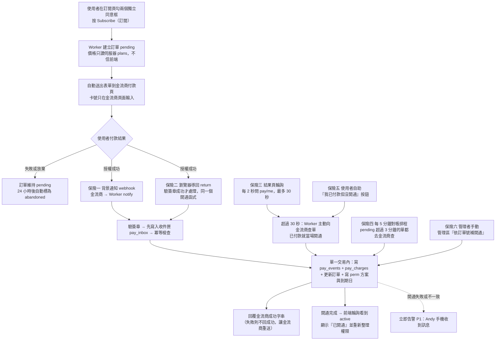
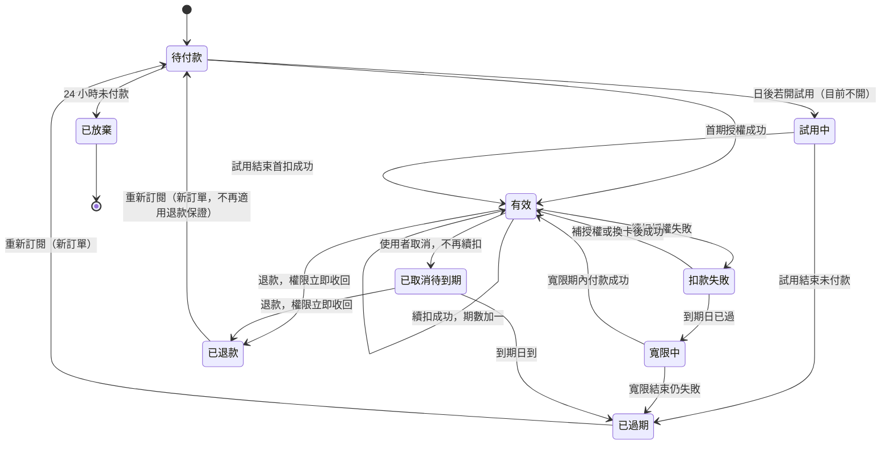
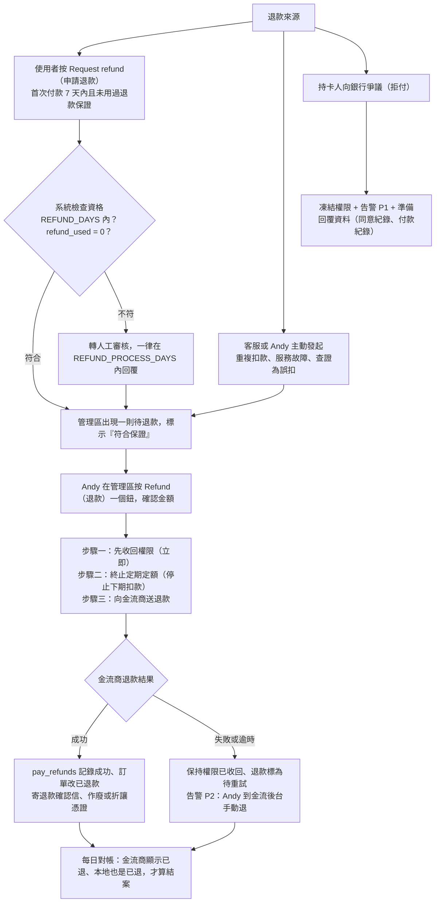
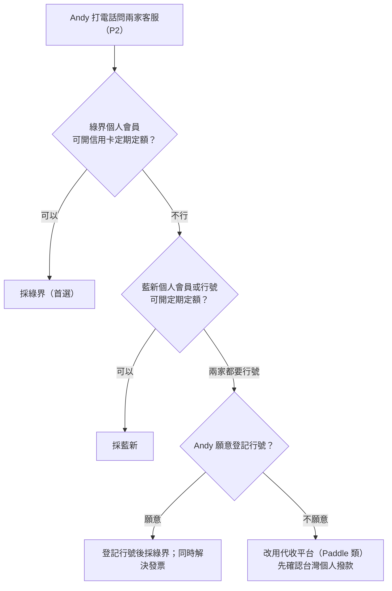
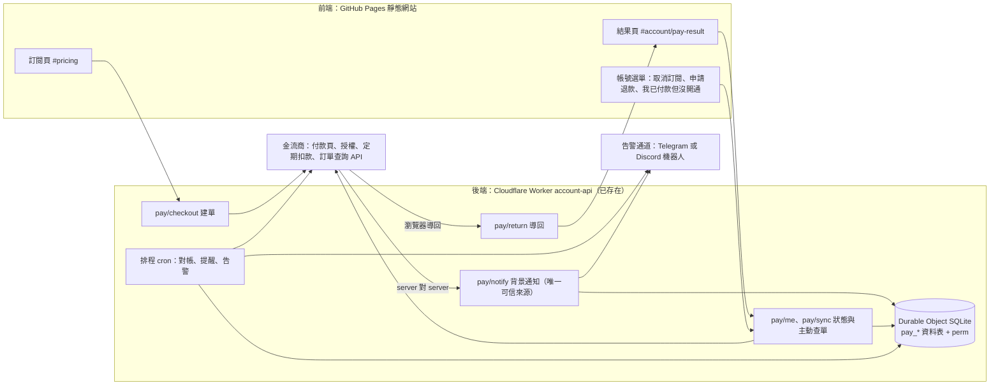
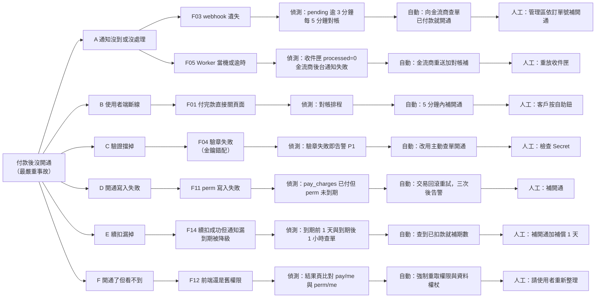
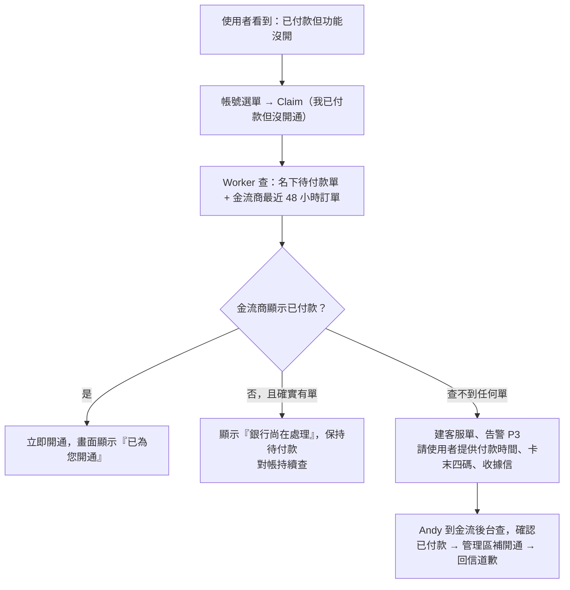

# 結帳付款與訂閱制規格（付款後必定開通）

> 產出：payments-billing，2026-10-11（台北）。**只是規格，沒有改任何產品程式碼、沒有 commit、沒有 push。**
> 起因：Andy 要求「確認付款後記錄付款時間、訂閱多久、多久後自動取消；客戶付款後必須立刻開放功能，絕對不能發生付了款沒開通；退款要能快速退款」。
> 查證方式：只有 WebSearch 摘要（出口代理擋 WebFetch，讀不到金流商原文）。**每個事實標來源、日期、信心度；標「未確認」的不准當定論。**
> 金鑰、測試金鑰、商店代號一律不寫進本文件或 repo（repo 是 public）。
> 符號：⬜ 待辦｜🔄 進行中｜✅ 完成｜⚖ 請法遵（legal-compliance）確認｜🔒 請資安（security-privacy）確認。
> 本次**沒有**實際向法遵、資安、前端專家取得回覆（沒有可用的派工通道），改以既有文件為依據：`docs/payment_newebpay_plan.md`、`docs/checkout_plan.md`、`docs/launch_gap_payment_1009.md`、`docs/legal_refund_1009.md`、`docs/legal_payment_faq_1006.md`、`docs/security_review_1006.md`、`workers/account-api/worker.js`。凡是與法律、資安交界的地方都標了 ⚖ 或 🔒，請 CEO 轉派。

---

## 0. 總覽圖（先看這節）

### 0-1 付款到開通的完整流程圖（六道保險，任何一道成功就開通）

### 0-2 訂閱狀態機

### 0-3 退款流程圖

### 0-4 本文件章節與狀態一覽

| 章節 | 內容 | 狀態 | 負責人 |
|---|---|---|---|
| 1 | 結論與金流商選擇、靜態網站下的接法 | ⬜ 待 Andy 打電話確認 P2 | payments-billing、Andy |
| 2 | 資料表與狀態機 | ⬜ 待實作 | backend（Worker） |
| 3 | 付款後必定開通（最重要） | ⬜ 待實作 | backend、security-privacy 🔒 |
| 4 | 退款機制 | ⬜ 待實作；7 天鑑賞期 ⚖ | backend、legal-compliance |
| 5 | 續訂與取消 | ⬜ 待實作 | backend、frontend-ui |
| 6 | 發票與稅務 | ⬜ 待記帳士 | Andy、記帳士 |
| 7 | 上線前驗收（沙盒 32 條） | ⬜ 待實作後執行 | QA（`_uitest` 與 node 測試） |
| 8 | 分階段交付、工時、Andy 要動手的事 | ⬜ | CEO 排工 |

---

## 1. 結論

### 1-1 五行結論

1. **金流商：以「綠界（ECPay）信用卡定期定額」為首選實作對象，藍新（NewebPay）為備案；兩家的程式只差一層轉接頭，切換成本約 1 個工作天。** 理由是綠界的定期定額 API 文件公開可查（授權通知 PeriodReturnURL、補授權 ReAuth、終止 Cancel、訂單查詢），而「訂單查詢」正是「付款後必定開通」的補救核心。**但「個人會員能不能開定期定額」兩家都查不到原廠說法（未確認），必須 Andy 打電話問（待辦 P2）。**
2. **Stripe 台灣不能當首選**：2026 年的第三方資料互相矛盾（有的說完全不支援、有的說可申請但本地撥款受限），不能假設可用。**代收平台（Paddle、Lemon Squeezy 這類「經銷商代收」）是沒有統編時的備案**，台灣個人撥款是否支援**未確認**。
3. **靜態網站沒有後端不是問題**：後端就是已經在線上的 Cloudflare Worker `workers/account-api`（會員、方案、到期日都已在裡面）。付款頁由金流商代管，卡號永遠不經過我們；金流商用 webhook（背景通知）打回 Worker，Worker 用同一個「開通函式」寫入 `perm` 方案與到期日。金鑰只放 Worker Secret。
4. **「付款後必定開通」靠六道保險，不是靠一道**（第 3 節）：背景通知、瀏覽器導回、結果頁輪詢加主動查單、每 5 分鐘對帳、使用者自助按鈕、管理者手動補開通。**任何一道成功就開通，且每次開通都是冪等的（重複執行不會多加期間）。** 開通失敗或不一致會在 2 分鐘內推播到 Andy 手機。
5. **開收前還有三道牆不是工程問題**：⚖ 投信投顧法（一收錢「報酬」要件就成立，見 `docs/legal_payment_faq_1006.md`）、付費資料仍在公開 JSON（`docs/security_review_1006.md` D3，收錢前必做）、沒有統編不能開統一發票（第 6 節）。工程可先做到沙盒為止，**開收開關要等這三件有結論**。

### 1-2 金流商比較（查證日 2026-10-11；所有數字都是第三方摘要，信心偏低）

| 項目 | 綠界 ECPay | 藍新 NewebPay | Stripe | Paddle／Lemon Squeezy（代收） | TapPay | LINE Pay |
|---|---|---|---|---|---|---|
| 信用卡費率 | 國內卡 2.75%、海外卡 3.5%，每筆最低 5 元，未稅（Shopify 應用程式頁摘要，**非官網費率表**）。信心：中低 | 2.8% 起（ithelp 第三方文章）。信心：中低 | 不適用（見下列「個人可否」） | 5% 加 0.5 美元／筆，無月費；Lemon Squeezy 訂閱另加 0.5%，國際卡另加 1.5%（比較部落格，其中一家是競品，需對照官網）。信心：中低 | 國內卡 2.75%、海外卡 3.5%，另計 5% 營業稅；**系統建置費 5,000 元、會員年費 9,600 元**（TapPay 官網定價頁摘要）。信心：中 | 未確認 |
| 撥款週期 | **未確認**。只查到另一種付款方式（網路 ATM）「隔日撥款」，不能套用到信用卡 | **未確認** | 不適用 | 未確認 | 未確認 | 未確認 |
| 訂閱制（定期定額）API | **有**：授權通知 PeriodReturnURL（要回字串 `1\|OK`）、補授權 ReAuth（只能補最新一筆失敗，stage 測試環境無法測）、終止 Cancel（終止後不能重啟，只能建新單）、訂單查詢。來源：綠界官方開發者文件摘要。信心：中高 | **有**：定期定額、可改金額／暫停／終止（第三方 SDK 說明）；第三方說明指出扣款時會先授權較多期（顯示 99 期）但每週期只扣一次。信心：中 | 有（Subscriptions） | 有 | 搜尋未見定期定額專屬說明，**未確認** | 搜尋未見，**未確認** |
| 電子發票 | 綠界電子發票（要營業登記統編，**未確認具體條件**） | ezPay（要統編；要購買發票額度）。信心：中 | 不適用 | 由代收平台處理（對外賣方是平台）。**未確認** | 無（需另接） | 無 |
| 個人可否申請 | 有「個人會員」；**個人會員能否開定期定額：未確認** | 個人開發者摘要說「需要能開統編」。信心：中低；**個人能否開定期定額：未確認** | 2026 年第三方資料互相矛盾：有的說不支援台灣商家，有的說個人可申請但本地撥款受限，建議美國公司或代收平台。信心：低。**不可假設可用** | **未確認**（搜尋完全沒查到台灣個人撥款說明） | 企業導向（有建置費與年費），個人**未確認**，不建議 | 未確認 |
| 退款時金流手續費是否退還 | **未確認**（官方退款文件沒寫） | **未確認** | — | — | — | — |
| 退款技術限制 | 授權後未關帳用「放棄」釋放額度；已關帳才「退刷」；**退刷不支援部分金額（分期與紅利一律全額）**，帳戶餘額不足不能退刷（要預存）。來源：綠界信用卡請退款文件摘要。信心：中高。**定期定額是否可部分退：未確認** | 有取消授權與退款 API（第三方 SDK 功能列表）。信心：中 | — | — | — | — |
| 做得到的第一步 | 打客服問第 8 節 P2 六題；同時註冊測試商店（不需統編） | 同左 | 不做 | 不做，除非兩家都不收個人 | 不做 | 不做 |
| 最小成本 | 0 元開辦（未確認）；每筆約 2.75% | 0 元開辦（未確認）；每筆約 2.8% 起 | — | 每筆 5% 加 0.5 美元 | 14,600 元起（建置加年費） | — |

**依「沒資料就不選」的規則，結論用決策樹表示：**

**實收試算（以綠界 2.75% 加 5% 手續費稅，數字為估算）：**

| 方案（月繳，Andy 指定） | 手續費 | 約實收 | 備註 |
|---|---|---|---|
| NT$399 | 約 10.97 元，加稅約 11.5 元 | 約 387 元 | ⚠ 價格三版本對不上（399／799、程式內建 299／549、正式站為 0「價格待定」），見 `docs/launch_gap_payment_1009.md` P1，**請 Andy 先定價** |
| NT$799 | 約 21.97 元，加稅約 23.1 元 | 約 776 元 | 同上 |

**App 內購（IAP）**：本站現在是網頁，付款在瀏覽器完成，**不經過蘋果、Google，沒有 15～30% 抽成**。若日後上架 App 並在 App 內賣數位訂閱：蘋果規則 3.1.1 預設要求走內購；2025 年 5 月法院命令後，**僅「美國商店」**放寬了外部購買連結（搜尋摘要，信心：中）；**台灣商店的規則這次沒查到，未確認**；抽成比例（常見 15%／30%）我沒有查到 2026 年的原文，**未確認**。結論：**上架 App 前要另案查證，在那之前 App 內不放任何價格與購買按鈕**（對應 `docs/mobile_release_plan.md`）。

### 1-3 靜態網站沒有後端的接法（架構總圖）

- **不需要新後端、不需要新資料庫**：沿用 `account-api` 的 Durable Object SQLite（現有 `perm`、`plans`、`bill_flags`、`sub_requests`、`grants`）。
- **不用 Stripe 那種「Payment Link 加 Customer Portal」的現成託管頁**也能達到同樣效果：付款頁（金流商代管）取代 Payment Link；取消與換卡自己做在帳號選單（因為綠界、藍新沒有現成 Customer Portal，**未確認**）。若日後真的用到 Stripe 或代收平台，架構不變：只換轉接頭、webhook 簽章改用該平台規則。
- **金鑰**：`wrangler secret put` 或 Cloudflare 後台「Workers → 變數 → 加密」。清單：`ECPAY_MERCHANT_ID`、`ECPAY_HASH_KEY`、`ECPAY_HASH_IV`（藍新則 `NEWEBPAY_*`）、`ALERT_BOT_TOKEN`、`ALERT_CHAT_ID`、`TRIAL_HMAC_KEY`（已有）。**測試金鑰也是金鑰，不進 repo。** push 前照 CLAUDE.md 掃 `git grep`。🔒
- **公開 repo 的特別注意**：`workers/account-api/wrangler.toml` 只放非機密的變數（網址、旗標）；`MerchantID` 是半公開識別碼但仍放 Secret，避免被拿去偽造通知。
- **現有缺口（已驗證程式碼）**：Worker **完全沒有寄信能力**（`launch_gap_payment_1009.md` 1-1）、`perm` 以 **email 為主鍵**（不是 uid）、`sub_requests` 沒有同意欄位、`data-gw` 未部署。這些在第 8 節列為前置工作。

---

## 2. 資料表清單與狀態機

> 全部建在同一個 Durable Object SQLite，沿用既有寫法（檔尾新增區塊、只加不改）。**不存任何卡號、安全碼**；只存金流商回的卡片末四碼與卡別，方便客服。

### 2-1 `pay_orders`：訂閱主檔（一份訂閱合約一列）

| 欄位 | 型別 | 說明 | 狀態 |
|---|---|---|---|
| `order_no` | 文字，主鍵 | 我方訂單號，只含英數，長度 ≤ 20（綠界 MerchantTradeNo 上限 20，**藍新上限未確認**） | ⬜ |
| `uid`、`email` | 文字 | 綁**登入帳號 uid**，不靠付款人填的 email（避免付款 email 與登入 email 不同而對不上）；`perm` 以 email 為鍵，開通時以登入 email 寫入 | ⬜ |
| `gateway` | 文字 | `ecpay`、`newebpay`、`manual` | ⬜ |
| `gw_trade_no` | 文字 | 金流商交易編號（首期） | ⬜ |
| `gw_period_id` | 文字 | 金流商定期定額訂單識別（取消、查詢用；欄位名以正式文件為準，**未確認**） | ⬜ |
| `plan`、`period` | 文字 | 方案（plus、pro）、週期（month、year） | ⬜ |
| `amount`、`currency` | 整數、文字 | 每期金額與幣別（`TWD`）。**價格快照**：下單當下的價格，之後方案調價不影響舊訂單 | ⬜ |
| `status` | 文字 | 見 2-3 狀態機：`pending`、`trialing`、`active`、`payment_failed`、`grace`、`canceling`、`canceled`、`refunded`、`expired`、`abandoned` | ⬜ |
| `auto_renew` | 0／1 | 自動續訂開關（使用者取消 → 0） | ⬜ |
| `cancel_requested_at` | 毫秒 | 使用者按取消的時間 | ⬜ |
| `cancel_effective_at` | 毫秒 | 取消生效日＝當期結束日（取消後使用到期末） | ⬜ |
| `started_at` | 毫秒 | **首次付款成功時間**（＝ `bill_flags.first_paid`，退款 7 天從這天算） | ⬜ |
| `period_no_paid` | 整數 | 已成功扣款的最高期數（開通期間只由它計算，見 3-3） | ⬜ |
| `current_period_start`、`current_period_end` | 毫秒 | 目前這一期的起訖 | ⬜ |
| `next_charge_at` | 毫秒 | 下次扣款日（金流商若有回就存回傳值，否則自算；**回傳欄位未確認**） | ⬜ |
| `exec_times_total` | 整數 | 委託的總期數上限（綠界月繳最多 99、年繳最多 9，來源：既有 `checkout_plan.md`，**未再核對**） | ⬜ |
| `auto_end_at` | 毫秒 | **多久後自動取消**＝委託期數用完的日期（`started_at` 加總期數個週期）；到這天委託自動結束，不會無限扣款 | ⬜ |
| `grace_until` | 毫秒 | 寬限截止（預設到期日加 3 天，與既有決策一致） | ⬜ |
| `consent_at`、`consent_version`、`consent_waive7`、`consent_renew` | 毫秒、文字、0／1、0／1 | 結帳時兩個勾選框的同意證據：排除七日解除權、同意自動續扣。⚖ | ⬜ |
| `invoice_mode` | 文字 | `receipt`（電子收據，無統編時）、`einvoice`（有統編後） | ⬜ |
| `created`、`updated` | 毫秒 | | ⬜ |

### 2-2 其他資料表

| 資料表 | 用途 | 關鍵欄位 | 狀態 |
|---|---|---|---|
| `pay_charges` | **每一期每一次扣款**一列（付款時間、金額都在這） | `charge_id` 主鍵、`order_no`、`period_no`、`gw_trade_no`（唯一）、`amount`、`currency`、`status`（`authorized`、`captured`、`failed`、`refunded`、`partial_refunded`）、`paid_at`（**付款時間**）、`card_last4`、`card_brand`、`fail_code`、`fail_msg`、`source`（`notify`、`return`、`sync`、`reconcile`、`claim`、`admin`，記錄是哪一道保險開通的）、`invoice_no`（發票或收據號碼）、`created` | ⬜ |
| `pay_events` | **冪等表**：同一事件只處理一次 | `event_key` 主鍵（＝ `gw_trade_no` 加通知類型）、`order_no`、`received`、`result` | ⬜ |
| `pay_inbox` | 收件匣：**驗章通過就先原文入庫**，再處理，處理失敗也不會遺失 | `id`、`received`、`channel`（notify／return）、`raw`（去掉卡號）、`verified`、`processed`、`error` | ⬜ |
| `pay_refunds` | 退款紀錄 | `refund_id`、`charge_id`、`order_no`、`amount`、`kind`（`full`、`partial`、`prorata`、`chargeback`）、`reason`、`requested_by`（user／admin）、`requested_at`、`approved_by`、`gw_status`（`pending_gateway`、`done`、`failed`）、`gw_refund_no`、`done_at`、`credit_note_no`（發票折讓或收據作廢號碼）、`access_revoked_at` | ⬜ |
| `pay_claims` | 使用者按「我已付款但沒開通」的紀錄 | `id`、`uid`、`order_no`（可空）、`created`、`result`（`activated`、`not_paid`、`pending_manual`）、`handled_by` | ⬜ |
| `pay_alerts` | 告警紀錄（去重） | `id`、`severity`（P1／P2／P3）、`kind`、`order_no`、`first_at`、`last_at`、`count`、`sent`、`ack_at` | ⬜ |
| `pay_audit` | 狀態轉換稽核：每次狀態改變誰、為什麼、舊值新值 | `ts`、`order_no`、`from`、`to`、`by`、`source`、`note` | ⬜ |
| `pay_reconcile_runs` | 對帳排程每次執行結果 | `ts`、`checked`、`fixed`、`mismatch`、`error` | ⬜ |
| `perm`（既有，加欄） | 實際控制權限；加 `source`（`manual`／`gateway`）、`order_no` | 金流只能覆寫 `source=gateway` 或已過期的 manual；不覆寫 Andy 手動送的未到期方案 | ⬜ |
| `bill_flags`（既有） | `first_paid`、`refund_used`、`cancel_at`、`refund_at` | 付款路徑要照既有 `adminPermPut` 規則寫，不另起爐灶 | ⬜ |

**保存期限**：付款與訂單紀錄依稅務會計法令保存（年限由記帳士確認，**未確認**）；`pay_inbox` 原文保留 13 個月；刪除帳號時，付款紀錄不刪、改去識別（隱私權政策已寫「付款紀錄依法保存」）。🔒⚖

### 2-3 狀態機說明（對應 0-2 的圖）

| 狀態 | 中文 | 使用者能用付費功能？ | 怎麼進來 | 怎麼出去 |
|---|---|---|---|---|
| `pending` | 待付款 | 否 | 按下訂閱、建單 | 授權成功 → 有效；24 小時沒付 → 已放棄 |
| `trialing` | 試用中 | 是 | **保留，目前不開**（Andy 10-09 決定先不提供免費試用，只保留 7 天退款保證） | 試用結束首扣成功 → 有效；失敗 → 已過期 |
| `active` | 有效 | 是，到 `current_period_end` | 首期或續扣成功 | 續扣失敗 → 扣款失敗；取消 → 已取消待到期；退款 → 已退款 |
| `payment_failed` | 扣款失敗 | **是**（已付的這一期還沒到期） | 續扣授權失敗 | 補授權成功 → 有效；到期日過 → 寬限中 |
| `grace` | 寬限中 | 是，到 `grace_until`（預設 3 天） | 到期日過、尚未收到新一期款項 | 付款成功 → 有效；寬限結束 → 已過期 |
| `canceling` | 已取消待到期 | 是，到 `current_period_end`（**準確到期日，不加緩衝**） | 使用者取消 | 到期日到 → 已過期 |
| `refunded` | 已退款 | **否，立即收回** | 退款 | 重新訂閱要建新單，**不再適用退款保證** |
| `expired` | 已過期 | 否（退回免費會員，自選清單等資料保留不刪） | 寬限結束、取消到期、試用結束未付款 | 重新訂閱 |
| `abandoned` | 已放棄 | 否 | 待付款逾時 | 終點 |

**資料處理原則**：停止服務後，帳號與自選清單保留不刪（沿用既有規則「降級不刪資料」）；付費專屬的計算結果不保留；使用者可自行刪帳號，付款紀錄依法保存。

---

## 3. 付款後必定開通（最重要）

> Andy：「絕對不能發生付款了卻沒開通，這非常嚴重。」下面不是「盡量」，而是**明確列出每個會失敗的地方，每一處都有偵測、自動補救、人工補救**。

### 3-1 設計原則（八條，缺一條都不算完成）

| # | 原則 | 做法 | 狀態 |
|---|---|---|---|
| 1 | **webhook 是唯一可信來源** | 開通的依據只有「金流商簽章過的通知」或「Worker 自己向金流商查單的結果」。**前端說付款成功一律不信**，網址參數一律不信 | ⬜ |
| 2 | **多道保險，同一個開通函式** | 通知、導回、主動查單、對帳、自助、手動六條路都呼叫同一支 `activateFromCharge()`；邏輯只有一份，不會各寫各的 | ⬜ |
| 3 | **先入庫再處理** | 驗章通過就先寫 `pay_inbox`；處理失敗不丟、可重放 | ⬜ |
| 4 | **同一交易內完成** | `pay_events` 寫入、`pay_charges`、`pay_orders`、`perm` 在**同一個 Durable Object 交易**內；不會出現「記了已處理但權限沒寫」 | ⬜ |
| 5 | **冪等且與順序無關** | 事件鍵 `pay_events.event_key` 撞主鍵就當已處理；到期日**由「已付最高期數」算出**，不是「現在加 30 天」，所以重送、亂序都不會多加或少加（3-3） | ⬜ |
| 6 | **處理失敗就不回成功** | 內部出錯時回非成功字串，讓金流商重送（綠界要回 `1\|OK` 才停止重送；重送次數與間隔的第三方說法是每 5～15 分鐘、最多 4 次，**非官方，未確認**） | ⬜ |
| 7 | **失敗一定叫得到人** | 任何「已付款但未開通」超過 2 分鐘 → P1 告警推到手機 | ⬜ |
| 8 | **開通不依賴次要工作** | 寄信、開收據、統計失敗都不能阻擋開通（放在開通之後、可重試的佇列） | ⬜ |

### 3-2 六道保險（誰在什麼時候負責）

| 保險 | 觸發時間 | 做什麼 | 補的是什麼缺口 | 狀態 |
|---|---|---|---|---|
| 一 背景通知 | 付款後數秒內 | 金流商 POST `pay/notify` → 驗章 → 入庫 → 開通 | 正常路徑 | ⬜ |
| 二 瀏覽器導回 | 使用者付完被導回時 | `pay/return` 收到金流商簽章過的結果，**簽章驗過才處理**，呼叫同一個開通函式。簽章未過只導頁不改狀態。（綠界導回表單是否也帶簽章：**未確認，沙盒驗證**；若沒有簽章就退回「只導頁」） | 背景通知延遲或漏發時，使用者回到網站那刻就開通 | ⬜ |
| 三 結果頁輪詢加主動查單 | 使用者在結果頁 | 每 2 秒問 `pay/me`，最多 30 秒；30 秒仍是待付款 → 前端呼叫 `pay/sync`，Worker 用訂單號向金流商「訂單查詢」，**查到已付款就當場開通** | 通知與導回都沒到 | ⬜ |
| 四 對帳排程 | 每 5 分鐘（cron） | 找出 `pending` 超過 3 分鐘的單，逐筆向金流商查；另每天一次全量對帳（見 3-5） | 使用者關掉頁面又沒收到通知；續扣漏通知 | ⬜ |
| 五 使用者自助 | 使用者按 Claim（我已付款但沒開通）鈕 | `pay/claim`：查他名下的待付款單與最近 48 小時內的金流商訂單，已付款就開通，查不到就建客服單並告警 P1 | 以上都失敗時，使用者自己有出口 | ⬜ |
| 六 管理者手動 | Andy 在管理區 | 輸入訂單號按「依金流商查詢結果補開通」（仍會先向金流商查，不是盲目開通） | 最後防線 | ⬜ |

### 3-3 開通函式 `activateFromCharge()` 的規格（照做不要改）

1. **輸入**：已驗證過的 `{order_no, gw_trade_no, period_no, amount, currency, paid_at, source}`。
2. **前置檢查（任何一項不符 → 不開通、寫 `pay_inbox.error`、告警 P2）**：
   - 商店代號等於我們的；
   - 訂單存在；
   - **金額等於訂單快照金額**（竄改防護）；
   - 環境一致（測試金鑰簽的通知不得開通正式訂單，反之亦然）；
   - 訂單狀態不是 `refunded`（**退款後舊通知被重送，不得再開通**，只記錄）。
3. **單一交易內**：
   - `INSERT pay_events`（`event_key` 唯一）；撞到主鍵 → 回傳「已處理」，**後續全部略過**；
   - `INSERT pay_charges`；
   - `period_no_paid = max(原值, period_no)`；
   - `current_period_end` ＝ 由 `started_at` 往後推「`period_no_paid` 個週期」（月繳用日曆月、遇月底取當月最後一天；年繳用日曆年）；**不是**「今天加 30 天」；
   - 寫 `perm.plan`、`perm.expires`：`active` 用 `current_period_end` 加 `RENEW_BUFFER_HOURS`（預設 24 小時，吸收金流商在週期邊界上的通知延遲）；`canceling` 用準確的 `current_period_end`；`grace` 用 `grace_until`；
   - `perm.source='gateway'`、`perm.order_no`；**保留 `over`（個別微調）不動**；
   - 第一次付款時寫 `bill_flags.first_paid`（已存在就不動）；
   - 寫 `pay_audit`。
4. **交易提交後**：觸發前端可見的更新（使用者重新取得權限）、排入寄收據信與開收據工作（失敗不影響開通）。
5. **輸出**：`{activated: true, already: false}` 或 `{already: true}`。

> 為什麼不會多加：重送同一通知 → 撞 `pay_events` 回「已處理」；兩道保險同時開同一期 → 第二道撞主鍵；亂序（先收到第 2 期）→ `period_no_paid` 取最大值，到期日照最大值算，晚到的第 1 期不會把到期日倒退，也不會重複加。

### 3-4 失敗模式樹（嚴重的八棵，圖）

### 3-5 失敗模式完整表（每一條：偵測 → 自動補救 → 人工補救）

| # | 失敗點 | 嚴重度 | 偵測方式 | 自動補救 | 人工補救 | 狀態 |
|---|---|---|---|---|---|---|
| F01 | 付款成功但使用者直接關掉分頁或網路中斷，沒回到網站 | P1 | 對帳排程：`pending` 超過 3 分鐘 → 向金流商查單 | 查到已付款 → 開通，來源記 `reconcile` | 使用者按自助鈕；Andy 補開通 | ⬜ |
| F02 | 回到結果頁但輪詢逾時（頁面慢） | P1 | 前端輪詢滿 30 秒仍待付款 | 前端呼叫 `pay/sync` 主動查單；仍沒有則顯示「處理中，會自動開通」並維持背景輪詢 | 自助鈕 | ⬜ |
| F03 | 付款成功但 webhook 沒到（網路、金流商延遲或漏發） | P1 | 同 F01；另每天比對「金流商成功單數」與「本地開通單數」 | 對帳補開通 | 管理區補開通；向金流商客服查通知發送紀錄 | ⬜ |
| F04 | webhook 到了但驗章失敗（金鑰錯貼、用了測試金鑰、換了金鑰） | P1 | 驗章失敗**立即**告警（同一原因 10 分鐘內合併一則） | 不開通；改走主動查單（不依賴簽章） | 檢查 Worker Secret；對照後台金鑰 | ⬜ |
| F05 | webhook 到了但 Worker 出錯、逾時或回 5xx | P1 | `pay_inbox.processed=0` 超過 2 分鐘；金流商後台通知失敗紀錄 | 回非成功 → 金流商重送；對帳補開通；收件匣自動重放（最多 5 次） | 管理區「重放收件匣」鈕 | ⬜ |
| F06 | 重複 webhook（金流商重送、同時兩道保險） | P3 | `pay_events` 撞主鍵 | 回「已處理」，不改任何資料 | 無 | ⬜ |
| F07 | 順序顛倒（第 2 期通知先於第 1 期；失敗通知晚於成功通知） | P2 | `period_no` 小於現有最大值 | 期數取最大、到期日由最大期數算；晚到的失敗通知若同期已成功則忽略 | 無 | ⬜ |
| F08 | 金額、幣別、訂單不符（竄改或調價） | P1 | 開通前置檢查 | 不開通、凍結該單、告警 | 查證後人工決定退款或補開通 | ⬜ |
| F09 | 使用者開多個訂單（重複按、多分頁） | P2 | 同 uid 同方案多筆 `pending` | 建單時若已有 `pending` 就沿用；已有 `active` 同方案就拒絕再建並導向帳號頁 | 重複扣款 → 退款 | ⬜ |
| F10 | 付款用的 email 與登入帳號不同 | P2 | 訂單綁 `uid`，通知以訂單號找回 | 用訂單綁的登入帳號開通，不看付款人填的 email | 客服查 `order_no` | ⬜ |
| F11 | 開通時資料庫寫入失敗 | P1 | 交易例外；對帳發現 `pay_charges` 已付但 `perm` 未更新 | 交易整個回滾、不標已處理，下次重送或對帳重試；三次失敗告警 | 補開通 | ⬜ |
| F12 | 開通成功但前端仍顯示舊權限（快取、資料權杖未更新） | P2 | 結果頁同時讀 `pay/me`（active）與 `perm/me`（free）不一致 | 前端強制重取權限、重取資料權杖（`data-gw` 上線後尤其重要） | 請使用者重新整理或重新登入 | ⬜ |
| F13 | 延遲到帳（超商代碼、ATM 轉帳，數小時至數日） | P2 | 訂單 `pending` 且金流商顯示「已取號未繳費」 | v1 **不提供**這兩種方式（定期定額本來就只有信用卡）；日後提供一次性年繳時：訂單保留到繳費期限，繳費通知到才開通，另寄繳費提醒 | 繳費期限過了才放棄 | ⬜ |
| F14 | 續扣成功但通知漏掉，到期被降為免費（最傷信任） | P1 | 到期前 1 天與到期後 1 小時，對每筆 `active` 且即將到期的訂單向金流商查最近一期 | 查到已扣款 → 補期數；`RENEW_BUFFER_HOURS` 緩衝吸收短暫延遲 | 補開通並補償 1 天 | ⬜ |
| F15 | 金流商扣款成功，我方卻判成失敗 | P1 | 對帳發現金流商成功、本地 `failed` | 以金流商為準更正，補開通 | 道歉信 | ⬜ |
| F16 | 使用者已取消，卻仍被扣款 | P1 | 通知到達時訂單是 `canceling`／`expired` 且期數超過取消日 | 自動建立退款待辦（符合 REFUND 規則）；告警；重送終止定期定額 | Andy 一鍵退款 | ⬜ |
| F17 | 退款後權限沒收回 | P1 | 每日對帳：`refunded` 但 `perm.expires` 仍在未來 | 對帳自動收回權限 | 手動收回 | ⬜ |
| F18 | 退款後，舊的付款通知被重送又把權限開回來 | P1 | 開通前置檢查：訂單狀態是 `refunded` | 拒絕開通、只記錄 | 無 | ⬜ |
| F19 | 同一使用者同時有兩份有效訂閱，重複扣款 | P2 | 同 uid 有兩筆 `active` | 告警；保留較早的一筆，另一筆列入退款待辦 | 一鍵退款 | ⬜ |
| F20 | 週期邊界、時區、月底日期算錯 | P2 | 測試案例（第 7 節）；上線後每日比對金流商 `next_charge_at` 與本地算的 | 以金流商回傳為準 | 修正 | ⬜ |
| F21 | 金流商金鑰過期或被更換 | P1 | 驗章全數失敗（比例突然 100%） | 走主動查單；告警 | 更新 Secret | ⬜ |
| F22 | Cloudflare 故障或額度用完（免費方案每日請求上限） | P1 | 外部心跳監測（免費的網站監測服務）；金流商後台通知失敗 | 金流商重送；故障恢復後對帳補開通 | 觀察額度、必要時升級付費方案 | ⬜ |
| F23 | 寄信失敗（收據、提醒） | P3 | 寄信回應錯誤 | 佇列重試 3 次；**絕不阻擋開通** | 管理區重寄 | ⬜ |
| F24 | 收據或發票開立失敗 | P3 | 開立回應錯誤 | 排入佇列重試 | 管理區重送 | ⬜ |
| F25 | Andy 手動送的方案被金流通知覆寫，或反過來 | P2 | `perm.source` 不一致 | `source=manual` 且未到期 → 金流只記錄不覆寫 | 人工決定 | ⬜ |
| F26 | 測試環境訂單打進正式環境（或反過來） | P1 | 商店代號、環境標記不符 | 前置檢查拒絕 | 檢查設定 | ⬜ |
| F27 | 使用者謊稱「已付款」 | P3 | 自助鈕查金流商查不到 | 不開通，建客服單 | 客服查證 | ⬜ |
| F28 | 持卡人向銀行爭議（拒付） | P1 | 金流商通知或後台（**通知欄位未確認**） | 凍結權限、告警 | 準備同意紀錄與付款紀錄回覆 | ⬜ |

### 3-6 告警規格（Andy 要能立刻被通知）

| 等級 | 觸發 | 送到哪 | 時效 | 狀態 |
|---|---|---|---|---|
| P1 | 已付款未開通（F01～F05、F11、F14、F21、F22、F26）、取消後仍扣款（F16）、拒付（F28）、驗章全面失敗 | **Telegram 機器人或 Discord Webhook**（建議，免費，一個 HTTP 請求就送，Worker 不需要寄信；服務免費額度與限制我沒有查證，**未確認**）加管理區頂端紅色橫幅 | 偵測後 2 分鐘內；未確認收到則 15 分鐘後重發 | ⬜ |
| P2 | 對帳不一致、重複訂閱、順序異常、退款待重試 | 同上（合併成一則） | 每小時彙整 | ⬜ |
| P3 | 寄信、收據失敗，使用者自助查不到 | 管理區清單 + 每日彙整 | 每日 | ⬜ |

- 不使用 LINE Notify：我記得該服務已終止（2025 年 3 月底），**這次沒有重新查證，信心：中低**，所以避開。
- 告警去重：同一原因同一訂單 10 分鐘內只送一則，`pay_alerts.count` 累加。
- **死人開關**：每天固定時間，若 24 小時內「有建單但完全沒收到任何通知」，也告警一次（防止通知通道整個壞掉卻沒人發現）。
- 告警內容必含：訂單號、方案、金額、使用者代號（不放完整 email）、卡別末四碼、已經試過什麼、管理區連結。🔒

### 3-7 客戶端「我已付款但沒開通」與客服流程

- 按鈕限流：每人每小時 5 次，避免被當成壓力測試。
- **客服標準回覆時限**：P1 當日處理；補開通後主動補償（延長 3 天），這個補償政策 ⚖ 請法遵確認用語。
- 管理區「付款監控」頁（一頁看全部）：待付款清單與停留分鐘、最近 24 小時通知收件匣、對帳結果、待退款清單、告警清單、一鍵補開通。

### 3-8 延遲到帳情境

| 付款方式 | 是否提供 | 說明 |
|---|---|---|
| 信用卡（一次授權、定期定額） | **v1 提供** | 即時授權；開通走第 3-2 節 |
| Apple Pay、Google Pay | 未確認是否可用於定期定額 | 若可用，行為同信用卡 |
| 超商代碼、ATM 轉帳 | **v1 不提供** | 無法自動續扣（沒有授權可重複扣）；若日後提供年繳一次性付款，訂單 `pending` 保留到繳費期限，繳費通知到才開通，並在期限前寄提醒 |

---

## 4. 退款機制

### 4-1 規則

| 情境 | 規則 | 依據／狀態 |
|---|---|---|
| 首次付款 7 天內 | **全額退款，不問理由**（站方自願的「退款保證」，`legal_config.REFUND_DAYS = 7`；每帳號限一次，刪帳號重註冊視為同一帳號） | Andy 10-09 決定；見 `legal_refund_1009.md` ⬜ |
| 法定七日解除權 | 消費者保護法第 19 條：通訊交易七日內可退。例外：準則第 2 條第 5 款，「非以有形媒介提供之數位內容，或提供後即告完成之線上服務，**經消費者事先同意始提供，並經企業經營者告知排除**」。**訂閱型持續服務是否屬「提供後即告完成」要個案認定，主管機關採例外從嚴；未盡告知義務，消費者仍可主張七日解除權。** 來源：行政院法規與函釋摘要（2026-10-11 查），信心：中。**⚖ 請法遵確認。** 實務做法：結帳時兩個獨立勾選框（排除七日解除權、同意自動續扣）都要勾、記錄同意時間與條款版本；同時因為站方自願提供 7 天保證，實質上 7 天內一律可退，風險已壓到最低 | ⚖ ⬜ |
| 全額退款 | 退回該期實付金額；權限立即收回 | ⬜ |
| 部分退款 | 用於：重複扣款退差額、服務中斷比例退、升級折算。**綠界信用卡退刷：一般授權可部分退，分期與紅利須全額；定期定額是否可部分退未確認**；不能部分退時改「全額退刷再重新收款」或「下期折抵」 | ⬜ |
| 年繳中途退款 | 保證期內全額；之後不按月退，除非站方終止服務或連續 `REFUND_OUTAGE_DAYS`（預設 7）日無法使用核心功能（比例退或延長） | 既有退款頁第 5、6 節 ⬜ |
| 升降級（399 ↔ 799） | v1 不做自動換算：升級＝終止舊委託、新方案立即建單全額扣款、舊方案剩餘天數**依日數比例退款**；降級＝下期生效。比例公式：`退款額 ＝ 無條件捨去（該期金額 × 剩餘天數 ÷ 該期總天數）`。**折抵或退款二選一，待 Andy 定** | ⬜ |
| 退款後再付款 | 允許重新訂閱（建新單），**不再適用退款保證**（`bill_flags.refund_used = 1`） | ⬜ |
| 持卡人拒付（爭議） | 立即凍結權限；用同意紀錄、付款時間、使用紀錄回覆；結果出來前不再扣款 | ⚖ ⬜ |

### 4-2 Andy 一鍵退款的操作路徑

**目標：從收到退款申請到完成，Andy 只需要「一次確認、一次點擊」。**

管理區（`#admin`）新增「付款與退款」頁：

1. 待退款清單：每一則顯示使用者、方案、付款日、金額、距離付款幾天、是否符合 7 天保證（綠色「符合」／橘色「需審核」）、使用者填的理由。
2. 按 **Refund（退款）**（全額）或 **Partial refund（部分退款）**（輸入金額）→ 跳出確認窗，顯示將執行的三件事。
3. 確認後系統依序執行（**先收權限，再處理金流**，避免「錢退了功能還在」）：
   - 步驟一：`perm` 立即收回、訂單改 `refunded`、寫 `bill_flags.refund_used`、`pay_refunds`（`pending_gateway`）；
   - 步驟二：向金流商送「終止定期定額」（**漏了這步，下個月又會被扣款**）；
   - 步驟三：向金流商送退款（v2 串 API；**v1 由 Andy 到金流後台手動做，見 4-3**）。
4. 金流商成功 → `pay_refunds.gw_status='done'`，寄退款確認信，處理憑證；失敗或 v1 尚未手動完成 → 列在「待處理」並告警 P2。

### 4-3 v1 手動：綠界廠商後台退款逐步（⚠ 選單名稱依 API 文件推導，信心低，**以實際後台畫面為準**）

1. 開啟綠界廠商後台並登入（已開兩步驟驗證）。
2. 進入訂單查詢，以**我方訂單號**或**金流商交易編號**搜尋該筆交易。
3. 看交易狀態：
   - 若是**已授權**（尚未關帳）→ 按**放棄**（釋放額度，持卡人通常看不到這筆）；
   - 若是**要關帳**→ 先按取消關帳，再按放棄；
   - 若是**已關帳**→ 按**退刷**，輸入金額（定期定額是否可部分退：未確認）。
4. 帳戶餘額不足時退不了刷，要先在廠商後台預存餘額（來源：綠界信用卡請退款文件摘要）。若有開啟「每日自動關帳」，每天 20:15 到 20:30 不要操作退款。
5. 到**定期定額訂單**找到同一張委託，按**終止**（Cancel）。**這一步不可省。**
6. 回網站管理區，在該則待退款按**標記金流已完成**，填金流商退款編號。
7. 次日對帳確認顯示「已退款」。

藍新後台步驟：**未確認**（拿到商店帳號後補上）。

### 4-4 退款後的連動

| 項目 | 做法 | 狀態 |
|---|---|---|
| 權限即時回收 | 步驟一就收（見上），不等金流商回覆；前端下一次請求即降為免費會員，資料保留 | ⬜ |
| 發票或收據 | 有發票：已開立後退款，**按財政部規定開立折讓單或作廢發票**（時限與條件由記帳士確認，**未確認**）；現況無統編只開電子收據 → 收據標記作廢並寄通知 | ⚖ 記帳士 ⬜ |
| 手續費 | 金流商手續費退不退**未確認**；銀行對持卡人的海外手續費是否退還各家不同，與我們無關 | ⬜ |
| 對帳 | 每日比對 `pay_refunds` 與金流商退款狀態；不一致標紅 | ⬜ |
| 退款時限 | 審核並通知金流商：`REFUND_PROCESS_DAYS`（預設 14 日）內；入帳日依發卡行 | 既有設定 |
| 通知 | 退款確認信（需寄信能力，P10） | ⬜ |

---

## 5. 續訂與取消

### 5-1 續訂時間軸

| 時間點 | 做什麼 | 狀態 |
|---|---|---|
| 到期前 14 天（年繳）／7 天（月繳） | 寄提醒信：方案、金額、扣款日、取消方式（有連結）。數位產業署草案方向是要「事前揭露續約」，**草案未公告**，信心：中（搜尋摘要） ⚖ | ⬜ |
| 扣款日 | 金流商自動扣款 → 通知 → 開通函式（期數加一）→ 寄收據 | ⬜ |
| 扣款失敗當天 | 狀態 `payment_failed`；寄信「扣款失敗，請更新信用卡」；站內公告一則；**功能不中斷**（已付的這一期還沒到期） | ⬜ |
| 失敗後第 1、3 天 | 若金流商支援，Worker 呼叫補授權（綠界 ReAuth：只能補**最新一筆**失敗，stage 環境測不到，需正式環境小額驗證） | ⬜ |
| 到期日過 | 進入 `grace` 寬限（預設 3 天，使用者介面顯示紅字倒數） | ⬜ |
| 寬限結束仍失敗 | `expired`、退回免費會員、資料保留；寄信告知如何重新訂閱 | ⬜ |
| 換卡 | 綠界：終止舊委託、建新委託（換卡是否能直接修改：未確認）；換卡成功後立即補收未付的期間 | ⬜ |

### 5-2 使用者自助取消

| 步驟 | 做法 | 狀態 |
|---|---|---|
| 入口 | 帳號選單 → **Cancel subscription（取消訂閱）**，不需要客服、不需要寄信（數產署草案方向是「退訂與訂閱一樣方便」，⚖） | ⬜ |
| 確認 | 二次確認，畫面寫明「到 YYYY/MM/DD 為止仍可使用，之後不再扣款」 | ⬜ |
| 執行 | Worker 呼叫金流商「終止定期定額」→ 成功後 `auto_renew=0`、狀態 `canceling`、`cancel_effective_at＝current_period_end` | ⬜ |
| **金流商呼叫失敗** | 本地**照樣標記已取消**，把「終止」放進重試佇列（每 5 分鐘），3 次失敗告警 P1；到期日前最後一天再確認金流商端確實終止了。**不允許出現「使用者按了取消但仍被扣款」（F16）** | ⬜ |
| 取消後 | 使用到期末（`perm.expires` ＝準確到期日，不加緩衝）；取消≠退款；取消後再訂閱要建新單 | ⬜ |
| 取消確認信 | 寄出，內容含生效日 | ⬜ |
| 自動取消（多久後自動取消） | `auto_end_at`：委託期數用完（或到期日）後自動結束，不會無限扣款；前端顯示「共 N 期，最後一期扣款日 YYYY/MM/DD」 | ⬜ |

---

## 6. 發票與稅務

> **這節是整份文件信心最低的一節。查證只有搜尋摘要，不構成稅務意見；全部交記帳士確認（待辦 P7）。**

| 項目 | 查到的 | 信心 | 來源（2026-10-11 查） |
|---|---|---|---|
| 網路銷售起徵點 | 自 114 年 1 月 1 日起：銷售貨物每月 10 萬元、銷售勞務每月 5 萬元。訂閱服務算勞務還是數位貨物，**未確認** | 中 | 財政部稅務入口網（etax.nat.gov.tw）與媒體摘要 |
| 合併計算 | 同一人不論幾個帳號或平台，銷售額合併計算 | 中 | 國稅局新聞稿摘要 |
| 每月 20 萬 | 國稅局依規定核定使用統一發票、課營業稅 5%（摘要原文脈絡是網拍賣家；是否適用我們：未確認） | 中低 | 同上 |
| 揭露義務 | 自 112 年 1 月 1 日起，稅籍登記項目新增網域名稱與會員帳號，營業人應於網路銷售網頁清楚揭露**營業人名稱與統一編號** | 中 | 同上 |
| 起徵點以下是否免登記 | 起徵點以下可免辦登記，但**金流商企業會員（藍新）與電子發票（ezPay、綠界發票）要營業登記統編** | 中低 | 既有 `payment_newebpay_plan.md` 0-2 |
| 無統編時給消費者的憑證 | 無法開統一發票；實務做法為寄送電子收據（非稅務憑證）。收據的法律效力與是否合規：**未確認** | 低 | 推論 |
| 個人 vs 行號 vs 公司 | 稅率、小規模營業人是否可免用統一發票、營業稅額（常聽到 1%）、所得稅申報類別：**未確認，不下結論** | — | — |
| 金流撥款後的所得申報 | 個人收款的所得類別與申報：**未確認** | — | — |

**對規格的影響（不論記帳士怎麼答，資料表都先備好）**：
- `invoice_mode` 預設 `receipt`；有統編後切 `einvoice`，每一期扣款成功後開立（失敗進佇列，不阻擋開通）。
- `pay_charges.invoice_no` 欄位保留；退款時 `pay_refunds.credit_note_no` 記折讓或作廢號碼。
- 價格頁要有「營業人揭露」與「發票說明」文案：現在 `legal_config.tax_id` 是「尚未辦理」，寫法等記帳士答覆。⚖
- **建議**：若預估月收入逼近 5 萬元（約 125 位 399 元月繳會員），或金流商要求統編，就辦理行號登記。行號登記天數與費用**未確認**（各縣市不同）。

---

## 7. 上線前驗收清單

### 7-1 驗收總表（全部通過才准把 `PAY_ONLINE` 改 true）

| # | 驗收項目 | 方式 | 負責人 | 狀態 |
|---|---|---|---|---|
| V1 | 沙盒測試案例 32 條全部通過（7-2） | node 測試加沙盒環境 | backend、QA | ⬜ |
| V2 | 前端 `_uitest.py` 新段落「金流訂閱」：按訂閱 → 表單欄位齊全 → 模擬通知 → 帳號頁顯示到期日、下次扣款日 → 取消 → 顯示「將於 X 到期」 | 真瀏覽器操作 | frontend-ui | ⬜ |
| V3 | 結帳頁兩個獨立勾選框預設不勾、沒勾不能送出；同意證據寫入 `pay_orders` | 手動加自動 | frontend-ui、⚖ | ⬜ |
| V4 | 金鑰只在 Worker Secret：`git grep -iE "hashkey|hashiv|merchantid|bot_token"` 在 repo 0 筆（排除說明文字） | 指令 | security-privacy 🔒 | ⬜ |
| V5 | 通知端點拒絕：驗章錯、金額錯、未知訂單、環境不符、重放舊事件（對應允許／拒絕兩向測試） | node 測試 | backend | ⬜ |
| V6 | 告警實測：人為製造「已付款未開通」，2 分鐘內 Andy 手機收到 | 實測 | Andy、backend | ⬜ |
| V7 | 對帳排程實測：關閉 webhook 後付款，5 分鐘內自動開通 | 沙盒 | backend | ⬜ |
| V8 | 退款演練：沙盒完成「退款 → 權限即收回 → 對帳一致」 | 沙盒 | backend | ⬜ |
| V9 | 正式小額實刷：開 NT$1（或最低金額，**未確認**）隱藏方案，Andy 自己刷一次再退 | 正式環境 | Andy | ⬜ |
| V10 | 手機版（390 寬）結帳、結果頁、取消、Claim 鈕可用，且桌機守門 0 差異 | `_uitest` 桌機守門 | frontend-ui | ⬜ |
| V11 | 法律頁：退款政策頁 `PAY_ONLINE` 改 true 後自動改寫、同意橫幅 `enabled` 打開 | 手動 | ⚖ | ⬜ |
| V12 | 付費資料保護（D3、`data-gw`）已上線，未付費者拿不到付費 JSON | 實測 | security-privacy 🔒 | ⬜ |
| V13 | 寄信可用：收據、提醒、失敗、取消、退款五封都收得到，寄件人為服務專用信箱 | 實測 | Andy、backend | ⬜ |
| V14 | 投顧法諮詢完成並有書面結論 | 律師 | Andy ⚖ | ⬜ |

### 7-2 沙盒測試案例（32 條；每條寫「做什麼 → 預期」）

> 綠界測試環境（stage）無法測 ReAuth；定期定額「第 2 期以後」能否在測試環境模擬：**未確認**，不能時用「手動構造簽章過的通知」測。

| # | 案例 | 預期結果 | 狀態 |
|---|---|---|---|
| T01 | 正常首期付款 | 通知到 → 訂單 `active`、`perm` 為付費方案、`pay_charges` 有 `paid_at` 與金額、結果頁 10 秒內顯示已開通 | ⬜ |
| T02 | **重複 webhook**（同一通知連送 3 次） | 只處理 1 次，期數不變、到期日不變、回成功字串 | ⬜ |
| T03 | **順序顛倒**：先送第 2 期通知再送第 1 期 | `period_no_paid=2`，到期日依第 2 期，第 1 期晚到後不改變 | ⬜ |
| T04 | **付款成功但網路中斷**（使用者沒被導回、webhook 也被丟棄） | 5 分鐘內對帳補開通，來源記 `reconcile` | ⬜ |
| T05 | 付款成功，webhook 到但 Worker 暫時回 500 | 金流商重送後開通；或對帳補開通；收件匣有紀錄 | ⬜ |
| T06 | **退款後再付款** | 退款後權限即收回；再次訂閱建新單、可付款、可開通、`refund_used=1`、不再適用退款保證 | ⬜ |
| T07 | 退款後舊通知被重送 | 拒絕開通、狀態維持 `refunded` | ⬜ |
| T08 | 驗章錯誤的通知 | 400、不開通、告警 P1 | ⬜ |
| T09 | 金額被竄改的通知（簽章合法但金額與訂單不符） | 不開通、凍結、告警 | ⬜ |
| T10 | 未知訂單號的通知 | 不開通、記錄 | ⬜ |
| T11 | 測試金鑰簽的通知打正式端點 | 拒絕（環境不符） | ⬜ |
| T12 | 結果頁輪詢逾時（30 秒內沒收到通知） | 觸發 `pay/sync` 主動查單並開通 | ⬜ |
| T13 | 使用者按 Claim 鈕（金流商已付款） | 立即開通 | ⬜ |
| T14 | 使用者按 Claim 鈕（確實沒付款） | 不開通、建客服單 | ⬜ |
| T15 | 續扣第 2 期成功 | 期數加一、到期日往後一個週期、寄收據 | ⬜ |
| T16 | 續扣失敗 | 狀態 `payment_failed`、功能不中斷、寄失敗信、站內公告 | ⬜ |
| T17 | 失敗後到期日過 | `grace`、紅字倒數、功能仍可用至 `grace_until` | ⬜ |
| T18 | 寬限結束仍失敗 | `expired`、降為免費、自選清單保留 | ⬜ |
| T19 | 寬限期內補付款成功 | 回 `active`，期間正確 | ⬜ |
| T20 | 使用者取消 | `canceling`、金流商委託終止、到期日不變、到期後 `expired` | ⬜ |
| T21 | 取消時金流商呼叫失敗 | 本地照樣已取消、進重試佇列、3 次失敗告警 | ⬜ |
| T22 | 取消後仍收到扣款通知 | 標異常、建退款待辦、告警 P1 | ⬜ |
| T23 | 7 天內申請退款（符合保證） | 待退款清單標「符合」、一鍵退款後權限即收回 | ⬜ |
| T24 | 第 8 天申請退款 | 標「需審核」，不自動核准 | ⬜ |
| T25 | 部分退款（重複扣款退差額） | 金額正確、權限不變、`pay_refunds` 記 `partial` | ⬜ |
| T26 | 同帳號重複下單、重複扣款 | 偵測並告警，列退款待辦 | ⬜ |
| T27 | 付款用的 email 與登入 email 不同 | 以訂單綁定的登入帳號開通 | ⬜ |
| T28 | 管理者手動送的未到期方案，遇金流通知 | 不覆寫，只記錄 | ⬜ |
| T29 | 月底訂閱（1 月 31 日首期） | 第二期落在 2 月最後一天，不跳到 3 月 | ⬜ |
| T30 | 開通後寄信失敗、收據失敗 | 權限照常開通，佇列重試 | ⬜ |
| T31 | 刪除帳號後付款紀錄 | 付款紀錄保留並去識別，其他資料刪除 | ⬜ |
| T32 | 同時兩道保險開同一期（通知與對帳同一秒） | 只開一次、不重複加期 | ⬜ |

---

## 8. 分階段交付、工時、Andy 要動手的事

### 8-1 分階段交付

| 階段 | 內容 | 估時（agent 連續作業） | 依據 | 要等誰 | 狀態 | 負責人 |
|---|---|---|---|---|---|---|
| 0 | 前置（8-3 清單） | Andy 約 4～6 小時，另加等待審核（**天數未確認**） | `launch_gap_payment_1009.md` P1～P11 | Andy | ⬜ | Andy |
| 1 | 後端核心：資料表、`checkout`、`notify`、`return`、`me`、驗章、開通函式、冪等、node 測試（允許／拒絕兩向） | 10～14 小時 | 既有估 6～10 小時，加入收件匣與環境檢查 | 測試商店 | ⬜ | backend |
| 2 | 前端：結帳按鈕改「訂閱」、兩個勾選框、自動送出表單、結果頁三態、帳號頁訂閱區塊 | 6～9 小時 | 既有估 5～8 小時 | — | ⬜ | frontend-ui |
| 3 | 保險網：對帳 cron、主動查單、Claim 鈕與客服單、告警通道、管理區付款監控頁 | 10～14 小時 | 新增項目；既有對帳估 3～4 小時，加告警與監控頁 | 告警機器人 | ⬜ | backend、frontend-ui |
| 4 | 生命週期：取消（含重試佇列）、續訂提醒、失敗寬限、退款流程、一鍵退款、寄信 | 12～18 小時 | 既有 取消 2～3、失敗重扣 3～4、退款 2～3、寄信 3～5 小時合計 | P10 寄信服務 | ⬜ | backend |
| 5 | 沙盒驗收：32 條案例、`_uitest` 新段落、桌機守門 | 8～12 小時 | 既有測試整合 3～4 小時，案例數增加 | 測試商店 | ⬜ | QA |
| 6 | 正式小額實刷、切換正式金鑰、`PAY_ONLINE=true` | 約 1 小時加 Andy 10 分鐘 | — | 審核、律師 | ⬜ | Andy、backend |
| 7 | 電子發票串接 | 6～10 小時 | 既有估 1.5～2 天 | 統編 | ⬜ | backend |
| | **階段 1～6 合計** | **約 47～68 小時（agent 平行作業約 5～7 個工作天）** | 既有 `launch_gap_payment_1009.md` 估 37～56 小時，本規格增加收件匣、六道保險、告警、32 條案例 | | | |

估時為區間且標了依據；工時**不含**金流商審核與律師等待時間（這是關鍵路徑，見 `launch_gap_payment_1009.md` 1-4）。

**最短可上線的最小版（若要先上，順序）**：階段 1 → 2 → 3（只含對帳與告警）→ 5 → 6；取消與退款 v1 用「人工處理加管理區標記」，階段 4 其餘延後。但**「付款後必定開通」的保險（階段 3）不可省**。

### 8-2 不用等 Andy、現在就能做的

- 階段 1 與 2 的程式骨架與 node 測試（簽章演算法先依公開規格寫，拿到測試商店再用官方範例向量驗證）。
- 管理區付款監控頁、狀態機、退款流程的前端與 Worker 邏輯。
- 沙盒測試案例的測試檔架構。

### 8-3 需要 Andy 動手的事（一句話一項）

| # | 事項 | 狀態 | 備註 |
|---|---|---|---|
| A1 | 先定價：到 `#admin/perm` 把 Plus、Pro 的月繳與年繳價格填好（399／799 還是內建的 299／549）。 | ⬜ | 價格 0 可能被金流商審核退件（未確認） |
| A2 | 打電話給綠界與藍新客服，同一天問完這六題：個人會員能否開信用卡定期定額、審核幾個工作天、要哪些文件、網站要有哪些頁面、個人收款額度、撥款週期與定期定額費率與**退款時手續費退不退**。 | ⬜ | 答案貼給我，我就能定金流商 |
| A3 | 註冊綠界與藍新的測試商店（不需統編、不需審核），把測試金鑰直接放進 Cloudflare Worker 加密變數，不要貼在對話或任何檔案。 | ⬜ | 約 30 分鐘 |
| A4 | 準備身分證正反面、健保卡、本人銀行帳戶封面，向選定的金流商申請正式個人會員並申請信用卡定期定額。 | ⬜ | 約 1～2 小時，審核天數未確認 |
| A5 | 決定是否要自有網域，並且在送審前換好（金流商會登記網址與通知網址，換了要重送）。 | ⬜ | 見 P5 |
| A6 | 問記帳士三件事：沒統編收訂閱費怎麼報稅、月銷售多少要辦稅籍與是否要登記行號、無統編時給消費者什麼憑證。 | ⬜ | 第 6 節的所有「未確認」 |
| A7 | 預約律師一小時，帶 `docs/legal_payment_faq_1006.md` 的功能對照表，問哪些付費功能可以收費、7 天鑑賞期與自動續扣的告知寫法。 | ⬜ | 開收前必過 ⚖ |
| A8 | 開一個服務專用 Gmail 或網域信箱，並註冊一家寄信服務（Resend、Postmark 或 Cloudflare Email，免費額度與價格未確認）。 | ⬜ | 沒有它收據、提醒寄不出去 |
| A9 | 建立一個告警用的 Telegram 機器人（或 Discord 頻道），把機器人代碼放進 Worker 加密變數，並確認手機通知打開。 | ⬜ | 沒有它「付款沒開通」你不會立刻知道 |
| A10 | 金流商後台、Cloudflare、寄信服務、告警通道全部開兩步驟驗證，不共用帳號。 | ⬜ | 15 分鐘 |
| A11 | 確認 Worker 的 `TRIAL_HMAC_KEY` 已設定（正式上線後再設會讓舊比對碼全部失效）。 | ⬜ | 見 P8 |
| A12 | 回一句「同意橫幅可以開」，我們把 `legal_config.enabled` 改為 true；上架時再回一句「法律同意橫幅打開」。 | ⬜ | 既有決定 |
| A13 | 決定三件待定規則：升級是「按日數退款」還是「折抵」、寬限期幾天（預設 3）、補償政策（補開通延長幾天，預設 3）。 | ⬜ | 3 分鐘 |
| A14 | 授權「依 `data-gw` 切換清單」到 Cloudflare 後台按幾個鈕（R2、權杖、網址），收費前必做。 | ⬜ | 見 `datagw_plan.md` 第 10 節 |
| A15 | 正式上線當天，自己用信用卡刷一次最低金額並退款一次，確認從付款到開通到退款都正常。 | ⬜ | V9 |

---

## 9. 未確認清單（拿到金流商正式文件後逐條核對，**不准當成定論**）

1. 綠界、藍新個人會員是否可開信用卡定期定額；申請文件、審核天數。
2. 信用卡費率的官方值；定期定額是否同費率；撥款週期；**退款時金流手續費是否退還**。
3. 定期定額每期授權通知的欄位、成功回應字串（綠界是 `1|OK`，藍新未確認）、失敗是否自動重送與次數。
4. 瀏覽器導回表單是否帶簽章（保險二能否啟用）。
5. 定期定額是否可部分退刷；可否換卡；測試環境能否模擬第 2 期以後。
6. 金流商拒付通知的欄位與時效。
7. 訂單編號長度與字元限制（藍新）；通知來源 IP 是否公開。
8. 小規模營業人、免用統一發票的門檻；個人收款的所得申報類別；訂閱服務屬勞務還是數位貨物；付款紀錄保存年限。
9. 數位產業署「不得預設自動續約」是否已公告；數位內容 7 天解除權對持續性訂閱服務的認定。
10. Telegram、Discord 機器人免費額度與限制；Cloudflare 免費方案 cron 觸發器數量與每日請求上限；Resend 等寄信服務價格。
11. 蘋果、Google 在台灣商店的 App 內購規則與抽成（上架 App 前另案）。
12. Paddle、Lemon Squeezy 對台灣個人的撥款支援。

---

## 10. 來源（查證日 2026-10-11；皆為搜尋摘要，未讀原文，信心已於內文標示）

- 綠界費率（Shopify 應用程式頁，第三方）：<https://apps.shopify.com/ecpay-app-credit-card?locale=cs>
- 綠界定期定額付款結果通知：<https://developers.ecpay.com.tw/5631/>、<https://developers.ecpay.com.tw/22945/>（PeriodReturnURL，回應 `1|OK`）
- 綠界信用卡定期定額訂單作業（補授權、終止）：<https://developers.ecpay.com.tw/2900/>
- 綠界信用卡請退款功能（放棄、退刷、部分退款限制、餘額）：<https://developers.ecpay.com.tw/45919/>
- 綠界重送機制（第三方，非官方）：<https://ithelp.ithome.com.tw/articles/10349735>
- 藍新費率與個人需統編（第三方）：<https://ithelp.ithome.com.tw/articles/10396944>
- 藍新定期定額 99 期說明（第三方）：<https://picsee.io/help/99-newebpay>
- Stripe 台灣可用性（第三方，互相矛盾）：<https://www.shareuhack.com/en/posts/taiwan-indie-dev-global-payments-guide-2026>、<https://incorpuk.com/blog/how-to-open-stripe-account-in-taiwan/>
- Stripe webhook 至少一次送達、重送約 3 天、以事件編號去重（第三方整理，需對照 Stripe 官方文件）：<https://hookdeck.com/webhooks/platforms/guide-to-stripe-webhooks-features-and-best-practices.md>
- Paddle、Lemon Squeezy 費率（競品部落格，需對照官網）：<https://dodopayments.com/blogs/paddle-vs-lemon-squeezy/>
- TapPay 定價：<https://tappaysdk.com/taiwan-en/help/pricing>
- 通訊交易解除權合理例外情事適用準則第 2 條第 5 款（行政院函釋摘要）：<https://www.ey.gov.tw/Page/8F51FEE53AB45EA9/d09b1f97-08be-4e98-9726-3417fce28004>
- 網路銷售起徵點與揭露（財政部稅務入口網）：<https://www.etax.nat.gov.tw/etwmain/tax-info/network-transaction-taxtation-area/press/3EYDDZV>
- 數位產業署網路交易定型化契約草案（新聞）：<https://www.nownews.com/news/6806900>
- 蘋果外部購買連結（美國商店例外，媒體整理）：<https://512pixels.net/2025/05/apple-updates-app-review-guidelines/>
- 本專案既有文件：`docs/payment_newebpay_plan.md`、`docs/checkout_plan.md`、`docs/launch_gap_payment_1009.md`、`docs/legal_refund_1009.md`、`docs/legal_payment_faq_1006.md`、`docs/compliance_and_tiers.md`、`docs/security_review_1006.md`、`workers/account-api/worker.js`
