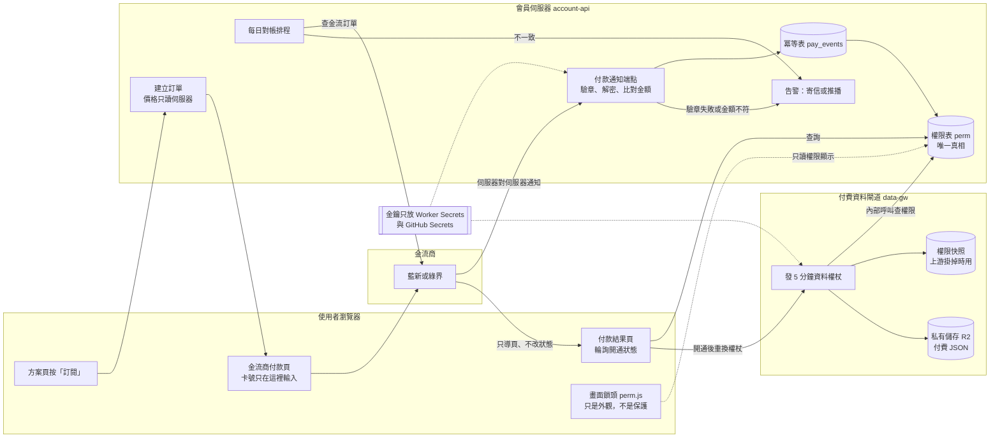
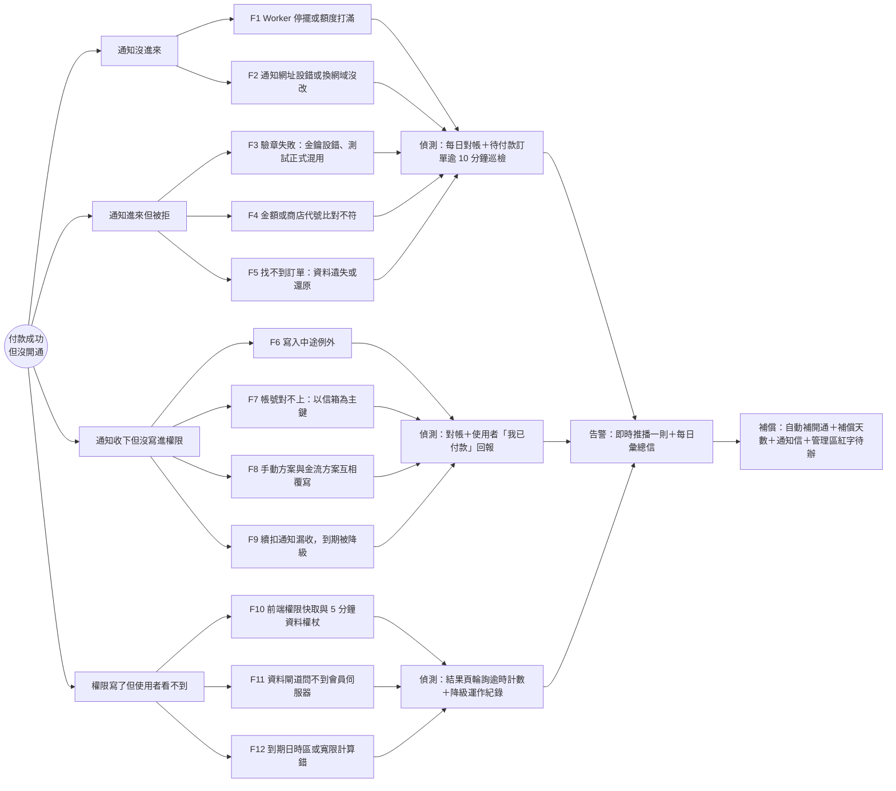
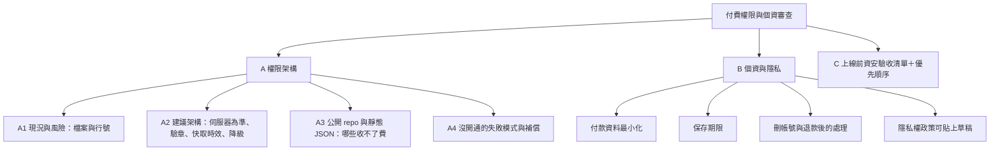
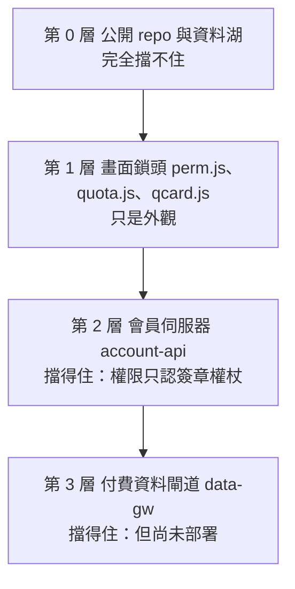
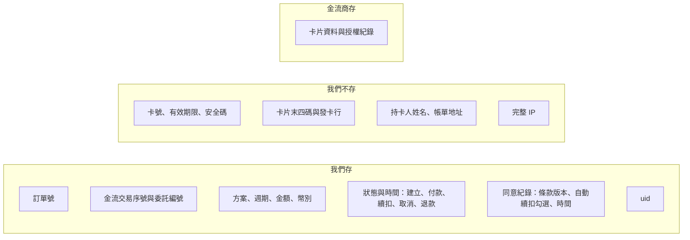
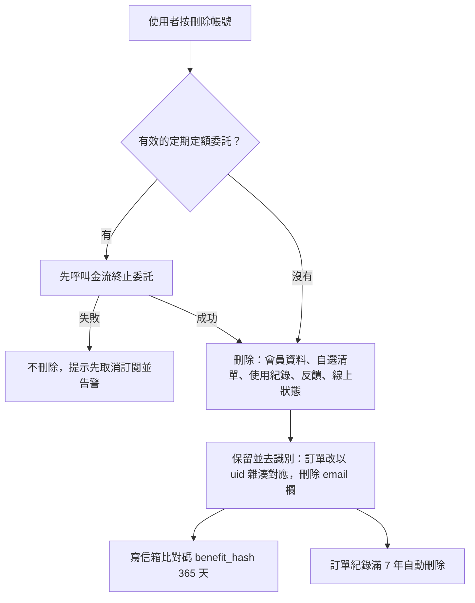
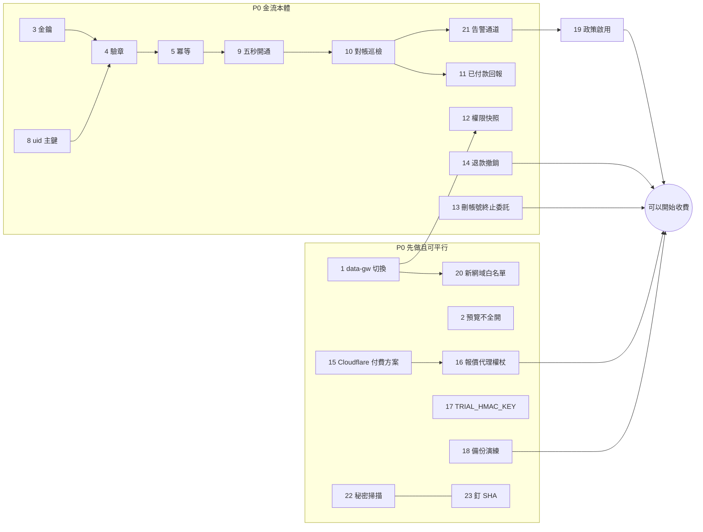

# 付費權限（開通）與個資資安審查

> 2026-10-11（台北），security-privacy。**只是審查文件，沒有改任何產品程式碼。**
> 依據：main `6a1b0b5` 的程式碼（行號皆以此版為準）、`docs/launch_gap_security_1009.md`（G1～G14）、`docs/datagw_plan.md`、
> `docs/payment_newebpay_plan.md`、`docs/checkout_plan.md`、`docs/launch_gap_payment_1009.md`、`site/legal.js`、`site/legal_config.js`。
> 這不是法律意見；標「請律師／記帳士確認」的不准當定論。
> ⚠ 對齊對象 `docs/payments/checkout_subscription_spec.md`（payments-billing）在本文完成時**還不存在**；
> 嘗試用訊息聯繫 payments-billing，回覆「找不到這個 agent」。所以本文以三份既有金流文件為準，差異對照寫在 A4-4，請該專家產出規格時逐條對回。

---

## 〇、總覽圖（先看這一節）

### 圖一：付款到權限開通的架構



### 圖二：每一次讀付費內容的權限判斷流程

```mermaid
flowchart TD
  S[要讀一支付費資料] --> W{白名單裡有這支檔？}
  W -- 沒有 --> X404[回 404]
  W -- 有 --> F{分級是免費？}
  F -- 是 --> OK[直接回資料]
  F -- 否 --> T{帶了資料權杖？}
  T -- 沒有 --> G{訪客範本開著？}
  G -- 否 --> X401[回 401 請登入]
  G -- 是 --> OK
  T -- 有 --> V{簽章、到期、裝置都對？}
  V -- 否 --> X401b[回 401 前端自動重換一次]
  V -- 是 --> P{此人功能開關開著？}
  P -- 是 --> R{每分鐘限流內？}
  P -- 否 --> E{有體驗額度？}
  E -- 有 --> R
  E -- 沒有 --> X403[回 403 顯示升級卡]
  R -- 否 --> X429[回 429]
  R -- 是 --> L[記錄、異常規則、加浮水印] --> OK2[回資料<br/>不准進瀏覽器快取]

  subgraph 換權杖時（每 5 分鐘一次）
    Q1[拿登入權杖問 account-api] --> Q2{account-api 有回應？}
    Q2 -- 有 --> Q3[用最新權限簽權杖<br/>並更新權限快照]
    Q2 -- 沒有 --> Q4{有未過期的「付費」快照？}
    Q4 -- 有 --> Q5[用快照簽權杖<br/>記一筆降級運作]
    Q4 -- 沒有 --> Q6[只給免費權限<br/>畫面提示稍後再試]
  end
```

### 圖三：「付款後沒開通」失敗模式樹（失敗點 → 偵測 → 告警 → 補償）



### 圖四：本文結構樹



---

## A1. 現況：付費牆可以放在哪、哪裡會被繞過

### A1-1 四層付費牆，只有兩層真的擋得住



| 層 | 放在哪 | 現在擋不擋得住 | 用途定位 |
|---|---|---|---|
| 0 | public repo、`data/*.parquet`（234 支已進版控）、`pipeline/compute/`、`pipeline/groups/*.yaml` | **擋不住**（見 A3） | 不能拿來收費 |
| 1 | `site/perm.js`、`site/quota.js`、`site/qcard.js`、`site/livegate.js` | **擋不住**（改 localStorage、改主控台、封鎖請求都能繞） | 只負責「好看、好懂、引導升級」 |
| 2 | `workers/account-api/worker.js` 的 `/v1/perm/me`、`/v1/quota/hit`、`/v1/grants/hit` | **擋得住**：伺服器只看權杖裡的人，不看前端送的方案 | 權限的唯一真相 |
| 3 | `workers/data-gw/worker.js` | 程式寫好、**沒部署**，`DATAGW_SPLIT` 沒開 | 付費資料唯一出口 |

### A1-2 逐條風險（攻擊情境 → 影響 → 緩解 → 成本）

分兩類：**【現在就會被打】**＝今天的正式站就成立；**【收費才會被打】**＝開始收錢、有付費客戶之後才成立或才有損失。

| # | 位置（檔案:行號） | 攻擊情境 | 影響 | 緩解 | 成本 | 類別 |
|---|---|---|---|---|---|---|
| R1 | `site/account_config.js:6`（`api: ''`）、`.github/workflows/pages.yml:135-149`（分流步驟只在 `DATAGW_SPLIT=1` 才跑） | 打開 F12 →「網路」看到 `data/flow_v3.json`，寫迴圈全抓 | 所有「付費候選」資料免費拿，**沒有紀錄** | 照 `datagw_plan.md` 第 10 節切換 data-gw | 工程 3～4 小時＋Andy 30 分鐘 | 現在就會被打 |
| R2 | `site/perm.js:48`：`owner()` 遇到 `window.TW_PREVIEW` 一律回真 | 把 `/preview/<名稱>/` 網址貼到社群 | 預覽版全功能不鎖、不計次 | 正式網域部署包排除 `site/preview/`；預覽版改成「只有管理者登入才比照擁有者」 | 0.5 天 | 現在就會被打 |
| R3 | `site/perm.js:310`、`322-326`：權限快取存 `localStorage` 的 `tw.perm` | 手改 `feats` 全設為真，或在主控台覆寫 `TwPerm.can` | 畫面鎖頭全開（資料仍受 R1 決定） | **不修**：第 1 層本來就不是保護；確保資料走第 3 層 | 0 | 收費才會被打（R1 修好後只剩外觀） |
| R4 | `site/perm.js:314-316`：連不到伺服器、又沒快取時「全開」 | 在開發者工具封鎖會員伺服器網址 | 畫面全開 | 同 R3，保留這個「寧可多給」的設計（對真付費客戶是正確的降級），但資料面要靠第 3 層 | 0 | 同上 |
| R5 | `site/account.js:40` 從 `tw.acct.user` 讀快取使用者；`site/livegate.js:55-56`、`71` 用快取裡的 `owner`／`admin` 決定即時報價 | 在 localStorage 塞一個假使用者 `owner:true` 加任意權杖字串 | `/v1/me` 回來前看得到即時畫面；`livegate.js:38-41` 自己寫明報價代理本身公開可打 | 報價代理改成要求會員權杖並限流（G3／S4） | 0.5～1 天 | 現在就會被打 |
| R6 | `site/quota.js:25`：訪客次數只記 `localStorage` 的 `tw.quota` | 清除網站資料或開無痕視窗 | 訪客每日次數無限 | 訪客額度改由 data-gw 以 IP 網段計數（`GUEST_PER_MIN` 已有，再加每日上限） | 0.5 天 | 收費才會被打 |
| R7 | `workers/account-api/worker.js:42`（`TOKEN_DAYS = 60`）、`433`（滑動續期）；權杖存 localStorage | 一個跨站腳本漏洞或公用電腦登入 → 偷走權杖 | 付費帳號被盜用 60 天；管理者權杖被盜可改任何人的方案 | 一般會員 14 天、管理者 7 天不續期；加「登出所有裝置」（遞增 `tv`）；上 CSP | 1～1.5 天 | 收費才會被打 |
| R8 | `workers/account-api/worker.js:136`、`540-548`：`perm` 以 **email 為主鍵** | 使用者改了 Google 帳號信箱，或用另一個 Google 帳號登入 | 付了錢卻「沒開通」（F7）；或刪帳號後信箱被別人註冊，接手舊方案 | 付款紀錄與權限改以 `uid`（Google `sub` 的雜湊，`users.subh`）為主；email 只當顯示 | 0.5 天＋遷移測試 | 收費才會被打 |
| R9 | `workers/account-api/worker.js:2263-2290`（`/v1/subscribe/change` 申請制）；全檔沒有 `/v1/pay/*` | — | 目前沒有付款端點，所以「偽造付款通知」暫時不存在；但也沒有冪等、對帳、驗章 | 依 A2-2 實作 | 見 `launch_gap_payment_1009.md` E1～E9 | 收費才會被打 |
| R10 | `workers/data-gw/worker.js:300`：換權杖時拿不到權限就回 503 | 會員伺服器短暫停擺（或 Cloudflare 額度 1027） | **已付費客戶被鎖住**，違反「寧可放行付費者」 | 加權限快照（A2-5） | 0.5 天 | 收費才會被打 |
| R11 | `workers/data-gw/wrangler.toml:11`：`ACCOUNT_ORIGIN` 只有 `https://miaozike.github.io`；第 10 行已有新網域 | 搬到 `liguligu-puipui.com` 後 | 付費內容全部打不開（客訴、退款） | 部署前補上新網域並驗收 | 10 分鐘 | 收費才會被打 |
| R12 | `workers/account-api/worker.js:1532` 停權端點 `/internal/suspend` 在公開網址也收得到 | 猜到或外洩 `INTERNAL_KEY` | 任意停權別人 | 鑰匙 48 字以上；端點加來源檢查（只收 service binding 的請求標頭）；失敗次數告警 | 1 小時 | 收費才會被打 |
| R13 | `site/app.js:496-516`：付費檔不進 IndexedDB 快取（**做對了**） | — | — | 保持；新增付費檔一律走 `TwGw` | — | — |
| R14 | `workers/account-api/worker.js:549-556` `permMe` 刻意不讀前端送的方案（**做對了**） | — | — | 新付款端點照同一原則：方案、價格、到期日都只由伺服器決定 | — | — |

---

## A2. 建議架構

### A2-1 原則（五條，一條都不能少）

1. **權限只有一個真相：account-api 的 `perm`。** 畫面、data-gw、報價代理都只「讀」它。前端任何欄位（方案、價格、到期日）一律不信。
2. **狀態只由伺服器對伺服器的付款通知改變。** 瀏覽器導回頁（ReturnURL／OrderResultURL）只導頁，可以被偽造。
3. **付費資料只有一個出口：data-gw。** 公開目錄一份都不留（`split_paid.py` 已是「搬走」不是「複製」）。
4. **金鑰只放 Secrets。** 金流 HashKey／HashIV、`GW_SECRET`、`INTERNAL_KEY`、`TRIAL_HMAC_KEY`、寄信服務金鑰：只在 Cloudflare Worker Secret，由 GitHub Secret 經部署工作流寫入；不進 `wrangler.toml`、不進 repo、不進前端、不出現在對話。
5. **出錯時：已知付費者放行，未知者擋下。** 寧可讓付費客戶多用幾小時，也不能鎖住他。

### A2-2 付款通知（webhook）的驗證順序

| 步 | 檢查 | 失敗時 |
|---|---|---|
| 1 | 只收 POST、內容長度上限（例如 16KB）、同 IP 每分鐘上限 | 413／429，記錄 |
| 2 | 驗檢查碼（藍新 `TradeSha`、綠界 `CheckMacValue`），**用等長逐字元比對**（沿用 `safeEq`） | 400，記 `sig_fail`，**同一小時 3 次以上立即告警**（多半是金鑰設錯，F3） |
| 3 | 解密（藍新 AES-256-CBC） | 400，同上 |
| 4 | 商店代號是我們的、環境一致（測試金鑰不准打正式端點） | 400，告警 |
| 5 | 訂單存在、**金額＝建單時記下的金額**（不是現在的方案價，避免改價後舊單全被拒，F4）、方案存在 | 不開通，記 `mismatch`，告警 |
| 6 | 冪等：`pay_events` 主鍵＝訂單號＋期數（或金流交易序號）；撞主鍵＝處理過，直接回成功 | — |
| 7 | **同一個交易**內寫 `pay_events`、`pay_orders`、`perm`（Durable Object 的 SQLite 交易） | 例外就**不回成功字串**，讓金流商重送（F6） |
| 8 | 交易提交後才回金流商要求的成功字串 | — |

### A2-3 權限寫入規則

- `perm` 新增欄位：`source`（`manual`／`gateway`／`grant`）、`order_no`、`uid`。金流**不覆寫**「`manual` 且未到期」的人（F8）。
- 到期日：`max(現有到期日, 本期起算) + 1 期 + 寬限 3 天`（沿用 `payment_newebpay_plan.md` 2-3），一律以 UTC 毫秒存、台北日期只在顯示時換算（F12）。
- 退款或扣款爭議（拒付）：`expires = 現在`，`tv + 1`（舊資料權杖最遲 5 分鐘失效，登入權杖立刻失效）。

### A2-4 權限查詢 API 與快取時效（付款後最慢幾秒生效）

| 快取點 | 現在的時效 | 付款後怎麼讓它立刻失效 | 目標 |
|---|---|---|---|
| `perm` 表（伺服器） | 即時（同一個 Durable Object，強一致） | — | 0 秒 |
| 結果頁輪詢 `/v1/pay/me` | 新做 | 每 2 秒問一次，最多 30 秒 | **通知抵達後 2 秒內**畫面顯示開通 |
| 前端權限快取 `tw.perm`（`perm.js:310`） | 每次載入頁面重抓、同人 5 秒節流 | 結果頁看到開通 → 呼叫 `TwPerm.refresh()` | 2 秒內 |
| data-gw 資料權杖（`data-gw/worker.js:26`，300 秒） | 5 分鐘 | 結果頁看到開通 → 呼叫 `TwGw.reset()` 立刻重換 | 2 秒內 |
| 同一瀏覽器其他分頁 | 不會自動更新 | 用 `storage` 事件或廣播頻道通知其他分頁重抓 | 5 秒內 |
| 其他裝置 | 下次載入頁面 | 不主動推 | 下次開頁，最遲 5 分鐘 |

**對 Andy 的承諾口徑**：「金流商通知抵達後，付款那個分頁 **5 秒內**開通；其他裝置**重新整理即可**。」
金流通知本身的延遲不在我們控制內；若 30 秒還沒到，結果頁顯示「付款處理中，最晚數分鐘內自動開通」，背後由 A4 的巡檢接手。

**撤銷（退款、停權）**：登入權杖立刻失效（`tv` 遞增）；資料權杖最遲 **5 分鐘**失效。這個延遲可接受，不建議為了它縮短權杖（會加倍請求數，撞 Cloudflare 額度）。

### A2-5 離線與服務掛掉時的降級策略

| 掛掉的是誰 | 已付費者 | 免費會員／訪客 | 做法 |
|---|---|---|---|
| 會員伺服器 account-api | **照常可用最多 72 小時** | 只給免費內容 | data-gw 每次成功換權杖就存一份「權限快照」（uid、功能開關、方案到期日），有效到 `min(方案到期日, 現在＋72 小時)`；上游失敗時用快照簽權杖並記 `degraded`（修 R10） |
| data-gw | 付費內容暫時打不開 | 免費內容不受影響（免費檔仍在公開目錄） | 畫面顯示「付費資料暫時無法載入」，**不准退回公開網址**；超過 1 小時告警；停擺時間進補償帳（A4-3） |
| R2 私有儲存 | 同上 | 同上 | 同上 |
| 金流商 | 不影響已開通者 | 不能新購 | 方案頁顯示「付款服務暫停」；續扣漏收由寬限 3 天＋對帳接手 |
| 前端連不到任何伺服器 | 畫面照快取顯示（`perm.js:322-326`） | 照快取 | 保持現行設計 |
| Cloudflare 額度打滿（1027） | 全部停擺到台北早上 8 點 | 同 | 上線前升級付費方案（G3），這是唯一解 |

---

## A3. 公開 repo＋靜態 JSON：哪些東西其實收不了費

### A3-1 收不了費的清單

| 類別 | 為什麼收不了 | 證據 |
|---|---|---|
| **整個資料湖** | `data/` 有 234 支 Parquet 進版控，任何人 `git clone` 就拿到全部原始資料 | 以 `git ls-files data` 篩出 Parquet，共 234 支 |
| **所有計算口徑** | `pipeline/compute/`、`pipeline/indicators.py` 公開，配上資料湖跑 `python -m pipeline.build_payload` 就能**在自己電腦產出全部付費 JSON** | repo 結構 |
| **人工整理的族群、題材、供應鏈** | `pipeline/groups/groups.yaml`、`themes.yaml`、`supply_chain.yaml` 公開，這是本站最難複製的智慧財產 | 同上 |
| **git 歷史** | 就算之後拆 repo，舊版本仍可從歷史與既有複本取得 | git 特性 |
| **盤中即時報價** | 來源是公開的證交所即時端點，報價代理只看 Origin | `livegate.js:38-41` |
| **已交付給付費者的畫面與數字** | 付費者看得到就能截圖、抄數字；浮水印只抓得到「整份原封不動轉貼」 | `datagw_plan.md` 浮水印節 |
| **免費分級的檔案** | 本來就公開（`stocks`、`groups_today`、`sparks`、大盤） | `pipeline/datagw_tiers.json` |

結論：**data-gw 切換後，只擋住「不會跑 Python 的人」**。對會寫程式的人，現在的付費內容等於免費。
真正能收費的只剩：**每天自動更新的省事程度、整理好的畫面、以及 Andy 持續校訂的族群判斷（如果把 YAML 移出公開 repo）**。

### A3-2 可行的保護方式（由便宜到貴）

| 方案 | 做法 | 擋得住什麼 | 成本 | 建議 |
|---|---|---|---|---|
| ① data-gw 代理發放 | 現有設計：Worker 驗權杖後從 R2 讀出、加浮水印、回應 `private, no-store` | 一般使用者、F12 爬蟲 | 已寫好，切換半天 | **P0 必做** |
| ② Worker 簽發短效連結 | 大檔（`hist/<代號>/p<N>`、`stock/<代號>`）改由 data-gw 簽發 60 秒有效的 R2 預簽網址，瀏覽器直接下載 | 同①，但省 Worker 運算與流量 | 1 天；代價是**這類檔沒有浮水印、沒有逐筆紀錄**（只記「簽發」） | P2，等流量變大再做 |
| ③ 把智慧財產移出公開 repo | 只把 `pipeline/groups/*.yaml` 與資料湖 `data/` 移到私有位置（私有 repo 或 R2），工作流用部署金鑰拉取 | 會跑程式的人拿不到族群定義與歷史資料 | 1～2 天；公開 repo 的 Actions 分鐘數照舊免費 | **P1**（第一筆收費前做） |
| ④ 整個 repo 改私有 | 一步到位 | 全部 | Actions 實測約 1.2 萬分鐘／月，超過私有免費額度 2,000 分鐘；超額費率約每分鐘 0.008 美元（**未查證最新價**）→ 約每月 80 美元 | P2；③ 做完多半不需要 |
| ⑤ 數值浮水印 | 在付費數值最後一位小數嵌入使用者識別 | 抄數字外流可追 | 會改到畫面數值，需 Andy 同意 | 不建議 |

⚠ 做 ③ 或 ④ 之前，**已公開的歷史版本收不回來**；能保護的只有「之後新增的族群校訂與資料」。

---

## A4. 「付款後沒開通」：失敗模式、偵測、告警、補償

### A4-1 失敗模式表

| # | 失敗點 | 發生情境 | 偵測 | 告警 | 自動補償 | 人工補償 |
|---|---|---|---|---|---|---|
| F1 | Worker 停擺或額度打滿 | Cloudflare 1027、部署壞掉 | 對帳排程：金流「已授權」我方「待付款」 | 即時推播 | 對帳發現即補開通（走同一條寫入函式） | 補償天數＝停擺天數＋1 |
| F2 | 通知網址設錯 | 換網域、測試正式網址填反 | 待付款訂單逾 10 分鐘巡檢（每 5 分鐘一次） | 即時推播 | 同上 | 修金流後台網址 |
| F3 | 驗章失敗 | 金鑰設錯、測試正式混用 | `sig_fail` 計數 | 一小時 3 次即時告警 | 無（不能放行假通知） | 修金鑰後以對帳補開通 |
| F4 | 金額或商店代號不符 | 改價、錯誤設定、偽造 | `mismatch` 紀錄 | 每筆即時告警 | 無 | 人工核對後手動開通或退款 |
| F5 | 找不到訂單 | 資料遺失、還原舊備份 | `order_missing` 紀錄 | 每筆即時告警 | 依金流資料重建訂單 | 核對身分後開通 |
| F6 | 寫入中途例外 | 程式錯誤 | 不回成功字串→金流重送；連續失敗計數 | 同一訂單 3 次失敗告警 | 金流重送時自然補上 | 修程式 |
| F7 | 帳號對不上 | 以信箱為主鍵（R8）；用另一個 Google 帳號登入 | 使用者按「我已付款但沒開通」 | 每筆列管理區紅字 | 無 | 核對訂單後綁到正確 uid |
| F8 | 手動方案與金流方案互相覆寫 | Andy 送的永久方案被月繳蓋掉，或反過來 | 寫入時比對 `source` | 衝突即記錄 | 依 A2-3 規則不覆寫 | 管理區確認 |
| F9 | 續扣通知漏收 | 第 2 期之後的通知沒到 | 對帳；到期前 1 天巡檢「有效委託但未延長」 | 每日彙總 | 寬限 3 天內對帳補延長 | — |
| F10 | 前端快取未更新 | `tw.perm` 快取、5 分鐘資料權杖 | 結果頁輪詢逾時次數 | 每日彙總 | 結果頁強制重抓（A2-4） | 請使用者重新整理 |
| F11 | data-gw 問不到會員伺服器 | account-api 短暫停擺 | `degraded` 紀錄 | 超過 15 分鐘告警 | 權限快照（A2-5） | — |
| F12 | 到期日計算錯 | UTC 與台北日期、月底、閏年 | 單元測試；對帳比對到期日 | 每日彙總 | — | 補天數 |
| F13 | 反方向：退款後沒撤銷 | 金流後台退款但我方沒標記 | 對帳：金流「已退款」我方「有效」 | 每日彙總 | 自動設 `expires=現在` | — |
| F14 | 刪帳號但委託還在扣 | 使用者自刪帳號，金流定期定額沒終止 | 刪帳號流程先檢查有效委託 | 每筆即時告警 | 刪帳號時**先呼叫終止委託**，失敗就不准刪（提示先取消） | 人工終止並退款 |

### A4-2 必要的新元件

- **`pay_orders`／`pay_events`**（金流規格已有）＋ **`pay_alerts`**（種類、訂單號、uid、時間、是否已處理）。
- **巡檢**：Durable Object 每 5 分鐘的 alarm 掃「待付款逾 10 分鐘」；每天台北 06:00 全量對帳（呼叫金流訂單查詢）。
- **使用者回報**：結果頁逾時後出現「我已付款但沒開通」按鈕 → 寫 `pay_claims`（uid、訂單號、時間）→ 管理區紅字、即時推播。
- **告警通道**：沿用 data-gw 的 `ALERT_WEBHOOK`／`ALERT_EMAIL`＋寄信服務（⚠ 目前 Worker 完全不能寄信，見 `launch_gap_payment_1009.md` P10）。**通知內容只帶 uid 與訂單號，不帶 email、不帶金額以外的付款資料。**
- **補償帳**：`comp_log`（uid、原因、補幾天、誰做的、時間），只增不改；補償一律延長 `expires`，不退現金（退現金走退款流程）。

### A4-3 補償規則（建議值，Andy 可改）

| 情況 | 補償 |
|---|---|
| 付款後超過 1 小時才開通 | 補 1 天 |
| 付款後超過 24 小時才開通 | 補 3 天＋道歉信 |
| 付費內容連續停擺超過 1 小時 | 補停擺天數（不足一天以一天計） |
| 連續 7 天無法提供核心功能 | 依 `legal_config.js` 的 `REFUND_OUTAGE_DAYS=7` 按比例退款 |

### A4-4 與金流規格的差異（待 payments-billing 對回）

| 項目 | 既有金流文件寫的 | 本文建議 | 差異原因 |
|---|---|---|---|
| 權限主鍵 | `pay_orders.email`、`perm.email` | 以 `uid` 為主，email 只當顯示 | R8／F7 |
| 金額比對 | 「金額＝訂單金額」 | 同意，並強調**不是現在方案價** | F4 |
| 寫入失敗時 | 未寫 | 不回成功字串，讓金流重送 | F6 |
| 對帳 | 每天一次 | 每天全量＋每 5 分鐘巡檢待付款 | F1／F2 要在分鐘級發現 |
| 卡片末四碼 | 「若有就存」 | **不存**，客服查詢到金流後台查 | 最小蒐集（B1） |
| 刪帳號 | 未寫 | 先終止委託才准刪 | F14 |
| data-gw 上游失敗 | 未寫 | 權限快照 72 小時 | R10／F11 |
| 使用者回報入口 | 未寫 | 「我已付款但沒開通」按鈕 | F7 唯一偵測方式 |

---

## B. 個資與隱私

### B1 付款資料：只存代碼，不碰卡號



- 卡號欄位永遠只出現在金流商頁面（金流規格已這樣設計）。我們不在任何紀錄、錯誤訊息、告警中寫入通知原文；要留原文時先刪掉所有卡片相關欄位。
- 金流商要求的消費者電子郵件：只在建單時送出，不另存一份。

### B2 個資法最小蒐集對照

| 原則 | 本站做法 | 狀態 |
|---|---|---|
| 告知義務（個資法第 8 條） | 隱私權政策逐項列「情境／資料／目的／保存期間」（`site/legal.js:190-205`） | 要補付款列（B4） |
| 特定目的內利用 | 付款資料只用於開通、對帳、客服、稅務 | 寫進政策 |
| 目的消失即刪除（第 11 條） | 刪帳號、到期資料自動清（`worker.js` 已有多個保存常數） | 付款紀錄例外：依稅務會計法令保存（B3） |
| 外洩通報（第 12 條） | 查明後通知當事人 | 寫進事件應變小抄（G8） |
| 安全維護（第 27 條） | 金鑰只放 Secrets、權杖簽章、管理端點限管理者 | 見 C 清單 |
| 第三方揭露 | 金流商、寄信服務、Cloudflare R2 都要列名 | `legal_config.js` 的 `hosting` 目前缺這三個 |

### B3 保存期限（建議值，⚠ 法定年限請記帳士確認）

| 資料 | 保存期間 | 依據 |
|---|---|---|
| 訂單、付款、退款紀錄（`pay_orders`、`pay_events`） | **最後一筆交易後 7 年** | 商業會計法第 38 條（憑證 5 年、帳簿 10 年）與稅捐核課期間（5～7 年）取保守值；本站尚無統編，**請記帳士確認是否適用** |
| 同意紀錄（條款版本、自動續扣勾選） | 與訂單同 | 消費爭議舉證 |
| 付款通知異常紀錄（`pay_alerts`） | 1 年 | 營運稽核 |
| 「我已付款」回報（`pay_claims`） | 處理完 1 年 | 客服 |
| 補償帳（`comp_log`） | 與訂單同 | 會計 |
| 安全紀錄（data-gw 存取） | 30 天（已實作） | `datagw_plan.md` |
| 信箱比對碼（`benefit_hash`） | 365 天（已實作） | `legal_config.js` |

### B4 帳號刪除與退款後的資料處理



| 情境 | 權限 | 資料 |
|---|---|---|
| 退款完成 | `expires=現在`、`tv+1`；資料權杖最遲 5 分鐘失效 | 訂單保留（標 `refunded`）；自選清單不刪 |
| 拒付（信用卡爭議） | 同上，並暫停再次購買直到爭議結束 | 保留通知與同意紀錄當證據 |
| 取消續訂 | 用到本期到期日 | 不刪任何資料 |
| 刪帳號（無訂單） | 立刻失效 | 全刪，只留比對碼 |
| 刪帳號（有訂單） | 立刻失效 | 個人資料全刪；訂單去識別保留 7 年 |

### B5 隱私權政策要新增的條目（可直接貼上的草稿）

**加在「蒐集之資料、目的與保存期間」表格（`site/legal.js:190-205` 的 `rows`）：**

| 情境 | 蒐集之資料 | 目的 | 保存期間 |
|---|---|---|---|
| 訂閱付款 | 訂單編號、金流服務商交易序號與定期定額委託編號、方案、付款週期、金額、付款／續扣／取消／退款之狀態與時間、您勾選同意之條款版本與自動續扣同意時間。**本網站不取得、不保存您的信用卡卡號、有效期限、安全碼及卡片末四碼**，該等資料由金流服務商依其隱私權政策處理 | 開通與維持付費方案、對帳、處理退款與消費爭議、履行稅務及會計義務 | 最後一筆交易後 **7 年**；刪除帳號後改以無法直接識別您之方式保存至期滿 |
| 付款異常處理 | 帳號識別碼、訂單編號、異常種類與時間；您主動回報「已付款未開通」之時間 | 確保付款後確實開通、補償與客服 | **1 年** |

**加在「資料之利用與分享對象」段落：**

> 付款時，您將被導向**【金流服務商全名】**之付款頁面，由其直接蒐集並處理您的付款資料。本網站僅於建立訂單時，將訂單編號、金額、方案名稱及您的電子郵件地址提供予該服務商，以完成交易與寄送付款通知。付費資料存放於 Cloudflare, Inc. 之 R2 儲存服務；付款收據與服務通知由**【寄信服務商名稱】**代為寄送，該服務商僅取得您的電子郵件地址與通知內容。

**加在「您的權利」段落末：**

> 如您刪除帳號時仍有生效中之自動續扣訂閱，本網站將先為您終止續扣；終止未完成前，帳號不會被刪除。刪除帳號後，付款紀錄依稅務及會計相關法令保存，期間內僅以無法直接識別您之方式保存，期滿自動刪除。

**加在「資料安全」段落末：**

> 如發生個人資料遭竊取、洩漏、竄改或其他侵害情事，本網站將於查明後，以電子郵件或網站公告通知您可能受影響之範圍及已採取之因應措施。

---

## C. 上線前資安驗收清單

狀態：⬜ 待辦／🔄 進行中／✅ 完成（狀態依 2026-10-11 程式碼與 `launch_gap_security_1009.md` 查證；查不到的一律 ⬜）。
優先級：**P0**＝不做不准開始收費；**P1**＝收費後一個月內；**P2**＝可延後。

| # | 驗收項目 | 怎麼驗（通過條件） | 優先級 | 狀態 | 對應 |
|---|---|---|---|---|---|
| 1 | data-gw 部署並切換 | 無痕視窗直接開 `/data/flow_v3.json` 回 404；付費帳號資金流向頁正常 | P0 | 🔄 程式完成、未部署 | R1 |
| 2 | 預覽網址不再全開 | 正式網域打 `/preview/任一名稱/` 回 404，或訪客看到的鎖頭與正式站相同 | P0 | ⬜ | R2 |
| 3 | 金流金鑰只在 Worker Secret | `git grep` 掃不到；`wrangler.toml` 無金鑰；部署工作流以 Secret 寫入 | P0 | ⬜ 尚無金鑰 | A2-1 |
| 4 | 付款通知驗章 | 測試：錯章、竄改金額、未知訂單、錯商店代號都回 400 且不開通 | P0 | ⬜ 端點未寫 | A2-2 |
| 5 | 付款通知冪等 | 同一通知送兩次只開通一次、到期日只延一次 | P0 | ⬜ | A2-2 |
| 6 | 導回頁不改狀態 | 偽造導回參數，權限不變 | P0 | ⬜ | A2-1 |
| 7 | 價格只讀伺服器 | 前端改送金額，訂單金額仍為伺服器價 | P0 | ⬜ | A2-1 |
| 8 | 權限以 uid 為主鍵 | 換信箱、刪帳號後同信箱新註冊，都不會錯接權限 | P0 | ⬜ | R8／F7 |
| 9 | 付款後 5 秒內開通 | 測試商店付款，結果頁 5 秒內顯示開通、付費檔可讀 | P0 | ⬜ | A2-4 |
| 10 | 對帳與巡檢 | 手動刪掉一筆通知，5～10 分鐘內被巡檢補開通並告警 | P0 | ⬜ | A4 |
| 11 | 「我已付款但沒開通」按鈕 | 按下後管理區出現紅字、Andy 收到推播 | P0 | ⬜ | F7 |
| 12 | data-gw 權限快照降級 | 關掉會員伺服器，付費帳號 72 小時內仍可讀；訪客只拿到免費 | P0 | ⬜ | R10 |
| 13 | 刪帳號先終止委託 | 有委託的測試帳號刪除時，委託被終止；終止失敗則不刪 | P0 | ⬜ | F14 |
| 14 | 退款立即撤銷 | 管理區標記退款後，登入權杖立刻失效、付費檔 5 分鐘內 403 | P0 | ⬜ | B4 |
| 15 | Cloudflare 付費方案＋預算警示 | 後台看得到方案與警示設定 | P0 | ⬜ | G3 |
| 16 | 報價代理要求權杖並限流 | 不帶權杖打 `/quote` 回 401 | P0 | ⬜ | R5 |
| 17 | `TRIAL_HMAC_KEY` 已設 | `/v1/billing/me` 回 `hk:'secret'` | P0 | ⬜ 10-09 查證未設 | G14 |
| 18 | 會員資料備份＋還原演練 | 演練 Worker 還原成功、筆數一致、有紀錄 | P0 | ⬜ 10-09 查證未設 | G6 |
| 19 | 隱私權政策補付款條目並啟用 | `legal_config.js` `enabled: true`；政策含 B5 四段 | P0 | ⬜ | B5 |
| 20 | 新網域加進 data-gw 的 `ACCOUNT_ORIGIN` | 新網域登入後付費檔可讀 | P0 | ⬜ | R11 |
| 21 | 告警通道可用 | 觸發一次測試告警，Andy 手機收到 | P0 | ⬜ | A4-2 |
| 22 | GitHub 秘密掃描與推送保護 | 設定頁顯示已開啟 | P0 | ⬜ 查不到 | G13 |
| 23 | 第三方 action 釘 SHA | 工作流中 `uses:` 皆為 40 碼 SHA | P0 | ⬜ | G13 |
| 24 | 權杖縮短＋登出所有裝置 | 一般 14 天、管理者 7 天不續期；按鈕可用 | P1 | ⬜ | R7 |
| 25 | 族群 YAML 與資料湖移出公開 repo | 公開 repo 不再有 `pipeline/groups/*.yaml` 新版本與 `data/*.parquet` 新檔 | P1 | ⬜ | A3-2 ③ |
| 26 | CSP 上線 | 回應標頭或 meta 有 CSP，全站驗收綠 | P1 | ⬜ | G7 |
| 27 | 停權端點加固 | `/internal/suspend` 只收 service binding；錯鑰匙 3 次告警 | P1 | ⬜ | R12 |
| 28 | 訪客每日額度改伺服器計 | 清 localStorage 後次數不重置 | P1 | ⬜ | R6 |
| 29 | 大檔改短效預簽連結 | `hist` 類檔由 60 秒預簽網址下載 | P2 | ⬜ | A3-2 ② |
| 30 | 整個 repo 改私有 | 依成本決定 | P2 | ⬜ | A3-2 ④ |

### 優先順序與相依



**最短路徑**：Andy 先做 15、17、22 與 data-gw 的 Cloudflare 設定（合計約 1 小時）→ 工程平行做 1、2、8、12、16、23 → 拿到測試商店後做 3～7、9～11、13、14 → 告警與政策（19、21）→ 開收。
