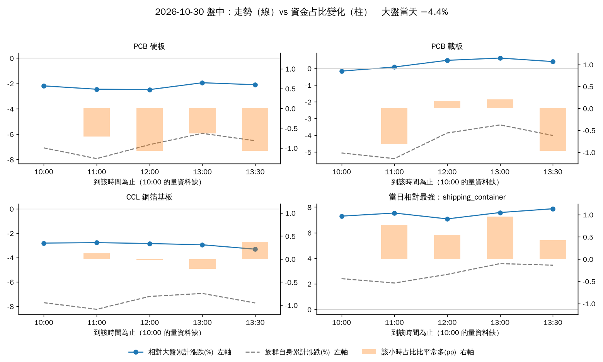
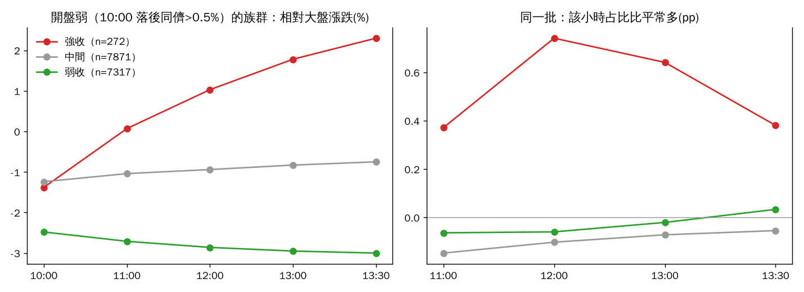
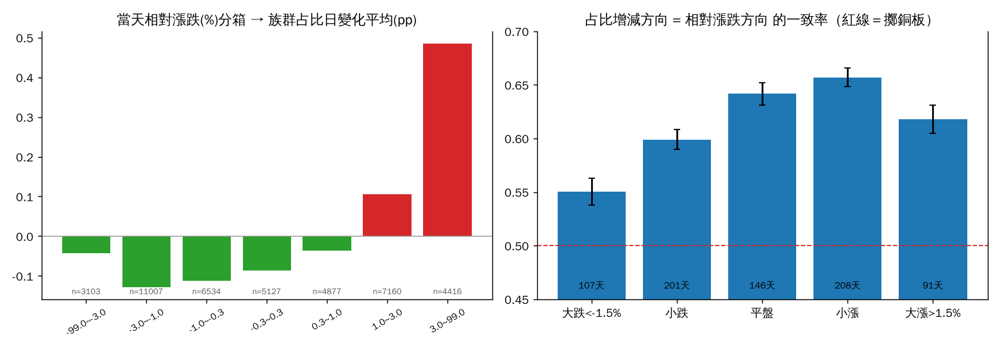
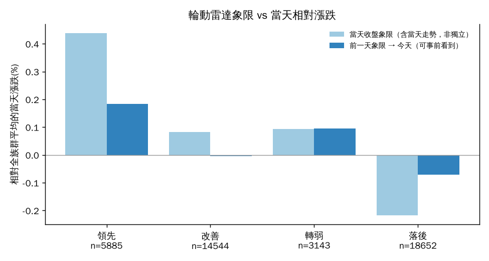
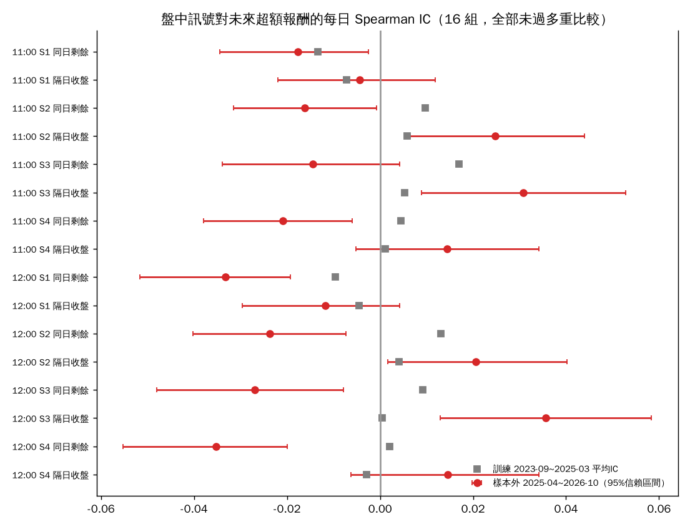
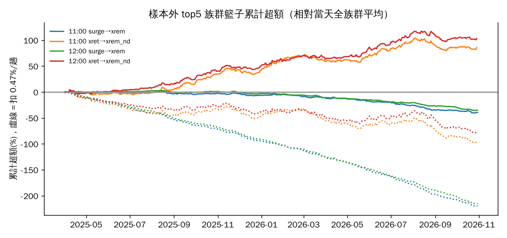

# 資金指標 vs 族群走勢：吻合度與「提前埋伏」可行性（2026-10-30 研究，第一版）

> 研究與證據，不是網站改動、不是買賣建議。腳本：`scripts/research/flow_vs_price.py`（可重跑，只讀資料湖）。
> 資料：資料湖 commit `dfcd7c5c`（資料更新 2026-10-30），60 分 K 2023-09-19 ～ 2026-10-30 共 754 個交易日，題材族群 56 個（成員 ≥3 檔、平均占比 ≥0.2%，不含 `ind_` 補位桶）。

## 一句話結論

1. **吻合度（第一步）：部分吻合，而且要分清楚是哪一個指標。**
   「族群成交值占比的**當日變化**」和「當天相對大盤漲跌」確實同向（一致率 61.9%、每日橫斷面相關 +0.28，t=31，樣本 42,224 筆族群×日）；
   但**輪盤象限本身不是資金指標**（它用價格算的），而網站上的資金「輪動 rot（占比 5 日均 − 20 日均）」跟當天走勢只有弱相關（一致率 53.7%，相關 +0.07）。
   而且**這個同向關係有一半是機械性的**（成交值本來就隨波動放大），大盤急跌日一致率掉到 55%。
2. **提前判斷（第二步）：目前的資料與訊號，找不到站得住腳的領先性。**
   用 11:00／12:00 的占比放大、上漲家數、相對強度去預測「同日剩餘」與「隔日」，16 組全部沒有通過訓練期的多重比較；
   同日剩餘報酬甚至是**微幅反向**（追當下最強的族群，收盤前平均少 0.04～0.10%）。唯一在樣本外看起來有料的是「12:00 相對大盤最強的 5 個族群 → 隔日收盤」＋0.27%／日，但訓練期沒有顯著、扣成本 0.47% 後為負，只能當線索。
   **主因是資料：資料湖的 60 分 K 缺 09:00–10:00 的成交量（最重要的那一小時）**，要先補資料才能認真回答「提前」（見最後一節）。

## 先講兩個會改變你理解的發現

**發現 A：資金輪盤的四個象限，是用價格算的。** 讀 `pipeline/compute/rrg.py`：`rrg_axes()` 用的是「族群價格指數 ÷ 大盤指數」的 RS-Ratio（EMA10、對 40 日均線偏離）與其 10 日變動率；`turnover_share`（占比）只用來濾掉太小的族群與顯示。所以「領先／改善／轉弱／落後」是**相對價格強弱的輪動**，不是資金流入流出。真正用占比的是熱力圖「資金流向」與 `rotation_radar`（占比 5 日均 − 20 日均，單位 pp）。這也表示：雷達象限和族群走勢「吻合」是意料中的事，不能拿來當「資金樹是對的」的證據。

**發現 B：資料湖 60 分 K 的 09:00 那根（09:00–10:00）幾乎沒有成交量。** 只有 29% 的列有量（2330 整年都是 0），價格正常。對照市場成交量分布（指數 1 分 K：09 時段約占全日 48%）可知漏掉的正是量最大的第一小時；60 分 K 估算的日成交值只有日線的約 53%（中位數）。
我的處理：成交值只用 10:00 起的 4 根，並用「同一根、過去 20 日平均」當基準，吃掉常數偏差。驗證：以此算出的族群日占比與網站 `group_daily` 的相關 0.969、日漲跌相關 0.875（中位絕對差 0.29pp）。**「早盤 9–10 點資金有沒有進」目前這份資料回答不了。**

## 第一步：吻合度（表格）

### A. 日線層（用網站同一份算法：`flow.group_daily`、`rotation_radar`、`rrg_axes`）

| 指標（對照：當天族群相對全族群平均的漲跌） | 每日橫斷面 Spearman IC | t（Newey-West） | 同向一致率（95% CI） | 樣本 |
|---|---|---|---|---|
| 占比日變化 dshare（今日占比 − 昨日占比） | **+0.284** | 31.0 | **61.9%**（61.4–62.3） | 42,224 筆／754 天 |
| 輪動 rot（占比 5 日均 − 20 日均） | +0.066 | 10.5 | 53.7%（53.2–54.2） | 同上 |

機械性檢查：dshare 與「相對漲跌**絕對值**」的相關也有 +0.21（與有方向的 +0.29 差不多），代表約一半是「動得大就量大」。但上漲的族群占比增加、下跌的族群占比減少仍是真的（圖 2 左：相對大盤 > +3% 的族群占比平均 +0.49pp；−1～−3% 的 −0.13pp）。

分盤勢（占比增減方向 = 相對漲跌方向 的一致率）：

| 盤勢（前日成交值加權全市場漲跌） | 天數 | 一致率（95% CI） | 平均 IC |
|---|---|---|---|
| 大跌 < −1.5% | 107 | 55.1%（53.8–56.3） | +0.16 |
| 小跌 | 201 | 59.9%（59.0–60.8） | +0.25 |
| 平盤 | 146 | 64.2%（63.1–65.2） | +0.33 |
| 小漲 | 208 | 65.7%（64.8–66.6） | +0.36 |
| 大漲 > +1.5% | 91 | 61.8%（60.5–63.1） | +0.27 |

分族群大小：小 62.0%、中 60.9%、大 60.2%（相差不大，大族群略差）。

**不吻合的情況**：(1) 大盤急跌日（占比被動變動，一致率最低）；(2) 極端反例——收盤占比放大排前 10% 但當天相對大幅落後的有 474 筆（占 1.1%），例如 2024-06-11 貨櫃航運占比 +8.9pp 卻 −9.6%、2026-09-17 CCL 占比 +6.6pp 卻相對落後 7.9%（放量下殺）。整體上「占比放大前 10% 的族群，當天相對同儕上漲的機率 64.6%（n=4,457）；占比縮減後 10% 的是 42.1%」。

### 輪動雷達象限（價格輪）：前一天的位置 vs 今天表現

| 象限 | 當天收盤象限（含當天走勢，非獨立）平均相對漲跌 | 前一天象限 → 今天：平均相對漲跌 | 今日上漲占比 | 樣本 |
|---|---|---|---|---|
| 領先 | +0.44% | +0.18% | 49.1% | 5,885 |
| 轉弱 | +0.09% | +0.10% | 48.7% | 3,143 |
| 改善 | +0.08% | −0.00% | 43.9% | 14,544 |
| 落後 | −0.22% | −0.07% | 43.5% | 18,652 |

次序合理（領先 > 落後），但差距很小，且「隔夜 rot 預測今日相對漲跌」的 IC 只有 +0.006（t=0.94，95% CI −0.007～+0.018），**統計上無法與 0 區分**。

### B. 盤中層（60 分 K；占比＝該小時占比 − 該族群同一根過去 20 日平均）

| 時段 | 占比放大 vs 該小時相對大盤漲跌：IC | t | 同向一致率 |
|---|---|---|---|
| 10:00–11:00 | +0.102 | 13.4 | 54.8% |
| 11:00–12:00 | +0.085 | 11.9 | 54.0% |
| 12:00–13:00 | +0.047 | 6.6 | 52.2% |
| 13:00–13:30（缺收盤集合競價量） | +0.003 | 0.5 | 50.5% |
| 到 13:30 累計占比 vs 全日相對漲跌 | +0.171 | 20.5 | 57.6% |

盤中同向性**在上午最明顯、尾盤消失**。注意這是「同時發生」，不是領先。

### 個案：2026-10-30（大盤 −4.4%）



| 族群 | 全日漲跌 | 相對大盤 | 全日占比比平常 | 當日雷達象限（日線） |
|---|---|---|---|---|
| PCB 硬板 | −6.5% | −2.1pp（排 47／56） | −0.89pp | 領先（連 7 天；但近 4 個交易日 −6.4%、+6.9%、−5.3%、−7.0%，rot 由 +0.30 降到 −0.48） |
| PCB 載板 | −4.0% | +0.4pp（持平，排 28） | −0.31pp | 落後 |
| CCL | −7.7% | −3.3pp（排 52） | +0.03pp | 落後 |
| 貨櫃航運（當日相對最強） | +3.5% | +7.9pp（排 1） | +0.69pp（排 4） | — |

**這一天資料不支持「PCB 走強」**：PCB 硬板相對大盤落後、占比低於平常；載板只是跟大盤差不多；今日相對強的是貨櫃航運、電信、散裝航運、銀行。若你看到的「PCB 走強」是另一個口徑（例如只看某幾檔、或絕對漲跌的盤中反彈），請告訴我口徑，我再用同一支腳本重畫。這個個案同時顯示雷達象限的**落後性**：硬板仍標「領先」，但近四天已連續大跌、資金占比往下。
（個案來自 60 分 K＋日線，資料湖的 10-30 日線可能仍是盤後暫定值；Cloudflare `/tape` 5 分鐘格我這邊讀不到，沒有用；見最後一節。）

**你描述的情境「開低→尾盤資金變多→轉強」，歷史上長這樣**（圖 4）：開盤 10:00 落後同儕 >0.5% 的族群共 15,460 筆，其中只有 272 筆（1.8%）收盤排進當天前 20%；這 272 筆在 11:00 前就已把落後補回（相對大盤 −1.4% → 0.0%），同一個小時占比比平常多 +0.37pp、中午 +0.74pp（其他的是 −0.15 → −0.10pp）。**資金與價格同時轉強，不是資金先走**。


### 圖 2、3




## 第二步：能提前判斷嗎？（walk-forward）

設計（事先固定，沒有調參）：
- 訊號時點 11:00 與 12:00（用 60 分 K 收盤，進場＝下一根開盤＝同價，等於不計延遲，偏樂觀）。
- 4 個訊號：S1 占比比平常多（surge）、S2 族群內上漲家數比、S3 相對大盤已漲幅、S4＝S1 與 S3 的百分位排名和。全部「值越大預期越強」，方向事先固定。
- 目標：(a) 同日剩餘＝下一根開盤到收盤，(b) 隔日收盤；皆為相對全市場（前日成交值加權）的超額。
- 評估：每日橫斷面 Spearman IC；top5 族群等權籃子相對「當天全族群平均」的超額；樣本外置換檢定（把當天排名打散 300 次）；block bootstrap（5 日一塊）95% CI。
- **訓練 2023-09-19～2025-03-31（約 19 個月）用來選；樣本外 2025-04-01～2026-10-30（385 天）只看一次。** 16 個檢定（4×2×2），以訓練期 p 值做 Holm 校正。
- 成本：一趟來回 0.47%（手續費 0.1425%×0.6 折×2＋證交稅 0.3%），沒算滑價；族群籃子是概念，實際要買成分股。

結果（樣本外，n=385 天；完整 16 列見 `step2.csv`，圖 5）：

| 時點 | 訊號 → 目標 | 訓練 IC (t) | 樣本外 IC (t) | 樣本外 top5 超額/趟 [95% CI] | 扣成本後 | 勝率 | Holm（訓練） |
|---|---|---|---|---|---|---|---|
| 11:00 | S1 占比 → 同日剩餘 | −0.013 (−1.5) | −0.018 (−2.2) | −0.10% [−0.16, −0.05] | −0.57% | 42% | 不過 |
| 12:00 | S1 占比 → 同日剩餘 | −0.010 (−1.2) | −0.033 (−4.0) | −0.09% [−0.14, −0.05] | −0.56% | 39% | 不過 |
| 11:00 | S3 相對強度 → 同日剩餘 | +0.017 (+2.1) | −0.014 (−1.5) | −0.07% [−0.12, −0.02] | −0.54% | 41% | 不過（0.60） |
| 12:00 | S3 相對強度 → **隔日收盤** | +0.0005 (+0.1) | +0.036 (+3.0) | **+0.27% [+0.10, +0.42]** | **−0.20%** | 56% | 不過 |
| 11:00 | S3 相對強度 → 隔日收盤 | +0.005 (+0.7) | +0.031 (+2.7) | +0.22% [+0.05, +0.39] | −0.25% | 52% | 不過 |
| 11:00 | S4 資金＋價格 → 隔日 | +0.001 (+0.1) | +0.015 (+1.4) | +0.11% [−0.05, +0.27] | −0.36% | 53% | 不過 |
| 12:00 | S4 資金＋價格 → 隔日 | −0.003 (−0.4) | +0.015 (+1.4) | +0.04% [−0.11, +0.17] | −0.43% | 50% | 不過 |

（其餘 S2 上漲家數、各種組合結果同量級，皆不顯著或為負。）




日線層「隔夜看雷達」：`rot_prev` IC +0.006（樣本外 t=0.7，CI −0.010～+0.023，不顯著）；`dshare_prev`（昨日占比變化）IC 訓練 +0.023（t 2.6）、樣本外 +0.018（t 2.2，CI +0.004～+0.035），**兩段同號**，但 top5 籃子日均只有 +0.05%（CI −0.07～+0.19，含 0），從 10:00 進場反而 −0.16%，無法操作。

**解讀（誠實版）**
1. **資金占比放大不領先價格。** 在 11:00／12:00 時，占比放大的族群，同日剩餘反而平均略輸（樣本外 IC −0.02～−0.03、t −2.2～−4.0，幅度 <0.1%，遠小於成本）。符合「資金與價格同時發生，等你看到時第一波已走完」。
2. **以弱開情境單獨檢驗**：10:00 落後 >0.5% 的族群，11:00 占比放大對 11:00 後剩餘超額的 IC＝−0.004（t −0.44，CI −0.024～+0.014，706 天）＝沒有預測力。
3. **唯一的線索**：12:00 相對大盤最強的 5 個族群，隔日收盤平均再贏 +0.27%，樣本外置換檢定 p=0.003（300 次置換下限為 0.003）。但 (a) 這是**價格動能，不是資金指標**；(b) 訓練期 IC 約 0（t 0.1），IC 不穩；(c) 16 組檢定做 Bonferroni 後門檻 0.003，只是勉強；(d) 全額成本 0.47%/趟下每趟 −0.20%（若連續持有、換手少，成本會低，但需用成分股實際回測）。**不能當成可上線的規則。**
4. 結論：**以目前資料，「資金往哪去」沒有證據能在盤中提前、並扣掉成本後賺錢。** 這不代表不存在，而是「一個漏掉最重要小時、粒度 60 分鐘的資料集」檢定力不足。

## 資金樹／雷達圖哪裡可信、哪裡該修

| 項目 | 判斷 | 理由／建議 |
|---|---|---|
| 資金分流樹、熱力圖的「占比」 | 可信（描述當天資金集中在哪） | 與走勢同向 62%，與網站日算 vs 60 分 K 重建占比相關 0.969 |
| 熱力圖「資金流向 rot（5日−20日）」 | 當「中期趨勢」可用，當天變化訊號偏弱 | 與當天走勢一致率 53.7%；建議並列「今日占比 − 昨日」或「− 20 日同時段平均」（dshare 一致率 61.9%） |
| 輪盤四象限 | 是價格相對強弱輪，別當資金證據 | 落後性明顯（PCB 硬板連跌仍「領先」）；若要「資金輪盤」，需另畫以占比變化為軸的版本 |
| 大盤急跌日的占比 | 要加註「被動」 | 一致率只有 55% |
| `rrg.market_index`（大盤基準） | 建議交 finance-quant 複核 | 它用「當天」成交值加權全市場漲跌，與加權指數相比長期偏高（本研究期內平均約 +0.7%/日，對照 index_daily 近 32 天：+0.37% vs −0.04%，相關 0.89），因族群漲跌同口徑，相對值影響有限，但絕對「相對大盤」數字會偏樂觀 |

## 限制

- **60 分 K 缺 09:00–10:00 成交量；估算成交值約為日線的 53%**，且用 (o+h+l+c)/4×量，不是逐筆。所有「占比」是 10:00–13:30 的占比，不含開盤與收盤集合競價。
- 指數 1 分 K 只有大盤與櫃買、期貨，沒有族群；`/tape`（5 分鐘格）資料只保留近幾天且位於 Cloudflare KV，這次研究環境讀不到，所以第一步個案只用 60 分 K。
- 族群成分用最新 groups.yaml 套全期（有存活者偏差與成分異動未回溯）。
- 髒資料處理：丟棄 |相對前收| >11.5% 的 60 分 K 列（個別代號減資／重用）；走勢權重用前一日成交值（避免偷看）。
- 族群「籃子」不能直接交易，成本與滑價為假設；樣本外只有 385 天、一個多頭為主的盤勢區間，不能外推到空頭。
- 一致率 61.9% 的 95% CI 假設樣本獨立；同一天族群彼此相關，實際不確定性更大（每日 IC 的 NW t 值已部分處理）。

## 補資料方案與下一步（建議，未實作）

1. **每天把 `/tape` 5 分鐘格落地進資料湖**（新表，例如 `tape_5m`，key=`ts,code` 或 `ts,group`，走 `store.append()`）。這是最有價值的一步：有了它才有「含 09:00–10:00 的成交量」與 5 分鐘粒度。累積 60 個交易日後重跑本腳本（只需把 prep 的來源換掉），可用 walk-forward 重新驗證第二步；預估資料量小（每天約 54 格×族群/個股）。
2. 補 09:00–10:00 成交量的替代：以 tape 的累計量差，或在盤後以 `mis` 5 分鐘累積量回補近幾天，歷史部分只能放棄（無合規來源）。
3. 網站呈現（只建議）：(a) 資金輪盤旁加「資金輪動（占比日變化）」切換，並標「與價格同時、非領先」；(b) 大盤急跌日（< −1.5%）在資金流向頁加「占比被動變動」提示；(c) **不要**上線「盤中埋伏候選」：目前沒有站得住的領先證據，擺出來等於暗示有。若 tape 累積後訊號通過 walk-forward，再以「觀察名單」而非買賣語氣呈現，並附樣本數與失效條件。
4. 失效條件（對那個唯一線索 S3→隔日）：盤勢由多頭轉空頭／急跌日、動能反轉（本樣本外期間台股偏多）、籃子換手高導致成本吞掉超額。

## 重跑

```
python scripts/research/flow_vs_price.py prep   --out <快取目錄>
python scripts/research/flow_vs_price.py build  --out <快取目錄>
python scripts/research/flow_vs_price.py report --out <快取目錄> --img docs/research/img
```
快取目錄請放 repo 外（約 300MB 以內的 parquet）；全程約 3 分鐘。
