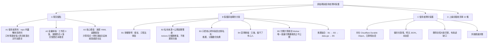
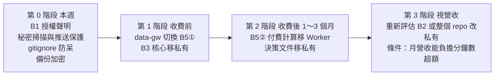
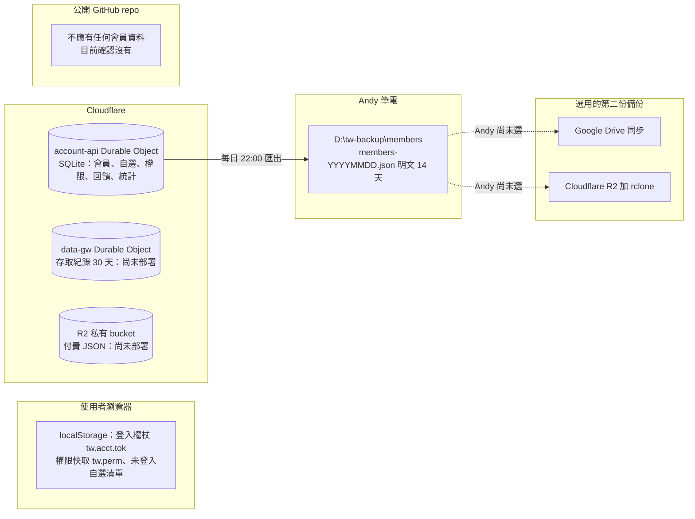
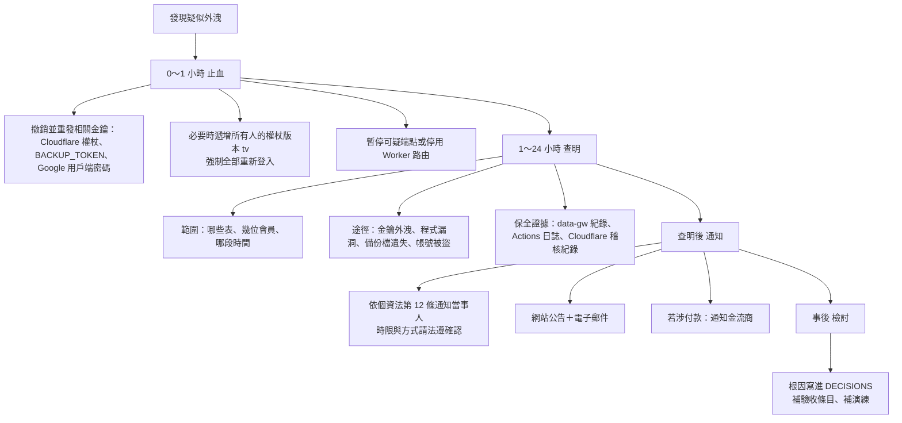

# 原始碼與使用者資料保護方案（公開儲存庫前提）

> 2026-10-16 17:36（台北），security-privacy。**只是規劃文件，沒有改任何產品程式碼，沒有 commit。**
> 前提（Andy 已拍板）：GitHub 儲存庫**維持公開**（免費方案的私人儲存庫不能用 Pages），但「一定要保護原始碼以及使用者資料」。
> 依據：本機工作區 `88c8f32c`（2026-10-11）的程式碼與文件；`docs/payments/entitlement_security_review.md`（下稱「付費審查」）、`docs/security_review_1006.md`（下稱「10-06 審查」）、`docs/BACKUP_RUNBOOK.md`。行號皆以此版為準。
> 這不是法律意見；標「請法遵確認」的不准當定論。查不到的一律標「未確認」。

---

## 〇、總覽樹狀圖

### 給 Andy 的五句話

1. **使用者資料目前完全不在 repo 裡**：會員、email、自選清單、付款、登入狀態都在 Cloudflare 的 Durable Object；會員備份在你的筆電。repo 裡出現的 email 全是測試假資料，加上你刻意公開的客服信箱。
2. **金鑰掃描乾淨**：工作區與本機能看到的 2,941 個 commit 都沒掃到真的金鑰；但本機是淺層複本，**完整歷史要靠 GitHub 的秘密掃描再確認一次**（要你按開關）。
3. **公開的程式碼不可能真正保密**：只要它在公開 repo，任何人都能讀、能複製、而且已公開的歷史收不回來。能做的是：用授權聲明保住法律權利、把最值錢的東西（族群 YAML、資料湖）移出公開 repo、把付費邏輯放到伺服器端。
4. **推薦順序**：先加授權聲明（半天）→ 族群 YAML 與資料湖移到私有 repo、Actions 仍在公開 repo 跑（2～3 天，分鐘數維持免費）→ 付費資料閘道切換（已寫好）→ 付費計算移到 Worker（依功能而定）。
5. **最大的使用者資料風險其實在備份**：筆電上的 `members-YYYYMMDD.json` 是明文，若同步到 Google Drive 也是明文；要加密。

---

## A. 現況盤點

### A1 repo 內的「使用者資料」

查法：`git ls-files` 篩檔名（member、backup、export、log、sqlite、db、dump、users、env、secret、token…）、`git grep` 全部 email 樣式、`git log --all --diff-filter=AD` 找曾經存在後來被刪的檔。

#### A1-1 結論：repo 內沒有會員資料

| 類別 | repo 內有沒有 | 證據（檔案:行號） | 實際存在哪裡 |
|---|---|---|---|
| 會員帳號（email、名稱、大頭貼網址） | **沒有** | 結構定義在 `workers/account-api/worker.js:130`（`users` 表），資料不在 repo | Cloudflare Durable Object（SQLite） |
| 自選清單 | **沒有** | `worker.js:131`（`lists` 表）；`site/watchlists.js` 只是前端程式 | 同上；未登入者在瀏覽器 localStorage |
| 權限與方案 | **沒有** | `worker.js:136`（`perm`，以 email 為主鍵） | 同上 |
| 付款資料 | **沒有**（付款功能尚未實作） | 全檔無 `/v1/pay/*`（付費審查 R9） | 尚無；`bill_flags`（`worker.js:2202`）只存旗標 |
| 登入狀態 | **沒有** | `worker.js:134`（`logins` 表，一次性） | Durable Object；權杖在使用者瀏覽器 |
| 意見回饋、訂閱申請 | **沒有** | `worker.js:693-694`（`sub_requests`、`feedback`，含聯絡方式與瀏覽器字串） | Durable Object |
| 存取日誌 | **沒有** | `workers/data-gw/worker.js:63`（`log` 表含 IP 網段與瀏覽器字串，保留 30 天，第 27 行） | data-gw 的 Durable Object（尚未部署） |
| 會員備份檔 | **沒有** | 備份腳本寫到 `<備份根目錄>\members\members-YYYYMMDD.json`（`tools/laptop/backup.ps1:38-40`），腳本內無任何 `git add`／`commit`／`push` | Andy 筆電 `D:\tw-backup\members\`（`docs/BACKUP_RUNBOOK.md:13`） |
| Worker 主控台日誌 | **沒有個資輸出** | 正式 Worker 程式（`account-api/worker.js`、`data-gw/worker.js`）**沒有任何 `console.log`**；只有本機開發伺服器 `devserver.mjs:70` 在設了 `DEV_LOG` 時印方法與路徑 | — |
| 測試資料 | 有，但全是假的 | `andy@example.com`、`bob@example.com` 等 `example.com` 網域，以及 `workers/account-api/tests/grants.test.mjs:164` 的 `dan@gmail.com`（測試信箱正規化用的假名） | — |

**本節沒有 P0 項目**（沒有找到需要從歷史清除的使用者資料）。

#### A1-2 不是「使用者資料」、但屬於營運者個人資訊的東西（P2）

| # | 內容 | 位置 | 風險 | 建議 | 優先級 | 狀態 |
|---|---|---|---|---|---|---|
| U1 | Andy 個人 Gmail（10-11 已換成商用信箱，但舊字串還在） | `docs/confirm_ledger.md:478`、`docs/launch_gap_payment_1009.md:27`、`docs/legal_refund_1009.md:127`、`scripts/_uitest.py:50086`（註解）、`site/legal_config.js:23`（註解；部署時壓縮會拿掉註解，但 repo 裡看得到） | 攻擊者知道要釣誰（10-06 審查 S11） | 下次動到這些檔時順手把個人信箱改成「原個人信箱」字樣；**不必重寫歷史** | P2 | ⬜ |
| U2 | Cloudflare 帳號子網域（`tw-account.<帳號>.workers.dev`）含個人帳號名 | 28 支檔（例：`docs/BACKUP_RUNBOOK.md:22`） | 同上；且這是前端一定要知道的網址，藏不住 | 上正式網域後改用自訂網域（例如 `api.` 子網域）指向 Worker | P2 | ⬜ |
| U3 | 歷史裡的 `push-log-0916.txt`：Windows 本機使用者路徑 | 加入於 `1b28dfcd`／`c642d409`（2026-09-16），刪除於 `7643b14b`（2026-09-18） | 只洩漏本機帳號名與資料夾結構 | 不清歷史（理由見 A1-3）；`.gitignore` 已補 `push-log*.txt` | P2 | ✅ 已防止再發生 |
| U4 | 歷史裡的 `probe.log`：測試輸出 | `c08a2d05`～`5cc4ee67`（2026-10-08） | 內容是 pytest 進度與雲端執行路徑，無個資 | 不處理 | — | ✅ 無害 |
| U5 | `CLAUDE.md`、`DECISIONS.md`、`HANDOFF.md`、`docs/`、`obsidian/` 裡的 Andy 原話與決策過程 | 全 repo | 10-06 審查 S2：等於把整套方法與權限設計弱點公開 | 見 B3（決策文件也可一起移私有） | P1 | ⬜ |

#### A1-3 萬一日後真的有使用者資料進了 repo：清除步驟（只寫步驟，不要自己執行）

> 目前**不需要執行**。這是備用程序。每一步都要 Andy 明確同意，因為它違反 `CLAUDE.md`「絕不 force push」那條，必須是 Andy 親口下的例外。

| 步 | 做什麼 | 誰 | 風險與注意 |
|---|---|---|---|
| 1 | **先當作已外洩處理**：照 C6 外洩應變走，評估要不要通知當事人 | Andy＋CEO | 公開 repo 被機器人爬的速度以分鐘計；清歷史不等於沒外洩 |
| 2 | 若是金鑰：**先撤銷、重發**，再談清歷史 | Andy | 撤銷才是真正的止血 |
| 3 | 暫停會寫 repo 的排程（`daily.yml`、`backfill.yml`），避免清理途中又有新 commit | Andy 在 Actions 頁停用 | 資料湖會少一兩天，之後回補補得回來 |
| 4 | 在**完整複本**（不是淺層複本）上用 `git filter-repo --path <檔案> --invert-paths` 移除該檔所有版本 | CEO 執行，Andy 同意 | 所有 commit 雜湊會改變；551 條遠端分支都要一起處理 |
| 5 | 強制推回所有分支與標籤 | Andy 授權 | **破壞性操作**：預覽分支、所有 agent 的工作分支都會失效；別人既有的 clone 與 fork 不受影響（資料仍在他們手上） |
| 6 | 向 GitHub 支援申請清除快取的檢視與拉取請求參照 | Andy | 不申請的話，舊 commit 仍可能透過雜湊網址被讀到 |
| 7 | 重新啟用排程，跑一次 `pages.yml` 確認網站正常 | CEO | — |
| 8 | 補 `.gitignore` 與推送保護，避免再發生 | CEO＋Andy | — |

### A2 金鑰與權杖掃描

| # | 掃描 | 指令重點 | 結果 | 狀態 |
|---|---|---|---|---|
| K1 | `CLAUDE.md` 規定樣式（排除 md） | `git grep -iE "github_pat_\|ghp_\|finmind.*token" -- . ':!*.md'` | 命中 30 多行，**全部是變數名稱、說明文字或從 Secret 讀值**（例：`.github/workflows/daily.yml:82` 的 `${{ secrets.FINMIND_TOKEN }}`、`pipeline/config.py:176` 讀環境變數、`setup.ps1:109` 用安全字串讀輸入）；另有 `docs/marketing/video_1010/bibi_promo_9x16_1010_v2.mp4` 二進位巧合命中。**沒有實際金鑰值** | ✅ |
| K2 | 真實金鑰形狀（含 md） | GitHub 權杖、AWS、Google API 金鑰、私鑰檔頭、Slack、Stripe、Google OAuth 密碼、完整 JWT | **0 筆** | ✅ |
| K3 | 寫死的指派（排除 md） | `token／secret／api_key／hash_key／hash_iv／password = "20 字以上"` | 2 筆，都是測試假值：`workers/account-api/tests/export.test.mjs:102`、`workers/data-gw/tests/gw.test.mjs:13`（`test-secret-not-real`） | ✅ |
| K4 | `pipeline/sources/certs/uobam_intermediate.pem` | 檔名像金鑰 | 是公開的中繼憑證（給 TLS 驗證用），不是私鑰；K2 的私鑰檔頭樣式沒有命中 | ✅ |
| K5 | `wrangler.toml` | 人工讀 `workers/account-api/wrangler.toml`、`workers/data-gw/wrangler.toml` | `[vars]` 只有網域白名單與門檻；金鑰全部寫成註解說明「由 Secret 帶入」 | ✅ |
| K6 | git 歷史（本機） | `git log --all -G "<K2 樣式>"`，排除圖片影片與 parquet | 掃了本機所有參照的 2,941 個 commit：**0 筆** | ✅（有限制） |
| K7 | git 完整歷史 | — | **未確認**：本機是淺層複本（`git rev-parse --is-shallow-repository` 回 `true`），更早的 commit 不在本機。要靠 GitHub「秘密掃描」對整個歷史掃一次 | ⬜ 要 Andy 開 |

### A3 核心價值與被複製的難易度

| 資產 | 規模（實測） | 被複製的難易度 | 為什麼 | 價值 |
|---|---|---|---|---|
| `pipeline/groups/groups.yaml`、`themes.yaml`、`supply_chain.yaml` | 共 2,812 行（844＋206＋1,762） | **極易**：`git clone` 就拿到；而且**前端 JSON 本身就透露族群成分**（`groups_today` 屬免費分級） | 人工校訂、附證據的族群與供應鏈判斷 | **最高**：唯一無法用公開資料自動重建的東西 |
| `pipeline/compute/`＋`pipeline/indicators.py` | 18 支、約 8,673 行 | **易**：程式公開；要重現需要資料湖 | 指標算法多半是公開方法（均線、KD、RSI），價值在口徑與組合 | 中 |
| 資料湖 `data/` | 234 支 Parquet＋1,718 個公司 Logo，約 380 MB | **極易**：`git clone` 一次全拿 | 原始資料本身來自公開來源，價值在「每天整理好、歷史補齊」 | 中高（省下對方的回補時間與額度） |
| `site/*.js` | 53 支、約 72,306 行、5.6 MB | **易**：部署版已壓縮並拿掉註解（`scripts/minify_site.py`），但 repo 原始碼有完整註解 | 前端畫面與互動 | 中（換皮就能用） |
| 決策與交接文件（`DECISIONS.md`、`HANDOFF.md`、`docs/`、`obsidian/`） | 數千行 | **極易** | 整套方法、資料源評估、權限設計弱點 | 中高（給競爭者地圖） |
| Worker 程式（`workers/*`） | — | 易 | 程式公開，但**資料與金鑰不在 repo**，複製程式拿不到會員 | 低到中 |

**組合起來的結論**：`compute/`＋`groups/*.yaml`＋`data/` 三樣都在，就能在自己電腦跑 `python -m pipeline.build_payload` 重建整個網站的所有 JSON（付費審查 A3-1）。拿掉其中最難重建的 `groups/*.yaml` 與最花時間的 `data/`，重建成本會大幅提高。

---

## B. 公開 repo 下保護原始碼的可行方案

### B0 先講清楚一個事實

**放在公開 repo 的程式碼，不可能真正保密。** 這不是做得不夠好，是公開的定義：

- 任何人可以讀、可以 clone、可以 fork；GitHub 沒有「只能看不能複製」的設定。
- **已經公開過的歷史收不回來**：即使今天移走，舊版本仍在別人的 clone、fork、搜尋引擎快取與封存網站裡。能保護的只有「之後新增或修改」的內容。
- 部署到瀏覽器的程式（`site/*.js`）無論放哪個 repo，**瀏覽器一定要拿到它才能跑**，所以永遠看得到。

所以替代保護只有三條路，下面五個方案都是這三條的組合：

| 路線 | 原理 | 對應方案 |
|---|---|---|
| 法律保護 | 看得到不等於可以用；保住權利，被抄時有依據 | B1 |
| 移走核心 | 公開 repo 只留「沒有它也沒用」的部分 | B2、B3 |
| 伺服器端 | 邏輯與資料不出伺服器，瀏覽器只拿結果 | B5（＋已寫好的 data-gw） |

B4（混淆壓縮）不屬於上面任何一條，只是提高門檻。

### B1 授權與著作權聲明

| 項目 | 內容 |
|---|---|
| 做法 | ① repo 根目錄加 `LICENSE`（或 `NOTICE`）：寫明「專有軟體，著作權人保留所有權利；未經書面授權，禁止重製、改作、散布、商業使用；公開原始碼僅供檢視，不構成任何授權」。② `README.md` 開頭放同一段摘要。③ 主要原始檔與三支族群 YAML 檔頭加一行著作權聲明。④ 網站服務條款已有智慧財產權條款（`site/legal.js:162-166`），對齊用語即可 |
| 現況 | **repo 根目錄沒有 `LICENSE`、`NOTICE`、`COPYING`**（實測）。依一般理解，**沒有授權條款＝預設保留所有權利**，別人沒有被授權使用；但沒有明文聲明，容易被誤認為「放在公開 repo 就是開源」。⚠ GitHub 服務條款允許其他使用者在 GitHub 上檢視與 fork 公開 repo，這部分無法用授權條款排除（**請法遵確認**範圍） |
| 能擋什麼 | 善意或半善意的複製者（看到聲明就不敢用）；被商業抄襲時的主張依據；向 GitHub 提出著作權侵權下架通知時的基礎 |
| 擋不了什麼 | 不在乎法律的人、海外匿名者；**「想法」與「方法」本身不受著作權保護**（著作權法第 10 條之 1：保護表達，不保護觀念、程序、操作方法），別人看懂邏輯後自己重寫就不算侵權（**請法遵確認**） |
| 營業秘密的邊界 | 營業秘密法第 2 條要求「非一般涉及該類資訊之人所知」且「所有人已採取合理保密措施」。**放在公開 repo 的內容幾乎不可能主張是營業秘密**（判決實務對合理保密措施的要求見最高法院 102 年度台上字第 235 號的引述）。反過來說：族群 YAML 若移到私有 repo、限制存取者、標示機密，**之後的版本**才有機會成為營業秘密（**請法遵確認**） |
| 族群 YAML 的著作權 | 族群分類屬「資料的選擇與編排」，可能構成編輯著作（著作權法第 7 條），但個別事實（某公司屬於某族群）不受保護（**請法遵確認**） |
| 成本 | 0 元；律師審閱授權文字另計（未確認） |
| 對部署的影響 | 無。`pages.yml`、每日管線、預覽分支都不受影響 |
| 工時 | 0.5 天（撰寫＋放檔頭）；若要律師審閱另加等待時間 |
| 優先級 | **P0**（最便宜、今天就能做） |

### B2 「私有來源 repo＋公開部署 repo」雙倉模式

| 項目 | 內容 |
|---|---|
| 做法 | 新建私有 repo（例如 `tw-rotation-src`）放全部程式、設定、資料湖、文件；現有公開 repo 只保留建置後的 `site/` 成品。私有 repo 的 Actions 跑每日管線與建置，用部署金鑰把成品推到公開 repo，公開 repo 只負責發布 Pages |
| 能擋什麼 | 原始碼、YAML、資料湖、決策文件**之後的版本**全部不公開 |
| 擋不了什麼 | 已公開的歷史；部署到瀏覽器的前端程式（只是壓縮過）；公開 JSON 透露的族群成分 |
| **Actions 分鐘數（關鍵）** | 查證：GitHub 免費方案的私人 repo 每月 **2,000 分鐘**，公開 repo 標準執行器**免費不計**；Pro 為 3,000 分鐘（[GitHub 方案說明](https://docs.github.com/en/get-started/learning-about-github/githubs-plans)）。實測 2026-10-08～10-14 七天的執行紀錄（以每輪開始到結束時間無條件進位估算）：歷史回補 3,764 分、部署網站 1,308 分、每日盤後管線 946 分（22 輪，平均每輪約 43 分）、其他約 215 分，**七天合計約 6,233 分，推估每月約 2.7 萬分**（付費審查估 1.2 萬分；兩者差異來自量測期間與方法，可信區間抓 **1.2～2.7 萬分／月**）。**光是每日管線三輪一個月就約 4,000 分，已經超過 2,000** |
| 成本 | 超額按分鐘計費；Linux 執行器費率付費審查寫「約每分鐘 0.008 美元（未查證最新價）」→ 超額 1～2.5 萬分 ≈ **每月 80～200 美元**（未確認最新價）。若把回補降到每天 2 輪、部署只在資料更新後跑，可壓到 5,000～8,000 分，仍超額 |
| 資料湖放哪 | 選項 ① 私有 repo 一起放（最省事，380 MB 在一般容量內）② Cloudflare R2（免費 10 GB，但要改 `store.append()` 的讀寫路徑，工程量大） |
| 對 `pages.yml` 的影響 | 大改：建置步驟搬到私有 repo；公開 repo 的 `pages.yml` 只剩「收到成品就發布」；`deploy_wait.py` 要改查公開 repo |
| 對每日管線的影響 | `daily.yml`、`backfill.yml` 整支搬到私有 repo，資料湖 commit 到私有 repo |
| 對預覽分支的影響 | `preview/*` 機制要重做：預覽分支在私有 repo，建置後推到公開 repo 的 `preview/<名稱>/` 目錄；`docs/preview.md` 要改 |
| 新增風險 | 多一把**可寫入公開 repo 的部署金鑰**（高價值金鑰）；兩邊同步點增加故障面（10-06 審查 (c) 的顧慮） |
| 工時 | 3～5 天＋全站驗收 |
| 結論 | **現在不推薦**：分鐘數成本明確超出免費額度，且 B3 能以更低成本拿到大部分好處 |

### B3 只把核心資料與設定移到私有 repo，程式碼維持公開（推薦）

| 項目 | 內容 |
|---|---|
| 做法 | 新建私有 repo（例如 `tw-rotation-core`），放：`pipeline/groups/*.yaml`、資料湖 `data/`、（建議一起）`DECISIONS.md`、`HANDOFF.md`、`obsidian/`、內部規格文件。公開 repo 的 Actions 在執行時用**唯讀或限定單一 repo 的權杖**（細粒度個人存取權杖或部署金鑰，存在公開 repo 的 Secrets）把私有 repo 拉到工作目錄；每日管線寫完資料湖後推回私有 repo |
| 為什麼分鐘數仍免費 | **Actions 仍在公開 repo 跑**，只是多拉一個私有 repo；分鐘數計在執行的 repo 上，公開 repo 不計費（同 B2 查證來源）。⚠ 這個解讀請在第一週觀察帳單頁確認（**未確認**實際計費歸屬） |
| 能擋什麼 | 不會寫程式的人與大多數會寫程式的人：沒有 YAML 與資料湖，公開的 `compute/` 跑不出東西；族群校訂**之後的版本**、證據文件與決策過程不再公開 |
| 擋不了什麼 | ① 已公開的歷史 ② 公開 JSON 透露的**族群成分**（`groups_today` 等免費檔，任何人每天抓一次就能重建名單；只有 YAML 裡的 `note` 與證據保住）③ 資料湖可由公開來源重新回補（只是要花時間與 FinMind 額度）④ `compute/` 計算口徑仍公開 |
| 公開 repo 特有的三個陷阱 | ① **公開 repo 的 Actions 日誌任何人都看得到**：工作流不准印出 YAML 內容、資料湖檔案清單或任何私有內容；`set -x` 一律禁止 ② **公開 repo 的 Actions 產物（artifact）可被下載**：`probe.yml`、`sse-probe.yml`、`live-rotation-probe.yml` 都有 `upload-artifact`，要確認產物不含私有 repo 內容 ③ 來自 fork 的拉取請求拿不到 Secrets（安全），但**絕不准**改用 `pull_request_target` 觸發會拉私有 repo 的工作 |
| 成本 | 0 元（私有 repo 免費；容量 380 MB 在一般範圍內） |
| 對 `pages.yml` 的影響 | 中：`build_payload` 前加一步「拉私有 repo」；權杖放公開 repo Secrets |
| 對每日管線的影響 | 中：`daily.yml:119-141`、`backfill.yml:224-235` 的 `git add data`／`commit`／`push` 改成推到私有 repo；資料湖不再在公開 repo 長大 |
| 對預覽分支的影響 | 小：預覽只帶 `site/`、資料讀正式站，不需要私有 repo；但若預覽分支改了 YAML，要另外推到私有 repo 的對應分支（`docs/preview.md` 要補一句） |
| 對其他規則的影響 | `CLAUDE.md` 的「改了 `groups/*.yaml` 要先重算 payload」「絕不覆寫 `data/*.parquet`」照舊適用，只是位置換到私有 repo；本機開發要多 clone 一個 repo；`docs/BACKUP_RUNBOOK.md` 的筆電備份要多抓一個 repo |
| 公開 repo 裡的舊檔 | 移走後在公開 repo **刪除檔案**（一般 commit，不改歷史）；`.gitignore` 加上 `pipeline/groups/*.yaml`、`data/`，防止被加回來 |
| 工時 | 2～3 天（含工作流改寫、權杖設定、全段驗收）＋Andy 約 30 分鐘（建私有 repo、發權杖） |
| 優先級 | **P1**（第一筆收費前做；付費審查清單第 25 條同一件事） |

### B4 前端混淆與壓縮

| 項目 | 內容 |
|---|---|
| 現況 | **已做**：部署時用 esbuild（鎖定版本）壓縮自家 JS／CSS／HTML、拿掉註解、刪除 source map（`pages.yml` 第 191-192 行說明、`scripts/minify_site.py`）；`site/` 內無 `sourceMappingURL`（實測） |
| 能擋什麼 | F12 隨手看到註解裡的內部文字與 Andy 原話（10-06 的原始問題）；降低「直接複製貼上就能用」的便利度 |
| 擋不了什麼（誠實版） | **擋不了任何有心人**：① 原始碼就在公開 repo，根本不需要從瀏覽器還原 ② 即使不在 repo，壓縮後的程式用格式化工具幾秒就能讀 ③ 更強的混淆（變數改亂碼、控制流打亂）同樣能被反混淆工具處理，還會讓程式變慢、除錯困難、桌機守門與手機驗收更難排查 |
| 成本 | 已完成；加強混淆另需 1 天＋全站驗收，**不建議** |
| 對部署的影響 | 無新增 |
| 優先級 | 維持現狀即可；不另投入 |

### B5 付費計算移到伺服器端（Worker），前端只拿結果

| 項目 | 內容 |
|---|---|
| 做法 | 把「付費才有的計算」（例如進階評分、族群輪動訊號的組合規則、選股條件）從 `pipeline/compute/` 與前端移到 Cloudflare Worker：Worker 驗權杖（沿用 data-gw 的資料權杖）→ 讀 R2 上的中間資料 → 算 → 只回結果。前端只負責畫圖 |
| 兩種形態 | ① **預先算好**：仍由每日管線算，但結果只上傳 R2、由 data-gw 發放（這就是 data-gw 已寫好的設計，付費審查 A3-2 ①）—— 擋住資料，但**計算程式仍在公開 repo** ② **即時算**：計算程式本身只存在私有 repo，部署成 Worker —— 公開 repo 看不到這段邏輯 |
| 能擋什麼 | ② 是**唯一能讓付費邏輯真正不公開**的方法：程式不在公開 repo、不送到瀏覽器 |
| 擋不了什麼 | 付費者看到的結果仍可被截圖、抄數字（浮水印只能事後追查）；黑箱反推（大量送不同輸入觀察輸出），要靠限流 |
| 成本 | Workers 付費方案每月 5 美元起（付費審查清單第 15 條本來就要升級）；CPU 時間與請求數在 1 千會員規模內應在方案額度內（10-06 審查 2-2 估算）；超過另計（未確認） |
| 對 `pages.yml` 的影響 | ① 無（data-gw 已規劃）② 新增一支 Worker 部署工作流，**而且它的原始碼要放私有 repo**，部署工作流要從私有 repo 拉程式 |
| 對每日管線的影響 | ① 無 ② 管線改成只產「中間資料」上傳 R2 |
| 對預覽分支的影響 | 預覽版拿不到付費結果（預覽寫入本來就被擋），需另開一支測試用 Worker 或以管理者權杖測試 |
| 工時 | ① 已寫好，切換 3～4 小時＋Andy 30 分鐘（付費審查 R1）② 依功能而定，每項付費計算約 1～3 天＋測試 |
| 優先級 | ① **P0**（收費前）② **P2**（等確定哪些計算是付費賣點再做） |

### B6 推薦組合與分階段順序

| 階段 | 做什麼 | 為什麼這個順序 | 工時 | 誰動手 |
|---|---|---|---|---|
| 0 | B1 授權聲明；開秘密掃描＋推送保護；`.gitignore` 加會員備份與資料庫檔樣式（C4）；筆電備份加密（C4） | 便宜、無副作用、立刻生效 | 1 天＋Andy 30 分鐘 | CEO 派工；Andy 按 GitHub 設定、設加密 |
| 1 | data-gw 切換（已寫好）；B3 族群 YAML＋資料湖移私有 | 不移走 YAML 與資料湖，data-gw 只擋得住不會跑 Python 的人（付費審查 A3-1） | 3～4 天＋Andy 1 小時 | CEO 派工；Andy 建 R2、私有 repo、權杖 |
| 2 | B5② 選定付費計算移 Worker；`DECISIONS.md` 等決策文件移私有 | 等知道哪些功能真的有人付錢再投入 | 依功能 | CEO |
| 3 | 重新評估 B2 或整個 repo 改私有（含 GitHub Pages 商用條款問題，見 `docs/hosting_cost_plan.md`） | 分鐘數每月約 80～200 美元超額（未確認最新價），營收撐得住才划算 | 3～5 天 | Andy 決定 |

**不推薦**：重寫公開 repo 的歷史來「收回」已公開的程式碼 —— 收不回來（別人手上的複本不受影響），卻會打壞 551 條分支、所有預覽與進行中的 agent 工作，而且違反「絕不 force push」。只有出現真正的使用者資料或金鑰外洩時才走 A1-3。

---

## C. 使用者資料保護

### C1 資料存在哪

| 資料 | 儲存位置（檔案:行號） | 含個資欄位 | 保存期限（程式內常數） |
|---|---|---|---|
| 會員 | `account-api/worker.js:130` `users` | email、名稱、大頭貼網址、Google 識別碼雜湊（`subh`） | 24 個月未使用自動刪（`worker.js:52`） |
| 自選清單 | `worker.js:131` `lists` | 以 `uid` 對應 | 隨會員 |
| 權限 | `worker.js:136` `perm` | **以 email 為主鍵**（付費審查 R8，應改 uid） | 隨會員 |
| 訂閱申請、意見回饋 | `worker.js:693-694` | email、聯絡方式、內文、瀏覽器字串 | 13 個月（`worker.js:670`、`896-898`） |
| 個人使用事件 | `worker.js:931` `uev` | `uid`＋頁面 | 90 天（`worker.js:918`） |
| 公告已讀 | `worker.js:701` `notice_reads` | email | 刪帳號時刪 |
| 計費旗標、比對碼 | `worker.js:2202-2203` | email；`benefit_hash` 為雜湊 | 比對碼 365 天 |
| 停權紀錄 | `worker.js:1518` `susp` | `uid`、原因 | **未確認**（沒找到清除程式） |
| 管理者名單紀錄 | `worker.js:2087` `admin_log` | 管理者 email（營運者，不是會員） | 只增不刪（刻意設計） |
| 存取紀錄 | `data-gw/worker.js:63` `log` | `uid`、IP 網段、瀏覽器字串 | 30 天（`data-gw/worker.js:27`、`209`） |

### C2 存取控制

| # | 項目 | 現況（證據） | 缺口 | 優先級 | 狀態 |
|---|---|---|---|---|---|
| AC1 | 會員資料只能經 Worker 存取 | 前端無直連資料庫；管理端點先過 `admin()`（`worker.js:490`）；管理者名單在 Secret `ADMIN_EMAILS` | — | — | ✅ |
| AC2 | 匯出端點 | `worker.js:1610-1617`：只認備份權杖（16 字以上、等長比對）或管理者＋來源白名單；每小時 6 次；不匯出登入狀態、線上名單與金鑰類鍵（`1584`、`1599`） | 速率計數在記憶體，冷啟動歸零（程式自己註明） | P2 | 🔄 可用 |
| AC3 | 管理者帳號兩步驟驗證 | 10-06 審查 S14 | Google、GitHub、Cloudflare 都要開；**未確認**是否已開 | P0 | ⬜ |
| AC4 | `CLOUDFLARE_API_TOKEN` 最小範圍 | 10-06 審查 S19：三支工作流共用 | 權杖外洩＝可改寫會員 Worker、讀會員資料 | P1 | ⬜ 未確認 |
| AC5 | 登入權杖效期 | `worker.js:42` 60 天滑動續期（付費審查 R7） | 一般 14 天、管理者 7 天；加「登出所有裝置」 | P1 | ⬜ |
| AC6 | 第三方 action 釘 SHA | 實測 `cloudflare/wrangler-action@v3`（`deploy-account-worker.yml` 等 4 處）、`denoland/setup-deno@v2` 只用版本標籤 | 標籤被改指向惡意版本即可偷 Cloudflare 權杖 | P0 | ⬜ |
| AC7 | 私有 repo 權杖（B3 之後） | 尚無 | 只給單一私有 repo、唯讀＋資料湖寫入；設到期日 | P1 | ⬜ |

### C3 加密

| 位置 | 現況 | 狀態 |
|---|---|---|
| Durable Object 靜態資料 | Cloudflare 官方說明：所有 Durable Object 資料（含 SQLite）以 AES-256 靜態加密，金鑰由 Cloudflare 管理；Worker 與 Durable Object 之間走 TLS（[Cloudflare 資料安全說明](https://developers.cloudflare.com/durable-objects/reference/data-security/)） | ✅（平台提供） |
| Durable Object 時間點還原 | 同一份文件：SQLite 型 Durable Object 可還原到過去 30 天任一時間點 —— 這是**筆電備份之外的第二道保險**，但還原流程本站尚未演練（**未確認**是否可透過現有部署方式操作） | ⬜ 待演練 |
| 傳輸 | 全站 HTTPS；Worker 端點 HTTPS | ✅ |
| 筆電備份檔 | `members-*.json` **明文**存放（`backup.ps1:38-57`）；有 SHA-256 與 HMAC 簽章（防竄改，**不防偷看**） | ⬜ 要加密 |
| 第二份雲端備份 | 尚未選（`BACKUP_RUNBOOK.md:40`）；選 Google Drive 就是明文上雲 | ⬜ |
| 欄位層級加密 | email 明文存（查詢需要）；`benefit_hash`、`grant_ip` 用雜湊 | 可接受 |

### C4 備份不得進公開 repo

| # | 檢查 | 結果 | 建議 | 優先級 | 狀態 |
|---|---|---|---|---|---|
| BK1 | 備份檔位置 | `D:\tw-backup\`（`BACKUP_RUNBOOK.md:34`、`install.ps1:27-28`），在 repo 外；腳本不做任何 `git add` | 維持 | — | ✅ |
| BK2 | 筆電上的 repo 複本與備份目錄分開 | 工具 clone 在 `%USERPROFILE%\tw-tools`（稀疏複本，只有 `tools/laptop`），備份在 `D:\tw-backup` | 安裝腳本加檢查：`-BackupRoot` 若落在任何 git 工作目錄內就拒絕 | P1 | ⬜ |
| BK3 | `.gitignore` 防呆 | 現有 `.gitignore` **沒有**會員備份或資料庫檔的樣式 | 加：`members-*.json`、`*.sqlite`、`*.sqlite3`、`*.db`、`tw-backup/`、`*export*.json`（注意別擋到 `docs/admin_export_spec.md` 之類的文件，只擋 json） | P0 | ⬜ |
| BK4 | 推送保護 | GitHub 推送保護擋金鑰，**不擋個資檔** | 加一支推送前檢查：拒絕含 `"tables":{"users"` 字樣的檔案（匯出檔的固定格式，`worker.js:1585`） | P1 | ⬜ |
| BK5 | 備份檔加密 | 明文 | 選一：① 筆電 D 槽開 BitLocker（Windows 專業版）② `backup.ps1` 匯出後用 Windows DPAPI 或 7-Zip AES-256 加密再存，金鑰另行保管 | P0 | ⬜ |
| BK6 | 雲端第二份 | 未選 | 選 R2 時 bucket 不開公開網址；選 Google Drive 時只傳加密後的檔 | P1 | ⬜ |
| BK7 | 匯出涵蓋範圍 | `worker.js:1596` 的匯出清單**沒有** `bill_flags`、`benefit_hash`、`grant_defs`、`grants`、`grant_hits`、`admin_log`、`susp`（是否刻意排除：**未確認**） | 還原後會遺失計費旗標、贈送權益、新增的管理者名單；`BACKUP_RUNBOOK.md` 第 3.3 節本來就要求新表要加進匯出清單 | P1 | ⬜ |

### C5 日誌不含個資

| # | 檢查 | 結果 | 狀態 |
|---|---|---|---|
| LG1 | Worker 主控台日誌 | 正式程式無 `console.log`（實測）；Cloudflare 即時日誌只會有請求網址與狀態 | ✅ |
| LG2 | 告警內容 | 付費審查 A4-2 規定只帶 uid 與訂單號，不帶 email | ⬜ 告警尚未實作 |
| LG3 | GitHub Actions 日誌（公開可見） | 每日管線日誌含資料抓取進度，不含會員資料；**B3 之後**要確保不印私有 repo 內容 | 🔄 |
| LG4 | Actions 產物 | `probe.yml`、`sse-probe.yml`、`live-rotation-probe.yml` 上傳產物；內容**未逐一確認** | ⬜ |
| LG5 | 存取紀錄 | data-gw 只存 IP 網段（`ipNet()`，`data-gw/worker.js:248`、`288`），30 天刪 | ✅（尚未部署） |
| LG6 | 意見回饋的瀏覽器字串 | `feedback.ua` 原文保存 13 個月 | 可接受；隱私權政策要列 |

### C6 刪除流程

| 情境 | 現況（證據） | 缺口 | 優先級 | 狀態 |
|---|---|---|---|---|
| 會員自刪帳號 | `POST /v1/delete`（`worker.js:245`）→ `deleteMe`（`475-487`）刪 `lists`、`presence`、`logins`、`visits`、`perm`、`users`；外掛擴充再刪 `feedback`、`sub_requests`、`quota_hits`、`notice_reads`（`877-886`）、`uev`（`1013-1016`）、`bill_flags`（`2297-2309`，並寫入雜湊比對碼）、`grants`、`grant_hits`（`2639-2653`） | ① `susp`（停權紀錄，以 uid 對應）沒有刪，也沒找到過期清除（**未確認**是否刻意保留）② 刪帳號時沒有通知 data-gw 清它的 `sessions`、`devices`、`log`（data-gw 尚未部署；`log` 30 天自然過期） | P1 | 🔄 |
| 長期未使用 | 24 個月自動刪（`worker.js:646-647`） | — | — | ✅ |
| 備份裡的已刪會員 | 筆電備份保留 14 天（`backup.ps1:57`）；**刪除的會員在 14 天內仍存在於備份** | 隱私權政策要寫明「備份最長保留 14 天後覆蓋」；還原時要重套刪除名單（目前沒有這份名單） | P1 | ⬜ |
| 有付款紀錄的會員 | 付費審查 B4：個資刪除、訂單去識別保留 7 年（**請記帳士確認**） | 付款功能尚未實作 | P0（收費前） | ⬜ |
| 客服來信要求刪除 | `site/account.js:532` 告知可來信申請 | 沒有書面作業步驟（誰查、多久內完成、怎麼回覆） | P1 | ⬜ |

### C7 外洩應變（事件應變小抄）

| 外洩情境 | 第一個動作 | 誰 |
|---|---|---|
| repo 被推入金鑰 | 立刻到該服務撤銷金鑰（**不是先刪檔**），再走 A1-3 | Andy 撤銷、CEO 協助 |
| repo 被推入會員資料 | 走 A1-3＋本節通知流程 | Andy 決定 |
| 筆電遺失或被入侵 | 換 `BACKUP_TOKEN`；若備份未加密，視為會員資料外洩 | Andy |
| 管理者 Google 帳號被盜 | Google 帳號找回＋從 `ADMIN_EMAILS` 移除＋全員 `tv+1` | Andy |
| Cloudflare 帳號或權杖外洩 | 撤銷權杖、檢查 Worker 是否被改寫、比對會員表筆數 | Andy＋CEO |

---

## D. 上線前驗收清單

狀態：⬜ 待辦／🔄 進行中／✅ 完成（依 2026-10-16 實測與既有文件；查不到的一律 ⬜）。
優先級：**P0**＝不做不准開始收費；**P1**＝收費後一個月內；**P2**＝可延後。

| # | 驗收項目 | 怎麼驗（通過條件） | 優先級 | 狀態 | 對應 |
|---|---|---|---|---|---|
| 1 | repo 內無會員資料 | `git ls-files` 篩檔名＋`git grep` 非 `example.com` 的 email，只剩客服信箱與已知營運者資訊 | P0 | ✅ 10-16 實測 | A1 |
| 2 | 工作區無金鑰 | A2 的 K1～K3 指令 0 筆真金鑰 | P0 | ✅ 10-16 實測 | A2 |
| 3 | 完整歷史無金鑰 | GitHub 秘密掃描開啟後，警示清單為 0 | P0 | ⬜ 要 Andy 開 | K7 |
| 4 | 推送保護開啟 | 故意推一支含假權杖格式的測試檔被擋（在測試分支） | P0 | ⬜ | 10-06 S1 |
| 5 | 授權聲明上線 | repo 根目錄有 `LICENSE` 或 `NOTICE`；`README.md` 開頭有保留權利聲明；族群 YAML 檔頭有著作權行 | P0 | ⬜ | B1 |
| 6 | `.gitignore` 防呆 | 在工作區放一個 `members-20261016.json`，`git status` 看不到它 | P0 | ⬜ | BK3 |
| 7 | 備份檔加密 | 筆電上打開最新備份，不輸入金鑰看不到 email | P0 | ⬜ | BK5 |
| 8 | 管理者三個帳號兩步驟驗證 | Google、GitHub、Cloudflare 安全性頁面都顯示已開啟 | P0 | ⬜ 未確認 | AC3 |
| 9 | 第三方 action 釘 SHA | `grep -n "uses:" .github/workflows/*.yml` 中非 `actions/*` 的都是 40 碼雜湊 | P0 | ⬜ | AC6 |
| 10 | data-gw 切換 | 無痕視窗直接開付費 JSON 網址回 404；付費帳號頁面正常 | P0 | 🔄 程式完成、未部署 | B5①／付費審查 #1 |
| 11 | 族群 YAML 移私有 | 公開 repo 的 `pipeline/groups/` 沒有 YAML；每日管線照常產出網站 | P1 | ⬜ | B3 |
| 12 | 資料湖移私有 | 公開 repo 不再出現「資料更新」commit；私有 repo 每天有新 commit | P1 | ⬜ | B3 |
| 13 | 公開 repo 分鐘數仍免費 | B3 上線後一週，GitHub 帳單頁 Actions 用量不計費 | P1 | ⬜ 未確認計費歸屬 | B3 |
| 14 | 公開 Actions 日誌不洩私有內容 | 抽查 3 輪每日管線日誌，搜尋族群 YAML 特有字串 0 筆 | P1 | ⬜ | B3、LG3 |
| 15 | Actions 產物不含私有內容 | 下載 `probe.yml` 等三支的最新產物逐一檢查 | P1 | ⬜ | LG4 |
| 16 | 匯出涵蓋所有會員相關表 | 匯出檔含 `bill_flags`、`grants` 等（或文件寫明為何排除）；匯出再匯入測試筆數一致 | P1 | ⬜ | BK7 |
| 17 | 會員資料還原演練 | 依 `BACKUP_RUNBOOK.md` 情境 B 在測試 Worker 還原成功、筆數一致、有紀錄 | P0 | ⬜ | 付費審查 #18 |
| 18 | 刪帳號清乾淨 | 測試帳號刪除後，查所有含 `uid` 或 `email` 的表都是 0 筆（`susp` 若保留要文件註明理由） | P1 | 🔄 | C6 |
| 19 | 權限以 uid 為主鍵 | 換信箱、刪帳號後同信箱新註冊不會錯接權限 | P0 | ⬜ | 付費審查 R8 |
| 20 | 隱私權政策寫明備份保留與刪除時效 | 政策含「備份最長保留 14 天」與「來信刪除幾個工作天內完成」 | P0 | ⬜ | C6 |
| 21 | 外洩應變小抄演練 | 模擬一次「BACKUP_TOKEN 外洩」，30 分鐘內完成撤銷與重發 | P1 | ⬜ | C7 |
| 22 | Cloudflare 權杖最小範圍 | 權杖權限頁只有必要的 Workers 編輯與指定帳號 | P1 | ⬜ 未確認 | AC4 |
| 23 | 營運者個資清理 | 文件與註解中的個人 Gmail 改成代稱（不改歷史） | P2 | ⬜ | U1 |

---

## 附錄：本次查證來源

- [GitHub 方案說明（私人 repo 免費 2,000 分鐘、Pro 3,000 分鐘、公開 repo 標準執行器免費、免費方案 Pages 限公開 repo）](https://docs.github.com/en/get-started/learning-about-github/githubs-plans)
- [GitHub 社群討論：私人 repo 使用 Pages 需要付費方案](https://github.com/orgs/community/discussions/22817)
- [Cloudflare Durable Objects 資料安全（靜態加密、30 天時間點還原）](https://developers.cloudflare.com/durable-objects/reference/data-security/)
- [營業秘密合理保密措施說明（引用最高法院 102 年度台上字第 235 號）](https://blog.104.com.tw/business-secret-rationality/)
- Actions 分鐘數：`gh api repos/MiaoZiKe/tw-rotation/actions/runs`，期間 2026-10-08～10-14，340 輪；以「每輪開始到結束時間無條件進位到分」估算，未計平行工作的分別計費，屬概估
- 超額費率每分鐘約 0.008 美元：沿用付費審查的數字，**未查證最新價**
